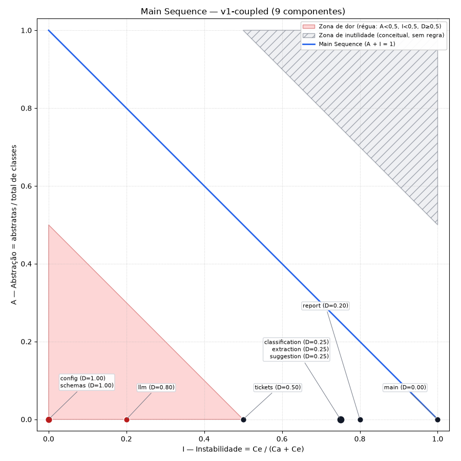

# Helpdesk com IA: da integração frágil à arquitetura resiliente

Fork de trabalho do desafio **Arquitetura na Era da IA** (Full Cycle). O enunciado original continua disponível no [repositório base](https://github.com/devfullcycle/desafio-arquitetura-era-ia-1).

> [!NOTE]
> Este README está em construção. Por enquanto, ele traz apenas as seções **Como rodar**, **Métrica** e **Diagnóstico da v1**. As demais seções obrigatórias (Visão geral, Tabela de capacidades, Tabela de fallback, Fluxos, Troca de modelo, Roteiro de governança, Mapa de decisões) entram nos próximos passos.

## Como rodar

### 1. Subir o ambiente

```bash
cp .env.example .env        # só na primeira vez
docker compose up -d --build
curl http://localhost:8000/health   # {"status":"ok"}
```

A aplicação só é acessada pela borda (`http://localhost:8000`). O provider-fake expõe a administração em `http://localhost:8090/admin/*`.

### 2. Rodar os testes de caracterização

Os testes chamam a aplicação real pela borda, com o provider-fake de verdade (sem mocks). Antes de começar, eles conferem o `/health` e fazem `POST /admin/reset` no provider para garantir o modo `normal`.

Opção A, Python local (3.12 ou mais recente):

```bash
python -m venv .venv
. .venv/bin/activate              # Windows: .venv\Scripts\Activate.ps1
pip install -r tests/requirements.txt
python -m pytest tests/characterization -v
```

Opção B, sem instalar nada no host (só Docker):

```bash
docker run --rm -v "${PWD}:/w" -w /w -e PYTHONDONTWRITEBYTECODE=1 \
  -e HELPDESK_BASE_URL=http://host.docker.internal:8000 \
  -e PROVIDER_ADMIN_URL=http://host.docker.internal:8090 \
  python:3.12-slim sh -c "pip install -q -r tests/requirements.txt && python -m pytest tests/characterization -v -p no:cacheprovider"
```

| Variável | Padrão | Uso |
|---|---|---|
| `HELPDESK_BASE_URL` | `http://localhost:8000` | Borda (edge) do helpdesk |
| `PROVIDER_ADMIN_URL` | `http://localhost:8090` | Admin do provider-fake (reset para o modo `normal`) |

Resultado esperado: `32 passed` em cerca de 60 s. A F2 leva ~16 s por caso e a F3 (um dia) ~10 s, ambas abaixo dos 30 s da borda.

Os valores esperados vêm de respostas reais observadas (golden masters em `tests/characterization/expected/`). Uma falha significa que o comportamento mudou: confira se a mudança foi intencional antes de atualizar qualquer expectativa. Detalhes em [docs/caracterizacao/relatorio-caracterizacao.md](docs/caracterizacao/relatorio-caracterizacao.md).

### 3. Voltar à v1 original

```bash
git worktree add --detach ../helpdesk-v1 v1-coupled
```

### 4. Medir o acoplamento (métricas de Robert C. Martin)

Pré-requisito: Python 3.12 ou mais recente. A ferramenta analisa só o código-fonte (AST): não precisa do Docker no ar e não executa os módulos analisados.

```bash
pip install -r metrics/requirements.txt pytest     # matplotlib==3.11.2 (só para o gráfico)
python -m pytest tests/metrics -q                  # testes da própria ferramenta
git worktree add --detach ../helpdesk-v1 v1-coupled
python metrics/measure.py --source ../helpdesk-v1/app/helpdesk --name v1-coupled
```

| Opção | Obrigatória | Uso |
|---|---|---|
| `--source` | sim | diretório do pacote a medir; aponte para qualquer checkout (worktree, outra pasta) |
| `--name` | sim | nome da medição; vira `metrics/results/<name>.csv` e `.png` |
| `--output-dir` | não | outro diretório de saída (padrão `metrics/results/`) |
| `--root-package` | não | pacote raiz dos imports absolutos (padrão: nome do diretório de `--source`) |
| `--no-plot` | não | só o CSV |

Saída: 0 sucesso, 1 arquivo ilegível ou com erro de sintaxe (nada é gravado), 2 argumentos inválidos. Sem Python no host: `docker run --rm -v "<pasta que contém os dois checkouts>:/p" -w /p/desafio-arquitetura-era-ia-1 python:3.12-slim sh -c "pip install -q -r metrics/requirements.txt && python metrics/measure.py --source ../helpdesk-v1/app/helpdesk --name v1-coupled"`.

## Métrica

A régua vem do enunciado; a ferramenta está em `metrics/` e a decisão em [ADR 0001](docs/adr/0001-metrics-and-architectural-stability.md). Fundamentos, exercícios e glossário em [docs/metricas/fundamentacao.md](docs/metricas/fundamentacao.md); análise completa em [docs/metricas/relatorio-v1-coupled.md](docs/metricas/relatorio-v1-coupled.md).

| Item | Definição |
|---|---|
| Componente | cada `.py` de `app/helpdesk/` (recursivo), exceto `__init__.py`; nome com pontos (`adapters.gateway`) |
| Dependência | import absoluto ou relativo que resolve para **outro** componente; externos, biblioteca padrão, duplicatas, transitivas e autorreferências não contam |
| Ca | componentes distintos que importam o componente |
| Ce | componentes distintos que o componente importa |
| I | Ce / (Ca + Ce); 0 se ambos forem 0 |
| A | classes que herdam de `typing.Protocol` ou `abc.ABC` / total de classes; 0 sem classes |
| D | \|A + I − 1\| |
| Zona de dor | A < 0,5 e I < 0,5 e D ≥ 0,5 |

**Análise estática:** cada arquivo vira uma AST (`ast.parse`); os nós `Import`/`ImportFrom` são resolvidos contra o inventário de componentes (inclusive relativos, aliases e símbolos reexportados por `__init__.py`), e os `ClassDef` têm as bases checadas pela origem do nome. Cálculo com frações exatas; só o resultado é arredondado (2 casas, meio para cima).

**Main Sequence:** a reta A + I = 1. Perto dela, o componente equilibra quanto é usado (estabilidade) com quanto é extensível (abstração). Longe, abaixo e à esquerda, fica a zona de dor: concreto e difícil de mudar.

### Baseline da v1 (`v1-coupled`, commit `8028305`)

| Componente | Ca | Ce | I | A | D | Zona de dor |
|---|---|---|---|---|---|---|
| classification | 1 | 3 | 0.75 | 0.00 | 0.25 | |
| config | 6 | 0 | 0.00 | 0.00 | 1.00 | **sim** |
| extraction | 1 | 3 | 0.75 | 0.00 | 0.25 | |
| llm | 4 | 1 | 0.20 | 0.00 | 0.80 | **sim** |
| main | 0 | 5 | 1.00 | 0.00 | 0.00 | |
| report | 1 | 4 | 0.80 | 0.00 | 0.20 | |
| schemas | 5 | 0 | 0.00 | 0.00 | 1.00 | **sim** |
| suggestion | 1 | 3 | 0.75 | 0.00 | 0.25 | |
| tickets | 1 | 1 | 0.50 | 0.00 | 0.50 | no limite (I = 0,5) |



**Leitura:** a v1 tem zero abstrações. As dependências apontam para o que é mais estável (o SDP é respeitado em todas as 20 arestas), mas o que é estável é concreto e tecnológico: `llm` (SDKs e um método por provider) e `config` (nomes de modelos físicos). É a expressão estrutural das Dores 3 e 4 do diagnóstico.

**Exigem investigação:** `llm` e `config` (problemas reais); `tickets` (no limite); as features (métrica boa, mas escolhem o provider pelo nome da função, um acoplamento semântico que a régua não vê).

**Limitações:** a régua não conta SDKs e frameworks, acoplamento semântico, configuração de runtime, contratos HTTP, coesão nem frequência de mudança; módulos isolados e DTOs geram falsos positivos. Nenhuma mudança será feita só para baixar D (Goodhart).

**Exceções pendentes de validação:** `schemas` é candidata (DTOs do contrato HTTP). `config` não é. `llm`, o futuro componente de comunicação com o gateway e as features não podem ser exceção.

As medições da `v2-decoupled` e da versão final serão adicionadas quando esses estados existirem.

## Diagnóstico da v1

### Condições dos experimentos

| Item | Valor |
|---|---|
| Commit | `a1aedd76fc046077edc71c11222f3f999d3e1433` ("initial commit"); `git diff --stat upstream/main -- app provider-fake edge data compose.yaml` vazio |
| Data | 24/11/2026, entre 19:10 e 19:58 UTC |
| Ambiente | Windows + Docker Desktop 29.9.2, Compose v5.6.1; `cp .env.example .env && docker compose up -d --build --wait` |
| SDKs no container `app` | `openai 3.19.0`, `anthropic 1.8.0` |
| Entrada | todas as features **pela borda** (`localhost:8000`); `/admin/*` pelo `localhost:8090` |
| Medição | `curl -w "status=%{http_code} ttfb=%{time_starttransfer} total=%{time_total}"`, com horário UTC registrado antes de cada requisição |
| Isolamento | `POST /admin/reset` antes de cada experimento; espera até não haver chamada com `duration_ms: null` em `/admin/calls`; `docker compose restart app` quando sobrava chamada órfã |
| Corpo padrão (F1, F2, F4) | `{"ticket_id": "TK-00042", "text": "Meu pedido #481516 não chegou e já passou do prazo, urgente"}` |

Comandos de apoio:

```bash
curl -s -X POST localhost:8090/admin/reset
curl -s localhost:8090/admin/failures
curl -s "localhost:8090/admin/calls?last=50"
curl -s -X POST localhost:8090/admin/failures -H "Content-Type: application/json" -d '{"provider": "openai", "mode": "error_500"}'
docker compose logs app --since 5m
docker compose logs edge --since 5m
```

---

### Dor 1: o relatório do mês não chega

**Problema.** O painel pede o relatório de agosto (5.000 tickets) e recebe erro.

**Hipótese.** A F3 processa os lotes em série dentro de uma única requisição HTTP. O tempo acumulado passa dos 30 s da borda, e o processamento continua depois que o cliente desiste.

**Comando**

```bash
curl -s -o /dev/null -w "status=%{http_code} ttfb=%{time_starttransfer} total=%{time_total}\n" \
  -X POST localhost:8000/reports/topics -H "Content-Type: application/json" \
  -d '{"start": "2026-08-01", "end": "2026-08-31"}'
```

**Referência (1 dia, `2026-08-01`):** `200` em 9,84 s, `total_tickets: 137`, 15 temas, 1 chamada `topics` (6.132 tokens de entrada / 360 de saída).

**Resultado observado (mês)**

| Medida | Valor |
|---|---|
| Status | **`504 Gateway Time-out`** (HTML do nginx) |
| Tempo | `ttfb=30.031 total=30.032` |
| Log da borda | `upstream timed out (110: Operation timed out) while reading response header from upstream ... POST /reports/topics` |
| Chamadas ao provider | **34** `anthropic / claude-fake-large / topics`, todas `200`, estritamente sequenciais, de 9,2 a 9,85 s cada |
| Período das chamadas | 19:11:02,767 → cerca de 19:16:34 UTC (**cerca de 5 min depois do `504`**) |
| Chamadas iniciadas depois do `504` | **30** (mais 1 que estava em andamento no momento do corte) |
| Tokens depois do `504` | 195.483 de entrada / 10.742 de saída |
| Custo estimado depois do `504` | **US$ 0,75** (US$ 0,77 incluindo a chamada em andamento), a US$ 3/M de entrada e US$ 15/M de saída |
| Custo do mês inteiro | 222.114 / 12.162 tokens → US$ 0,85 |
| Log do `app` | **nenhuma** linha `POST /reports/topics` para essa requisição; o trabalho órfão terminou em silêncio |

Trecho de `/admin/calls` (ts, status, entrada, saída, ms):

```
19:11:02.767  200  6711  361  9827
19:11:12.595  200  6637  361  9826
19:11:22.424  200  6627  361  9826
19:11:32.252  200  6656  337  9228   <- começou 0,6 s antes do 504
... 29 chamadas de ~9,8 s ...
19:16:25.448  200  2225  315  8676   <- último lote (~50 tickets)
```

**Causa no código**

```python
# app/helpdesk/report.py:15-18
for first in range(0, len(selected), config.TICKETS_PER_CALL):
    batch = selected[first:first + config.TICKETS_PER_CALL]
    content = "\n".join(f"[{t['id']}] {t['text']}" for t in batch)
    answer = llm.parse_json(llm.call_anthropic(config.REPORT_MODEL, "topics", content))
```

```python
# app/helpdesk/main.py:30-32  (rota síncrona: executa numa thread, que não é cancelada)
@app.post("/reports/topics")
def topics_report(period: PeriodInput) -> TopicsReport:
    return report.topics(period)
```

```nginx
# edge/nginx.conf
proxy_read_timeout 30s;
```

**Causa raiz.** O tamanho do lote (`TICKETS_PER_CALL = 150`, `config.py:18`) é imposto pela janela de 8.000 tokens do modelo. Por isso, 5.000 tickets viram 34 chamadas. Como elas rodam em série, o tempo é de 34 × ~9,8 s ≈ 5,4 min, contra uma borda que espera no máximo 30 s. A entrega é síncrona e não há como o cliente buscar o resultado depois. A rota `def` roda numa thread do pool, e a desconexão do cliente não interrompe essa thread: **o timeout da borda encerra a conexão, mas não cancela o processamento**.

**Impacto.** O relatório nunca chega a quem pediu (nem mesmo em parte), e cerca de 88% do custo é pago depois que o cliente desistiu. Cada nova tentativa do usuário dispara outra execução completa e órfã.

**Conclusão.** ✅ Comprovado. Execução síncrona e sequencial, incompatível com o orçamento de latência da borda, e sem cancelamento.

---

### Dor 2: a sugestão deixa o atendente esperando sem ver nada

**Problema.** O atendente pede uma sugestão de resposta e a tela fica vazia até o texto inteiro ficar pronto.

**Hipótese.** A aplicação chama o modelo sem streaming e só responde depois da geração completa. O tempo até o primeiro byte (TTFB) é igual ao tempo total, que cresce com o tamanho do texto.

**Comandos**

```bash
# 5 repetições
curl -s -o /dev/null -w "status=%{http_code} ttfb=%{time_starttransfer} total=%{time_total}\n" \
  -X POST localhost:8000/tickets/reply-suggestion -H "Content-Type: application/json" \
  -d '{"ticket_id": "TK-00042", "text": "Meu pedido #481516 não chegou e já passou do prazo, urgente"}'

# chegada dos bytes, sem buffer do curl
curl -N -v --trace-time -X POST localhost:8000/tickets/reply-suggestion -H "Content-Type: application/json" -d '...'
```

**Resultado observado**

| Medida | Valor |
|---|---|
| Status | `200` nas 5 repetições, 2.606 bytes |
| TTFB × total (s) | 15,956/15,957 · 15,955/15,955 · 15,955/15,956 · 15,955/15,956 · 15,956/15,956 |
| Média | **15,956 s** de TTFB = 15,956 s de total |
| `curl -N --trace-time` | status, headers (`Content-Type: application/json`, `Content-Length: 2606`) e corpo chegaram **juntos**, 15,95 s depois do envio |
| Sonda de chunks pela borda | headers 15,963 s; primeiro byte 15,963 s; último byte 15,963 s |
| Tempo até o primeiro conteúdo para o atendente | **15,96 s** (a resposta é um JSON único) |
| `/admin/calls` | `anthropic / claude-fake-large / suggest`, **`stream: false`**, 19 tokens de entrada / **606 de saída**, 15.950 ms |
| Mesmo prompt direto no provider com `stream: true` (só comparação) | headers 0,008 s; **primeiro texto (TTFT) 0,809 s**; fim 16,21 s |

A conta do provider fecha com a medição: 0,8 s de TTFT + 606 tokens ÷ 40 tokens/s = **15,95 s**. O primeiro token existe em 0,8 s, mas o atendente só o vê em 15,96 s.

**Causa no código**

```python
# app/helpdesk/llm.py:20-26
def call_anthropic(model: str, task: str, content: str) -> str:
    response = anthropic_client.messages.create(
        model=model,
        max_tokens=config.MAX_OUTPUT_TOKENS,
        messages=[{"role": "user", "content": f"TASK: {task}\n{content}"}],
    )                                    # sem stream: espera a geração inteira
    return response.content[0].text

# app/helpdesk/suggestion.py:6-7
text = llm.call_anthropic(config.SUGGESTION_MODEL, "suggest", ticket.text)
return ReplySuggestion(ticket_id=ticket.ticket_id, suggestion=text)
```

**Causa raiz.** O contrato da F2 é síncrono e devolve um JSON único (`ReplySuggestion`). A integração usa `messages.create` sem `stream`, e a aplicação acumula o texto inteiro antes de responder. Por isso, a latência percebida é igual à latência total, que é proporcional aos tokens de saída. O buffering do nginx (padrão) não chega a ser exercitado, porque o `app` não envia nada antes do fim.

**Impacto.** São 16 s de tela vazia por sugestão. Uma resposta 2× maior dobraria a espera e passaria de 30 s, gerando `504` (foi o que aconteceu no modo `slow`, na Dor 3).

**Conclusão.** ✅ Comprovado. A diferença entre o TTFT (0,81 s) e o primeiro conteúdo visível (15,96 s) é desperdício de experiência causado pelo modo de entrega.

---

### Dor 3: com um provider fora do ar ou travado, parte do helpdesk para

**Problema.** Uma instabilidade em um provider derruba as features ligadas a ele.

**Hipótese.** Cada feature está presa a um único provider, sem destino alternativo. A aplicação depende dos padrões dos SDKs (timeout longo e retries), que amplificam a latência e não respeitam os 30 s da borda.

**Padrões dos SDKs** (lidos no container: `client.timeout`, `client.max_retries`, `_constants.py` e `_base_client.py`)

| | `openai 3.19.0` | `anthropic 1.8.0` |
|---|---|---|
| Timeout | connect 5 s, read/write/pool **600 s** | connect 5 s, read/write/pool **600 s** |
| Retries | **2** (3 tentativas no total) | **2** (3 tentativas no total) |
| Retenta | 408, 409, 429, ≥500 (respeita `x-should-retry`) | 408, 409, 429, ≥500 (respeita `x-should-retry`) |
| Backoff sem `Retry-After` | `min(0,5·2ⁿ, 8) × jitter(0,75–1)` | igual |
| Com `Retry-After` | usa se 0 < valor ≤ 120 s | usa se > 0 |
| Timeout do lado do cliente | retenta | **não retenta** (`APITimeoutError` direto), lido no código e não observado |

**Comandos**

```bash
curl -s -X POST localhost:8090/admin/reset
curl -s -X POST localhost:8090/admin/failures -H "Content-Type: application/json" -d '{"provider": "openai", "mode": "error_500"}'
# F1, F2, F3 (só 2026-08-01) e F4 pela borda com curl -w; depois:
curl -s "localhost:8090/admin/calls?last=50"
docker compose logs app --since 5m
```

**Resultado observado (matriz de impacto; F3 com 1 dia)**

| Provider | Modo | F1 | F2 | F3 | F4 | Tentativas e intervalos |
|---|---|---|---|---|---|---|
| openai | `error_500` | **500** em 1,30 s | 200 15,96 s | 200 9,84 s | **500** em 1,18 s | 3 por requisição; [0,47 s, 0,83 s] e [0,39 s, 0,79 s] |
| anthropic | `error_500` | 200 1,08 s | **500** em 1,28 s | **500** em 1,51 s | 200 1,08 s | 3; [0,44 s, 0,83 s] e [0,50 s, 0,98 s] |
| openai | `error_429` | **500** em 4,01 s | 200 | 200 | **500** em 4,01 s | 3; [2,00 s, 2,00 s] (respeitou `Retry-After: 2`) |
| anthropic | `error_429` | 200 | **500** em 4,01 s | **500** em 4,05 s | 200 | 3; [2,00 s, 2,00 s] |
| openai | `slow` | 200 em 10,76 s | 200 | 200 | 200 em 10,76 s | 1 |
| anthropic | `slow` | 200 | **504** em 30,03 s | **504** em 30,03 s | 200 | 1; órfãs terminaram com 200 após 159,5 s (F2) e 98,0 s (F3) |
| openai | `timeout` | **504** em 30,03 s | 200 15,96 s | 200 9,84 s | não executada | **3 tentativas de 300 s**: 19:30:12, 19:35:13, 19:40:14; terminou por volta de 19:45:14 |
| anthropic | `timeout` | 200 1,08 s | **504** em 30,03 s | não executada | 200 1,08 s | 2ª tentativa às 19:52:52 (+300,4 s); interrompida com `docker compose restart app` |

Logs do `app`: `openai.InternalServerError: Error code: 500`, `openai.RateLimitError: Error code: 429`, `anthropic.InternalServerError`, `anthropic.RateLimitError` e, no timeout, `openai.InternalServerError: Error code: 504 - Timeout simulado` às 19:45:14. Nenhuma das requisições abandonadas (504 na borda) gerou linha de acesso.

**Causa no código**

```python
# app/helpdesk/llm.py:8-9  (sem timeout, max_retries ou destino alternativo)
openai_client = OpenAI(api_key=config.OPENAI_API_KEY, base_url=config.OPENAI_BASE_URL)
anthropic_client = Anthropic(api_key=config.ANTHROPIC_API_KEY, base_url=config.ANTHROPIC_BASE_URL)

# app/helpdesk/classification.py:11  (provider fixo pela função)
text = llm.call_openai(config.CLASSIFICATION_MODEL, "classify", ticket.text)
```

Nenhuma feature tem `try/except` em torno da chamada ao modelo: a exceção do SDK vira `500 Internal Server Error`.

**Causa raiz.** Cada feature escolhe o provider no código (`call_openai` para F1 e F4; `call_anthropic` para F2 e F3), sem destino equivalente. A aplicação não declara timeout nem política de retry, então herda os padrões dos SDKs: 600 s de leitura e 3 tentativas, ou seja, até cerca de 15 min por requisição contra 30 s da borda. Os erros do provider não são traduzidos: um `429` vira `500` para o cliente.

**Impacto.**
- **Raio de impacto:** um provider fora derruba exatamente metade das features (openai → F1 e F4; anthropic → F2 e F3), embora existam modelos equivalentes no outro provider.
- **Amplificação:** cada requisição gera 3 chamadas ao provider (3× carga num provider já degradado).
- **Trabalho órfão:** com o provider travado, uma F1 que o cliente abandonou em 30 s segurou uma thread do `app` por cerca de 15 min.
- **Lentidão:** a feature de saída longa estoura a borda (F2 em `slow`: 504, com a geração seguindo por 159 s).

**Conclusão.** ✅ Comprovado. Não há resiliência explícita: sem timeout próprio, sem fallback, com retries implícitos dos SDKs que amplificam a latência e a carga.

---

### Dor 4: trocar o modelo de uma feature exige mudar código e reconstruir

**Problema.** Trocar o modelo de uma feature, por exemplo por um mais barato, é uma decisão operacional que hoje exige deploy.

**Hipótese.** Os nomes dos modelos físicos são literais no código. Mudar só o ambiente ou reiniciar o container não basta: é preciso editar `config.py` e reconstruir a imagem.

**Comandos e resultado** (alteração **temporária**, revertida no mesmo experimento)

| Passo | Comando | Resultado em `/admin/calls` |
|---|---|---|
| 1. Original | F1 pela borda | `openai / gpt-fake-large / classify`, 1.076 ms |
| 2. Edição | `CLASSIFICATION_MODEL = "gpt-fake-large"` → `"gpt-fake-mini"` em `app/helpdesk/config.py:10` | — |
| 3. Só reiniciar | `docker compose restart app` + F1 | **continua `gpt-fake-large`**: o código está dentro da imagem |
| 4. Reconstruir | `docker compose up -d --build app --wait` (7,27 s) | durante a troca, `/health` pela borda respondeu **`502`** uma vez |
| 5. Depois do rebuild | F1 pela borda (0,40 s) | **`openai / gpt-fake-mini / classify`**, 374 ms |
| 6. Reverter | `git checkout -- app/helpdesk/config.py` + `docker compose up -d --build app --wait` (6,01 s; outro `502`) | `gpt-fake-large`, 1.076 ms |
| 7. Prova | `git status` e `git diff --stat upstream/main -- app` | ambos vazios |

```python
# app/helpdesk/config.py:9-13
# A classificação e a extração rodam na OpenAI; a sugestão e o relatório, na Anthropic.
CLASSIFICATION_MODEL = "gpt-fake-large"
EXTRACTION_MODEL = "gpt-fake-large"
SUGGESTION_MODEL = "claude-fake-large"
REPORT_MODEL = "claude-fake-large"
```

**Causa raiz.** A escolha do modelo físico é uma decisão de infraestrutura, mas mora no código da aplicação (`config.py`, valores literais) e é consumida diretamente pelas features. O provider também está fixo pela função chamada (`call_openai` / `call_anthropic`). Portanto, trocar `gpt-fake-large` por `claude-fake-large` não seria nem uma mudança de configuração: exigiria trocar a função em `classification.py`. As credenciais (`FAKE_OPENAI_KEY`, `FAKE_ANTHROPIC_KEY`) também chegam ao `app` por `env_file`.

**Impacto.** Cada troca de modelo exige editar o código, gerar uma nova imagem e recriar o container, com indisponibilidade breve observada (`502`). Mudar de provider exige mexer no código das features. Não há como trocar o modelo de uma feature sem passar por desenvolvimento e deploy.

**Conclusão.** ✅ Comprovado. O sistema está acoplado ao modelo físico, ao provider e ao SDK.

---

### Resumo do diagnóstico

| Dor | Status | Causa raiz | Onde |
|---|---|---|---|
| Relatório não chega | ✅ 504 em 30 s; 30 chamadas e US$ 0,75 depois do corte | lotes sequenciais síncronos + rota sem cancelamento | `report.py:15-18`, `main.py:30-32`, `nginx.conf` |
| Tela parada na sugestão | ✅ 15,96 s até o 1º byte (TTFT do modelo: 0,81 s) | chamada sem streaming, resposta JSON única | `llm.py:20-26`, `suggestion.py:6-7` |
| Provider fora derruba metade | ✅ 500/504 nas features do provider; 3 tentativas; até ~15 min órfão | provider fixo por feature, padrões dos SDKs, sem fallback | `llm.py:8-26`, features |
| Troca de modelo exige deploy | ✅ restart não basta; rebuild com 502 | modelo físico literal no código | `config.py:10-13` |
