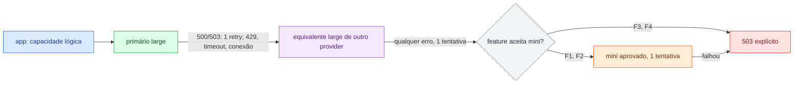
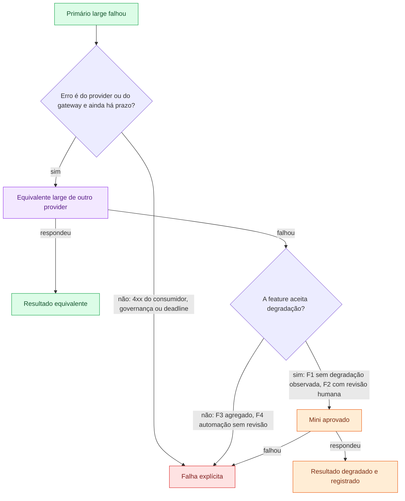

# 0006. Recuperar pelo large de outro provider e degradar para mini só onde o negócio aceita

- Status: aceita
- Data: 2026-11-27
- Nível: solução
- Revisa: [0005](0005-resilience-policy.md) (tentativas por destino e prazo da F3)

> **Legenda de cores:** 🟦 Entrada (cliente, borda, app) · ⬜ Gateway · 🟩 Primário large · 🟪 Equivalente large (fallback técnico) · 🟧 Mini (fallback degradado) · 🟥 Falha explícita

## Contexto

Depois do Passo 10, um provider fora do ar derruba a feature dele: duas tentativas e `503` em cerca de 2,5 s (`docs/fallback/evidencias/01-baseline-error_500.json`). O desafio exige fallback técnico em todas as capacidades e deixa aceitar ou recusar um modelo inferior feature por feature.

| Fato | Evidência |
|---|---|
| Os dois `large` dão a mesma saída | 1.000/1.000 em `classify` e `extract`, 17/17 lotes de `topics`, 24/24 textos de `suggest` (`docs/fallback/evidencias/comparacao-modelos.json`) |
| Mini na F1 | 1.000/1.000 iguais ao large, prioridade inclusive |
| Mini na F2 | texto com ~44% do tamanho (1.068 contra 2.433 caracteres), ainda em português e no contrato |
| Mini na F3 | 17/17 lotes iguais (temas, contagens e exemplos) |
| Mini na F4 | 316/1.000 diferentes: `product: null` em 192 casos em que o large extraiu o produto e **número do pedido errado** em 150 (pega a nota fiscal) |
| Preço (US$/1M entrada/saída) | GPT L 2,50/10; Claude L 3/15; GPT m 0,15/0,60; Claude m 0,80/4 |
| Gateway | LiteLLM `v1.102.1`: fallback entre **grupos de modelos**, ordem fixa, pula destino já tentado, `max_fallbacks`, política de retry por grupo; **sem deadline por requisição** e **sem filtro por tipo de erro** (só contexto e política de conteúdo) |
| Domínio de falha | os dois providers são o mesmo container `provider-fake`: o experimento prova o roteamento, não a independência física |

## Opções consideradas

| Critério | 1. Falhar logo | 2. Só retry no mesmo destino | 3. Large de outro provider | 4. Mini direto | 5. Large → large → mini por feature |
|---|---|---|---|---|---|
| Disponibilidade com um provider fora | ❌ | ❌ (mesma causa) | ✅ | ✅ | ✅ |
| Correção do resultado | ✅ | ✅ | ✅ (equivalente) | ❌ na F4 | ✅ onde há degradação aceita |
| Custo | 0 | baixo | +41% (F1) a −33% (F2) | muito menor | depende do caminho |
| Respeita o negócio de cada feature | n/a | n/a | n/a | ❌ | ✅ |

**Onde fica o mecanismo**

| Critério | Aplicação | Gateway | Distribuída (escolhida) |
|---|---|---|---|
| Centralização | cada adapter decide | um arquivo | gateway executa, app limita o prazo |
| Conhecimento do negócio | alto | nenhum | a decisão fica no ADR e vira configuração |
| Isolamento tecnológico | app passaria a conhecer destinos | total | total: a app só vê capacidades |
| Controle de tentativas | duplicaria o retry do gateway | um só dono | um só dono (gateway) |
| Controle do deadline | sim | **não** (LiteLLM não tem) | app corta a chamada única ao gateway |
| Auditoria | log da app | headers `x-litellm-*` | os dois |

## Decisão

Opção 5, com responsabilidades distribuídas: o **gateway** guarda a cadeia, os destinos físicos e as tentativas; a **app** pede só a capacidade lógica, impõe o deadline global (uma única chamada HTTP, então o prazo não reinicia ao trocar de destino) e registra quando a resposta veio de fallback.



| Capacidade | 🟩 Primário | 🟪 Fallback técnico | 🟧 Inferior | Tentativas máx. (P / E / m) | Timeout por tentativa | Deadline da app |
|---|---|---|---|---|---|---|
| `ticket-classification` (F1) | `gpt-fake-large` | `claude-fake-large` | `gpt-fake-mini` | 2 / 1 / 1 = 4 | 3 / 3 / 2 s | 14 s |
| `reply-suggestion` (F2) | `claude-fake-large` | `gpt-fake-large` | `claude-fake-mini` | 2 / 1 / 1 = 4 | 20 / 20 / 5 s | 25 s |
| `topics-report` (F3, por lote) | `claude-fake-large` | `gpt-fake-large` | — | 2 / 1 = 3 | 12 / 12 s | 25 s |
| `order-extraction` (F4) | `gpt-fake-large` | `claude-fake-large` | — | 2 / 1 = 3 | 3 / 3 s | 14 s |

**Regras de transição**
- Primário: repete uma vez só falha imediata possivelmente transitória (`500`, `503`). `429` e timeout **migram na hora**: esperar o `Retry-After` ou outra janela de 3 s no destino saturado atrasa a recuperação e não cabe no prazo da F1 com o mini.
- Equivalente e mini: uma tentativa, qualquer erro.
- O mini é o do provider oposto ao último large tentado (alternância: nunca dois saltos seguidos no mesmo provider).
- Cadeia finita: `max_fallbacks: 2`, destinos de fallback sem fallback próprio, e o LiteLLM pula destino já tentado. Sem ciclo `OpenAI → Anthropic → OpenAI`.
- Um deployment por grupo: sem balanceamento, o primário nunca é sorteado.
- Fallback não é usado para contornar governança: recusas de chave, orçamento e limite do gateway acontecem antes do router (verificar no Passo 12).

**Orçamento (pior caso calculado, LiteLLM pausa 0,5–1,25 s antes da retentativa e 1,0–1,75 s depois da última)**

| Capacidade | Primário (500 e depois trava) | Equivalente | Mini | Total | Deadline | Margem |
|---|---|---|---|---|---|---|
| F1 | 3,0 + 3 = 6,0 s | 3 s | 2 s | 11,0 s | 14 s | 3,0 s |
| F4 | 6,0 s | 3 s | — | 9,0 s | 14 s | 5,0 s |
| F3 (lote) | primário travado 12 s | 9,9 s normal | — | 21,9 s | 25 s | 3,1 s |
| F2 | primário travado 20 s | 16,2 s normal | — | 36,2 s | 25 s | ❌ não cabe |

## Decisão por funcionalidade

### F1 — Classificação: aceita mini (`gpt-fake-mini`)
1. **Negócio:** o cliente espera a confirmação na abertura; a classificação define fila e prioridade.
2. **Primário:** `gpt-fake-large`. 3. **Técnico:** `claude-fake-large`.
4. **Inferior:** aceito.
5. **Evidência:** 1.000/1.000 tickets reais e 21/21 casos do Passo 03 idênticos ao large, inclusive `priority`; contrato validado pela app (`classification.py`).
6. **Impacto da degradação:** nenhum observado; risco residual é o modelo real não se comportar como o simulador.
7. **Justificativa:** a indisponibilidade bloqueia o cliente na tela; a degradação não apareceu em nenhuma amostra.
8. **Sem destino:** `503 model_unavailable` (ou `model_timeout`) em até ~8 s, com 4 chamadas no máximo.

> [!NOTE]
> **Questão em aberto:** o enunciado não diz se a falha da classificação impede a abertura do ticket ou só atrasa a triagem, nem se um atendente revisa a prioridade depois. Se a revisão existir, a aceitação do mini fica mais confortável; se a prioridade alimentar SLA automático sem revisão, reavaliar.

### F2 — Sugestão: aceita mini (`claude-fake-mini`)
1. **Negócio:** o atendente lê e edita antes de enviar (human-in-the-loop).
2. **Primário:** `claude-fake-large`. 3. **Técnico:** `gpt-fake-large`.
4. **Inferior:** aceito.
5. **Evidência:** 24/24 textos do mini com ~44% do tamanho, em português, sem quebrar o contrato (`suggestion` é texto livre).
6. **Impacto:** sugestão mais curta; o atendente completa.
7. **Justificativa:** sem sugestão o atendente escreve do zero; uma curta revisada é melhor que nenhuma.
8. **Sem destino:** `503`. Com o primário **travado**, o deadline de 25 s chega antes do equivalente terminar: `503 model_timeout` aos 25 s (limitação aceita até o streaming do Passo 14).

### F3 — Relatório: rejeita mini
1. **Negócio:** consolida milhares de tickets para decisão; ninguém espera na tela; pode ser executado de novo.
2. **Primário:** `claude-fake-large`. 3. **Técnico:** `gpt-fake-large`, por **lote** (só a chamada que falhou é refeita).
4. **Inferior:** rejeitado.
5. **Evidência:** o mini empatou nos 17 lotes testados, então a recusa **não** vem de degradação observada.
6. **Impacto de aceitar:** um relatório parte large, parte mini teria procedência mista e nada no `TopicsReport` diria isso; contagens erradas viram decisões erradas sem ninguém perceber.
7. **Justificativa:** custo assimétrico. Esperar e reprocessar custa pouco (Passo 15 trará job assíncrono com deadline de 60 s); um erro silencioso num agregado custa caro. Com amostra pequena e modelo real diferente do simulador, o ganho de disponibilidade não paga o risco.
8. **Sem destino:** `503`; nenhum relatório parcial, `total_tickets` nunca é ajustado.

### F4 — Extração: rejeita mini
1. **Negócio:** alimenta troca e devolução **sem revisão humana**; erro vira frete, estoque e prejuízo.
2. **Primário:** `gpt-fake-large`. 3. **Técnico:** `claude-fake-large`.
4. **Inferior:** rejeitado.
5. **Evidência:** `product: null` em 192/1.000 e **pedido errado em 150/1.000** (ex.: TK-00036, large `#389511`, mini `#927477`, que é a nota fiscal). As duas respostas são JSON válido e passam na validação da app.
6. **Impacto:** troca no pedido errado; `null` confundido com "o cliente não informou".
7. **Justificativa:** indisponibilidade explícita reprocessável é mais barata que incorreção silenciosa.
8. **Sem destino:** `503`; nunca `{"order_number": null, "product": null}` para esconder falha de infraestrutura.



## Consequências

**Melhora**
- Um provider fora do ar não derruba mais nenhuma feature: `500` no primário vira `200` em 2,8–3,6 s (F1/F4), 18,1 s (F2), 12,4 s (F3), com resposta idêntica ao golden master.
- F1 com o primário travado responde em 4,1 s (antes 8,6 s com erro); F3 recupera o lote travado em 21,9 s.
- `429` no primário migra na hora: F1 1,1 s (com a política do Passo 10 eram 6,1 s).
- Os dois large fora: F1 e F2 respondem pelo mini (2,3 s e 4,8 s); F3 e F4 dão `503` sem tocar num mini.
- Sem `504` da borda em nenhum experimento.

**Piora ou custo**
- Fallback técnico muda o custo: Claude L custa +41% na F1 e +44% na F4; GPT L custa −33% na F2 e −20% na F3.
- Lentidão/timeout continuam gerando trabalho descartado: na F1 lenta, o primário termina a geração e é pago junto com o equivalente (US$ 0,00038 contra 0,00016).
- **Cadeia órfã:** quando a app desiste (F2 travada aos 25 s), o gateway segue a cadeia sozinho e chega a chamar o mini ~40 s depois. Na F2 lenta, o equivalente terminou (US$ 0,0061 pagos) depois que o cliente já tinha recebido `503`.
- **Fallback em 400:** o LiteLLM aciona o fallback para qualquer erro. O estouro de contexto só é reconhecido na mensagem do formato Messages; na F1/F4 o `400` percorre a cadeia (3 chamadas, todas `400` imediatas, resposta final `502` igual).
- O consumidor não vê no JSON que a resposta veio do mini; a degradação fica no log da app e nos headers do gateway.

**Riscos remanescentes**
- Os dois providers rodam no mesmo container: independência de domínio de falha não foi provada.
- Os grupos `*-equivalent` e `*-degraded` podem ser pedidos diretamente com a master key. No Passo 12, as chaves virtuais devem listar só as 4 capacidades; com `enforce_fallback_model_access` desligado (padrão), o fallback interno continua funcionando.
- O LiteLLM não registra custo (preços dos modelos simulados não declarados): o Passo 12 precisa declará-los, senão nenhum orçamento estoura.

**Para os próximos passos**
- Passo 14 (streaming F2): fallback só antes do primeiro trecho; o timeout passa a ser de primeiro token (~0,8 s normal), o que torna o fallback da F2 viável no prazo. Depois do primeiro trecho, evento `error`.
- Passo 15 (F3 assíncrona): mesma cadeia por lote; o job inteiro com deadline de 60 s e estado `failed` quando um lote esgota a cadeia; nenhum lote novo é iniciado depois disso.

## Evidência

```bash
docker compose up -d --build --wait
python docs/fallback/sondas_fallback.py primario-500        # P 500, P 500, E 200 nas 4 features
python docs/fallback/sondas_fallback.py larges-500          # F1/F2 terminam no mini; F3/F4 em 503
curl -s "localhost:8090/admin/calls?last=10"
pytest tests/fallback -v                                    # 40 passed
```

Detalhes, tabelas e diagramas em [`docs/fallback/relatorio-fallback.md`](../fallback/relatorio-fallback.md); registros em `docs/fallback/evidencias/`; configuração em `gateway/config.yaml`.

## Revisão no Passo 12 (2026-11-28)

As pendências marcadas para o Passo 12 foram resolvidas ([ADR 0010](0010-gateway-governance.md)):

- **Governança antes do fallback, verificado:** com orçamento esgotado ou RPM esgotado, a requisição é recusada na autenticação/limitador e nenhum destino (primário, equivalente, mini) recebe chamada, mesmo com o primário ou a cadeia inteira em `500` (`docs/governanca/evidencias/04-fallback-nao-contorna-budget.json` e `07-fallback-nao-contorna-rate.json`).
- **Grupos internos:** a chave `helpdesk-app` lista só as 4 capacidades; pedir `*-equivalent` ou `*-degraded` direto dá `403 key_model_access_denied`. O fallback interno continua funcionando (`enforce_fallback_model_access` no padrão, falso).
- **Custo:** preços declarados por destino; num fallback a chave paga o modelo que respondeu (primário `500` na F1: US$ 0,000222 do `claude-fake-large`, não 0,0001575; dois large fora: US$ 0,00000945 do mini). Tentativas que falharam com `500` custam 0.
- **RPM:** uma requisição com 4 tentativas físicas conta 1 no limite da chave.
