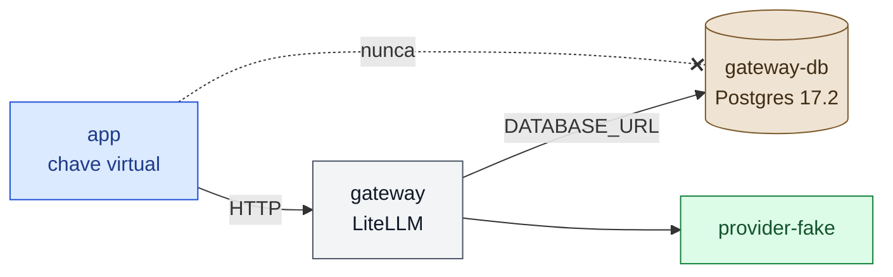

# 0007. Dar ao gateway um Postgres próprio para chaves virtuais e gasto

- Status: aceita
- Data: 2026-11-28
- Nível: solução
- Relaciona: [0003](0003-ai-gateway.md) (gateway), [0010](0010-gateway-governance.md) (políticas que precisam deste banco)

> **Legenda de cores:** 🟦 Consumidor · ⬜ Gateway · 🟫 Banco de governança · 🟩 Provider

## Contexto

O desafio exige uma chave com orçamento e outra com limite de requisições, com recusa antes do provider. No LiteLLM `v1.102.1`, o gateway escolhido no [ADR 0003](0003-ai-gateway.md), isso é feito com **chaves virtuais**. Sem banco, o gateway aceita só a master key e não guarda gasto por chave:

| Chamada (sem `DATABASE_URL`, commit `ce6c041`) | Resultado |
|---|---|
| `GET /key/info` com a master key | `500 Database not connected. Connect a database to your proxy` |
| `GET /spend/logs` | `500 ... Database not connected ...` |
| F1 com a master key | `200`, `x-litellm-key-spend: 0.0` |

Fonte: [`docs/governanca/evidencias/00-antes-sem-governanca.txt`](../governanca/evidencias/00-antes-sem-governanca.txt). A documentação do LiteLLM para chaves virtuais pede um Postgres (`DATABASE_URL`); o esquema é criado pelo próprio gateway com Prisma ao subir (`prisma migrate deploy`, 171 migrações na imagem, sem acesso à internet).

## Opções consideradas

| Critério | 1. Sem banco (só master key) | 2. Postgres do gateway | 3. Controle na app | 4. Outro banco |
|---|---|---|---|---|
| Chave por consumidor | ❌ uma chave para tudo | ✅ | ⚠️ a app teria de emitir e validar chaves | ❌ o LiteLLM só suporta Postgres para isso |
| Orçamento com recusa no gateway | ❌ | ✅ `max_budget` por chave | ❌ a recusa seria na app, não no gateway | — |
| Gasto sobrevive a reinício | ❌ | ✅ volume nomeado | depende | — |
| Novo serviço para operar | não | sim | não | sim |
| Atende ao requisito | ❌ | ✅ | ❌ (o enunciado pede a recusa no gateway) | ❌ |

## Decisão

Opção 2: serviço `gateway-db` com `postgres:17.2-alpine` (versão fixada), usado **só pelo gateway**.

```yaml
gateway-db:
  image: postgres:17.2-alpine
  environment: {POSTGRES_DB: litellm, POSTGRES_USER: litellm, POSTGRES_PASSWORD: ${GATEWAY_DB_PASSWORD}}
  volumes: [gateway-db-data:/var/lib/postgresql/data]
  healthcheck: {test: ["CMD-SHELL", "pg_isready -U litellm -d litellm"]}
```

- O gateway recebe `DATABASE_URL` e espera `gateway-db` saudável (`depends_on: service_healthy`).
- Sem porta publicada no host: ninguém fora da rede do compose fala com o banco. Inspeção, quando precisa: `docker compose exec gateway-db psql -U litellm -d litellm`.
- A app não recebe senha nem URL do banco e não importa driver de banco: a dependência é só do gateway.
- Migrações: automáticas, pelo gateway, a cada subida (idempotentes).



O que o banco guarda (tabelas do LiteLLM): `LiteLLM_VerificationToken` (hash da chave, alias, modelos, `max_budget`, `rpm_limit`, `spend`), `LiteLLM_BudgetTable` (`soft_budget`), `LiteLLM_SpendLogs` (uma linha por requisição com custo, modelo e chave). O valor da chave não é guardado, só o hash.

## Consequências

- Melhor: chaves virtuais, orçamento, gasto por chave e por requisição, revogação; o gasto sobrevive a reinício do gateway (volume `gateway-db-data`).
- Pior: mais um serviço (uma imagem, um processo, um volume, uma senha) e o gateway passa a depender dele para autenticar chaves virtuais. A subida ficou mais longa (migrações na primeira vez, ~3 s).
- Semântica a vigiar: o gasto é gravado **em lote**, a cada 10 s + 0 a 5 s (`PROXY_BATCH_WRITE_AT`). A decisão de orçamento usa o contador em memória do gateway, atualizado na hora; o banco (e o `/key/info`) fica até ~15 s atrás. Um reinício do gateway antes da gravação perde o gasto ainda na fila.
- Fora do escopo: backup, réplica, alta disponibilidade e retenção do `LiteLLM_SpendLogs`. Num ambiente real o banco seria gerenciado.
- Redis **não** entrou: com uma instância do gateway, contadores em memória bastam (ver [ADR 0010](0010-gateway-governance.md)).

## Evidência

```bash
curl -s localhost:4000/health/readiness          # {"status":"healthy","db":"connected"}
docker compose exec gateway-db psql -U litellm -d litellm \
  -c 'select key_alias, spend, max_budget, rpm_limit from "LiteLLM_VerificationToken";'
docker compose config | grep -n DATABASE_URL     # só no serviço gateway
```
