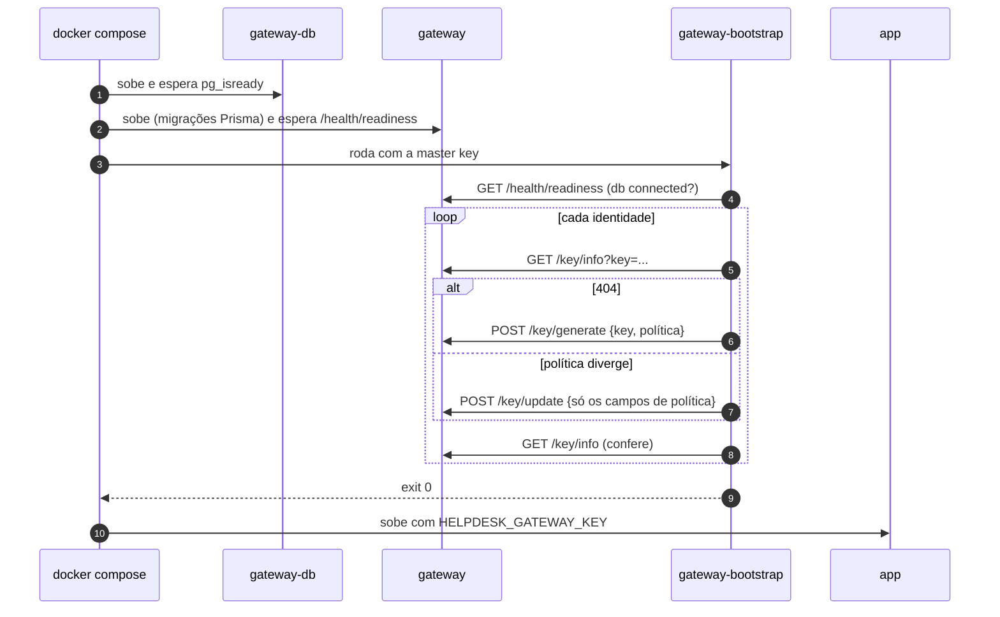

# 0008. Provisionar as chaves virtuais com um serviço de bootstrap idempotente no compose

- Status: aceita
- Data: 2026-11-28
- Nível: solução (o script é decisão de software)
- Relaciona: [0007](0007-gateway-governance-database.md), [0010](0010-gateway-governance.md)

> **Legenda de cores:** 🟦 Consumidor · ⬜ Gateway · 🟨 Provisionamento · 🟫 Banco

## Contexto

O avaliador roda `cp .env.example .env && docker compose up -d --build --wait` e precisa usar a aplicação sem passo manual. Com chaves virtuais ([ADR 0010](0010-gateway-governance.md)), alguém tem de criá-las no gateway antes que a app as use, e a app precisa receber o valor da sua.

O que o LiteLLM `v1.102.1` oferece, conferido na imagem:

| Mecanismo | Existe? | Observação |
|---|---|---|
| Chaves declaradas no `config.yaml` | ❌ | o arquivo só tem modelos, roteamento e `general_settings` |
| `POST /key/generate` com o campo `key` | ✅ | cria a chave com o valor escolhido (precisa do prefixo `sk-`) |
| `GET /key/info?key=` | ✅ | `404 not_found_error` quando não existe |
| `POST /key/update` | ✅ | muda só os campos enviados; sem `spend`, o gasto fica |

## Opções consideradas

| Critério | A. Declarativa | B. Script manual | C. Serviço de inicialização no compose | D. Embutido no gateway ou na app |
|---|---|---|---|---|
| Suportada pela ferramenta | ❌ | ✅ | ✅ | ⚠️ mudaria o entrypoint do gateway ou daria a master key à app |
| Sem passo manual | — | ❌ | ✅ | ✅ |
| Idempotência | — | depende de quem roda | ✅ consulta antes de criar | ✅ |
| Controle de falha | — | humano | ✅ código de saída bloqueia a app | ⚠️ falha some no log do serviço |
| Menor privilégio | — | ✅ | ✅ só ele recebe a master key além do gateway | ❌ na app |
| Complexidade operacional | — | baixa | um serviço que roda e termina | escondida |

Distribuição da chave da app:

| Critério | Valor fixo no `.env`, criado com esse valor | Chave gerada a cada subida | Arquivo compartilhado |
|---|---|---|---|
| A app sabe a chave antes de subir | ✅ | ❌ precisa esperar e ler | ⚠️ volume a mais |
| Reprodutível | ✅ | ❌ muda a cada `up` | ✅ |
| Risco | valor conhecido (aceitável: é local e simulado) | chaves órfãs e consumidores com chave velha | arquivo com segredo montado em dois serviços |

## Decisão

Opção C com chave de valor fixo:

1. `.env.example` define `HELPDESK_GATEWAY_KEY`, `GOVERNANCE_BUDGET_KEY` e `GOVERNANCE_RATE_KEY` (valores locais com prefixo `sk-`).
2. Serviço `gateway-bootstrap`: reusa a imagem do gateway (já tem Python; nenhuma imagem nova), roda [`gateway/scripts/bootstrap_keys.py`](../../gateway/scripts/bootstrap_keys.py), depende de `gateway: service_healthy` e termina.
3. `app` depende de `gateway-bootstrap: service_completed_successfully`: a app nunca sobe sem a sua chave.
4. O script, para cada identidade da lista `IDENTITIES` (estado desejado):
   - espera prontidão verificada (`/health/readiness` com `db: connected`, até 90 s), sem espera fixa;
   - `GET /key/info`: não existe → `POST /key/generate` com o valor do ambiente e a política;
   - existe → compara só campos de política (`key_alias`, `models`, `max_budget`, `soft_budget`, `budget_duration`, `rpm_limit`, `metadata`) e, se divergirem, `POST /key/update` só com eles;
   - relê e confere a política efetiva; qualquer divergência ou erro HTTP → código 1.
5. Nunca envia `spend`, nunca apaga nem regenera chave: provisionar de novo não é resetar.
6. Reset de gasto é outro comando, só para as chaves de demonstração (recusa `helpdesk-app`), e espera o gasto estabilizar antes e depois, porque o gateway grava o gasto em lote:
   `docker compose run --rm gateway-bootstrap --reset-spend governance-budget-demo`
7. Log sem segredo: alias e `sk-...` + 4 últimos caracteres.

## Consequências

- Melhor: subida reprodutível sem passo manual; a app não sobe se a chave não existe; mudar uma política é editar `IDENTITIES` e rodar `up`.
- O `gateway-bootstrap` aparece como `Exited (0)` no `docker compose ps -a`; isso é o estado de sucesso. `docker compose up --wait` termina com código 0 com ele assim.
- Valor fixo de chave: é o compromisso consciente de um ambiente local e simulado. Fora dele, o valor viria de um cofre de segredos e a rotação seria `key/regenerate` com atualização do consumidor.
- A master key passa a existir em dois serviços (gateway e bootstrap). A app continua sem ela.
- Remover uma identidade da lista **não** a revoga (o script não apaga nada): revogar é um ato explícito (`POST /key/delete`).
- O script conhece endpoints administrativos do LiteLLM `v1.102.1`; trocar de gateway troca o script.

## Evidência

| Cenário | Esperado | Observado (log do bootstrap) |
|---|---|---|
| A. Ambiente novo (clone limpo, volumes novos) | 3 chaves `criada`, app saudável | ver [`evidencias/30-ambiente-limpo.txt`](../governanca/evidencias/30-ambiente-limpo.txt) |
| B. Ambiente existente | 3 × `já conforme`, gasto mantido | `helpdesk-app já conforme; ... spend=0.0030570` (evidência 31) |
| C. Gateway reiniciado | `já conforme`, gasto mantido (banco) | evidência 31 |
| D. Falha parcial | sai com 1, app não sobe; na volta cria só o que falta | 1ª execução: `FALHA: helpdesk-app: política efetiva diverge` (bug do script: `soft_budget` fica em outra tabela), `up` parou com `didn't complete successfully: exit 1`; 2ª: `helpdesk-app já conforme`, as outras duas `criada` |
| Reset de demonstração | gasto 0 confirmado após um ciclo de gravação | `spend 0.0005500 -> 0.0000000 ... confirmado`; `--reset-spend helpdesk-app` → `FALHA ... só nas chaves de demonstração`, exit 1 |
