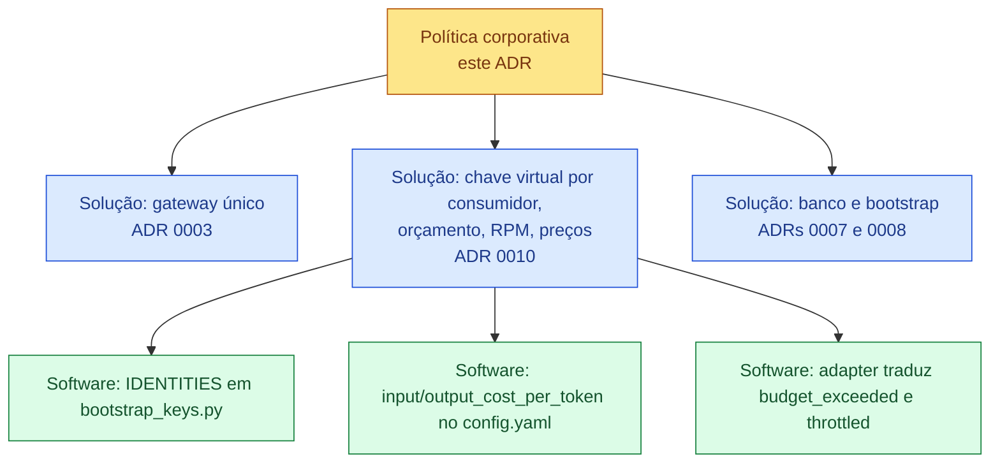

# 0009. Consumir IA só pelo gateway, com identidade, orçamento e limite por consumidor

- Status: aceita
- Data: 2026-11-28
- Nível: corporativa
- Orienta: [0003](0003-ai-gateway.md) e [0010](0010-gateway-governance.md) (solução), [0008](0008-key-bootstrap-service.md) (provisionamento)

> **Aviso:** esta é uma política **proposta para o contexto simulado do desafio**. A organização, os valores e os papéis são didáticos; não descrevem nenhuma empresa real.

## Contexto

No cenário do desafio, uma loja on-line usa IA no helpdesk (classificar, sugerir resposta, extrair pedido, resumir temas) e outras equipes devem fazer o mesmo. Sem uma política comum:

- **Custo cresce sem dono.** O custo de IA é por token e por chamada: retries, fallbacks e lotes multiplicam a conta sem que o código mude. O fallback do Passo 11 já mostrou −33% a +44% de custo por operação conforme o destino.
- **Credencial compartilhada não tem dono.** Até o Passo 11 a app usava a master key: quem a tem administra o gateway e consome sem limite, e o gasto não é atribuível.
- **Cada equipe contrataria provider e chave por conta própria**, com políticas, logs e limites diferentes.
- **Não há como responder** quem consumiu, quanto e com que finalidade.

## Opções consideradas

| Critério | 1. Cada aplicação contrata e consome | 2. Consumo centralizado no gateway | 3. Orçamento central único | 4. Orçamento por identidade |
|---|---|---|---|---|
| Credenciais de provider | espalhadas | só no gateway | — | — |
| Responsabilização (accountability) | por contrato | por chave | ❌ ninguém responde pelo total | ✅ cada chave tem dono e centro de custo |
| Um consumidor esgota os outros | não (isolado) | depende do limite | ✅ sim | ❌ não |
| Padronização de logs e preço | ❌ | ✅ | — | — |
| Ponto único de falha | não | ✅ sim (o gateway) | — | — |

## Decisão

Política de consumo de IA do helpdesk (simulada):

1. **Todo consumo de modelo passa pelo AI Gateway.** Nenhuma aplicação recebe chave de provider.
2. **Providers permitidos:** os dois do `provider-fake` (formato OpenAI e Anthropic). Incluir outro é decisão desta camada, registrada em ADR.
3. **Uma identidade de consumo por aplicação e finalidade**, com dono, centro de custo e ambiente registrados. Chave compartilhada entre aplicações é proibida.
4. **A credencial administrativa (master key) não consome.** Fica só com o gateway e com o provisionamento automatizado.
5. **Toda identidade tem orçamento com recusa (hard limit)**; o aviso (soft limit) é complementar, nunca substituto.
6. **Toda identidade tem limite de frequência**, mesmo que folgado, para que um laço descontrolado não esgote o orçamento nem a capacidade dos outros.
7. **Capacidades por identidade:** cada chave só acessa as capacidades lógicas da sua finalidade; destinos internos de fallback não são consumíveis diretamente.
8. **Recuperação não contorna política:** retry e fallback valem para falha do provider, nunca para recusa de governança.
9. **Valores didáticos desta política** (o detalhe executável está no [ADR 0010](0010-gateway-governance.md)):

| Identidade | Orçamento | Período | Frequência | Dono (simulado) |
|---|---|---|---|---|
| `helpdesk-app` | US$ 20,00, aviso em US$ 15,00 | 30 dias | 600 req/min | time-helpdesk, centro de custo `atendimento` |
| `governance-budget-demo` | US$ 0,0004 | acumulado (reset só manual) | sem limite | arquitetura (demonstração) |
| `governance-rate-demo` | US$ 1,00 | acumulado | 3 req/min | arquitetura (demonstração) |

Ordem de grandeza do orçamento do helpdesk, só para mostrar a conta: uma F1 custa US$ 0,0001575; 1.000 classificações por dia por 30 dias custam US$ 4,73. Os US$ 20 cobrem esse volume com folga para F2 e F3 e ainda param um consumo fora do normal.

## Consequências

- **Benefícios:** custo atribuível por identidade (showback já é possível pelo `LiteLLM_SpendLogs`), credenciais de provider num lugar só, revogação por consumidor, um consumidor não consome o orçamento de outro.
- **Restrições:** nenhuma aplicação nova consome IA sem uma identidade provisionada; mudar orçamento é mudar configuração versionada, não pedir a chave de alguém.
- **Responsabilidades:** arquitetura mantém a política e o gateway; cada time responde pelo consumo da sua identidade; operação mantém gateway e banco.
- **Riscos:** o gateway vira ponto único de falha e de concentração de segredos (alta disponibilidade fora do escopo deste desafio); orçamento mal dimensionado vira indisponibilidade da feature.
- **Impacto organizacional:** custo de IA deixa de ser "da infraestrutura" e passa a ter dono por aplicação; chargeback real exigiria um processo financeiro que não faz parte deste desafio.

## Evidência

A política vira configuração verificável: [`gateway/scripts/bootstrap_keys.py`](../../gateway/scripts/bootstrap_keys.py) (`IDENTITIES`), `compose.yaml` (a app recebe só `HELPDESK_GATEWAY_KEY`) e os testes `tests/governance/`.
