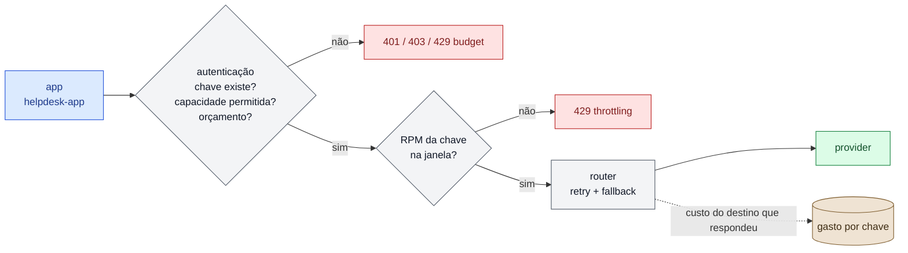

# 0010. Aplicar autenticação, preço, orçamento e RPM por chave virtual no gateway

- Status: aceita
- Data: 2026-11-28
- Nível: solução
- Implementa: [0009](0009-corporate-ai-governance.md) · Depende de: [0007](0007-gateway-governance-database.md), [0008](0008-key-bootstrap-service.md) · Revisa: [0003](0003-ai-gateway.md) (chave da app), [0005](0005-resilience-policy.md), [0006](0006-fallback-policy.md)

> **Legenda de cores:** 🟦 Consumidor · ⬜ Gateway · 🟥 Recusa de governança · 🟩 Provider · 🟫 Banco

## Contexto

Estado no fim do Passo 11 (commit `ce6c041`, evidência [`00-antes-sem-governanca.txt`](../governanca/evidencias/00-antes-sem-governanca.txt)):

| Fato | Consequência |
|---|---|
| A app usava a **master key** como `GATEWAY_API_KEY` | quem tem a chave da app administra o gateway; gasto não atribuível |
| `x-litellm-response-cost: 0.0` numa F1 com 19/11 tokens | o LiteLLM não conhece `gpt-fake-*`/`claude-fake-*`: **custo zero, orçamento nunca estoura** |
| Sem banco | nenhuma chave virtual, nenhum orçamento, nenhum RPM por chave |
| Retry e fallback no gateway (ADRs 0005/0006) | uma requisição pode gerar até 4 chamadas pagas; a política tem de valer **antes** disso |

## Opções consideradas

| Critério | Na aplicação | No gateway (escolhida) |
|---|---|---|
| Recusa antes do provider | só se a app não tiver bug; outros consumidores escapam | ✅ todo consumo passa por ele |
| Conhece o custo real (modelo que respondeu, fallback) | ❌ a app só vê capacidades | ✅ |
| Duplicação | cada app reimplementa | uma vez |
| Acoplamento da app | precisaria de preços e modelos físicos | nenhum novo |

| Critério | Contadores em memória do gateway | Contadores em Redis | Contadores no Postgres |
|---|---|---|---|
| Uma instância (hoje) | ✅ exato (concorrência: 3/6 admitidas com RPM 3) | ✅ | lento por requisição |
| Várias instâncias | ❌ cada uma conta a sua janela | ✅ | — |
| Novo serviço | não | sim | já existe (ADR 0007) |

Credenciais: master key na app (atual, ❌ privilégio total), uma chave por ambiente (❌ não separa consumidores), **uma chave virtual por consumidor e finalidade** (escolhida).

## Decisão

**1. Preço por destino físico** em `gateway/config.yaml`, da tabela do `provider-fake/README.md`, em US$ por token:

| Modelo | `input_cost_per_token` | `output_cost_per_token` | US$ / 1M (entrada/saída) | Validado |
|---|---|---|---|---|
| `gpt-fake-large` | 0.0000025 | 0.00001 | 2,50 / 10,00 | ✅ 19/11 tok → 0,0001575 |
| `claude-fake-large` | 0.000003 | 0.000015 | 3,00 / 15,00 | ✅ 19/11 tok → 0,000222 |
| `gpt-fake-mini` | 0.00000015 | 0.0000006 | 0,15 / 0,60 | ✅ 19/11 tok → 0,00000945 |
| `claude-fake-mini` | 0.0000008 | 0.000004 | 0,80 / 4,00 | ✅ 19/11 tok → 0,0000592 |

O preço fica em cada um dos 10 destinos (primário, `-equivalent`, `-degraded`), não na capacidade: num fallback o custo é o do modelo que respondeu.

**2. Identidades** (criadas pelo bootstrap, ADR 0008):

| Identidade | Finalidade | Capacidades | Budget | Rate limit | Permissões |
|---|---|---|---|---|---|
| `helpdesk-app` | consumo normal da app | as 4 capacidades | US$ 20 / 30 dias (soft US$ 15) | 600 RPM | só consumo; recebida só pelo serviço `app` |
| `governance-budget-demo` | demonstrar recusa por orçamento | `ticket-classification` | US$ 0,0004 acumulado | nenhum (isola a causa) | só consumo; uso manual pelo README |
| `governance-rate-demo` | demonstrar recusa por RPM | `ticket-classification` | US$ 1,00 (nunca é a causa) | 3 RPM | só consumo; uso manual pelo README |
| master key | administrar o gateway | todas | — | — | admin; gateway e bootstrap |

Os grupos internos `-equivalent`/`-degraded` não estão em nenhuma chave: chamá-los direto dá `403 key_model_access_denied`. O fallback interno continua funcionando porque `enforce_fallback_model_access` fica no padrão (falso).

**3. Semântica de contabilização (LiteLLM `v1.102.1`, observada):**

| Item | Comportamento |
|---|---|
| Custo de uma chamada | `(tokens_in × preço_in + tokens_out × preço_out)` do modelo que respondeu; header `x-litellm-response-cost` |
| Tentativa que falhou (500, 429, timeout sem `usage`) | custo 0 no gateway |
| Cadeia de fallback | uma linha de gasto com o custo do destino que respondeu |
| Gasto da chave | contador em memória atualizado na resposta; banco gravado em lote a cada 10–15 s |
| Admissão por orçamento | recusa quando `gasto >= max_budget`; antes de encaminhar, **reserva** o custo máximo estimado (entrada + até 16.384 tokens de saída) e reconcilia depois |
| Ultrapassagem | no máximo o custo da última chamada admitida (0,0004725 contra 0,0004) |

**4. Semântica do RPM (limitador v3 do LiteLLM, sem Redis):** janela **fixa** de 60 s que começa na primeira requisição admitida; cada requisição recebida conta 1, por mais tentativas físicas que gere; recusas não abrem nem estendem a janela; `429` com `Retry-After: 60` (pessimista: a janela pode terminar antes) e headers `x-ratelimit-api_key-remaining-requests`/`-limit-requests` nas respostas admitidas.

**5. Tratamento das recusas:**

| Erro | Origem | Retry | Fallback | Comportamento final (app) |
|---|---|---|---|---|
| `500`/`503` do provider | provider | 1 no primário (ADR 0005) | sim (ADR 0006) | `200` pelo destino seguinte ou `503 model_unavailable` |
| timeout do provider | provider | 0 no primário | sim | `200` ou `503 model_timeout` |
| `429` do provider | provider | 0 no primário | sim | `200` ou `503 model_rate_limited` |
| `429 budget_exceeded` | gateway (autenticação) | **não** (nem gateway nem app) | **não** | `503 model_budget_exceeded` |
| `429 throttling_error` "Rate limit exceeded for…" | gateway (limitador) | **não** | **não** | `503 model_throttled` + `Retry-After` |
| `401` chave inválida, ausente ou revogada | gateway | não | não | `502 model_rejected` |
| `403 key_model_access_denied` | gateway | não | não | `502 model_rejected` |

As recusas do gateway acontecem na autenticação ou no hook de pré-chamada, **antes do router**: o router (onde moram retry e fallback) nunca é acionado. Na app, `max_retries=0` (ADR 0005) e o adapter traduz pelo `type` do corpo; o `429` do limitador e o `429` de um provider ao fim da cadeia têm o mesmo status **e** o mesmo `type` (`throttling_error`), então o adapter também olha o começo da mensagem. As respostas da app não citam chave, orçamento nem limite.

## Evidências

| O quê | Resultado | Arquivo (`docs/governanca/evidencias/`) |
|---|---|---|
| Preços dos 4 modelos | manual = registrado nos 4 | `01-precos.json` |
| Autenticação | inválida 401, sem chave 401, revogada 401, capacidade fora 403, grupo interno 403; 0 chamadas em todas | `02-autenticacao.json` |
| Budget | 3 × `200` (0,0001575 cada), 4ª `429 budget_exceeded`; `/admin/calls` 3 → 3; gasto gravado 0,0004725 | `03-budget-esgotamento-e-recusa.json` |
| Fallback × budget | primário 500 e dois large 500: `429 budget_exceeded`, 0 chamadas em todos os modelos | `04-fallback-nao-contorna-budget.json` |
| Isolamento | budget e RPM esgotados; `helpdesk-app` pela borda `200` | `05-isolamento.json` |
| RPM | 3 × `200` (restante 2, 1, 0), 4ª `429`; 3 → 3; recupera 60 s após a 1ª | `06-rate-limit-recusa-e-recuperacao.json` |
| Fallback × RPM | 3 requisições = 12 chamadas físicas e 3 de RPM; 4ª `429`, 12 → 12 | `07-fallback-nao-contorna-rate.json` |
| Custo em cadeia | normal 0,0001575; primário 500 → 0,000222 (Claude); dois large 500 → 0,00000945 (mini); soma = delta da chave | `08-custo-em-cadeias-de-fallback.json` |
| Concorrência | budget: 6 simultâneas → 1 admitida (reserva); RPM 3: 6 → 3 | `09-…`, `10-…` |
| Reserva em sequência | chamadas coladas: 200, 429, 200, 429, 200, 429…; total 3 | `12-reserva-sequencial.json` |
| Latência | overhead mediano 1,35 ms (master) vs 1,41 ms (chave virtual); F1 pela borda 1,09 s | `11-latencia.json` |
| Testes | `tests/governance` 33 passed | `20-testes-governanca.txt` |

## Consequências

- **Segurança:** a app perdeu o privilégio administrativo; o vazamento da chave da app expõe no máximo US$ 20/30 dias e 600 RPM nas 4 capacidades, e a chave pode ser revogada sozinha.
- **Controle financeiro:** recusa real antes do provider, gasto por chave e por requisição (`LiteLLM_SpendLogs`).
- **Complexidade e dependências:** Postgres e o serviço de bootstrap; o gateway passa a depender do banco para autenticar chaves virtuais.
- **Latência:** +0,06 ms medianos de autenticação por chave virtual (dentro do ruído); a F1 segue em ~1,1 s.
- **Limitações:**
  1. Contadores de RPM e de gasto em memória: com duas instâncias do gateway cada uma contaria a sua janela (Redis seria o passo seguinte; não há réplica hoje).
  2. A reserva de orçamento é conservadora: perto do teto, ou com chamadas simultâneas, requisições que caberiam são recusadas (6 simultâneas com US$ 0,0004 → 1 admitida). Para o `helpdesk-app`, isso limita a ~120 requisições simultâneas em voo (20 / 0,164).
  3. Chamadas coladas na mesma conexão podem ser recusadas cedo enquanto a reserva anterior é liberada (evidência 12); repetir depois de um instante passa. A app não repete sozinha.
  4. Gasto no banco com atraso de até ~15 s; reset de demonstração precisa esperar o lote (ADR 0008).
  5. Tentativa interrompida por timeout custa 0 no gateway, mas um provider real cobraria a geração que continuou (cadeia órfã, ADR 0006).
  6. A mensagem de `401` cita o hash da chave e o nome de uma tabela interna; a app não repassa nada disso.
  7. Distinguir `429` do gateway e do provider depende do texto da mensagem do LiteLLM `v1.102.1` (coberto por teste).
