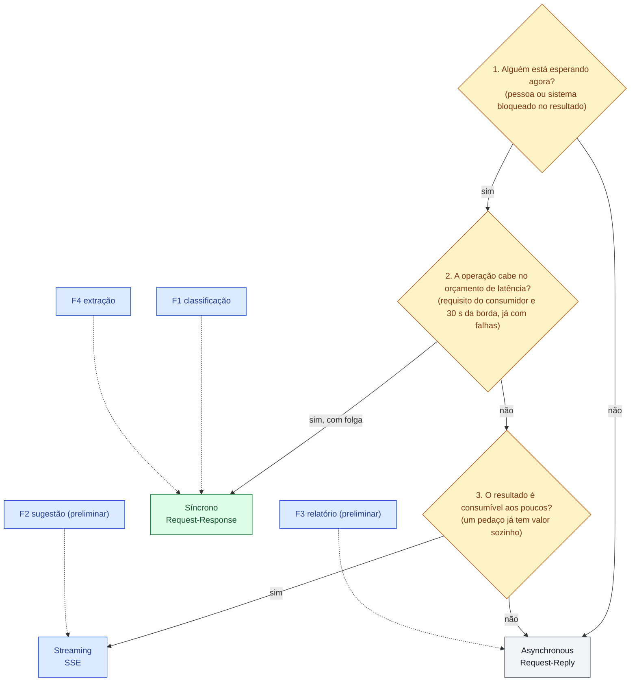

# 0011. Escolher o modo de execução de cada feature pelo consumidor: síncrono na F1 e F4

- Status: aceita para F1 e F4 (validadas no Passo 13); **preliminar** para F2 (Passo 14) e F3 (Passo 15)
- Data: 2026-11-28
- Nível: solução
- Depende de: [0003](0003-ai-gateway.md), [0005](0005-resilience-policy.md), [0006](0006-fallback-policy.md), [0010](0010-gateway-governance.md)
- Evidências: [`docs/execucao/evidencias/`](../execucao/evidencias/) · Relatório: [`docs/execucao/relatorio-execucao.md`](../execucao/relatorio-execucao.md)

> **Legenda de cores:** 🟦 Consumidor, borda e app · ⬜ Gateway · 🟩 Provider e sucesso · 🟥 Falha ou recusa · 🟨 Decisão

Este ADR é o registro **único** dos modos de execução do helpdesk, com uma seção por feature, como o enunciado exige. As seções de F2 e F3 ficam como hipótese até os seus passos; elas serão completadas aqui, sem criar ADRs paralelos.

## Contexto

| Fato | Fonte | Consequência para o modo de execução |
|---|---|---|
| A borda (nginx) encerra com `504` se o upstream passar **30 s** sem mandar byte | `edge/nginx.conf` (`proxy_read_timeout 30s`) | qualquer resposta síncrona precisa terminar antes; não podemos mudar a borda |
| Sem streaming, o provider só manda bytes **no fim** da geração | `provider-fake/README.md` ("a resposta chega inteira no fim") | o tempo de uma chamada é TTFT + tokens de saída ÷ velocidade |
| `large`: 800 ms até o 1º token, 40 tokens/s | `provider-fake/README.md` | F1 e F4 (~11 a 17 tokens) ~1,1 s; F2 (~600 tokens) ~16 s; F3 ~10 s por lote de 150 tickets |
| Retry, backoff e fallback no gateway; prazo global na app | ADRs 0005 e 0006; `app/helpdesk/config.py` | uma requisição síncrona pode atravessar até 4 chamadas; o prazo não reinicia |
| Recusa de governança antes do router | ADR 0010 | recusa é imediata, não consome provider |
| Rotas `def` no FastAPI 0.115.6, SDK `openai` síncrono com `max_retries=0` | `app/helpdesk/main.py`, `adapters/gateway.py` | cada requisição em espera ocupa **uma thread** do pool (40 por padrão) |

As quatro features têm consumidores diferentes: o cliente na abertura do ticket (F1), o atendente lendo uma sugestão longa (F2), a gestão que pede o relatório do mês (F3) e uma automação de troca e devolução sem revisão humana (F4). Um único modo para todas seria escolher pela tecnologia, não pelo consumidor.

## Alternativas consideradas

| Critério | Request-Response síncrono | Streaming (SSE) | Asynchronous Request-Reply |
|---|---|---|---|
| O consumidor recebe | o resultado completo na resposta | partes enquanto são geradas | um identificador; o resultado vem depois (polling ou callback) |
| Métrica principal | tempo total | tempo até o 1º trecho | tempo até o job concluir + atraso de consulta |
| Contrato HTTP | o da v1 (sem mudança) | muda (`text/event-stream`, eventos) | muda (`202` + recurso de status) |
| Estado no servidor | nenhum | conexão aberta | job persistido, com ciclo de vida |
| Erro | status + corpo | só antes do 1º byte; depois, evento de erro | estado `failed` no job |
| Acoplamento temporal | total: cliente, app, gateway e provider vivos ao mesmo tempo | total, mas o cliente já consome | desacoplado: o pedido termina antes do trabalho |
| Complexidade | menor | média (cliente e proxy precisam entender fluxo) | maior (fila ou worker, armazenamento, consulta) |

Nenhuma é superior em geral. As três perguntas abaixo organizam a escolha.

## Árvore de decisão

A árvore é um instrumento de análise do contexto, não uma regra automática: cada resposta precisa vir do negócio e das medições.

Duas ressalvas: (a) "cabe no orçamento" inclui o pior caso de falha, não só a latência normal; (b) "consumível aos poucos" é uma pergunta sobre o **consumidor**, não sobre o modelo: todo LLM gera tokens aos poucos, mas uma classificação pela metade não serve para nada.

## Decisão

| Feature | Q1 Alguém esperando? | Q2 Cabe no orçamento? | Q3 Consumível aos poucos? | Modo | Situação |
|---|---|---|---|---|---|
| F1 classificação | sim, o cliente na tela | sim: ~1,1 s normal; ≤ 8,1 s no pior caso do gateway; teto de 14 s | não: 2 valores de enum | **síncrono** | ✅ validado |
| F4 extração | sim, uma automação bloqueada | sim: ~1,1 s normal; ≤ 6,1 s no pior caso do gateway; teto de 14 s | não: a automação precisa do par pedido + produto | **síncrono** | ✅ validado |
| F2 sugestão | sim, o atendente | não: ~16 s normal; fallback não cabe nos 25 s | sim: texto lido enquanto é escrito | streaming | ⏳ hipótese (Passo 14) |
| F3 relatório | não, ninguém fica na tela | não: o mês passa dos 30 s da borda | não: um agregado parcial engana | assíncrono | ⏳ hipótese (Passo 15) |

**Internamente, F1 e F4 continuam como estão:** rotas `def` (o FastAPI as executa no thread pool), cliente HTTP síncrono, uma única chamada ao gateway com prazo global de 14 s. O modo de comunicação percebido pelo consumidor (síncrono) é independente do modelo de execução interno (thread bloqueada); trocar para `async def` + cliente assíncrono não mudaria o contrato nem os tempos medidos, só a forma de esperar, e não resolve nenhum problema observado (seção "Consequências").

### 🟦 F1: classificação de tickets

- **Negócio:** a classificação acontece na abertura do ticket; o cliente espera a confirmação na tela.
- **Contrato** (inalterado): `POST /tickets/classification`, entrada `{"ticket_id", "text"}`, saída `{"ticket_id", "category", "priority"}` com `category` ∈ `delivery`, `payment`, `exchange_return`, `product_defect`, `other` e `priority` ∈ `low`, `medium`, `high`.
- **Por que não streaming:** a saída tem ~11 tokens; o primeiro token chega em 0,8 s e o último em ~1,1 s. Entregar `{"category": "deliv` não ajuda ninguém, e o cliente precisaria entender eventos.
- **Por que não assíncrono:** o cliente está esperando agora; um `202` exigiria polling na tela, um recurso de job e estado no servidor para economizar ~1 s que já cabe no requisito.
- **Requisitos:** resultado completo em até **3 s** em modo normal; sucesso via fallback ou erro explícito em até **15 s** com o provider travado; tudo medido pela borda.
- **Resultados:**

| Cenário | Status | Tempo pela borda | Chamadas | Evidência |
|---|---|---|---|---|
| Normal, 9 entradas × 3 + 20 repetições | `200` | 1,062–1,163 s (mediana 1,088); 0 acima de 3 s | 1, primário | `02-normal-f1.json` |
| Primário travado (`timeout`) | `200` pelo `claude-fake-large` | 4,10 s (3×) | 2 | `05-primario-timeout.json` |
| Primário `500` | `200` pelo equivalente | 2,66–3,85 s | 3 | `04-primario-500.json` |
| Dois `large` em `500` | `200` pelo `gpt-fake-mini` (aprovado no ADR 0006) | 2,46–2,57 s | 4 | `08-larges-500.json` |
| Tudo travado | `503 model_timeout` | 8,05 s | 3 | `10-providers-timeout.json` |
| Gateway congelado | `503 model_timeout` (prazo da app) | 14,02 s | 0 | `13-gateway-congelado-deadline.json` |

- **Consequências:** a F1 depende de o gateway e um provider estarem vivos no instante da abertura do ticket (acoplamento temporal); com indisponibilidade total, o cliente recebe um erro explícito em segundos, e o ticket pode ser aberto sem classificação pelo cliente da API (decisão do produto, fora do escopo).

### 🟦 F2: sugestão de resposta (preliminar)

- **Negócio:** o atendente lê e edita a sugestão antes de enviar; a saída é longa (~2.400 caracteres no `large`).
- **Hipótese:** streaming (SSE). O atendente começa a ler em ~1 s em vez de esperar ~16 s; a sugestão é consumível aos poucos.
- **Justificativa preliminar:** no síncrono atual, o normal (~16 s) já está perto do limite útil e um primário travado responde `503` aos 25 s sem caber o fallback (Passo 11).
- **Pendente no Passo 14:** tempo até o 1º trecho pela borda; o que acontece com fallback e erro depois do 1º byte (o status `200` já foi enviado); custo de geração abandonada; comportamento do nginx com `text/event-stream`; contrato SSE e se o JSON síncrono continua disponível.

### 🟦 F3: relatório de temas (preliminar)

- **Negócio:** a gestão pede o relatório de um período; ninguém precisa dele em segundos; um agregado errado induz decisões erradas.
- **Hipótese:** Asynchronous Request-Reply: `202` com um identificador, processamento fora da requisição, consulta de status, estado `failed` explícito.
- **Justificativa preliminar:** o mês tem 34 lotes de ~10 s em série e passa dos 30 s da borda (Dor 1); não há entrega parcial útil.
- **Pendente no Passo 15:** onde o job roda e é guardado (sem serviço novo sem justificativa); prazo do job; recusa de governança no meio do lote; idempotência e reprocessamento.

### 🟦 F4: extração de dados do pedido

- **Negócio:** alimenta uma automação de troca e devolução **sem revisão humana**. Dado errado vira troca indevida, frete, estoque e prejuízo; uma falha explícita é melhor que um resultado errado.
- **Contrato** (inalterado): `POST /tickets/extraction`, saída `{"ticket_id", "order_number", "product"}`; `order_number` é `#` + 6 dígitos ou `null`; `product` é texto ou `null`. `null` significa "o processamento terminou e o ticket não cita o dado"; falha operacional nunca vira `null`.
- **Por que não streaming:** a automação não consegue agir só com o número do pedido; entregar o par em duas partes só adiciona estado no cliente.
- **Por que não assíncrono:** a extração leva ~1,1 s e o pior caso cabe com folga no prazo; um job exigiria armazenamento e consulta sem nenhum problema demonstrado para resolver. Se no futuro o volume da automação exigir processamento em lote, a decisão deve ser revista.
- **Requisito:** timeout explícito e sucesso via fallback ou erro explícito em até **15 s** com o provider travado. O enunciado não fixa 3 s para a F4; não adotamos objetivo interno de latência (não há consumidor humano para justificá-lo), só registramos o observado.
- **Resultados:**

| Cenário | Status | Tempo pela borda | Chamadas | Evidência |
|---|---|---|---|---|
| Normal, 7 entradas × 3 + 20 repetições | `200`, nulos legítimos preservados | 1,062–1,237 s (mediana 1,088) | 1, primário | `02-normal-f4.json` |
| Primário travado | `200` pelo `claude-fake-large`, mesmos valores | 4,25 s (3×) | 2 | `05-primario-timeout.json` |
| Dois `large` em `500` (mini no ar) | `503 model_unavailable`, **nenhuma chamada ao mini** | 2,25–2,35 s | 3 | `08-larges-500.json` |
| Tudo travado | `503 model_timeout` | 6,05 s | 2 | `10-providers-timeout.json` |
| Saída do modelo sem um dos campos | `502` (antes: `200` com `null` fictício) | — | 1 | `15-contrato-saida-antes.txt`, `tests/execution` |

- **Consequências:** a disponibilidade da F4 é deliberadamente menor que a da F1 (sem modelo inferior): o `mini` erra o pedido em 150/1.000 tickets e omite o produto em 192/1.000 (ADR 0006). Aumentar a disponibilidade com ele trocaria falhas visíveis por erros silenciosos na automação.

### Contrato de saída (complemento desta decisão)

Num fluxo síncrono, o consumidor confia que `200` significa "resultado utilizável". Por isso o Passo 13 fechou um defeito herdado da v1: saída do modelo fora do contrato virava `500` genérico (JSON inválido, tipo errado) ou, na F4, `200` com `null` fictício (campo ausente) ou com número inválido (`"#481516\n"`, dígitos não ASCII). Agora toda saída fora do contrato vira `502` explícito (`{"detail": ...}`), o `ticket_id` é sempre o da requisição e a F4 exige os dois campos presentes (mesmo nulos) e o número com `fullmatch` de `#[0-9]{6}`. Detalhes no relatório, seções 17 a 19.

## Consequências gerais

✅ **Benefícios**
- Contrato HTTP da v1 preservado nas quatro rotas; nenhum cliente precisa mudar.
- Operação simples: nenhum estado de job, nenhuma fila, nenhum serviço novo.
- Resultado disponível no fim da mesma requisição; erros explícitos com status e `code`.
- Tempos limitados por construção: timeout por tentativa e cadeia finita no gateway, prazo global de 14 s na app, abaixo dos 15 s exigidos e dos 30 s da borda.

⚠️ **Custos e limitações**
- **Acoplamento temporal:** cliente, borda, app, gateway e um provider precisam estar vivos ao mesmo tempo. O desacoplamento tecnológico dos Passos 06 a 09 não elimina isso.
- **Trabalho órfão:** quando a app desiste (gateway congelado), o gateway ainda processa a requisição depois e o provider cobra (`13b-chamadas-apos-despausar.json`). Geração em `slow` continua no provider depois do timeout.
- **Concorrência limitada por threads:** cada requisição em espera ocupa uma thread; acima de 40 simultâneas, as excedentes esperam (60 simultâneas: máximo 2,42 s, `12-concorrencia.json`). Não há requisito de throughput no enunciado; se aparecer, a alavanca é o tamanho do pool ou `async def` + cliente assíncrono, sem mudar o contrato.
- **Margem curta entre prazo e requisito:** 14 s de prazo contra 15 s exigidos (observado 14,02 s). Qualquer mudança no prazo precisa de nova medição.
- **Validação estrutural não é correção semântica:** `#123456` bem formado pode não ser o pedido do cliente.

## Revisão

Revisar quando: o enunciado fixar latência para a F4; aparecer requisito de throughput; o volume da automação da F4 pedir lote; ou a borda mudar de prazo. As seções de F2 e F3 serão concluídas nos Passos 14 e 15.
