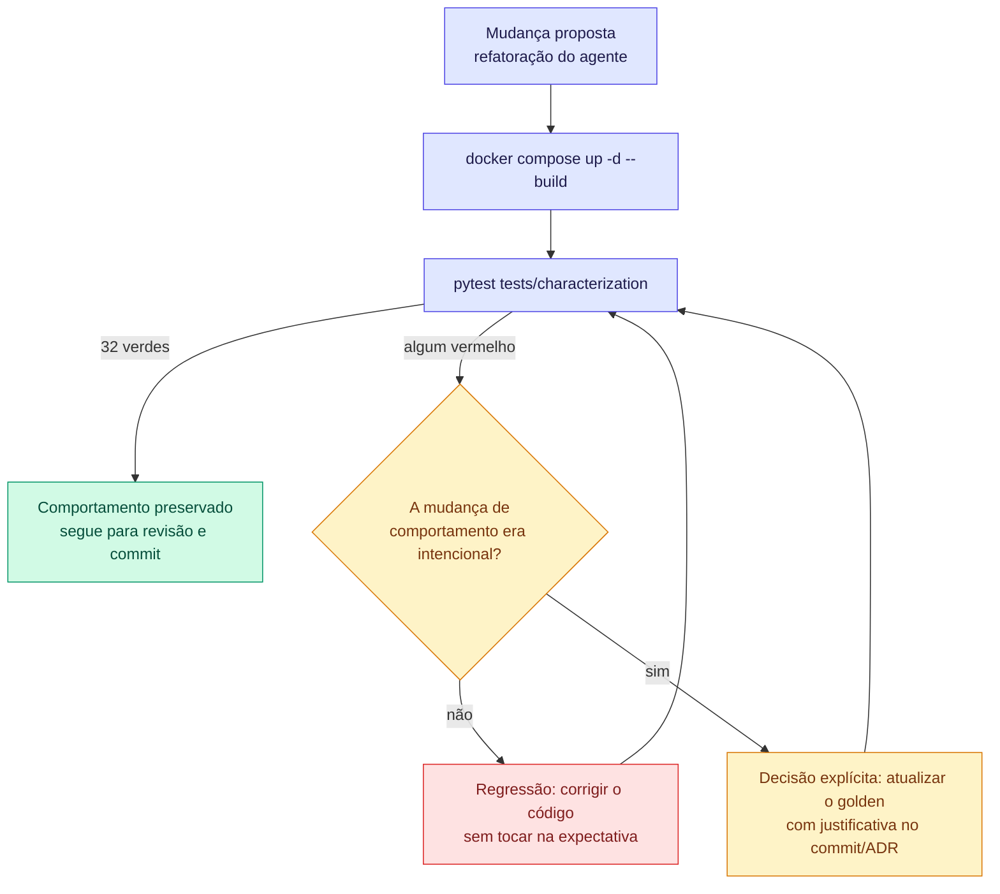
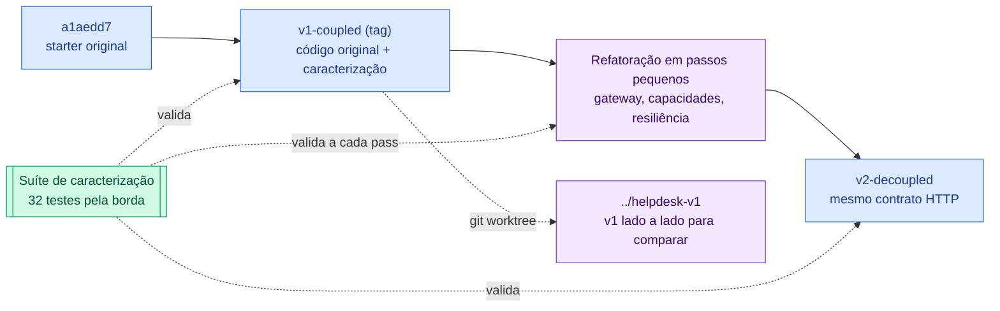

# Caracterização da v1 (`v1-coupled`)

> Rede de segurança do helpdesk acoplado, antes de qualquer refatoração. Os testes registram o que a v1 **faz hoje**, e não o que ela deveria fazer.

## 1. Como a suíte foi construída

- **Alvo real:** todas as chamadas passam pela borda `http://localhost:8000` (nginx → app → provider-fake). Não há mocks nem `TestClient`.
- **Expectativas observadas:** em 25/11/2026 cada cenário foi chamado pela borda com o provider em modo `normal`, e as respostas foram gravadas. Os valores curtos estão inline no `parametrize`; a F2 (texto integral) e a F3 (relatório de um dia) estão em golden masters JSON gerados mecanicamente da captura, sem edição manual. Nenhuma expectativa é calculada durante o teste.
- **Asserções exatas:** status e corpo inteiro (`resp.json() == esperado`), inclusive os corpos de erro 422 do FastAPI/Pydantic.
- **Fora do escopo de propósito:** a suíte não verifica qual modelo ou provider físico foi chamado nem quantas chamadas foram feitas. Isso é detalhe de implementação, e a v2 vai mudar exatamente isso.
- **Isolamento:** um fixture de sessão confere o `/health` e faz `POST /admin/reset` no provider, que volta ao modo `normal`. Cada teste envia a sua própria requisição e não depende do estado deixado por outro.

```
tests/
├── requirements.txt              pytest, httpx
└── characterization/
    ├── conftest.py               URLs, pré-condições, cliente, golden loader
    ├── test_classification.py    F1  13 testes
    ├── test_reply_suggestion.py  F2   4 testes
    ├── test_topics_report.py     F3   6 testes
    ├── test_extraction.py        F4   9 testes
    └── expected/
        ├── reply_suggestion_TK-00042.json
        ├── reply_suggestion_TK-00100.json
        └── topics_2026-08-01.json
```

## 2. Matriz de cobertura

| Feature | Endpoint | Sucesso | Erro de entrada | O que fica travado |
|---|---|---|---|---|
| F1 Classificação | `POST /tickets/classification` | 9 casos: as 5 categorias e as 3 prioridades (`low` em 1 caso) | 4: corpo vazio, `ticket_id` vazio, `text` vazio, `text` numérico | `ticket_id` ecoado, `category`, `priority`, formato exato do 422 |
| F2 Sugestão | `POST /tickets/reply-suggestion` | 2 textos integrais (entrega, pagamento), ~16 s cada | 2: sem `text`, `ticket_id` vazio | Texto inteiro, caractere a caractere |
| F3 Relatório | `POST /reports/topics` | 1 dia (137 tickets, 15 tópicos, ~10 s) e período vazio (setembro) | 4: início > fim, sem `end`, mês 13, formato `dd/mm/aaaa` | `total_tickets`, ordem, `count` e `examples` de cada tópico; 422 de regra de negócio e de parsing |
| F4 Extração | `POST /tickets/extraction` | 7 casos: pedido+produto, só pedido, só produto, nada, sem `#`, 7 dígitos, dois pedidos | 2: sem `ticket_id`, `text` vazio | `order_number` (`#dddddd` ou `null`), `product` (texto ou `null`) |
| **Total** | | **21** | **11** (+ 0 de 502) | **32 testes** |

### Comportamentos discutíveis caracterizados como estão

| Caso | Resposta atual | Por que fica assim |
|---|---|---|
| F1 "Não é urgente, só queria saber..." | `other` / **`high`** | A palavra "urgente" vence a negação |
| F4 "pedido 481516" (sem `#`) | `#481516` | O modelo normaliza o número |
| F4 dois pedidos (#112233 e #445566) | `#112233` + "cafeteira elétrica" | Pega o primeiro pedido, embora a cafeteira seja do segundo (incorreção silenciosa já vista no Passo 03) |

Corrigir esses casos é decisão de produto para depois. Se alguém mudar o comportamento, o teste falha e a mudança precisa ser explícita.

### Lacunas conhecidas (não cobertas)

| Lacuna | Motivo |
|---|---|
| 502 "Classificação fora dos valores permitidos" e 502 "Número de pedido em formato inválido" | O provider determinístico em modo `normal` nunca produz esses valores; só aparecem com injeção de falha (passo futuro) |
| F3 com mais de 150 tickets (vários lotes) e o mês inteiro (504 na borda) | Mais de 30 s; a dor já está documentada no diagnóstico e não é comportamento a preservar |
| Falhas do provider (500, 429, timeout, lento, erro no stream) | É o tema dos próximos passos (resiliência); hoje viram 500/504 sem contrato definido |
| Sensibilidade à codificação | Texto com mojibake muda a classificação e a extração; a suíte envia sempre UTF-8 correto via `httpx` (`json=`) |

## 3. Evidências

### Integridade do código original

| Verificação | Resultado |
|---|---|
| `git diff --stat a1aedd7 -- app provider-fake edge data` | vazio |
| `git diff --stat upstream/main -- app provider-fake edge data` | vazio (`upstream/main` = `a1aedd7`) |
| `git status --short` | `?? tests/` (e, depois deste passo, README e docs) |
| Arquivos gerados pela execução no repo | nenhum (`PYTHONDONTWRITEBYTECODE=1`, `-p no:cacheprovider`) |

### Execuções (Python 3.12.16, pytest 9.2.0, via `python:3.12-slim`)

| Execução | Resultado | Tempo pytest |
|---|---|---|
| Suíte completa, rodada 1 | 32 passed | 59,90 s |
| Suíte completa, rodada 2 | 32 passed | 59,94 s |
| Só `test_extraction.py` | 9 passed | 7,98 s |
| Arquivos em ordem inversa | 32 passed | 59,90 s |
| Um único nó (`duvida-simples-low`) | 1 passed | 1,19 s |

As durações de cada teste variaram no máximo ±0,01 s entre as rodadas. Os mais lentos são F2 TK-00100 (16,03 s), F2 TK-00042 (15,96 s) e F3 de um dia (9,85 s), todos abaixo dos 30 s da borda.

### Detecção de regressão (mutação das expectativas numa cópia fora do repo)

| # | Mutação | Teste que falhou |
|---|---|---|
| 1 | F1 `entrega-urgente`: `high` → `medium` | `test_classifica_ticket[entrega-urgente]` |
| 2 | F2 golden: "Olá!" → "Oi!" | `test_sugere_resposta_com_texto_integral[reply_suggestion_TK-00042]` |
| 3 | F3 golden: "Problema no rastreio" 20 → 21 | `test_relatorio_de_um_dia` |
| 4 | F4: "aspirador robô" → "aspirador" | `test_extrai_dados_do_pedido[protocolo-nao-e-pedido]` |
| 5 | F3 422: mensagem sem a última palavra | `test_rejeita_periodo_invalido[inicio-depois-do-fim]` |

Resultado: `5 failed, 27 passed`. Falharam exatamente as 5 mutações e nenhum outro teste. A cópia foi apagada depois, e o `app/` não foi tocado.

### Golden masters

| Arquivo | Bytes | sha256 |
|---|---|---|
| `reply_suggestion_TK-00042.json` | 2.778 | `e96ceb47…e71fa` |
| `reply_suggestion_TK-00100.json` | 2.746 | `b5d478cd…1a1ec1` |
| `topics_2026-08-01.json` | 2.809 | `b41067c3…80ecfa` |

As capturas que repetiram o mesmo cenário (F2 TK-00042 duas vezes, F3 de 01/08 duas vezes) devolveram corpos idênticos, o que confirma o determinismo do provider em modo `normal`.

## 4. Ciclo de validação de um agente (ou de qualquer pessoa)



A regra central: **o agente nunca ajusta uma expectativa para fazer o teste passar**. Atualizar um golden é uma decisão humana, registrada.

## 5. Evolução v1 → v2



Como os testes só conhecem o contrato HTTP (e não o modelo, o provider ou a quantidade de chamadas), a mesma suíte vale para a v1 e para a v2. Se a v2 passar, ela preserva o comportamento observável da v1.

## 6. Glossário

| Termo | Definição | Neste projeto |
|---|---|---|
| Teste de caracterização | Teste que registra o comportamento atual de um sistema legado, certo ou errado, antes de mudá-lo (Michael Feathers) | Os 32 testes; o caso "Não é urgente" → `high` é um exemplo |
| Regressão | Mudança não intencional de um comportamento que funcionava | O que os 5 mutantes simularam |
| Contrato | O que um consumidor pode esperar de uma interface: rotas, campos, tipos, códigos e erros | Corpo e status de cada endpoint pela borda |
| Golden Master | Saída de referência gravada de uma execução real e comparada integralmente nas próximas | `expected/*.json` (F2 e F3) |
| Safety Net (rede de segurança) | Conjunto de testes que permite refatorar com confiança, porque avisa quando algo quebra | A suíte inteira, antes da v2 |
| Test Isolation | Cada teste produz o mesmo resultado sozinho, em qualquer ordem e sem depender de outro | Reset do provider na sessão; rodadas isoladas e em ordem inversa |
| Fixture | Recurso preparado pelo pytest e injetado nos testes (setup e teardown) | `ambiente_pronto`, `client`, `load_golden` |
| Parametrização | Um mesmo teste executado com vários conjuntos de dados | `@pytest.mark.parametrize` nos casos de F1 e F4 e nos erros |
| AAA | Arrange, Act, Assert: preparar os dados, executar e verificar | Comentários `# Arrange / # Act / # Assert` |
| Teste determinístico | Mesmo input, mesmo resultado, sempre | Garantido pelo provider-fake em modo `normal` (corpos idênticos nas capturas repetidas) |
| Flaky | Teste que às vezes passa e às vezes falha sem mudança no código | Evitado: sem relógio, sem aleatoriedade, sem limites de tempo apertados (timeout de 60 s contra 30 s da borda) |
| Refatoração | Mudar a estrutura interna sem mudar o comportamento observável | A transição para a v2; a suíte é o critério de "sem mudar" |
| Git Tag | Nome fixo para um commit; a anotada guarda autor, data e mensagem | `v1-coupled` |
| Git Worktree | Segunda cópia de trabalho do mesmo repositório em outro diretório, num commit diferente | `../helpdesk-v1` para comparar v1 e v2 lado a lado |
