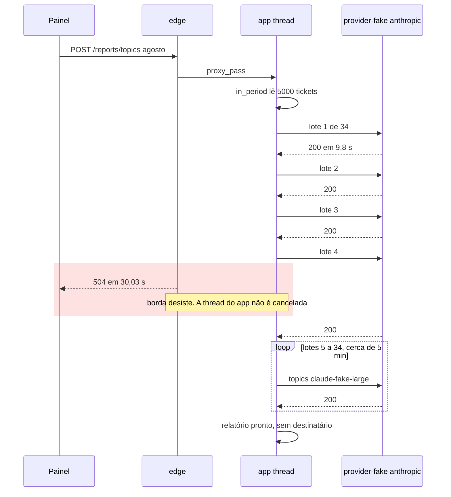
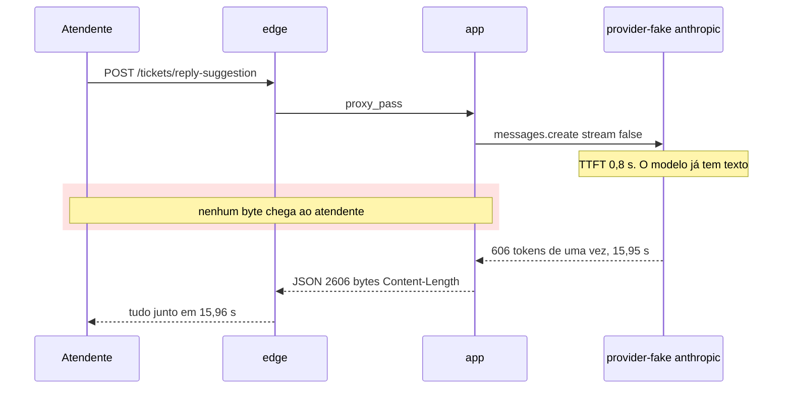
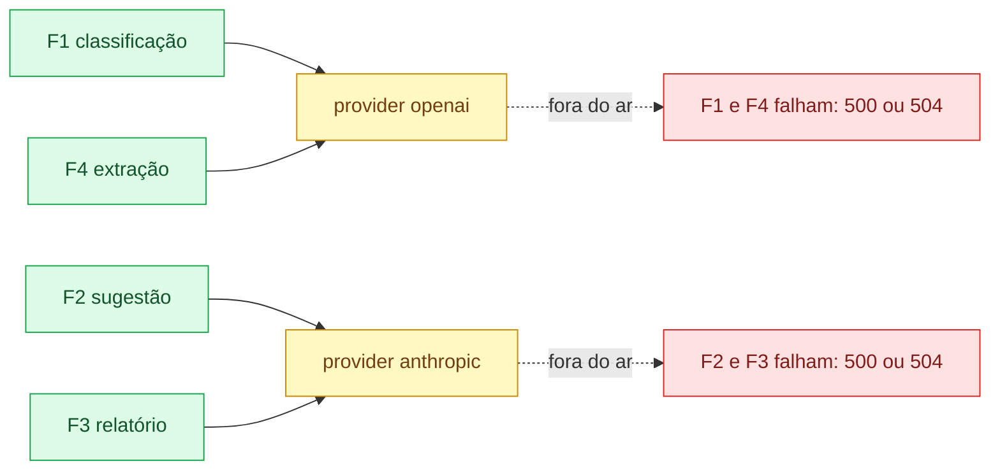
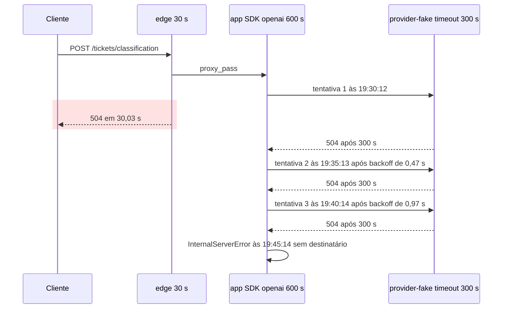
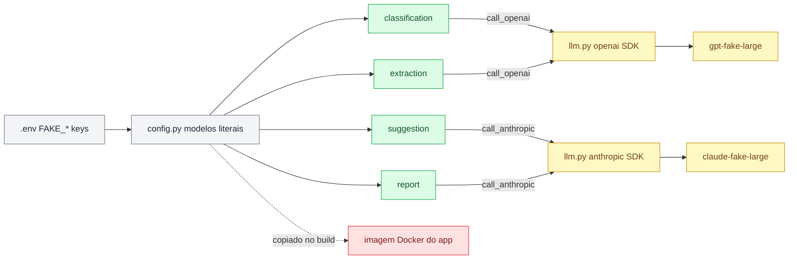

# 🩺 Passo 02: Diagnóstico da arquitetura atual (v1)

Este relatório complementa a seção **Diagnóstico da v1** do README. Ele registra o protocolo dos experimentos, os conceitos por trás de cada dor, os diagramas do comportamento observado, a matriz de diagnóstico, a baseline operacional para comparar com as próximas versões, as limitações das medições e as hipóteses de evolução. Todos os números vêm de experimentos executados em 24/11/2026, entre 19:10 e 19:58 UTC, sobre o commit `a1aedd7`.

> **Legenda de cores:** 🟦 Entrada (cliente, borda) · 🟩 Aplicação · 🟨 Provider/SDK · 🟥 Falha ou desperdício · ⬜ Configuração

## Sumário

1. [Protocolo de experimentação](#1-protocolo-de-experimentação)
2. [Experimento 01: relatório mensal](#2-experimento-01-relatório-mensal-f3)
3. [Experimento 02: latência percebida](#3-experimento-02-latência-percebida-f2)
4. [Experimento 03: indisponibilidade dos providers](#4-experimento-03-indisponibilidade-dos-providers)
5. [Experimento 04: acoplamento aos modelos físicos](#5-experimento-04-acoplamento-aos-modelos-físicos)
6. [Matriz de diagnóstico](#6-matriz-de-diagnóstico)
7. [Atributos de qualidade comprometidos](#7-atributos-de-qualidade-comprometidos)
8. [Baseline operacional da v1](#8-baseline-operacional-da-v1)
9. [Limitações dos experimentos](#9-limitações-dos-experimentos)
10. [Hipóteses de evolução](#10-hipóteses-de-evolução-não-decididas)
11. [Glossário](#11-glossário)

---

## 1. Protocolo de experimentação

### 1.1 Ferramentas

| Ferramenta | Para que serve neste diagnóstico |
|---|---|
| `curl` | executa a feature pela borda, do mesmo jeito que o consumidor real |
| `curl -w` | mede: `%{time_starttransfer}` (TTFB, primeiro byte), `%{time_total}`, `%{http_code}`, `%{size_download}` |
| `curl -N` | desliga o buffer de saída do curl; com `-v --trace-time`, mostra **quando** headers e corpo chegam |
| `docker compose logs <svc> --since` | timeout da borda (`upstream timed out`), tracebacks dos SDKs, linhas de acesso do uvicorn |
| `GET /admin/calls?last=N` | prova do lado do provider: provider, modelo, tarefa, `stream`, status, tokens, duração; uma linha por **tentativa** |
| `POST /admin/failures` / `GET /admin/failures` | liga e confere modos de falha por provider ou por modelo |
| `POST /admin/reset` | volta tudo a `normal` e **limpa** o registro de chamadas |

### 1.2 Passos de cada experimento

1. `POST /admin/reset`, depois `GET /admin/failures` (tudo `normal`) e `GET /admin/calls` (`[]`).
2. Anotar o horário UTC (`t0`) e executar a requisição pela borda com `curl -w`.
3. Anotar o horário de retorno (`t1`), o status e os tempos.
4. Coletar `/admin/calls` e os logs da janela.
5. **Não encerrar** enquanto houver chamada com `duration_ms: null`. Acompanhar até estabilizar, ou reiniciar o `app` e registrar isso.
6. Restaurar com `/admin/reset`.

> [!WARNING]
> **Dois cuidados descobertos durante a execução.** (1) No modo `timeout`, o provider grava `status: 504` **no início** da chamada, antes de esperar os 300 s. Por isso, "em andamento" deve ser identificado por `duration_ms: null`, e não por `status: null`. (2) O `/admin/reset` apaga o registro, inclusive o de chamadas que ainda estão em andamento: só as tentativas seguintes aparecem depois.

---

## 2. Experimento 01: relatório mensal (F3)

### Conceitos
- **Timeout de conexão vs. de leitura:** o primeiro limita o tempo para abrir o socket (`proxy_connect_timeout 5s`); o segundo limita o silêncio entre bytes recebidos (`proxy_read_timeout 30s`).
- **Timeout em cadeia:** numa cadeia cliente → borda → app → SDK → provider, **o menor timeout vence**. Aqui, os 30 s da borda contra os 600 s do SDK.
- **Latência acumulada:** chamadas sequenciais somam as latências: 34 × 9,8 s.
- **Timeout ≠ cancelamento:** o timeout fecha a conexão de quem esperava. O cancelamento interrompe o trabalho de quem processava. A v1 tem o primeiro e não tem o segundo.
- **Desperdício:** tokens consumidos para produzir um resultado que ninguém recebe.

### Comportamento observado

| Evidência | Valor |
|---|---|
| Tickets | 5.000 → 34 lotes (33 × 150 + ~50) |
| Status / tempo | 504 / 30,032 s |
| Chamadas | 34, todas 200, em série |
| Depois do `504` | 30 iniciadas (+1 em andamento), 195.483 / 10.742 tokens, **US$ 0,75** |
| Fim do processamento | cerca de 19:16:34, 5 min depois do `504` |
| Linha de acesso no `app` | nenhuma |

---

## 3. Experimento 02: latência percebida (F2)

### Conceitos
- **TTFT** (*time to first token*): quando o modelo produz o primeiro token. É do provider e vale 0,8 s no `large`.
- **TTFB** (*time to first byte*): quando o **cliente** recebe o primeiro byte. É medido com `curl -w`.
- **Primeiro conteúdo visível:** quando há texto útil para mostrar. Num JSON único, só existe quando o JSON está completo.
- **Throughput de geração:** 40 tokens/s no `large`; a duração total ≈ TTFT + tokens ÷ throughput.
- **Streaming vs. buffering:** o streaming repassa os pedaços à medida que são gerados. O buffering acumula tudo e entrega no fim.

### Comportamento observado

| Métrica | Valor | Quem mede |
|---|---|---|
| TTFT do modelo | 0,809 s | sonda direta no provider com `stream: true` |
| TTFB pela borda | 15,956 s (média de 5) | `curl -w` |
| Primeiro conteúdo visível | 15,963 s | sonda de chunks pela borda |
| Tempo total | 15,956 s | `curl -w` |
| Tokens de saída | 606 | `/admin/calls` |
| Streaming na chamada | `stream: false` | `/admin/calls` |

---

## 4. Experimento 03: indisponibilidade dos providers

### Conceitos
- **Disponibilidade e resiliência:** a disponibilidade é estar no ar; a resiliência é continuar servindo (ou falhar de forma controlada) quando uma dependência falha.
- **SPOF e raio de impacto:** cada provider é um ponto único de falha para as features ligadas a ele.
- **Falha transitória vs. persistente:** `429` e um `500` pontual tendem a passar; um provider fora por minutos não passa com retry.
- **Retry, backoff e amplificação:** o retry ajuda na falha transitória e multiplica a carga na persistente. O backoff espaça as tentativas.
- **Fallback:** um destino alternativo equivalente. **Não existe na v1.**
- **Falha em cascata:** threads presas por 15 min em requisições órfãs reduzem a capacidade para as demais. Isto é hipótese e não foi medido.

### Raio de impacto

### Provider travado: a cadeia de timeouts (F1, openai em `timeout`)

### Matriz de impacto

| Feature | Provider | Modo | Status | Tempo | Tentativas | Impacto |
|---|---|---|---|---|---|---|
| F1 | openai | error_500 | 500 | 1,30 s | 3 | 🟥 indisponível |
| F4 | openai | error_500 | 500 | 1,18 s | 3 | 🟥 indisponível |
| F2 / F3 | openai | error_500 | 200 | 15,96 / 9,84 s | 1 | ✅ sem efeito |
| F2 | anthropic | error_500 | 500 | 1,28 s | 3 | 🟥 indisponível |
| F3 | anthropic | error_500 | 500 | 1,51 s | 3 | 🟥 indisponível |
| F1 / F4 | anthropic | error_500 | 200 | 1,08 s | 1 | ✅ sem efeito |
| F1 / F4 | openai | error_429 | 500 | 4,01 s | 3 (intervalos de 2 s) | 🟥 429 vira 500 para o cliente |
| F2 / F3 | anthropic | error_429 | 500 | 4,01 / 4,05 s | 3 (intervalos de 2 s) | 🟥 429 vira 500 |
| F1 / F4 | openai | slow | 200 | 10,76 s | 1 | ⚠️ 10× mais lento, mas abaixo de 30 s |
| F2 | anthropic | slow | 504 | 30,03 s | 1 | 🟥 órfã por 159,5 s |
| F3 (1 dia) | anthropic | slow | 504 | 30,03 s | 1 | 🟥 órfã por 98,0 s |
| F1 | openai | timeout | 504 | 30,03 s | 3 × 300 s | 🟥 thread presa cerca de 15 min |
| F2 | anthropic | timeout | 504 | 30,03 s | ≥ 2 × 300 s | 🟥 interrompida pelo restart do `app` |

### Política documentada vs. observada

| Item | Lido no SDK | Observado |
|---|---|---|
| Tentativas | 1 + 2 retries | ✅ 3 tentativas em 500, 429 e timeout do provider (504) |
| Backoff exponencial | 0,5 s, depois 1 s, com jitter de até 25% | ✅ intervalos de 0,39–0,50 s e 0,79–0,98 s |
| `Retry-After` | respeitado | ✅ intervalos de 2,00 s com `Retry-After: 2` |
| Timeout de leitura | 600 s | ⚪ não atingido (o fake devolve 504 em 300 s) |
| Timeout do cliente no anthropic | não retenta | ⚪ só leitura de código |

---

## 5. Experimento 04: acoplamento aos modelos físicos

### Conceitos
- **Acoplamento tecnológico e dependência concreta:** a feature conhece o fornecedor, o SDK e o nome do modelo.
- **Vendor lock-in:** trocar de fornecedor exige reescrever o código de integração.
- **Separação de responsabilidades e DIP:** a feature deveria pedir uma *capacidade*. Qual modelo atende essa capacidade é decisão de infraestrutura.
- **Configuração vs. implementação:** o que muda por decisão operacional deveria ser configuração, sem rebuild.

### Mapa de acoplamento

| Evidência | Valor |
|---|---|
| Antes | `gpt-fake-large`, 1.076 ms |
| Só `restart` | continua `gpt-fake-large` |
| Rebuild | 7,27 s, com um `502` na borda |
| Depois | `gpt-fake-mini`, 374 ms |
| Reversão | `git checkout` + rebuild (6,01 s, outro `502`); volta a `gpt-fake-large`; `git status` limpo |

---

## 6. Matriz de diagnóstico

| Problema | Sintoma | Evidência | Causa imediata | Causa raiz arquitetural | Impacto técnico | Impacto no negócio |
|---|---|---|---|---|---|---|
| Relatório mensal | 504 em 30 s | edge log; 34 chamadas, 30 depois do corte | 34 lotes em série ≈ 5,4 min | execução síncrona para uma tarefa longa, sem estado nem cancelamento | thread ocupada por minutos; trabalho órfão | relatório nunca entregue; US$ 0,75 de 0,85 desperdiçados por pedido |
| Sugestão de resposta | 16 s de tela vazia | TTFB = total = 15,96 s; `stream: false` | `messages.create` sem stream | contrato síncrono de JSON único para saída longa | conexão presa por toda a geração | atendente ocioso; risco de 504 com textos maiores |
| Indisponibilidade | 500/504 em metade das features | matriz de impacto; 3 tentativas; 15 min órfã | exceção do SDK sem tratamento | feature presa a um provider; política de resiliência delegada aos padrões dos SDKs | amplificação ×3; threads presas | metade do helpdesk parado por falha de um fornecedor |
| Troca de modelo | restart não muda o modelo | `/admin/calls` antes e depois do rebuild | literal em `config.py` | decisão de infraestrutura codificada na aplicação | rebuild + recriação, com 502 | toda troca de custo ou modelo passa por desenvolvimento e deploy |

---

## 7. Atributos de qualidade comprometidos

| Atributo | Dor 1 | Dor 2 | Dor 3 | Dor 4 |
|---|---|---|---|---|
| Performance | 🟥 | 🟥 | 🟥 | |
| Disponibilidade | 🟥 | | 🟥 | ⚠️ (502 no deploy) |
| Resiliência | 🟥 | | 🟥 | |
| Manutenibilidade | | | ⚠️ | 🟥 |
| Modificabilidade | | | 🟥 | 🟥 |
| Usabilidade | 🟥 | 🟥 | 🟥 | |
| Eficiência de custos | 🟥 | | 🟥 (×3 tentativas) | 🟥 (impede trocar por modelo mais barato) |

---

## 8. Baseline operacional da v1

Condições: provider em `normal`, salvo indicação; chamadas pela borda; commit `a1aedd7`; 24/11/2026.

| Indicador | Feature | Resultado da v1 |
|---|---|---|
| Tempo total de resposta | F1 | 1,08 s (de 1,080 a 1,106 s) |
| Tempo até o primeiro conteúdo | F2 | 15,96 s |
| Tempo total de resposta | F2 | 15,956 s (média de 5) |
| Tempo até o timeout | F3 (mês) | 30,03 s → 504 |
| Chamadas após o timeout | F3 (mês) | 30 (+1 em andamento), de 34 |
| Tokens desperdiçados | F3 (mês) | 195.483 de entrada + 10.742 de saída |
| Custo estimado após o timeout | F3 (mês) | US$ 0,75 (preços do provider simulado) |
| Tempo total de resposta | F3 (1 dia) | 9,84 s |
| Tempo total de resposta | F4 | 1,08 s |
| Tentativas sob falha | todas | 3 (1 + 2 retries do SDK) em 500, 429 e timeout |
| Tempo sob `error_500` | F1/F4 · F2/F3 | 1,18–1,30 s · 1,28–1,51 s → 500 |
| Tempo sob `error_429` | todas do provider | 4,0 s → 500 |
| Tempo sob `timeout` | F1, F2 | 30,03 s → 504 (trabalho segue por até ~15 min) |
| Tempo sob `slow` | F1/F4 · F2/F3 | 10,76 s → 200 · 30,03 s → 504 |
| Features afetadas por provider | openai · anthropic | F1, F4 · F2, F3 |
| Alterações para trocar um modelo | aplicação | 1 linha de código + rebuild da imagem + recriação do `app` (cerca de 6–7 s, com 502) |

---

## 9. Limitações dos experimentos

- Os custos são **estimados** com os preços declarados pelo provider simulado. Não há cobrança real.
- O efeito das threads presas sobre outras requisições (esgotamento do pool) **não foi medido**.
- No `anthropic timeout`, o experimento foi interrompido na 2ª tentativa com `docker compose restart app`. A 3ª tentativa é inferida pelo SDK, não observada.
- A diferença de retry em timeout do lado do cliente entre os SDKs foi **lida no código**, não provocada.
- No `error_500`, a duração registrada de cada tentativa é 0 ms, o que é próprio do simulador.
- O `docker compose up --build app` também reconstruiu (do cache) a imagem do `provider-fake`. O container dele não foi recriado e o código não mudou, mas o `docker compose ps` passou a mostrar um ID de imagem.
- Cada medição foi feita uma vez, exceto a F2 (5 vezes). O simulador é determinístico, então a variação esperada é mínima.

---

## 10. Hipóteses de evolução (não decididas)

| Dor | Direção a investigar nos próximos passos |
|---|---|
| Relatório mensal | modo assíncrono (aceitar e consultar o estado depois), com estado da tarefa e limite de tempo |
| Sugestão | streaming ponta a ponta, sem buffer na cadeia |
| Indisponibilidade | timeout explícito menor que 30 s, retry limitado com backoff num único lugar, fallback para um modelo equivalente no outro provider |
| Troca de modelo | nomes lógicos de capacidade, com o mapeamento para modelo físico e as credenciais num AI Gateway |

---

## 11. Glossário

| Conceito | Onde apareceu na v1 |
|---|---|
| Timeout de leitura | `proxy_read_timeout 30s` gerou o 504 da F3 |
| Timeout em cadeia | borda 30 s < provider 300 s < SDK 600 s: vence a borda |
| Cancelamento | ausente: 30 lotes rodaram depois do 504 |
| Latência acumulada | 34 × 9,8 s ≈ 5,4 min |
| Processamento em lotes | 150 tickets por chamada por causa da janela de 8k |
| TTFT | 0,81 s no provider |
| TTFB | 15,96 s na borda (F2) |
| Throughput | 40 tokens/s → 606 tokens em ~15,2 s |
| Buffering | o `app` acumula o texto inteiro antes de responder |
| SPOF / raio de impacto | um provider derruba 2 das 4 features |
| Retry e backoff | 3 tentativas; 0,5 s → 1 s; 2 s com `Retry-After` |
| Amplificação de retry | 3 chamadas por requisição a um provider já com falha |
| Fallback | inexistente: nenhum destino alternativo |
| Trabalho órfão | F1 em timeout segurou uma thread por ~15 min após o 504 |
| Vendor lock-in | `call_openai` / `call_anthropic` escolhidos no código da feature |
| Configuração vs. implementação | trocar o modelo exigiu rebuild, não só reinício |
