# Passo 13: execução síncrona de F1 e F4

Este relatório responde à pergunta do passo: **quando uma feature com IA deve ser síncrona, e como provar que essa escolha cumpre os requisitos de experiência e confiabilidade?** Ele cobre a fundamentação (padrões de comunicação, acoplamento temporal, event loop, FastAPI), a decisão por feature (árvore e ADR 0011), as medições reais pela borda em 13 cenários e a única correção de código que os experimentos justificaram: o contrato de saída de F1 e F4.

> **Legenda de cores dos diagramas:** 🟦 Consumidor, borda e app · ⬜ Gateway · 🟩 Provider e sucesso · 🟥 Falha ou recusa · 🟨 Decisão e tempo

**Conclusão curta.** F1 e F4 **já eram** síncronas e continuam assim, agora como decisão registrada ([ADR 0011](../adr/0011-execution-modes.md)). A F1 entrega em 1,06–1,16 s (requisito: 3 s); com o primário travado, F1 e F4 respondem com sucesso em 4,1 e 4,25 s; no pior caso, erro explícito em 8,05 s (F1), 6,05 s (F4) ou 14,02 s com o gateway congelado (requisito: 15 s). Nenhum `504` da borda. Rotas, contratos, timeouts e políticas não mudaram; o que mudou foi que saída do modelo fora do contrato deixou de virar `500` ou um `200` fictício.

## Sumário

1. [Mapa das subetapas](#1-mapa-das-subetapas)
2. [Contexto recuperado (4.1)](#2-contexto-recuperado-41)
3. [Padrões de comunicação (4.2)](#3-padrões-de-comunicação-42)
4. [Request-Response (4.3)](#4-request-response-43)
5. [Acoplamento temporal (4.4)](#5-acoplamento-temporal-44)
6. [Síncrono não é bloqueante (4.5)](#6-síncrono-não-é-bloqueante-45)
7. [Concorrência e paralelismo (4.6)](#7-concorrência-e-paralelismo-46)
8. [FastAPI: `def` e `async def` (4.7)](#8-fastapi-def-e-async-def-47)
9. [Árvore de decisão (4.8)](#9-árvore-de-decisão-48)
10. [Decisão da F1 (4.9)](#10-decisão-da-f1-49)
11. [Decisão da F4 (4.10)](#11-decisão-da-f4-410)
12. [Baseline (4.11)](#12-baseline-411)
13. [Métricas de latência (4.12)](#13-métricas-de-latência-412)
14. [Orçamento de latência (4.13)](#14-orçamento-de-latência-413)
15. [Fluxos e dependências (4.14)](#15-fluxos-e-dependências-414)
16. [Revisão da F1 e da F4 (4.15, 4.16)](#16-revisão-da-f1-e-da-f4-415-416)
17. [Saídas estruturadas (4.17)](#17-saídas-estruturadas-417)
18. [Contratos de F1 e F4 (4.18, 4.19)](#18-contratos-de-f1-e-f4-418-419)
19. [Erros HTTP (4.20)](#19-erros-http-420)
20. [Resiliência na F1 e na F4 (4.21, 4.22)](#20-resiliência-na-f1-e-na-f4-421-422)
21. [Governança (4.23)](#21-governança-423)
22. [Handoff e correção (4.24)](#22-handoff-e-correção-424)
23. [Experimentos 01 a 10 (4.25 a 4.34)](#23-experimentos-01-a-10-425-a-434)
24. [Concorrência (4.35)](#24-concorrência-435)
25. [Consolidação das latências (4.36)](#25-consolidação-das-latências-436)
26. [Testes (4.37 a 4.39)](#26-testes-437-a-439)
27. [Revisão arquitetural e métricas (4.40)](#27-revisão-arquitetural-e-métricas-440)
28. [ADR, README, integridade e versionamento (4.41 a 4.44)](#28-adr-readme-integridade-e-versionamento-441-a-444)
29. [Preparação para o Passo 14 (4.45)](#29-preparação-para-o-passo-14-445)
30. [Limitações](#30-limitações)
31. [Perguntas de fixação](#31-perguntas-de-fixação)

## 1. Mapa das subetapas

| Bloco | Subetapas | Saída |
|---|---|---|
| Recuperar | 4.1 | matriz de artefatos, ambiente confirmado |
| Fundamentar | 4.2 a 4.7 | padrões, acoplamento temporal, bloqueio × Async I/O, concorrência, FastAPI (com experimento próprio) |
| Decidir | 4.8 a 4.10 | árvore, matriz e decisões de F1 e F4 |
| Medir antes de mexer | 4.11 a 4.14 | baseline, métricas de latência, orçamento, diagramas |
| Revisar | 4.15 a 4.23 | código, contratos, erros, resiliência, governança; 6 problemas comprovados |
| Corrigir | 4.24 | handoff, plano revisado, correção em 2 arquivos |
| Experimentar | 4.25 a 4.36 | 13 evidências JSON/TXT, tabela consolidada |
| Testar e registrar | 4.37 a 4.45 | `tests/execution` (57), ADR 0011, README, integridade, checkpoint |

Execução contínua, como nos Passos 10 a 12: as perguntas de fixação estão na seção 31.

## 2. Contexto recuperado (4.1)

| Artefato | Informação relevante | Utilização nesta etapa |
|---|---|---|
| Enunciado e `docs/refactoring-plan.md` | F1: cliente na tela, 3 s; F4: automação sem revisão; 15 s com provider travado | requisitos e critérios |
| Contratos HTTP (`app/helpdesk/schemas.py`, caracterização) | `TicketInput`; `Classification`; `OrderData` com `str \| None` | preservação do comportamento |
| Comparativo de modelos (Passo 03, `provider-fake/README.md`) | `large` 800 ms + 40 tok/s; `mini` 300 ms + 150 tok/s | prever latência de cada feature |
| `ports.py` e `adapters/gateway.py` | `LanguageModel.complete(capability, prompt)`; SDK síncrono `openai` 3.19.0, `max_retries=0`, timeout de leitura = prazo | modelo de execução interno |
| `main.py` | rotas `def`; `MODEL_ERRORS` → `503`/`502` com `code` | contrato de erro |
| `gateway/config.yaml` | timeouts 3/3/2 s (F1), 3/3 s (F4); `model_group_retry_policy`; fallbacks | orçamento de latência |
| `compose.yaml`, `edge/nginx.conf` | app recebe só `GATEWAY_URL` e a chave virtual; borda 30 s | limites e isolamento |
| ADRs 0005, 0006, 0010 | deadline global, mini só F1/F2, recusa antes do router | coerência |
| Testes | caracterização 32, resiliência 34, fallback 40, governança 33 | regressão |
| Métricas | `governance-step-12.csv`, 20 arestas | comparação |

Confirmações (comandos e saídas nas evidências citadas):

| Item | Resultado |
|---|---|
| Tags | `v1-coupled` → `8028305`, `v2-decoupled` → `b637c5a` (anotadas) |
| Partida | `main` limpa em `8227f5a` (Passo 12 commitado pelo usuário) |
| Quatro features | F1 e F4 medidas; F2 e F3 cobertas pela caracterização (seção 26) |
| Só pelo gateway | `grep` sem `gpt-fake`, `claude-fake` nem chaves de provider em `app/` (seção 28) |
| Timeouts, tentativas, fallback | conferidos no YAML e nos experimentos 04 a 10 |
| Governança | experimentos 11 e `tests/execution/test_sync_governance.py` |
| Modo atual | as 4 rotas `def`, síncronas, uma chamada ao gateway por requisição (F3: uma por lote) |

Versões instaladas na app: FastAPI 0.115.6, Starlette 0.41.3, AnyIO 4.16.0 (limitador padrão de **40** threads), uvicorn 0.34.0, Pydantic 2.14.4, `openai` 3.19.0 (sobre `httpx2` 2.16.2, pool de até 1.000 conexões).

## 3. Padrões de comunicação (4.2)

- **Comunicação síncrona:** quem pede espera a resposta antes de seguir. O resultado chega na mesma interação.
- **Comunicação assíncrona:** o pedido e o resultado acontecem em momentos distintos; quem pede pode fazer outra coisa.
- **Request-Response:** a forma síncrona clássica do HTTP: uma requisição, uma resposta completa.
- **Asynchronous Request-Reply:** o servidor aceita o pedido (`202 Accepted` + identificador), processa depois e o cliente consulta ou é avisado (Hohpe e Woolf, *Enterprise Integration Patterns*, "Request-Reply" com "Correlation Identifier").
- **Streaming:** uma resposta só, entregue em partes enquanto é produzida (HTTP chunked, Server-Sent Events).
- **Event-driven Architecture:** produtores publicam fatos ("ticket aberto") e consumidores reagem, sem o produtor saber quem consome.
- **Temporal Coupling:** os dois lados precisam estar disponíveis **ao mesmo tempo**.
- **Spatial Coupling:** um lado precisa saber **onde** está o outro (endereço, nome).
- **Blocking I/O:** a thread fica parada até o I/O terminar.
- **Non-blocking I/O:** a operação volta na hora; o resultado é avisado depois (base do event loop).

| Padrão | Característica principal | Comportamento do consumidor | No helpdesk |
|---|---|---|---|
| Síncrono | resultado completo na resposta | aguarda a conclusão | F1 e F4 (decidido) |
| Streaming | entrega progressiva | consome partes enquanto são produzidas | F2 (hipótese) |
| Assíncrono | pedido e resultado em momentos distintos | pode continuar outras atividades | F3 (hipótese) |

Nenhum é superior: o síncrono é o mais simples, mas prende o cliente; o streaming melhora a percepção de saída longa, mas complica erros depois do primeiro byte; o assíncrono desacopla no tempo, mas exige estado, consulta e ciclo de vida do job. Os critérios (necessidade do consumidor, duração, natureza do resultado, entrega incremental, urgência, consistência, complexidade operacional, tolerância a falhas) viram as três perguntas da seção 9.

## 4. Request-Response (4.3)

O diagrama abaixo é o ciclo de vida de uma F1 real: uma conexão, uma requisição, nenhum estado guardado entre requisições.

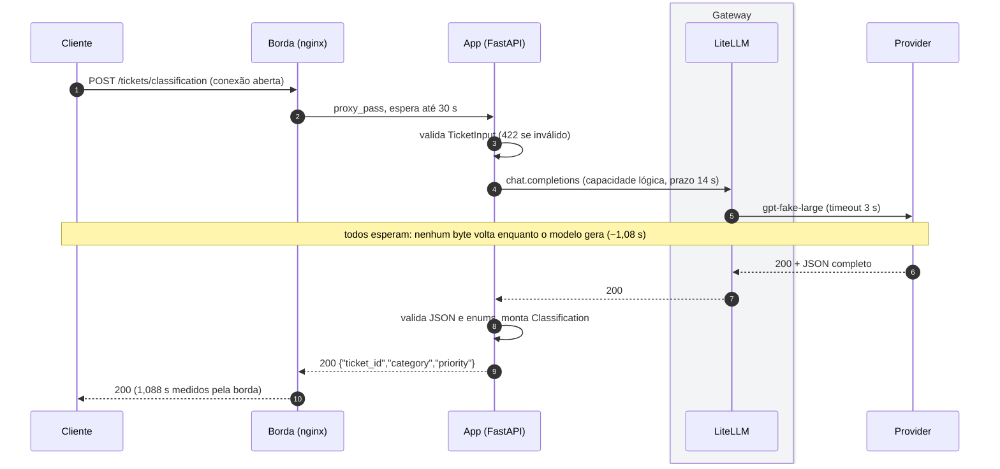

- **Estado da operação:** só existe enquanto a requisição está aberta; se a conexão cai, não há o que consultar depois.
- **Status e corpo:** o status já diz o resultado (`200`, `422`, `502`, `503`); o corpo é o resultado completo ou o erro.
- **Vantagens:** simplicidade, contrato direto, nenhum estado de job, resultado imediato após a conclusão.
- **Limitações:** acoplamento temporal, sensibilidade à latência (o cliente sente cada segundo), conexões longas ocupando recursos, propagação de falhas e limites de proxies (os 30 s da borda) e clientes.

**Por que LLM exige atenção.** Uma chamada a LLM tem latência alta e variável (proporcional aos tokens de saída), falha por motivos externos (cota, sobrecarga) e pode travar sem resposta. Num fluxo síncrono, tudo isso cai direto no tempo que o cliente espera, então o tempo precisa ser **limitado por construção**: timeout por tentativa, tentativas finitas, prazo global.

## 5. Acoplamento temporal (4.4)

O fluxo abaixo marca, em vermelho, o que cada falha na cadeia `Cliente → Borda → App → Gateway → Provider` provoca e quem a encerra.

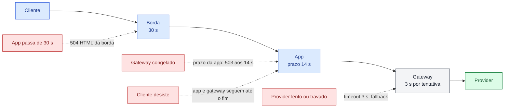

| O que acontece | Quem percebe | Efeito observado ou previsto |
|---|---|---|
| Provider demora | gateway (3 s por tentativa) | migra para o equivalente: F1 4,10 s, F4 4,25 s (experimento 05) |
| Gateway indisponível (congelado) | app (prazo de 14 s) | `503 model_timeout` aos 14,02 s; ao descongelar, o gateway **processa as 2 requisições abandonadas** e o provider as cobra (`13b`) |
| App esgota o prazo | app | erro explícito, gateway pode continuar (trabalho órfão) |
| Cliente encerra a conexão | ninguém para a cadeia | a rota `def` roda até o fim numa thread que não é cancelada (Dor 1, Passo 02) |
| Borda encerra a espera | nginx | `504` HTML; não acontece na F1/F4 porque o prazo da app (14 s) é menor |
| Fallback precisa rodar | gateway | consome o mesmo prazo global; não reinicia |

**Por que o desacoplamento dos Passos 06 a 09 não resolve isso.** Ele tirou da app o conhecimento de providers, modelos e SDKs (acoplamento de código e tecnológico). Mas a requisição síncrona ainda **espera** pelo provider: se ele não responde agora, o cliente não tem resultado agora.

| Tipo de acoplamento | Pergunta | Exemplo no helpdesk | Medido por |
|---|---|---|---|
| De código | o módulo importa o outro? | `classification → ports` | Ca, Ce, I (Passo 05) |
| Tecnológico | depende de um SDK, formato ou fornecedor? | v1: `openai`/`anthropic` dentro das features | parcialmente, via imports |
| Operacional | precisa do outro implantado, configurado, com credencial? | app precisa do gateway e da chave virtual | não |
| Temporal | precisa do outro **vivo agora**? | F1 precisa de gateway e um provider no instante da requisição | não |

Ca, Ce, A, I e D vêm de análise estática de imports: medem dependência entre módulos de código, não quem precisa estar no ar ao mesmo tempo. A medição deste passo saiu idêntica à do Passo 12 (seção 27) e o acoplamento temporal da F1 é o mesmo de antes.

## 6. Síncrono não é bloqueante (4.5)

Um contrato HTTP síncrono pode ser implementado com I/O bloqueante ou com Async I/O. O que muda é **o que fica parado** enquanto o modelo gera.

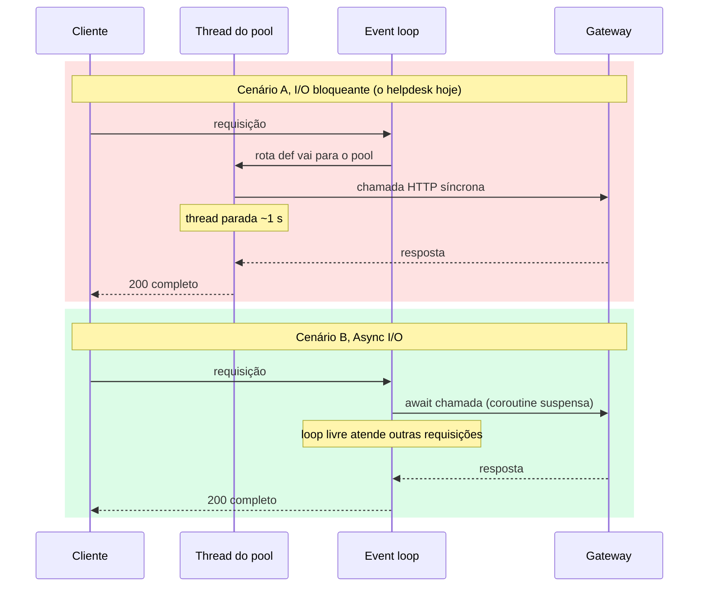

No cenário C (Asynchronous Request-Reply), a resposta inicial seria `202` com um identificador e o resultado viria numa segunda requisição.

| Característica | I/O bloqueante | Async I/O | Asynchronous Request-Reply |
|---|---|---|---|
| Cliente recebe resultado completo na resposta original | sim | sim | não |
| Pode liberar a execução enquanto aguarda I/O | não na thread bloqueada (o loop segue livre) | sim | depende da implementação |
| Necessita gerenciamento de estado do job | não | não | sim |
| Altera o contrato HTTP | não necessariamente | não necessariamente | sim |

**`async def` não é Asynchronous Request-Reply.** `async def` decide como o **servidor** espera (coroutine no event loop em vez de thread). O cliente continua esperando a resposta completa na mesma conexão. Asynchronous Request-Reply é uma decisão de **contrato**: a resposta original termina antes do trabalho. Uma rota `async def` que faz `await gateway()` é Request-Response síncrono com Async I/O, nada mais.

## 7. Concorrência e paralelismo (4.6)

- **Processo:** programa em execução com memória própria (o container `app` roda um processo uvicorn).
- **Thread:** linha de execução dentro do processo, com memória compartilhada; o SO alterna entre elas.
- **Coroutine:** função que pode ser suspensa em `await` e retomada depois, sem thread própria.
- **Task:** coroutine agendada no event loop (`asyncio.create_task`).
- **Concorrência:** lidar com várias tarefas no mesmo período, intercalando (40 F1 esperando o gateway ao mesmo tempo).
- **Paralelismo:** executar várias tarefas no mesmo instante, em núcleos diferentes. No CPython, o GIL impede threads de rodarem bytecode Python em paralelo, mas não impede esperar I/O em paralelo.
- **Context switching:** troca da thread (pelo SO) ou da coroutine (pelo loop) em execução; com threads custa mais.
- **Event loop:** laço que monitora sockets e retoma a coroutine cujo I/O ficou pronto.
- **Thread pool:** conjunto fixo de threads reaproveitadas; o Starlette usa o do AnyIO, com **40** threads.
- **I/O-bound:** passa o tempo esperando rede ou disco. **CPU-bound:** passa o tempo calculando.

| Atividade do helpdesk | Tipo | Tempo observado |
|---|---|---|
| Validar `TicketInput` (Pydantic) | CPU-bound, curta | parte dos 2–43 ms das recusas `422` |
| Montar prompt, `json.loads`, validar enums/regex | CPU-bound, curta | < 1 ms (não isolado; dentro dos ~12 ms de overhead) |
| Esperar o gateway e o modelo | **I/O-bound, depende de serviço externo** | ~1.076 ms dos ~1.088 ms totais |
| Ler `data/tickets.jsonl` (F3) | I/O de disco local | não medido aqui |
| Gerar tokens | CPU/GPU **no provider**, não na app | — |

Para a app, um LLM é rede: ela manda bytes e espera. Por isso a capacidade de atender várias requisições depende de **quantas esperas cabem ao mesmo tempo**: 40 threads no modelo atual, milhares de coroutines com Async I/O. A seção 24 mede isso de leve; otimizar não é o objetivo deste passo.

## 8. FastAPI: `def` e `async def` (4.7)

Comportamento documentado do FastAPI ("Concurrency and async / await"; versão 0.115.6) e do Starlette 0.41.3 (`run_in_threadpool`):

```python
@app.post("/example")
def example():                  # FastAPI chama via run_in_threadpool: roda numa das 40 threads
    return service.execute()    # pode bloquear à vontade; o loop continua livre

@app.post("/example")
async def example():            # roda NO event loop, como coroutine
    return await service.execute()   # await suspende e devolve o loop enquanto espera

@app.post("/example")
async def example():
    return blocking_client.execute()  # bloqueia o PRÓPRIO loop: nenhuma outra requisição anda
```

O experimento [`exemplo_event_loop.py`](exemplo_event_loop.py) roda as três variantes num FastAPI mínimo, com 1 s de "espera de modelo" e N requisições simultâneas (`evidencias/14-exemplo-event-loop.txt`):

| Rota | N = 10: conjunto | `/health` durante | N = 50: conjunto | `/health` durante |
|---|---|---|---|---|
| `def` + `time.sleep` | 1,02 s | 0,005 s | **2,09 s** (40 threads: 2 levas) | 0,006 s |
| `async def` + `time.sleep` | **10,02 s** (uma por vez) | **9,8 s** | **50,06 s** | **49,9 s** |
| `async def` + `await asyncio.sleep` | 1,02 s | 0,005 s | 1,05 s | 0,005 s |

A linha do meio é o erro que este passo evita: trocar `def` por `async def` sem trocar o cliente HTTP **pioraria** o helpdesk inteiro, porque o SDK atual é síncrono.

**No código real.** `main.py` declara as quatro rotas com `def`; o adapter usa `openai.OpenAI` (cliente síncrono). Isso é o cenário A: correto (nada bloqueia o loop) e suficiente para os requisitos. Converter para `async def` + `AsyncOpenAI` não muda contrato nem latência individual; só aumentaria o teto de concorrência, que não é requisito (seção 24). Decisão: **preservar**.

## 9. Árvore de decisão (4.8)

A árvore está no [ADR 0011](../adr/0011-execution-modes.md#árvore-de-decisão). Matriz inicial confrontada com os contratos:

| Feature | Alguém está esperando? | Resultado consumível aos poucos? | Modo candidato | Confronto com o contrato real |
|---|---|---|---|---|
| F1 classificação | sim, o cliente | não é útil fragmentar | síncrono | saída de ~11 tokens, 2 enums: confirma |
| F2 sugestão | sim, o atendente | sim | streaming | texto livre de ~600 tokens, `{"ticket_id","suggestion"}`: hipótese |
| F3 relatório | não | não é necessário | assíncrono | agregado de todos os lotes: hipótese |
| F4 extração | consumidor automatizado | não é útil fragmentar | síncrono | par pedido + produto, ~11–17 tokens: confirma |

## 10. Decisão da F1 (4.9)

| Aspecto | Análise |
|---|---|
| Resposta imediata | o cliente espera a confirmação na tela da abertura |
| Tamanho do resultado | 3 campos; ~11 tokens de saída, 19 de entrada (`/admin/calls`) |
| Tempo esperado | 0,8 s (1º token) + 11/40 s ≈ 1,08 s; medido 1,062–1,163 s |
| Entrega progressiva | inútil: meio JSON não classifica nada |
| Indisponibilidade | erro explícito em segundos; o produto decide abrir o ticket sem classificação |
| Classificação errada | prioridade baixa num ticket urgente atrasa atendimento; por isso o mini só foi aceito com 1.000/1.000 iguais (ADR 0006) |
| Custo de ficar assíncrono | `202`, recurso de status, polling na tela, persistência do job, para economizar nada |

| Alternativa | Benefício | Limitação |
|---|---|---|
| **Síncrono** ✅ | resultado direto e imediato, contrato da v1 | depende da latência e da disponibilidade no instante |
| Streaming | entrega progressiva | nada útil para entregar antes do fim |
| Assíncrono | desacoplamento temporal | estado e etapas extras para um resultado de 1 s |

Requisito: completo em até **3 s** em modo normal e sucesso ou erro explícito em até **15 s** com o provider travado, medidos em `http://localhost:8000`.

## 11. Decisão da F4 (4.10)

| Pergunta | Resposta |
|---|---|
| A automação usa só parte da extração? | não: trocar um item exige saber pedido **e** produto (ou saber que um deles não foi citado) |
| Benefício em mandar o pedido antes do produto? | nenhum: a geração inteira leva ~1,1 s e a automação teria de juntar as partes |
| O assíncrono resolve um problema demonstrado? | não: o pior caso medido (6,05 s) cabe no prazo; não há volume nem prazo que peça fila |
| Resposta errada pode ser pior que falha explícita? | sim: troca indevida, frete, estoque. Uma falha a automação pode reprocessar; um dado errado ela executa |

Não há humano na tela: a escolha do síncrono vem do **contrato curto**, da **necessidade do resultado completo** e da **simplicidade de integração**. O enunciado não fixa 3 s para a F4 e **não criamos objetivo interno** de latência; o requisito obrigatório é o de 15 s sob travamento. O cuidado da F4 é de **correção**, não de velocidade: nenhum mini (ADR 0006) e nenhum `null` fictício (seção 18).

## 12. Baseline (4.11)

App recém-reiniciada (`docker compose restart app`), provider resetado, `evidencias/01-baseline.json` e `00-curl-baseline.txt`:

| Feature | Status | TTFB | Tempo total | Chamadas | Modelo | Tokens in/out | Custo (preço do gateway) |
|---|---|---|---|---|---|---|---|
| F1 (1ª após o início) | 200 | 1,116 s | 1,116 s | 1 | `gpt-fake-large` | 19 / 11 | US$ 0,0001575 |
| F1 (5 seguintes) | 200 | 1,087–1,089 s | 1,087–1,089 s | 1 cada | `gpt-fake-large` | 19 / 11 | idem |
| F4 (exemplo do enunciado) | 200 | 1,087–1,088 s | 1,087–1,088 s | 1 cada | `gpt-fake-large` | 15 / 11 | US$ 0,0001475 |
| F1 via `curl -w` | 200 | 1,0906 s | 1,0906 s | 1 | `gpt-fake-large` | 19 / 11 | — |
| F4 via `curl -w` | 200 | 1,0879 s | 1,0879 s | 1 | `gpt-fake-large` | 15 / 11 | — |

- **TTFB ≈ tempo total:** sem streaming, o primeiro byte só sai quando tudo está pronto. Para F1 e F4, TTFB e tempo total medem a mesma coisa.
- **Primeira chamada:** +28 ms (conexão nova app → gateway); dentro do ruído do requisito.
- **Overhead da arquitetura:** o provider registrou 1.076 ms; a borda, ~1.088 ms. Borda + app + gateway (com autenticação e governança) somam **~12–15 ms**.
- **Achado:** o exemplo do enunciado da F4 (`"Quero devolver o teclado do pedido #481516."`) retorna `"product": null` no simulador, porque ele só conhece `"teclado mecânico"`. O valor `"teclado"` do enunciado é ilustrativo; os testes usam o observado.
- Custo calculado com os preços declarados no gateway (Passo 12): (19 × 2,50 + 11 × 10,00) / 10⁶.

As features já atendiam aos requisitos de tempo, então o passo se concentrou em validação, testes, documentação e nos problemas de contrato da seção 16.

## 13. Métricas de latência (4.12)

| Métrica | O que representa | Na F1/F4 |
|---|---|---|
| Latency | tempo de uma etapa (rede, fila, processamento) | 1.076 ms no provider |
| Response time | o que o cliente percebe, do envio ao fim | **1,088 s** pela borda |
| TTFB | tempo até o 1º byte da resposta HTTP | = response time (sem streaming) |
| TTFT | tempo até o 1º token gerado pelo modelo | 800 ms no `large`; invisível ao cliente síncrono |
| End-to-end latency | da ação do usuário ao resultado utilizável | response time + renderização do cliente |
| Network latency | trânsito na rede | ms dentro do compose |
| Processing time | trabalho real do servidor | geração no provider; ~ms na app |
| Throughput | operações por unidade de tempo | ~35 F1/s com 40 simultâneas (40 ÷ 1,2 s), não é requisito |
| Tail latency | o comportamento das piores requisições | p95 só com n ≥ 20 |
| Percentis | valor abaixo do qual está X% das amostras | p95 com 20–27 amostras; p99 não calculado |

**Por que o tempo total é a métrica da F1 e da F4.** O consumidor precisa do resultado inteiro; um TTFT de 0,8 s não ajuda quem só pode agir com o JSON completo. Usar TTFT para "provar" os 3 s seria medir uma coisa que o cliente não recebe.

Estatística usada: mínimo, máximo, média, mediana sempre; p95 só com n ≥ 20 (com 20 amostras o p95 é quase o 2º maior valor, então serve como indício, não como prova de cauda); p99 exigiria ≥ 100 amostras e não foi calculado.

## 14. Orçamento de latência (4.13)

```text
Tempo total = borda + app + autenticação/governança no gateway   (~12–15 ms, medido)
            + tentativas no primário (timeout 3 s cada)
            + backoff (0,5 s × 2ⁿ + jitter 0–0,75 s, só no primário em 500/503, com pausa após a última)
            + fallback técnico (1 tentativa, 3 s)
            + fallback inferior (só F1: 1 tentativa, 2 s)
            + validação e serialização (< 1 ms)
            ≤ prazo global da app: 14 s (uma única chamada HTTP; nunca reinicia)
```

| Componente | F1 | F4 |
|---|---|---|
| Processamento local (borda + app) | ~12–15 ms (junto com o gateway) | idem |
| Gateway e governança | recusa em 7–29 ms; admissão dentro dos ~12–15 ms | idem |
| Tentativas no primário | 1 × 3 s (timeout, `429`) ou 2 × imediato (`500`/`503`) | idem |
| Backoff | ~0,5–1,25 s + pausa ~1,0–1,75 s, só em `500`/`503` | idem |
| Fallback técnico | 1 × até 3 s (normal ~1,1 s) | 1 × até 3 s |
| Fallback inferior | 1 × até 2 s (normal ~0,4 s) | **não existe** |
| Pior caso do gateway (medido) | 8,05 s (3 timeouts) | 6,05 s (2 timeouts) |
| Pior caso do gateway (estimado) | ~10 s (`500` → `timeout` no primário + 3 + 2) | ~9 s |
| Margem até o prazo | ~4 s | ~5 s |
| Prazo global da app | **14 s** (medido: 14,02 s) | **14 s** (medido: 14,02 s) |
| Requisito do enunciado | 3 s normal; 15 s travado | 15 s travado |
| Borda | 30 s | 30 s |

Dois requisitos diferentes: os **3 s** são do caminho feliz (só a F1), e são cumpridos com 1,8 s de folga; os **15 s** são do pior caso, e são cumpridos pelo **prazo global** de 14 s, que independe de quantas tentativas o gateway faça. O prazo é o `timeout` de leitura da **única** chamada HTTP app → gateway; retry e fallback acontecem dentro dela, por isso nunca reiniciam o relógio (ADR 0005).

> [!WARNING]
> A margem entre o prazo (14 s) e o requisito (15 s) é de 1 s, e o gateway congelado consumiu 14,02 s. Aumentar o prazo da F1/F4 exige nova medição pela borda.

## 15. Fluxos e dependências (4.14)

Os sete diagramas abaixo seguem o fluxo real (`main.py` → feature → `ports.LanguageModel` → `adapters.gateway` → LiteLLM → provider-fake), com tempos e chamadas das evidências.

**1. F1 em condições normais** (`02-normal-f1.json`)

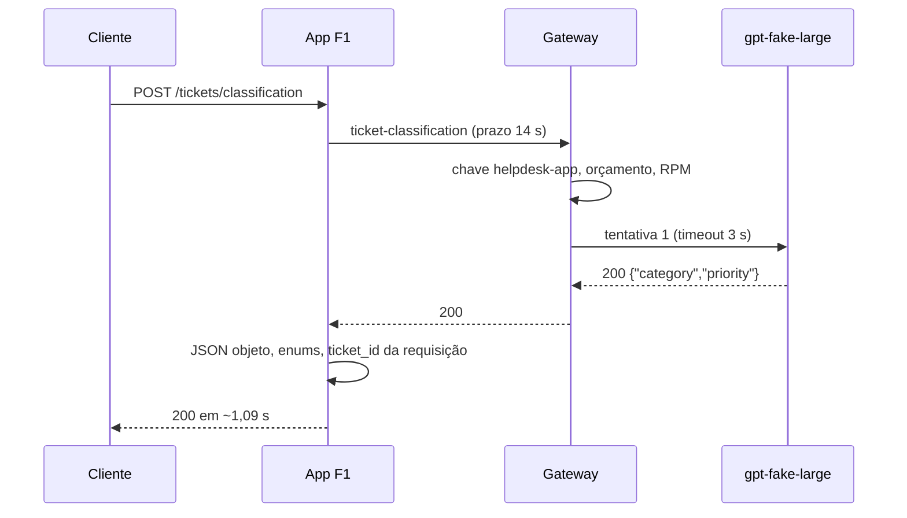

**2. F4 em condições normais** (`02-normal-f4.json`)

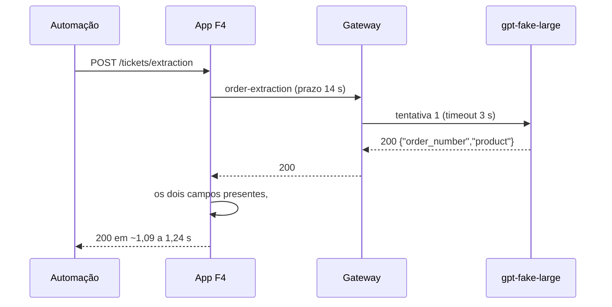

**3. Sucesso após retry** (o primário repete 1 vez em `500`/`503`; quando a 2ª tentativa funciona, termina ali). No simulador o modo é fixo, então a 2ª tentativa também falha; o sucesso após retry foi demonstrado no Passo 10 (`docs/resiliencia/evidencias`) e o diagrama mostra a política.

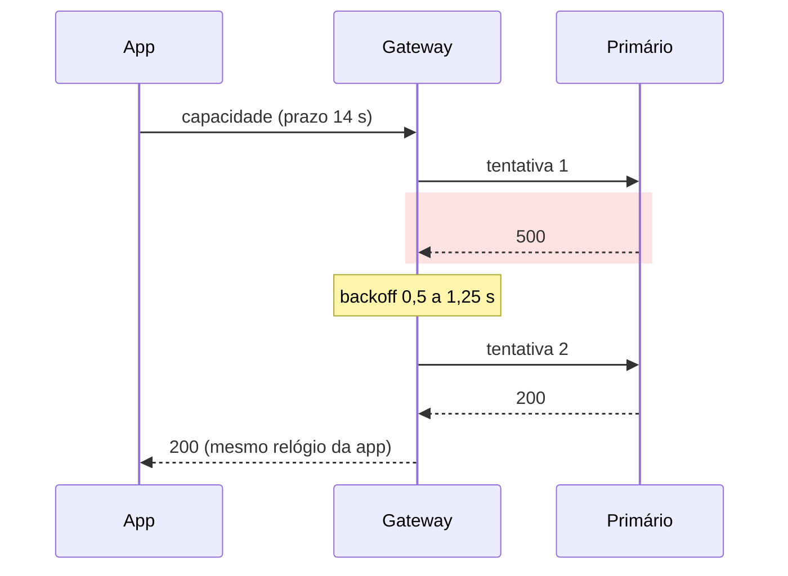

**4. Sucesso após fallback técnico** (`04-primario-500.json`, `05-primario-timeout.json`)

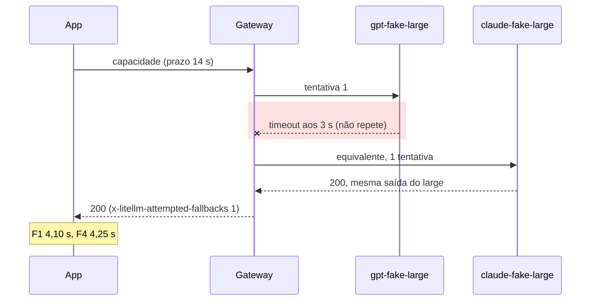

**5. Esgotamento do prazo** (`13-gateway-congelado-deadline.json`)

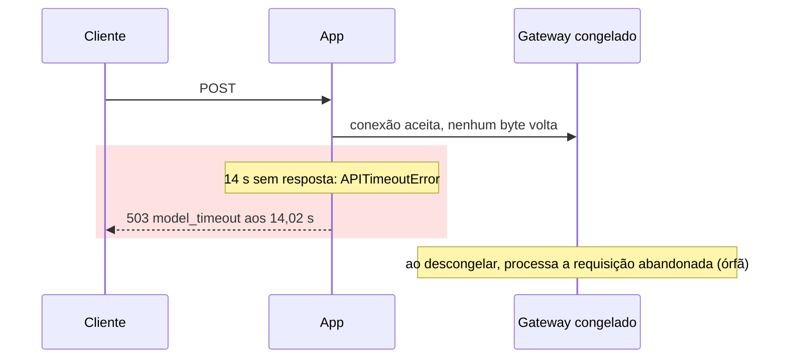

**6. Recusa por governança** (`11-governanca-*.json`)

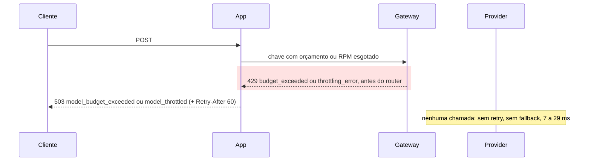

**7. Indisponibilidade de todos os destinos** (`09-providers-500.json`)

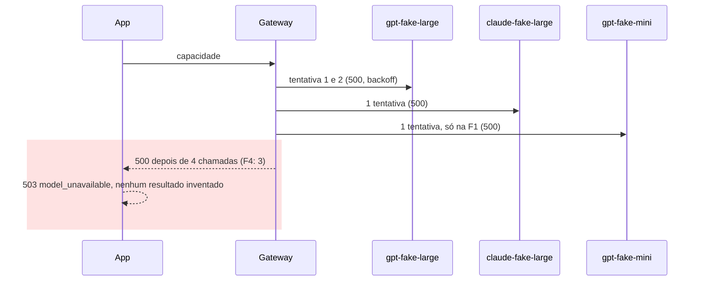

**Direção das dependências de código** (diferente do fluxo de execução: em tempo de execução a requisição vai até o provider, mas no código as features apontam para o contrato, e quem conhece o adapter é só o ponto de composição):

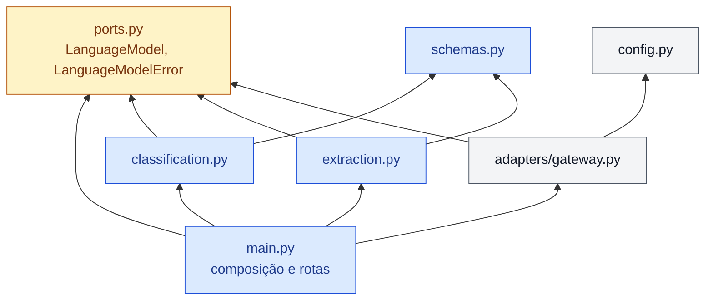

Arestas confirmadas em `evidencias/22-metricas.txt` (recorte de F1/F4; F2/F3 omitidas). Nenhuma seta sai de uma feature para o adapter, o gateway ou um provider.

## 16. Revisão da F1 e da F4 (4.15, 4.16)

Caminho revisado em `main.py`, `classification.py`, `extraction.py`, `schemas.py`, `ports.py`, `adapters/gateway.py` e `gateway/config.yaml`:

| Etapa | F1 | F4 | Avaliação |
|---|---|---|---|
| Validação da entrada | `TicketInput` (`min_length=1`) | idem | ✅ `422` sem chamar o modelo (experimento 03) |
| Construção da tarefa | `"TASK: classify\n" + text` | `"TASK: extract\n" + text` | ✅ prompt inalterado desde a v1 |
| Capacidade lógica | `ticket-classification` | `order-extraction` | ✅ |
| Chamada e espera | `model.complete`, síncrona, prazo 14 s | idem | ✅ |
| Interpretação | `json.loads(text)` | `json.loads(text)` | ❌ exceção vira `500` |
| Validação dos campos | `data.get(...) not in SET` | `ORDER_FORMAT.match` com `^#\d{6}$`; produto sem checagem; `data.get` | ❌ ver tabela abaixo |
| Resposta | `Classification(ticket_id=..., **data)` | `OrderData(...)` | ❌ F1: `**data` |
| Propagação de erros | `LanguageModelError` → `MODEL_ERRORS` | idem | ✅ explícita e sem segredo |

Problemas comprovados (código de `8227f5a`, `evidencias/15-contrato-saida-antes.txt`):

| Saída do modelo | F1 antes | F4 antes | Risco |
|---|---|---|---|
| JSON entre cercas de markdown, texto livre, lista, `null` | `500` texto | `500` texto | falha não explícita, parece bug |
| `{"ticket_id": "TK-99999", ...}` | `500` (`TypeError`) | — | o modelo interfere no identificador |
| categoria como lista | `500` (`unhashable`) | — | tipo não checado |
| `{}` ou só um campo | — | **`200` com `null`** | **falha mascarada como ausência legítima** |
| `"#481516\n"` ou `"#٤٨١٥١٦"` | — | **`200` com o valor** | **número inválido aceito pela automação** |
| número ou produto como inteiro | — | `500` | tipo não checado |

Riscos para a automação da F4: os dois `200` errados acima são os piores, porque a automação os executa. Os `500` pelo menos param o fluxo, mas não dizem que o problema é do upstream.

O que **não** precisou de mudança: rotas, schemas, adapter, prazos, timeouts, política de retry e fallback, enums, prompts e modelos.

## 17. Saídas estruturadas (4.17)

- **Structured Output:** pedir ao modelo uma saída num formato definido (aqui, JSON em texto; o simulador não usa `response_format`).
- **Data Validation:** verificar se o dado atende às regras antes de usá-lo.
- **Schema Validation:** campos, tipos e obrigatoriedade.
- **Semantic Validation:** se o valor representa a realidade do negócio.
- **Pydantic Models:** classes que validam tipos na construção (`OrderData`, `Classification`).
- **Enum / Literal:** conjunto fechado de valores (`Enum` cria um tipo; `Literal["low","medium","high"]` restringe na anotação).
- **Expressões regulares:** formato textual (`#[0-9]{6}`).
- **Campos obrigatórios × opcionais × nulos:** obrigatório precisa estar presente; opcional pode faltar; nulo está presente e vale `null`. Na F4, os dois campos são **obrigatórios e anuláveis**.

| Nível | Exemplo | Onde o helpdesk valida |
|---|---|---|
| Sintático | a resposta é JSON | `_json_object` (novo): senão `502` |
| Estrutural | campos e tipos esperados | enums da F1; chaves, tipos e `fullmatch` da F4 |
| Semântico | os valores estão certos para este ticket | **não valida** (não há como, sem outra fonte) |

`{"ticket_id": "TK-00042", "order_number": "#123456", "product": "teclado"}` passa nos três níveis que conseguimos checar e ainda pode estar errado: o cliente citou `#481516`. É exatamente o tipo de erro do `gpt-fake-mini` na F4 ("pega o primeiro número de seis dígitos, que pode ser a nota fiscal", `provider-fake/app/tasks.py`): estruturalmente perfeito, semanticamente errado. Validação estrutural não detecta isso, e por isso o ADR 0006 proibiu o mini na F4 em vez de tentar validar a saída dele.

## 18. Contratos de F1 e F4 (4.18, 4.19)

**F1.** Os valores vivem em `classification.py` como `CATEGORIES` e `PRIORITIES` (conjuntos de strings). Alternativas avaliadas: `Enum` ou `Literal` no schema de resposta mudariam o OpenAPI (a v2 tem evidência de OpenAPI idêntico à v1) sem resolver nada que o conjunto não resolva; validação explícita com conjuntos já existe. **Mantido**, com duas correções: checar `isinstance(str)` antes do `in` e construir a resposta com campos explícitos. Saída fora do enum continua `502 {"detail": "Classificação fora dos valores permitidos"}` (comportamento da v1); nada de inventar categoria.

**F4.** Regras do enunciado: `order_number` = `#` + 6 dígitos ou `null`; `product` = texto ou `null`.

| Situação | Exemplo | Resposta |
|---|---|---|
| Ausência legítima | modelo respondeu `{"order_number": null, "product": null}` | `200` com os dois `null` |
| Saída incompleta | `{}` ou só um campo | `502 Extração incompleta` (antes: `200` com `null`) |
| Formato inválido | `"#481516\n"`, `"481516"`, `481516`, dígitos Unicode | `502 Número de pedido em formato inválido` |
| Produto inválido | `123` | `502 Produto em formato inválido` |
| Falha operacional | timeout, indisponibilidade, tentativas esgotadas, governança, todos os destinos | `503`/`502` com `code` (seção 19) |

`null` só sai quando o modelo **respondeu** e disse `null`; nenhum caminho de falha produz `null`. Não passamos a exigir campos que o enunciado permite nulos.

## 19. Erros HTTP (4.20)

| Cenário | Origem | Representação interna | Status | Justificativa |
|---|---|---|---|---|
| Corpo inválido, campo ausente, tipo errado | consumidor | validação do FastAPI | `422` | erro do cliente; padrão FastAPI caracterizado na v1 (não usamos `400`) |
| Chave da app inválida ou revogada | gateway `401` | `LanguageModelError("rejected")` | `502 model_rejected` | a credencial é **da app**, não do cliente; repetir não adianta |
| Capacidade fora da chave | gateway `403` | `rejected` | `502 model_rejected` | idem |
| Orçamento esgotado | gateway `429 budget_exceeded` | `budget_exceeded` | `503 model_budget_exceeded` | política; tente mais tarde |
| RPM esgotado | gateway `429 throttling_error` | `throttled` | `503 model_throttled` + `Retry-After` | política com prazo conhecido |
| `429` do provider depois da cadeia | provider | `rate_limited` | `503 model_rate_limited` | transitório |
| `500`/`503` em todos os destinos | provider | `unavailable` | `503 model_unavailable` | transitório |
| Timeout do gateway (`408`) ou prazo da app | gateway ou app | `timeout` | `503 model_timeout` | transitório, tempo limitado |
| Saída do modelo fora do contrato | modelo | `HTTPException(502)` na feature | `502 {"detail"}` | o upstream respondeu algo inválido; nada inventado |
| Upstream passou de 30 s | borda | — | `504` HTML do nginx | **nunca** na F1/F4 (prazo 14 s) |

Os erros da app são JSON (`{"detail", "code"}` ou `{"detail"}`), nunca HTML; o `504` fica reservado à borda (decisão do ADR 0005), então quem recebe um `504` sabe que a origem é o proxy. Sem stack trace, chave ou limite no corpo (testado em `tests/execution`). Os códigos `400` e `401`/`403` ao cliente não são usados: o cliente do helpdesk não se autentica nesta arquitetura.

## 20. Resiliência na F1 e na F4 (4.21, 4.22)

| Verificação | F1 | F4 | Evidência |
|---|---|---|---|
| Primário em condições normais | ✅ 1 chamada `gpt-fake-large` em 48 execuções | ✅ 41 execuções | `02-normal-*` |
| Equivalente em falha elegível | ✅ `claude-fake-large` em `500`, `timeout`, `slow`, `429` | ✅ | `04`–`07` |
| Tentativas limitadas | ✅ máx. 4 (2 + 1 + 1) | ✅ máx. 3 (2 + 1) | `09` |
| Prazo global respeitado | ✅ 14,02 s | ✅ 14,02 s | `13` |
| Resultado compatível | ✅ mesmo JSON do primário | ✅ mesmos valores | `04`, `05` |
| Sem amplificação | ✅ declarado = observado | ✅ | `04`–`10` |
| Não depende da borda | ✅ todos os erros são da app, antes de 30 s | ✅ | todos |
| Modelo inferior | ✅ `gpt-fake-mini` só depois dos dois `large` | ✅ **nunca** chamado | `08` |

Nenhuma política foi duplicada na feature (a feature chama `complete` uma vez; retry só no gateway; SDK com `max_retries=0`, confirmado pelo teste de prazo: uma única conexão). Nenhum valor foi ajustado, porque as medições não pediram.

**Por que não aumentar a disponibilidade da F4 com o mini.** Disponibilidade só vale se o resultado for útil. Na F1, o mini acerta 1.000/1.000 e o pior efeito de um erro é uma prioridade trocada, visível a um atendente. Na F4, o mini erra o pedido em 15% dos tickets e a automação executa sem revisão: trocaríamos um `503` visível e reprocessável por trocas indevidas silenciosas.

**Lento × indisponível.** No `slow`, o primário responderia certo em ~10,8 s; no `timeout`, nunca. Para a F1 e a F4, os dois viram o mesmo caso, porque o timeout de 3 s por tentativa é a definição operacional de "lento demais para este consumidor". A diferença aparece no provider: no `slow` a geração **continua** depois que o gateway desiste (status `null` no instante da coleta) e seria cobrada; no `timeout`, não há geração.

## 21. Governança (4.23)

| Verificação | Resultado |
|---|---|
| Identidade usada | `GATEWAY_API_KEY` = chave virtual `helpdesk-app` (compose interpola `HELPDESK_GATEWAY_KEY`); nunca a master key |
| Credenciais de provider na app | nenhuma (`grep` vazio; ambiente do container sem `FAKE_*`) |
| Recusa ≠ resultado de negócio | `503`/`502` com `code`; nenhum campo de classificação ou extração no corpo |
| Recusa sem fallback e sem retry | 0 chamadas ao provider em todos os cenários, mesmo com o primário em `500` |
| Sem troca automática de chave | a app só conhece uma chave; credencial inválida vira `502 model_rejected` |
| Contabilização | F1 US$ 0,0001575, F4 US$ 0,0001475 por requisição no primário |

As chaves de demonstração do README e a chave do helpdesk não foram usadas nos experimentos: cada cenário criou uma chave efêmera, recriou só a app com ela e restaurou depois (seção 23, experimento 10).

Ausência de chamadas ao provider (contada em `/admin/calls`) não é ausência de requisições ao gateway: a requisição recusada **chegou** ao gateway, foi autenticada e recusada lá. São duas fronteiras: o provider prova que não houve custo; o gateway prova que houve tentativa de consumo (e conta no RPM).

## 22. Handoff e correção (4.24)

O [handoff](handoff-execucao.md) lista os 6 problemas, o escopo (só `classification.py` e `extraction.py`) e o plano revisado: duas propostas do agente foram rejeitadas (módulo comum novo e `Literal` nos schemas). O diff aplicado:

| Arquivo | Mudança |
|---|---|
| `app/helpdesk/classification.py` | `_json_object(text)` → `502` se não for objeto JSON; `isinstance(str)` antes dos enums; `Classification(ticket_id=..., category=..., priority=...)` |
| `app/helpdesk/extraction.py` | `_json_object`; as duas chaves obrigatórias; `ORDER_FORMAT = re.compile(r"#[0-9]{6}")` com `fullmatch`; tipo de `order_number` e `product` |

Nenhum import novo, nenhum módulo novo. A função `_json_object` está duplicada nas duas features (8 linhas): escolha consciente para não criar um componente compartilhado com dois usos; se a F3 precisar do mesmo no Passo 15, é o momento de extrair.

## 23. Experimentos 01 a 10 (4.25 a 4.34)

Sonda: [`sondas_execucao.py`](sondas_execucao.py) (um subcomando por experimento; grava JSON com status, TTFB, tempo total, corpo, modos do provider e `/admin/calls`). Comando base, sem Python no host:

```bash
docker run --rm -v "${PWD}:/w" -w /w -e HELPDESK_BASE_URL=http://host.docker.internal:8000 \
  -e PROVIDER_ADMIN_URL=http://host.docker.internal:8090 python:3.12-slim \
  sh -c "pip install -q httpx && python docs/execucao/sondas_execucao.py <experimento>"
```

### Experimento 01: F1 normal (`02-normal-f1.json`)

9 entradas da caracterização × 3 rodadas + 20 repetições do exemplo do enunciado:

| Entrada | Status | Tempo (3 rodadas) | Categoria | Prioridade | Chamadas |
|---|---|---|---|---|---|
| TK-00042 entrega urgente | 200 | 1,092 / 1,087 / 1,087 | delivery | high | 1 |
| TK-00100 cobrança duplicada | 200 | 1,088 / 1,088 / 1,087 | payment | high | 1 |
| TK-00101 troca sem pressa | 200 | 1,163 / 1,163 / 1,163 | exchange_return | medium | 1 |
| TK-00102 produto quebrado | 200 | 1,139 / 1,138 / 1,138 | product_defect | medium | 1 |
| TK-00103 cadastro | 200 | 1,087 / 1,087 / 1,088 | other | medium | 1 |
| TK-00104 negação de urgência | 200 | 1,089 / 1,088 / 1,088 | other | high | 1 |
| TK-00105 prazo de entrega | 200 | 1,112 / 1,113 / 1,113 | delivery | medium | 1 |
| TK-00106 dúvida simples | 200 | 1,062 / 1,063 / 1,063 | other | low | 1 |
| TK-00107 agradecimento | 200 | 1,088 / 1,088 / 1,087 | other | medium | 1 |

27 execuções: mínimo 1,062, mediana 1,088, média 1,102, máximo **1,163 s**; 0 acima de 3 s; 0 chamadas extras ou fora do primário. 20 repetições do exemplo: 1,087–1,091 s (p95 1,089 s, n = 20). A variação entre entradas é determinística: vem do tamanho da saída (`exchange_return` tem mais caracteres que `other`), não de ruído.

### Experimento 02: F4 normal (`02-normal-f4.json`)

| Entrada | Pedido esperado | Produto esperado | Observado | Tempo |
|---|---|---|---|---|
| exemplo do enunciado ("teclado") | `#481516` | `teclado` (ilustrativo) | `#481516`, **`null`** | 1,089–1,091 s |
| pedido e produto | `#481516` | fone de ouvido bluetooth | igual | 1,237 s |
| pedido ausente | `null` | aspirador robô | igual | 1,137–1,138 s |
| produto ausente | `#481516` | `null` | igual | 1,087–1,088 s |
| ambos ausentes | `null` | `null` | igual | 1,062–1,063 s |
| número sem `#` | `#481516` (normalizado) | `null` | igual | 1,087–1,088 s |
| sete dígitos | `null` | `null` | igual | 1,062 s |

21 execuções: 1,062–1,237 s, mediana 1,088 s; todas no primário, 1 chamada. Nulos legítimos preservados. Não há requisito de 3 s para a F4; o tempo é registrado, não aprovado.

### Experimento 03: entradas inválidas (`03-entradas-invalidas.json`)

| Feature | Entrada inválida | Status esperado | Status observado | Chamadas ao provider |
|---|---|---|---|---|
| F1 e F4 | corpo vazio | 422 | 422 | 0 |
| F1 e F4 | sem `ticket_id` / sem `text` | 422 | 422 | 0 |
| F1 e F4 | `ticket_id` ou `text` vazio | 422 | 422 | 0 |
| F1 e F4 | `text` numérico, `ticket_id` numérico, `text` nulo | 422 | 422 | 0 |
| F1 e F4 | corpo é lista | 422 | 422 | 0 |
| F1 e F4 | JSON malformado | 422 (`json_invalid`) | 422 | 0 |

20 casos em 2–43 ms, nenhum chega ao gateway. Nenhuma restrição nova: `ticket_id` numérico já era rejeitado pelo Pydantic (sem coerção em modo estrito para `str`).

### Experimento 04: fallback técnico, primário em `error_500` (`04-primario-500.json`)

| Feature | Primário | Tentativas | Fallback observado | Status | Resultado preservado? | Tempo |
|---|---|---|---|---|---|---|
| F1 | gpt-fake-large | 2 (`500`, `500`) | claude-fake-large `200` | 200 | ✅ `delivery`/`high` | 2,66 / 3,85 / 3,34 s |
| F4 | gpt-fake-large | 2 | claude-fake-large `200` | 200 | ✅ `#481516` / fone | 3,84 / 3,24 / 3,75 s |

A variação de ~1,2 s entre execuções é o jitter do backoff (0–0,75 s em cada uma das duas pausas). `200` aqui não basta como evidência: o `/admin/calls` mostra o `large` do **outro provider** e os valores iguais aos do primário.

### Experimento 05: timeout do primário (`05-primario-timeout.json`)

| Feature | Tentativas | Fallback utilizado? | Status final | Tempo total | Atende ao limite? |
|---|---|---|---|---|---|
| F1 | 1 no primário (timeout 3 s) + 1 no equivalente | sim | 200 | 4,100–4,104 s | ✅ < 15 s |
| F4 | idem | sim | 200 | 4,251–4,257 s | ✅ < 15 s |

Medido sem limite no cliente (`httpx` com 60 s): o servidor respondeu sozinho. O provider continua segurando a conexão abandonada por 300 s (registro com `duration_ms: null`), sem geração.

### Experimento 06: primário lento (`06-primario-slow.json`)

| Feature | Latência normal | Latência em `slow` (estimada pelo simulador) | Tentativas | Resultado |
|---|---|---|---|---|
| F1 | 1,09 s | ~10,8 s (8 s + 11 tokens × 0,25 s) | 1 no primário + 1 no equivalente | 200 em 4,10 s |
| F4 | 1,09–1,24 s | ~11–12 s | idem | 200 em 4,25 s |

A política não repete por lentidão: o timeout de 3 s corta a tentativa e o gateway migra. A geração do primário continua no provider depois disso (trabalho pago e descartado).

### Experimento 07: rate limiting do provider (`07-primario-429.json`)

| Feature | Origem | Retry no primário | Fallback | Status | Tempo |
|---|---|---|---|---|---|
| F1 | provider (`429`, `Retry-After: 2`) | não (`RateLimitErrorRetries: 0`) | claude-fake-large `200` | 200 | 1,10 s |
| F4 | idem | não | idem | 200 | 1,25 s |

É o fallback mais rápido de todos: o `429` volta na hora e não há backoff. Diferença para o `429` do gateway: o do provider chega **depois** de chamar o provider e é recuperável por fallback; o do gateway (`throttling_error`, "Rate limit exceeded for") chega **antes** do router e nunca dispara fallback (experimento 10). Se a cadeia inteira der `429`, a app responde `503 model_rate_limited`, não `model_throttled` (teste de governança `test_app_distingue_429_do_provider_do_429_do_gateway`).

### Experimento 08: os dois `large` em `error_500` (`08-larges-500.json`)

| Feature | Mini autorizado? | Mini utilizado? | Resultado esperado | Resultado observado |
|---|---|---|---|---|
| F1 | sim (ADR 0006) | sim, `gpt-fake-mini` `200` | 200 com o mesmo contrato | 200 `delivery`/`high` em 2,46–2,57 s, 4 chamadas |
| F4 | **não** | **não** (0 chamadas a mini, com os dois mini no ar) | falha explícita | `503 model_unavailable` em 2,25–2,35 s, 3 chamadas; nenhum `null` artificial |

### Experimento 09: indisponibilidade completa (`09-providers-500.json`, `10-providers-timeout.json`)

| Feature | Modo | Destinos tentados | Chamadas totais | Tempo | Status | Falha explícita? |
|---|---|---|---|---|---|---|
| F1 | `error_500` | large, equivalente, mini | 4 (2 + 1 + 1) | 2,16–2,59 s | 503 `model_unavailable` | ✅ |
| F4 | `error_500` | large, equivalente | 3 (2 + 1) | 2,20–2,78 s | 503 `model_unavailable` | ✅ |
| F1 | `timeout` (pior caso temporal) | large, equivalente, mini | 3 | 8,05 s | 503 `model_timeout` | ✅ |
| F4 | `timeout` | large, equivalente | 2 | 6,05 s | 503 `model_timeout` | ✅ |
| F1/F4 | gateway congelado | — | 0 durante; 2 órfãs depois | 14,02 s | 503 `model_timeout` | ✅ |

Cadeia finita, sem ciclo, nenhum `504` da borda, nenhum resultado fictício.

### Experimento 10: recusas de governança (`11-governanca-roteiro.txt`, `11-governanca-*.json`)

Roteiro do operador (estado inicial → chamadas antes → app recriada com a chave do cenário → requisição pela borda → chamadas depois → logs → restauração):

1. Criar duas chaves efêmeras com a master key (só no roteiro, nunca na app): `max_budget 0.0004` e `rpm_limit 3`.
2. Esgotar direto no gateway: orçamento em 3 chamadas (a 4ª recusada), RPM em 3.
3. Recriar **só** a app com outra chave: `HELPDESK_GATEWAY_KEY=<chave> docker compose up -d --no-deps --force-recreate --wait app` (o bootstrap não roda, a chave do helpdesk no gateway fica intacta).
4. `python docs/execucao/sondas_execucao.py governanca <rótulo>`: F1 e F4 pela borda, `/admin/calls` antes e depois.
5. Restaurar: `docker compose up -d --no-deps --force-recreate --wait app` (volta à chave do `.env`), conferir F1 `200` e apagar as chaves efêmeras.

| Feature | Motivo da recusa | Status | Retries | Fallbacks | Novas chamadas ao provider | Tempo |
|---|---|---|---|---|---|---|
| F1 | orçamento esgotado | 503 `model_budget_exceeded` | 0 | 0 | 0 | 0,028 s |
| F4 | orçamento esgotado | 503 `model_budget_exceeded` | 0 | 0 | 0 | 0,007 s |
| F1 | RPM esgotado | 503 `model_throttled`, `Retry-After: 60` | 0 | 0 | 0 | 0,029 s |
| F4 | RPM esgotado | 503 `model_throttled`, `Retry-After: 60` | 0 | 0 | 0 | 0,010 s |
| F1 | credencial inválida | 502 `model_rejected` | 0 | 0 | 0 | 0,041 s |
| F4 | credencial inválida | 502 `model_rejected` | 0 | 0 | 0 | 0,016 s |

Log da app: `motivo=rejected erro=AuthenticationError status=401 tipo=token_not_found_in_db`, sem chave. Restauração: F1 `200` em 1,11 s com a chave normal.

## 24. Concorrência (4.35)

Rajadas de F1 simultâneas pela borda, modo normal (`12-concorrencia.json`); 136 chamadas, todas `gpt-fake-large` `200`:

| Requisições simultâneas | Sucessos | Falhas | Latência média | Latência máxima | `/health` durante |
|---|---|---|---|---|---|
| 1 | 1 | 0 | 1,094 s | 1,094 s | — |
| 5 | 5 | 0 | 1,106 s | 1,110 s | — |
| 10 | 10 | 0 | 1,117 s | 1,132 s | — |
| 20 | 20 | 0 | 1,139 s | 1,168 s | — |
| 40 | 40 | 0 | 1,200 s | 1,276 s | 0,811 s (1ª), depois 0,002 s |
| 60 | 60 | 0 | 1,622 s | **2,416 s** | 0,965 s (1ª), depois 0,002 s |

| Sintoma possível | Observado? | Como distinguir |
|---|---|---|
| Limite de threads | ✅ com 60: 40 terminam em ~1,28 s e 20 esperam uma thread (~2,4 s); `/health` (também `def`) esperou ~0,8–1 s | latência bimodal, múltiplo de ~1,1 s |
| Rate limiting | não (136 requisições < 600 RPM da `helpdesk-app`) | `503 model_throttled` |
| Orçamento reservado | não (60 × ~US$ 0,164 < US$ 20) | `503 model_budget_exceeded` |
| Saturação do gateway | não (+0,1 s com 40) | latência subindo de forma contínua |
| Lentidão do provider | não (`duration_ms` estável) | `/admin/calls` |
| Bloqueio do event loop | não | `/health` lento mesmo com poucas requisições (seção 8, linha do meio) |

O teto de 40 é do thread pool do AnyIO, não do pool de conexões do SDK (1.000). Com 60 simultâneas a F1 ainda cabe nos 3 s, mas a partir de ~80 a terceira leva passaria. Não é requisito do enunciado; se virar, as alavancas (aumentar o limitador ou `async def` + `AsyncOpenAI`) não mudam o contrato.

## 25. Consolidação das latências (4.36)

| Feature | Normal | Error 500 | Error 429 | Slow | Timeout | Indisponibilidade completa |
|---|---|---|---|---|---|---|
| F1 | 200, 1,06–1,16 s, primário, 1 chamada | 200, 2,66–3,85 s, equivalente, 3 | 200, 1,10 s, equivalente, 2 | 200, 4,10 s, equivalente, 2 | 200, 4,10 s, equivalente, 2 | 503, 2,2–2,6 s (500, 4 chamadas) / 8,05 s (timeout, 3) |
| F4 | 200, 1,06–1,24 s, primário, 1 | 200, 3,24–3,84 s, equivalente, 3 | 200, 1,25 s, equivalente, 2 | 200, 4,25 s, equivalente, 2 | 200, 4,25 s, equivalente, 2 | 503, 2,2–2,8 s (3) / 6,05 s (2) |

Pior tempo medido por cenário, em segundos (as barras de cada grupo são F1 e F4):

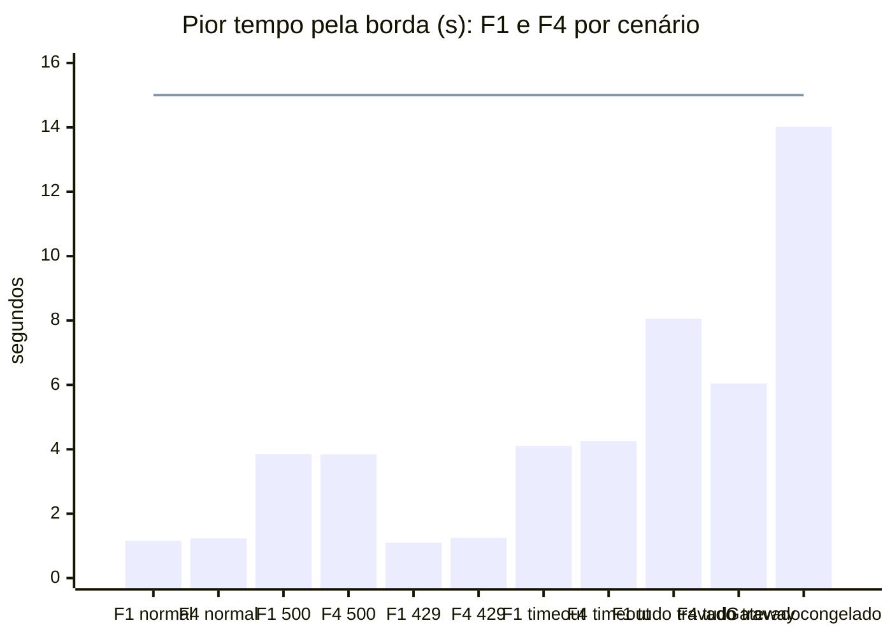

A linha é o limite de 15 s; o requisito de 3 s vale só para "F1 normal".

| Tipo de número | Exemplo |
|---|---|
| Tempo medido | F1 normal ≤ 1,163 s; gateway congelado 14,02 s |
| Limite configurado | timeout 3 s por tentativa; prazo da app 14 s |
| Limite exigido pelo desafio | F1 3 s normal; 15 s travado; sem `504` da borda |
| Objetivo complementar | nenhum (não criamos meta para a F4) |
| Hipótese não validada | pior caso misto do gateway (~10 s F1, ~9 s F4): estimado, não provocado |

**Evidências de latência obrigatórias (7.8):**

| Requisito | Limite | Resultado observado | Aprovado? |
|---|---|---|---|
| F1: resultado completo em modo normal | 3 s | 1,062–1,163 s (75 execuções incluindo baseline e série; 0 acima) | ✅ |
| F1: resposta diante de timeout | 15 s | 200 em 4,10 s (primário travado); 503 em 8,05 s (tudo travado); 503 em 14,02 s (gateway congelado) | ✅ |
| F4: resposta diante de timeout | 15 s | 200 em 4,25 s; 503 em 6,05 s; 503 em 14,02 s | ✅ |
| F1: cenários aplicáveis | sem `504` da borda | nenhum `504` (`edge_504: false` em todas as evidências) | ✅ |
| F4: cenários aplicáveis | sem `504` da borda | nenhum `504` | ✅ |

## 26. Testes (4.37 a 4.39)

Nova suíte `tests/execution/` (57 testes, ~1 min 50 s):

```text
tests/execution/
├── conftest.py                 # borda + admin do provider; app real em processo
├── test_sync_classification.py # F1 pela borda: 9 entradas ≤ 3 s, 422 sem chamada, 500, timeout, tudo travado, tudo fora
├── test_sync_extraction.py     # F4 pela borda: 5 entradas com nulos legítimos, 422, 500, timeout, mini proibido, tudo travado
├── test_sync_governance.py     # F1 e F4 em processo no gateway real: orçamento, RPM, credencial inválida, 0 chamadas
├── test_output_contract.py     # contrato de saída: 25 casos com um LanguageModel substituto
└── test_deadline.py            # prazo da app com um "gateway" que aceita e não responde: 503 em ~14 s, 1 conexão
```

| Cobertura pedida | Onde |
|---|---|
| Contratos síncronos e validação de campos | `test_sync_*`, `test_output_contract.py` |
| Latência (3 s F1) | `test_sync_classification.py::test_resultado_completo_em_ate_3s_no_primario` |
| Timeout e 15 s | `test_*_travado_*`, `test_deadline.py` |
| Fallback | `test_primario_500_*`, `test_dois_large_fora_*` |
| Governança | `test_sync_governance.py` |
| Erros e ausência de chamadas | `explicit_app_error`, contagens de `/admin/calls` |

Não duplicamos a caracterização (valores um a um), nem os cenários de backoff da resiliência, nem a mecânica de chaves da governança.

**Reprodutibilidade.** Cada teste começa e termina com `/admin/reset`; contagens filtradas por tarefa; nenhum depende de execução anterior; chaves efêmeras criadas e apagadas por teste; a suíte roda em sequência (estado global do provider). Operações que continuam após timeout: o provider segura a conexão por 300 s, mas o registro é limpo pelo reset e a cadeia do gateway da F1/F4 termina dentro da resposta (sem órfãos, ao contrário da F2). Testes temporais dependem do ambiente (Docker Desktop no Windows, carga da máquina): os limites não foram afrouxados; a folga real é de ~1,8 s nos 3 s e ~1 s nos 15 s do prazo.

**Resultados** (`evidencias/20-testes-execucao.txt`, `21-todas-as-suites.txt`), com a app reconstruída com a correção:

| Suíte | Resultado | Tempo |
|---|---|---|
| `tests/execution` (1ª execução) | 57 passed | 106 s |
| `tests/characterization` | 32 passed | 60 s |
| `tests/resilience` | 34 passed | 188 s |
| `tests/fallback` | 40 passed | 237 s |
| `tests/governance` | 33 passed | 191 s |
| `tests/execution` (2ª execução, logo após as outras) | 57 passed | 107 s |

O único aviso é a `DeprecationWarning` do `TestClient` do Starlette 0.41 sobre um alias do AnyIO; não afeta os testes.

`git diff v1-coupled v2-decoupled -- tests/characterization/` e `git diff v2-decoupled -- tests/characterization/` são vazios: a suíte original não foi tocada e continua passando na `main`.

## 27. Revisão arquitetural e métricas (4.40)

| Pergunta | Resposta |
|---|---|
| A execução síncrona introduziu acoplamento desnecessário? | não: nenhum import novo; as features continuam dependendo só de `ports` e `schemas` |
| Há duplicação de políticas de resiliência? | não: retry/fallback só no gateway, prazo só na app, SDK sem retry (1 conexão no teste de prazo) |
| O código passou a conhecer modelos físicos? | não (`grep` vazio) |
| As features têm responsabilidade excessiva? | não: validar a saída do **próprio** contrato é responsabilidade da feature; a duplicação de `_json_object` é a única dívida, consciente |
| Poderia ser mais simples? | a versão anterior era mais curta e errada; a atual é o mínimo que fecha os 6 casos |

Medição `sync-execution-step-13` ([CSV](metricas/sync-execution-step-13.csv), `evidencias/22-metricas.txt`):

| Medição | Arestas | `classification` / `extraction` (Ca, Ce, I, D) | `ports` (Ca, A, D) | Diferença |
|---|---|---|---|---|
| `v2-decoupled` | 19 | 1, 2, 0,67, 0,33 | 5, 1,00, 0,00 | — |
| Passo 10 `resilience-step-10` | 20 | idem | 6, 0,50, 0,50 | `main → ports` (erro do contrato) |
| Passo 11 `fallback-step-11` | 20 | idem | idem | igual ao 10 |
| Passo 12 `governance-step-12` | 20 | idem | idem | igual ao 10 |
| **Passo 13 `sync-execution-step-13`** | **20** | **idem** | **idem** | **byte a byte igual ao 12** |

A régua não mudou e a correção não mexeu em dependências. Esta não é a medição definitiva da `main` (F2 e F3 ainda mudam nos Passos 14 e 15).

## 28. ADR, README, integridade e versionamento (4.41 a 4.44)

- **ADR:** [0011-execution-modes.md](../adr/0011-execution-modes.md), nível solução, uma seção por feature (F1 e F4 com evidências definitivas; F2 e F3 preliminares).
- **README:** fluxos síncronos com `curl` exato, contratos, requisitos, comportamento sob falha, comandos de teste e de experimento, mapa de decisões com o 0011.
- **Integridade:** `evidencias/23-integridade.txt`: tags `v1-coupled` → `8028305` e `v2-decoupled` → `b637c5a` (objetos anotados `07c2026d` e `c954c434`); `git diff v2-decoupled -- provider-fake/ edge/ data/` vazio; `git diff v1-coupled v2-decoupled -- tests/characterization/` vazio; `grep` de modelos físicos e chaves em `app/` vazio; o container `app` só tem `GATEWAY_URL` e `GATEWAY_API_KEY`; provider restaurado ao modo `normal`. F2 e F3 sem diff (`suggestion.py`, `report.py` intocados) e preservadas pela caracterização (32/32).
- **Arquivos alterados:** `README.md`, `app/helpdesk/classification.py`, `app/helpdesk/extraction.py`; novos `docs/adr/0011-execution-modes.md`, `docs/execucao/`, `tests/execution/`.
- **Versionamento:** a pedido do usuário, **nenhum commit**. As mudanças estão na árvore de trabalho da `main` para revisão. Mensagem sugerida: `fix: explicit 502 for out-of-contract model output in F1/F4; sync execution tests and ADR 0011`.

## 29. Preparação para o Passo 14 (4.45)

| Dimensão | F1 e F4: síncrono | F2: futuro streaming |
|---|---|---|
| Resultado consumido | completo | progressivo |
| Métrica principal | tempo total (= TTFB) | tempo até o 1º trecho; tempo total continua relevante |
| Comunicação de erro | status HTTP e corpo | status só antes do 1º byte; depois, evento de erro no fluxo |
| Fallback | antes da resposta completa, invisível ao cliente | só antes do 1º trecho; depois, trocar de modelo muda o texto já mostrado |
| Conexões abertas | ~1 s por requisição | ~16 s por requisição (uma thread ou coroutine presa todo o tempo) |
| Contabilização | no fim, por requisição | no fim do fluxo; fluxo abortado pode cobrar o que foi gerado |
| Governança | recusa antes de tudo | recusa antes do 1º byte (Passo 12); orçamento reservado durante toda a geração |
| Complexidade do cliente | menor | maior (SSE, reconexão, montar o texto) |

Perguntas para o Passo 14: o nginx repassa `text/event-stream` sem bufferizar dentro dos 30 s? O `proxy_read_timeout` conta o tempo **entre** bytes, então um fluxo que manda bytes a cada poucos segundos não toma `504`; mas e o primeiro byte? O LiteLLM faz fallback em streaming antes do 1º token? O `midstream_error` do simulador (um quarto da resposta e erro) precisa de um evento de erro explícito. O contrato JSON síncrono da F2 continua existindo ao lado do SSE (caracterização)?

## 30. Limitações

1. **Validação semântica inexistente:** um número bem formado pode não ser o pedido do cliente; só a política de modelos protege a F4.
2. **Trabalho órfão:** gateway congelado processa depois as requisições abandonadas (2 chamadas cobradas); `slow` continua gerando após o timeout.
3. **Margem de 1 s** entre o prazo da app e o requisito de 15 s.
4. **Concorrência limitada a 40 esperas** simultâneas por processo; sem requisito, sem otimização.
5. **`502` de saída inválida sem `code`** (só `detail`), diferente dos erros do modelo; mantido por compatibilidade com o `502` da v1.
6. **Sucesso após retry** não reproduzível pela borda com o simulador (modo fixo); coberto pela política e pelo Passo 10.
7. **Pior caso misto** do gateway (`500` seguido de `timeout`) estimado, não provocado.
8. **p95 com 20–27 amostras** é indício, não prova de cauda; p99 não medido.
9. Medições num único host com Docker Desktop; outro ambiente muda os ms, não a ordem de grandeza.

## 31. Perguntas de fixação

1. Por que a F1 é síncrona e a F3 provavelmente não será, se as duas chamam o mesmo tipo de modelo?
2. Uma rota `async def` que chama `await client.chat.completions.create(...)` é Asynchronous Request-Reply? Justifique pelo contrato HTTP.
3. No experimento do event loop, por que `async def` + `time.sleep` levou 10 s com 10 requisições, e `def` + `time.sleep` levou 1 s?
4. Com 60 F1 simultâneas, por que a latência ficou bimodal (~1,28 s e ~2,4 s)? Que número da app explica isso?
5. Decomponha os 4,10 s da F1 com o primário travado. Por que não houve backoff?
6. E os 2,66–3,85 s do primário em `500`: de onde vem a variação de ~1,2 s?
7. Por que o `429` do provider recuperou em 1,10 s e o `500` levou mais de 2,6 s?
8. Por que o prazo de 14 s não reinicia quando o gateway troca de destino?
9. TTFB e tempo total da F1 deram o mesmo valor. Isso valeria na F2 com SSE?
10. Por que `{"order_number": null, "product": null}` pode ser um `200` correto, mas `{}` não pode?
11. `#123456` passa na regex. Que tipo de validação faltaria para saber se está certo, e por que o mini da F4 é perigoso justamente aí?
12. Por que a F4 falha com `503` quando os dois `large` caem, mesmo com o mini no ar, e a F1 não?
13. Uma recusa por orçamento chega ao gateway mas não ao provider. O que cada uma dessas duas contagens prova?
14. As métricas de Martin saíram idênticas às do Passo 12. Isso significa que o acoplamento temporal da F1 é baixo?
15. Se o enunciado passasse a exigir 200 F1 simultâneas em até 3 s, o que você mudaria primeiro e o que **não** mudaria no contrato?
