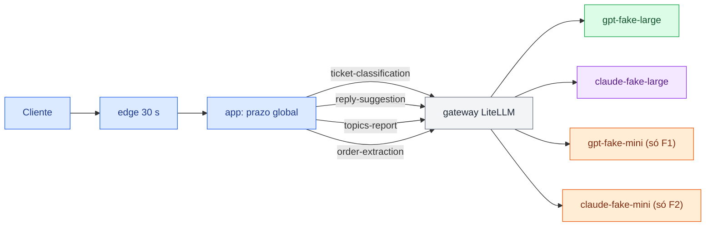
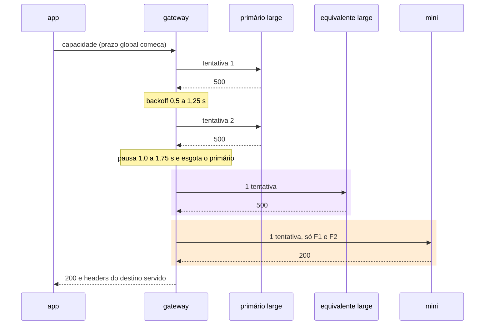
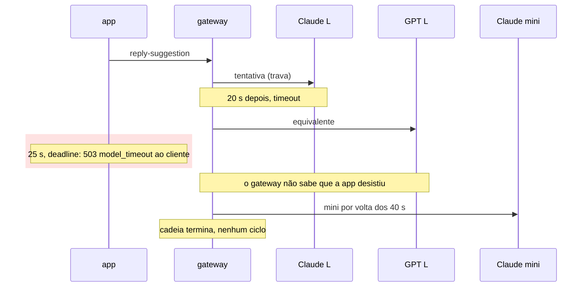

# 🔀 Passo 11: fallback técnico e fallback com modelo inferior

Este relatório registra como o helpdesk passou a sobreviver à queda de um provider e onde ele, de propósito, **não** tenta sobreviver. Ele cobre a fundamentação, as evidências que decidiram cada feature, a configuração do gateway, os experimentos com `/admin/calls`, custo, latência e o que fica para os Passos 12, 14 e 15. A decisão formal está no [ADR 0006](../adr/0006-fallback-policy.md).

> **Legenda de cores:** 🟦 Entrada (cliente, borda, app) · ⬜ Gateway · 🟩 Primário large · 🟪 Equivalente large (fallback técnico) · 🟧 Mini (fallback degradado) · 🟥 Falha explícita ou risco

> [!IMPORTANT]
> O `provider-fake` é determinístico e os dois providers rodam no **mesmo container**. Os experimentos provam o roteamento entre destinos lógicos, não a independência física de infraestrutura, e as conclusões sobre os modelos valem para o simulador, não para modelos comerciais.

## Sumário

1. [Contexto recuperado](#1-contexto-recuperado)
2. [Fundamentos](#2-fundamentos)
3. [Baseline antes do fallback](#3-baseline-antes-do-fallback)
4. [Evidências large × mini](#4-evidências-large--mini)
5. [Matriz de risco e decisões por feature](#5-matriz-de-risco-e-decisões-por-feature)
6. [O que o LiteLLM 1.102.1 oferece](#6-o-que-o-litellm-11021-oferece)
7. [Roteamento, cadeia e orçamento](#7-roteamento-cadeia-e-orçamento)
8. [Implementação](#8-implementação)
9. [Experimentos](#9-experimentos)
10. [Amplificação de tentativas](#10-amplificação-de-tentativas)
11. [Custo](#11-custo)
12. [Latência](#12-latência)
13. [Testes](#13-testes)
14. [Revisão arquitetural](#14-revisão-arquitetural)
15. [Streaming, F3 assíncrona e governança](#15-streaming-f3-assíncrona-e-governança)
16. [Limitações](#16-limitações)

---

## 1. Contexto recuperado

| Artefato | Informação relevante | Uso nesta etapa |
|---|---|---|
| `docs/model-comparison.md` (Passo 03) | large ≡ large; mini perde `product` na F4 (6/6) e encurta a F2 | ponto de partida das decisões, ampliado aqui para 1.000 tickets |
| [ADR 0005](../adr/0005-resilience-policy.md) e `docs/resiliencia/checkpoint-passo-10.md` | timeouts 3/3/20/12 s, 1 retry, backoff nativo, prazos da app 14/14/25/14 s, folga de ~5 s na F1/F4 | orçamento da cadeia |
| `app/helpdesk/` | features pedem capacidade lógica via `ports.LanguageModel`; adapter único `adapters/gateway.py`; `main.py` traduz `LanguageModelError` | onde a app entra (só prazo e log) |
| `gateway/config.yaml` | um destino large por capacidade | onde a cadeia entra |
| `tests/characterization/` (32), `tests/resilience/` (34) | contratos normais e limites do Passo 10 | regressão e revisão de expectativas |
| `provider-fake/README.md` | falha por modelo ou por provider; `/admin/calls` com `task`, `status`, tokens | injeção e prova |
| ADRs 0001–0005 | inversão de dependência, gateway, capacidades lógicas, resiliência | preservação arquitetural |

Confirmado antes de mudar: tags `v1-coupled` (`8028305`) e `v2-decoupled` (`b637c5a`) intactas, as quatro features respondendo `200` pela borda, nenhuma chave nem modelo físico em `app/`, 66 testes passando.

## 2. Fundamentos

| Mecanismo | Pergunta central | No helpdesk |
|---|---|---|
| Timeout | Quanto tempo podemos esperar? | 3 s por tentativa na F1 (normal 1,1 s) |
| Retry | Vale tentar de novo **no mesmo destino**? | só `500`/`503` no primário, 1 vez |
| Backoff | Quanto esperar antes de repetir? | 0,5 s × 2ⁿ + jitter, nativo do LiteLLM |
| Fallback | Existe **alternativa** quando o destino falha? | `claude-fake-large` quando `gpt-fake-large` cai |
| Failover | Dá para transferir a operação para outro destino disponível? | é o fallback técnico: mesmo resultado, outro provider |
| Graceful degradation | Dá para entregar algo inferior, mas útil? | mini na F2: sugestão menor que o atendente completa |

- **Retry × fallback.** O retry aposta que a causa é passageira; o fallback aposta que outro destino não compartilha a causa. Repetir num provider fora do ar só gasta tempo; trocar de provider troca de **domínio de falha** (o conjunto de coisas que caem juntas), mas traz custo, formato e dependências novas.
- **Fallback não é "mais uma tentativa".** Ele muda o destino, o preço (Claude L +41% na F1) e, no caso do mini, o resultado. Por isso tem orçamento e limite próprios.
- **Domínios compartilhados.** Dois providers reais podem dividir nuvem, região, DNS ou o próprio gateway. Aqui dividem o container `provider-fake` e o `gateway`, que continua sendo **ponto único de falha** (SPOF): com ele parado, as quatro features caem.
- **Fail-open × fail-closed.** Fail-open entrega alguma coisa quando o controle falha; fail-closed recusa. Aqui a pergunta é de negócio: a feature tolera um resultado degradado (F1, F2) ou é mais seguro recusar (F3, F4)?
- **Disponibilidade × correção.** `200` prova disponibilidade técnica e correção sintática. Disponibilidade **funcional** exige que o resultado sirva ao negócio. O mini da F4 devolve JSON válido com o pedido errado: aumenta a disponibilidade técnica e **reduz** a confiabilidade funcional.
- **Equivalência.** Interface (mesmo contrato de chamada: falso, OpenAI ≠ Messages, o gateway traduz), funcional e semântica (mesma saída: sim entre os large), operacional e de performance (mesma latência: sim), custo (não: até 50% de diferença).

| Tipo de operação | Exemplo no helpdesk | Tolera resposta aproximada? |
|---|---|---|
| Revisão humana | F2 | sim |
| Cliente esperando | F1 | sim, se não houver degradação observada |
| Pode rodar depois | F3 | não precisa tolerar: espera |
| Alimenta automação com efeito financeiro | F4 | não |

## 3. Baseline antes do fallback

Medido com a política do Passo 10, pela borda (`docs/fallback/evidencias/00-*` e `01-*`).

| Feature | Cenário | Tentativas | Tempo total | Resultado sem fallback |
|---|---|---|---|---|
| F1 | normal | 1 | 1,10 s | `200` |
| F4 | normal | 1 | 1,25 s | `200` |
| F2 | normal | 1 | 15,97 s | `200` |
| F3 (1 dia) | normal | 1 | 9,85 s | `200` |
| F1 | primário `500` | 2 (intervalo 1,11 s) | 2,84 s | `503 model_unavailable` |
| F4 | primário `500` | 2 (1,19 s) | 2,68 s | `503` |
| F2 | primário `500` | 2 (1,12 s) | 2,25 s | `503` |
| F3 | primário `500` | 2 (0,79 s) | 2,47 s | `503` |

## 4. Evidências large × mini

O Passo 03 usou 21 casos de F1 e 12 de F4. Para decidir com o modelo que **seria efetivamente usado**, repeti com 1.000 tickets reais (1 a cada 5 de `data/tickets.jsonl`), 17 lotes de 10 dias e 24 sugestões, direto no provider (`docs/fallback/comparar_modelos.py`, saída em `evidencias/comparacao-modelos.json`, 152 s).

| Feature | Entrada | Resultado large | Resultado mini | Degradação observada | Impacto |
|---|---|---|---|---|---|
| F1 | 1.000 tickets | referência | 1.000/1.000 iguais (categoria e prioridade) | nenhuma | — |
| F2 | 24 tickets | 2.433 caracteres em média, GPT L = Claude L | 1.068 caracteres, PT-BR, 0/24 iguais ao large | texto ~44% | atendente completa |
| F3 | 17 lotes (10 dias) | somas = nº de tickets | 17/17 iguais | nenhuma | — |
| F4 | 1.000 tickets | 615 com pedido, 192 com produto | **316 diferentes**: `product: null` em 192, **pedido errado em 150** | omissão e erro de identificador | troca indevida, `null` lido como "não informado" |

Os dois mini se comportaram igual entre si em todas as tarefas. Exemplo da F4 (TK-00036): *"Tenho aqui a nota fiscal 927477 … pedido nº 389511"*: large `#389511 / tapete de yoga`; mini `#927477 / null`. Isso **não** apareceu nos 12 casos do Passo 03: a amostra maior mudou a gravidade da conclusão.

## 5. Matriz de risco e decisões por feature

| Feature | Revisão humana | Risco da indisponibilidade | Risco da incorreção | Tolerância à degradação | Decisão |
|---|---|---|---|---|---|
| F1 Classificação | não comprovada (questão em aberto) | 🟥 alto: cliente esperando | 🟨 médio: fila e prioridade erradas | média, e nenhuma degradação observada | 🟧 aceita `gpt-fake-mini` |
| F2 Sugestão | **sim** | 🟨 médio: atendente escreve sozinho | 🟩 baixo: atendente corrige | alta | 🟧 aceita `claude-fake-mini` |
| F3 Relatório | premissa: leitura humana de um agregado | 🟩 baixo: ninguém espera, pode rodar de novo | 🟥 alto e silencioso: contagens guiam decisões | baixa | 🟥 rejeita: falha e reprocessa |
| F4 Extração | **não** (automação) | 🟨 médio: fila espera reprocessamento | 🟥 alto: frete, estoque, prejuízo | nenhuma | 🟥 rejeita: falha explícita |

> [!NOTE]
> **Premissas e questões em aberto:** o enunciado não fixa o custo de uma classificação errada, se a classificação bloqueia a abertura do ticket, nem quem lê o relatório. Não inventei valores financeiros. A recusa da F3 não se apoia em degradação observada (não houve), e sim na assimetria entre o custo de esperar e o custo de um agregado errado sem aviso. Se o negócio disser que o relatório parcial com aviso é aceitável, a decisão deve ser revista.

**Mistura de modelos na F3.** Com fallback por lote, um relatório pode ter lotes do Claude L e do GPT L: como os large são equivalentes, o agregado é idêntico (provado no teste `test_f3_fallback_recovers_only_the_failed_batch`). Com o mini, lotes de qualidade diferente seriam somados num único `TopicsReport` sem marcação de procedência: mais um motivo para a recusa.

## 6. O que o LiteLLM 1.102.1 oferece

Lido no código instalado na imagem (`litellm/router.py`, `router_utils/fallback_event_handlers.py`, `router_utils/get_retry_from_policy.py`, `proxy/auth/fallback_model_access.py`) e validado nos experimentos.

| Recurso | Suporte | Configuração | Validado? |
|---|---|---|---|
| Fallback entre grupos de modelos, em ordem | sim | `router_settings.fallbacks: [{grupo: [destino1, destino2]}]` | ✅ sequência exata no `/admin/calls` |
| Retry por destino | sim, a política é escolhida pelo grupo de cada salto | `model_group_retry_policy.<grupo>` | ✅ primário 2, equivalente 1, mini 1 |
| Limite de saltos | sim | `max_fallbacks` (padrão 5) | ✅ configurado 2 |
| Prevenção de ciclo | sim: pula destino já tentado na requisição | automático | ✅ estático: destinos não têm fallback próprio |
| Timeout por destino | sim | `litellm_params.timeout` | ✅ 3/3/2 s na F1 |
| Fallback por tipo de erro | **parcial**: só `context_window_fallbacks` e `content_policy_fallbacks`; o regular vale para **qualquer** exceção | listas vazias por grupo | ⚠️ funciona na F2/F3; na F1/F4 o `400` em português não é reconhecido |
| Deadline global da requisição | **não existe** | — | ⚠️ cadeia órfã demonstrada (§9.6) |
| Balanceamento no grupo | sim (`simple-shuffle`) se houver vários deployments | — | evitado: 1 deployment por grupo |
| Fallback por `order` dentro do grupo | sim | `litellm_params.order` | não usado: retry seria o mesmo para todos os destinos |
| Cooldown | sim | `disable_cooldowns: true` | mantido desligado (circuit breaker fora do escopo) |
| Rastro | headers `x-litellm-model-group`, `x-litellm-attempted-fallbacks`, `x-litellm-attempted-retries` | automático | ✅ logado pela app |
| Fallback × permissão da chave | sim, opcional | `general_settings.enforce_fallback_model_access` | a decidir no Passo 12 |

## 7. Roteamento, cadeia e orçamento

### 7.1 Roteamento atual

As cores do diagrama acima são as da F1. Na F2 e na F3 os papéis se invertem: o Claude L é o primário e o GPT L o equivalente.

### 7.2 Matriz de roteamento

| Capacidade | 🟩 Primário | 🟪 Fallback técnico | 🟧 Fallback inferior | Ordem | Encerramento |
|---|---|---|---|---|---|
| `ticket-classification` | `gpt-fake-large` | `claude-fake-large` | `gpt-fake-mini` | P → E → m | sucesso, mini falhou ou deadline 14 s |
| `reply-suggestion` | `claude-fake-large` | `gpt-fake-large` | `claude-fake-mini` | P → E → m | sucesso, mini falhou ou deadline 25 s |
| `topics-report` | `claude-fake-large` | `gpt-fake-large` | — | P → E | sucesso, E falhou ou deadline 25 s por lote |
| `order-extraction` | `gpt-fake-large` | `claude-fake-large` | — | P → E | sucesso, E falhou ou deadline 14 s |

Usar outro modelo **do mesmo provider** (ex.: GPT L → GPT mini) não protege contra a queda do provider: é a mesma conta, a mesma API e a mesma rede. Por isso o equivalente é sempre do outro provider, e o mini alterna para o provider oposto ao último large tentado.

### 7.3 Tentativas e orçamento

| Capacidade | Destino | Timeout | Tentativas máx. | Backoff | Reservado |
|---|---|---|---|---|---|
| F1 | 🟩 GPT L | 3 s | 2 em `500`/`503`; 1 em `429`/timeout | 0,5–1,25 s antes, 1,0–1,75 s depois | 6,0 s |
| F1 | 🟪 Claude L | 3 s | 1 | — | 3 s |
| F1 | 🟧 GPT mini | 2 s | 1 | — | 2 s |
| F1 | deadline global | — | 4 chamadas | — | 14 s (margem 3 s) |
| F4 | 🟩 / 🟪 | 3 / 3 s | 2 / 1 | idem | 6 + 3 = 9 s de 14 s |
| F2 | 🟩 / 🟪 / 🟧 | 20 / 20 / 5 s | 2 / 1 / 1 | idem | rápida: 3 + 16,2 = 19,2 s de 25 s; travada: não cabe |
| F3 (lote) | 🟩 / 🟪 | 12 / 12 s | 2 / 1 | idem | travada: 12 + 9,9 = 21,9 s de 25 s |

O prazo global é o timeout da **única** chamada HTTP da app ao gateway (`config.GATEWAY_DEADLINE_SECONDS`): trocar de destino dentro do gateway não reinicia esse relógio. Os limites são tetos: o `429` e o timeout já migram sem gastar a segunda tentativa.

### 7.4 Exercício didático (valores do enunciado, não usados na configuração)

Deadline 15 s; primário 2 × 3 s com backoff 0,5 s; técnico 1 × 3 s; mini 1 × 2 s; margem 1 s.

| Pergunta | Conta | Resultado |
|---|---|---|
| Máximo no primário | 3 + 0,5 + 3 | 6,5 s |
| Reservado ao técnico / mini | 3 / 2 | 3 s / 2 s |
| Pior caso total | 6,5 + 3 + 2 + 1 | 12,5 s, sobram 2,5 s |
| Chamadas máximas | 2 + 1 + 1 | 4 |
| Primário falha na hora | 0 + 0,5 + 0 + técnico 1,1 | ~1,6 s até a resposta |
| Primário trava nas duas | 6,5 s gastos, técnico começa aos 6,5 s | sucesso aos ~7,6 s |
| Técnico também falha | mini começa aos 9,5 s | resposta ~9,9 s ou erro aos 11,5 s |
| Deadline esgota antes | se o pior caso passasse de 15 s, a próxima tentativa nem deveria começar | o LiteLLM não sabe disso: quem corta é a app |

### 7.5 Interação entre retry e fallback

Os quatro cenários pedidos, com os números medidos:

| Cenário | Sequência no `/admin/calls` (F1) | Tempo |
|---|---|---|
| 1. Sucesso no primário | `gpt L 200` | 1,10–1,35 s |
| 2. Falha seguida de sucesso por retry | `gpt L 500 → gpt L 200` | 2,16 s (Passo 10, mesma política para `500`) |
| 3. Primário esgotado, sucesso no técnico | `gpt L 500 → gpt L 500 → claude L 200` | 2,78 s |
| 4. Todos os large falham | `gpt L 500 ×2 → claude L 500 → gpt mini 200` (F1) ou `503` (F4) | 2,28 / 2,36 s |

## 8. Implementação

O handoff usado está em [`handoff-fallback.md`](handoff-fallback.md). A ordem foi a do roteiro: F1 técnico primeiro, validação, depois F2–F4, validação das quatro, e só então os mini.

| Arquivo | Mudança |
|---|---|
| `gateway/config.yaml` | grupos internos `*-equivalent` (4) e `*-degraded` (F1, F2); `fallbacks`, `context_window_fallbacks`, `max_fallbacks: 2`; política do primário com `429`/timeout sem retry; destinos internos com 1 tentativa |
| `app/helpdesk/config.py` | prazo da F3 por lote 14 → 25 s |
| `app/helpdesk/adapters/gateway.py` | `with_raw_response` para ler `x-litellm-attempted-fallbacks` e `x-litellm-model-group` e logar `capacidade atendida por fallback` |
| `tests/fallback/` (novo) | 40 testes |
| `tests/resilience/` | expectativas revisadas (§13) |

O que pertence a quem:

| Informação | App | Gateway |
|---|---|---|
| Nome da capacidade | ✅ | ✅ |
| Prazo global da operação | ✅ | — |
| Destinos físicos, providers, chaves, `max_tokens` | — | ✅ |
| Ordem da cadeia e se há mini | — | ✅ (decisão de produto registrada no ADR 0006 e testada em `test_fallback_budget.py`) |
| Tentativas, timeout por tentativa, backoff | — | ✅ |
| Rastro de qual destino atendeu | log | headers |

A app não ganhou nenhum nome físico nem nome de grupo interno (`grep` vazio, `evidencias/23-integridade.txt`); o log mostra o valor opaco que o gateway devolve.

## 9. Experimentos

Todos com `docs/fallback/sondas_fallback.py CENARIO`, que reseta o provider, injeta a falha, chama a borda, espera as chamadas abertas e lê `/admin/calls` **antes** de resetar. Arquivos em `evidencias/`.

### 9.1 Fallback técnico (`primario-500`, arquivo 07)

| Feature | Primário | Falha | Tentativas no primário | Fallback observado | Status | Latência |
|---|---|---|---|---|---|---|
| F1 | GPT L | `error_500` | 2 | Claude L `200` | `200` | 2,78 s |
| F4 | GPT L | `error_500` | 2 | Claude L `200` | `200` | 3,58 s |
| F2 | Claude L | `error_500` | 2 | GPT L `200` | `200` | 18,09 s |
| F3 | Claude L | `error_500` | 2 | GPT L `200` | `200` | 12,38 s |

O corpo é idêntico ao do primário (golden masters da caracterização, conferidos em `test_primary_500_retries_once_then_recovers_on_the_equivalent_large`).

### 9.2 Os dois large fora (`larges-500`, arquivo 08)

| Feature | Large primário | Large alternativo | Mini usado? | Esperado | Observado |
|---|---|---|---|---|---|
| F1 | 500 ×2 | 500 | ✅ `gpt-fake-mini` 200 | `200` degradado | `200` em 2,28 s |
| F2 | 500 ×2 | 500 | ✅ `claude-fake-mini` 200 | `200` degradado | `200` em 4,77 s (267 tokens) |
| F3 | 500 ×2 | 500 | ❌ nenhum | `503` | `503 model_unavailable` em 2,95 s |
| F4 | 500 ×2 | 500 | ❌ nenhum | `503` | `503 model_unavailable` em 2,36 s |

Log da app: `capacidade atendida por fallback: capacidade=ticket-classification destino=ticket-classification-degraded saltos=2`.

### 9.3 Providers inteiros fora (`providers-500`, arquivo 09)

| Feature | Primário | Fallback técnico | Modelo inferior | Chamadas totais | Resultado |
|---|---|---|---|---|---|
| F1 | 2 × 500 | 1 × 500 | 1 × 500 | 4 | `503` em 1,93 s |
| F2 | 2 × 500 | 1 × 500 | 1 × 500 | 4 | `503` em 2,28 s |
| F3 | 2 × 500 | 1 × 500 | — | 3 | `503` em 2,35 s |
| F4 | 2 × 500 | 1 × 500 | — | 3 | `503` em 2,27 s |

### 9.4 Timeout no primário (arquivos 11, 12 e 14)

| Feature | Sequência | Resultado | Comentário |
|---|---|---|---|
| F1 | GPT L 504 (cortado em 3 s) → Claude L 200 | `200` em 4,10 s | requisito de 15 s atendido com folga; com a política do Passo 10 seriam 9,63 s (arquivo 04) |
| F4 | idem | `200` em 4,25 s | |
| F3 | Claude L 504 (12 s) → GPT L 200 | `200` em 21,88 s | só depois de subir o prazo do lote para 25 s; com 14 s dava `503` e deixava o GPT L órfão (arquivo 11) |
| F2 | Claude L 504 (20 s) → GPT L iniciado | `503 model_timeout` em 25,04 s | não cabe: 20 + 16 s; a app corta antes da borda |
| F1, todos travados | GPT L → Claude L → GPT mini, 3 × timeout | `503 model_timeout` em 8,05 s | erro explícito, não o `504` do nginx |

Nenhum `504` no log da borda durante os experimentos.

### 9.5 Rate limit e lentidão (arquivos 10 e 13)

| Feature | `429` no primário | `slow` no primário |
|---|---|---|
| F1 | GPT L 429 → Claude L 200, 1,10 s | GPT L cortado em 3 s → Claude L 200, 4,11 s; **o GPT L terminou a geração mesmo assim** |
| F4 | 1,24 s | 4,26 s, idem |
| F2 | 15,97 s | `503` em 25,03 s; o GPT L iniciado aos 20 s terminou depois da resposta (órfão pago) |
| F3 | 9,86 s | `200` em 21,86 s |

O `429` do provider é saturação **dele**: migrar para outro provider é legítimo. Já um `429` do **gateway** (limite do consumidor, Passo 12), um orçamento esgotado ou uma chave recusada são políticas de governança e não podem ser contornados trocando de destino. O `slow` só provoca fallback porque ultrapassa o timeout definido; um destino apenas mais lento que o normal, dentro do timeout, continua sendo usado (não há hedged request nem circuit breaker).

### 9.6 Cadeia órfã (arquivos 14 e 15)

No primeiro experimento de travamento total, o registro da F3 trouxe um `claude-fake-mini`, que a F3 não pode usar. A investigação pelo campo `task` mostrou que era `suggest`: a F2 anterior. A app desistiu aos 25 s, mas o gateway, sem deadline, continuou a cadeia (Claude L 20 s → GPT L 20 s → Claude mini) e chamou o mini por volta dos 40 s, já durante o experimento seguinte. Rodando isolado (arquivo 15), a F3 fez só `Claude L → GPT L`. Desde então as sondas e os testes filtram por `task` e os testes de F2 travada esperam a cadeia terminar.

### 9.7 Erro 400 (arquivo 16)

Entrada com ~10.000 tokens: F1 fez `gpt L 400 → claude L 400 → gpt mini 400` e respondeu `502 model_rejected`; F2 fez uma chamada `400` só. O LiteLLM reconhece o estouro de contexto pela mensagem do formato Messages, mas não pela mensagem em português do formato OpenAI, e o fallback regular vale para qualquer erro. As chamadas extras falham na hora, sem pausa nem tokens, e o status final é o mesmo.

## 10. Amplificação de tentativas

Camadas que poderiam repetir: SDK da app (`max_retries=0`), router do LiteLLM (política por grupo), SDK do provider dentro do gateway (zerado pelo router), destino alternativo (0), mini (0). Nenhum mecanismo externo repete a cadeia inteira.

| Capacidade | Destino | Limite declarado | Observado (`providers-500`) | Aprovado? |
|---|---|---|---|---|
| F1 | GPT L / Claude L / GPT mini | 2 / 1 / 1 | 2 / 1 / 1 | ✅ |
| F2 | Claude L / GPT L / Claude mini | 2 / 1 / 1 | 2 / 1 / 1 | ✅ |
| F3 (por lote) | Claude L / GPT L | 2 / 1 | 2 / 1 | ✅ |
| F4 | GPT L / Claude L | 2 / 1 | 2 / 1 | ✅ |

Na F3, as chamadas legítimas são uma por lote: o relatório de 2 dias faz 2 chamadas normais; com o 2º lote em falha fez `Claude L 200 → Claude L 500 → Claude L 500 → GPT L 200` (4 chamadas, o 1º lote não foi refeito, relatório idêntico).

## 11. Custo

Preços do simulador e tokens do `/admin/calls`. Tentativas com `500`/`429` não geram tokens no simulador; não presumo o mesmo para providers reais.

| Feature | Cenário | Tentativas | Modelos | Tokens (entrada/saída do que concluiu) | Custo |
|---|---|---|---|---|---|
| F1 | primário | 1 | GPT L | 19 / 11 | US$ 0,000158 |
| F1 | retry | 2 | GPT L ×2 | 19 / 11 | US$ 0,000158 |
| F1 | técnico | 3 | GPT L ×2, Claude L | 19 / 11 | US$ 0,000222 (+41%) |
| F1 | mini | 4 | + GPT mini | 19 / 11 | US$ 0,0000095 |
| F1 | lento | 2 | GPT L (descartado), Claude L | 2 × 19 / 11 | US$ 0,000380 |
| F1 | tudo falha | 4 | — | 0 | US$ 0 |
| F2 | primário | 1 | Claude L | 19 / 606 | US$ 0,009147 |
| F2 | técnico | 3 | Claude L ×2, GPT L | 19 / 606 | US$ 0,006108 (−33%) |
| F2 | mini | 4 | + Claude mini | 19 / 267 | US$ 0,001083 |
| F2 | lento | 2 | Claude L (abandonado), GPT L (órfão) | — / 606 | US$ 0,006108 pagos sem entregar; até 0,015 se o primário também terminar |
| F3 (lote) | primário | 1 | Claude L | 6.132 / 360 | US$ 0,023796 |
| F3 (lote) | técnico | 3 | Claude L ×2, GPT L | 6.132 / 360 | US$ 0,018930 (−20%) |
| F4 | primário | 1 | GPT L | 18 / 17 | US$ 0,000215 |
| F4 | técnico | 3 | GPT L ×2, Claude L | 18 / 17 | US$ 0,000309 (+44%) |

Projeção ilustrativa para 10.000 operações (não é volume real do helpdesk): F1 US$ 1,58 normal, 2,22 todo pelo técnico, 0,10 todo pelo mini; F2 US$ 91,47, 61,08 e 10,83; F2 lenta com órfão até US$ 152. O mini mais barato não garante operação mais barata: antes dele vieram tentativas, e o que torna o custo imprevisível são as gerações cortadas por timeout que continuam rodando no provider.

## 12. Latência

| Feature | Normal | Após retry | Após técnico | Após mini | Falha completa |
|---|---|---|---|---|---|
| F1 | 1,10–1,35 s | 2,16 s (Passo 10) | 2,78 s (`500`), 1,10 s (`429`), 4,10 s (timeout) | 2,28 s | 1,93 s (`500`), 8,05 s (travado) |
| F4 | 1,24 s | não medido (testado em `test_retry`, sem tempo registrado) | 3,58 / 1,24 / 4,25 s | — (`503` 2,36 s) | 2,27 / 6,04 s |
| F2 | 15,96 s | 16,91 s (Passo 10) | 18,09 / 15,97 s; travado: `503` 25,04 s | 4,77 s | 2,28 / 25,03 s |
| F3 (1 lote) | 9,85 s | — | 12,38 / 9,86 / 21,88 s | — (`503` 2,95 s) | 2,35 / 24,07 s |

- F1 em condições normais: ✅ abaixo de 3 s. F1 com o primário travado: ✅ `200` em 4,1 s; com tudo travado, `503` em 8,0 s, abaixo de 15 s.
- Demais: tentativas controladas, timeout explícito, resposta limitada e nenhum `504` da borda nos cenários avaliados. A F2 travada continua sem caber em 15 s e o mês da F3 continua passando da borda: requisitos dos Passos 14 e 15, não declarados como atendidos aqui.

## 13. Testes

| Suíte | Resultado | Comando |
|---|---|---|
| `tests/fallback` (novo) | **40 passed** em 239 s | ver README, seção "Testar o fallback" |
| `tests/resilience` (revisada) | **34 passed** em 187 s | idem |
| `tests/characterization` (intacta) | **32 passed** em 60 s | idem |
| `tests/metrics` | 64 passed | idem |

Revisão dos testes do Passo 10: nenhuma era regressão; todas as quebras eram **mudança deliberada sob falha** (o primário em falha agora recupera) ou **mudança de política** (`429` e timeout sem retry no primário). Para preservar a intenção de cada teste, quem testa esgotamento põe os dois providers inteiros em falha, e quem testa retry verifica que as duas chamadas foram no **mesmo** modelo. Nenhuma asserção ficou mais fraca: as contagens agora são exatas por destino.

## 14. Revisão arquitetural

- As features continuam só com `CAPABILITY` e `ports.LanguageModel`; nenhuma conhece provider, modelo físico ou grupo interno.
- A lógica de fallback existe em um lugar (o gateway). A app não repete, só limita o prazo e registra.
- A decisão de negócio (quem aceita mini) virou estrutura de configuração (F3/F4 não têm grupo `-degraded`) e é verificada por teste estático: nenhuma configuração leva F3/F4 a um mini.
- Risco: o gateway passou a carregar uma regra que é de produto. Ela está documentada no ADR e protegida por teste, mas quem editar o YAML precisa ler o ADR.
- Métrica intermediária `fallback-step-11` ([CSV](metricas/fallback-step-11.csv)): **idêntica** à `resilience-step-10` (20 arestas, `ports` D 0,50). O adapter mudou por dentro, sem nova dependência. Os arquivos oficiais em `metrics/results/` não mudaram.

## 15. Streaming, F3 assíncrona e governança

**Streaming (Passo 14, hipótese).** Antes do primeiro trecho, trocar de destino é invisível para o cliente e o timeout pode ser de primeiro token (~0,8 s normal), o que finalmente põe o fallback da F2 dentro do prazo. Depois do primeiro trecho, gerar de novo duplicaria ou misturaria textos: a interrupção vira o evento `error` exigido pelo desafio. `midstream_error` não foi usado como critério aqui.

**F3 assíncrona (Passo 15).** A cadeia por lote continua igual; o job ganha deadline total de 60 s, para de iniciar lotes quando um lote esgota a cadeia e vai para `failed` visível ao cliente, sem publicar relatório parcial nem mexer em `total_tickets`.

**Governança (Passo 12).**

| Mecanismo | Impacto no consumo | Informação necessária |
|---|---|---|
| Tentativa inicial | 1 chamada, tokens do destino | chave, capacidade, grupo servido, tokens, custo |
| Retry | chamadas extras; no simulador sem tokens em `500` | `x-litellm-attempted-retries` |
| Fallback técnico | custo de outro provider (−33% a +44%) | `x-litellm-model-group`, `attempted-fallbacks` |
| Fallback inferior | custo menor, mas depois de tentativas | idem, e marcar como degradado |
| Timeout | geração pode seguir e ser cobrada | chamadas abandonadas e órfãs |

A preparar: declarar os preços dos 4 modelos (hoje o LiteLLM calcula custo 0), criar chaves virtuais só com as 4 capacidades (os grupos internos deixam de ser chamáveis diretamente e o fallback continua, porque `enforce_fallback_model_access` é falso por padrão), e confirmar que recusas de orçamento e de limite do gateway acontecem antes do router e **não** disparam fallback.

## 16. Limitações

1. Mesmo container para os dois providers: independência de domínio não provada; o gateway segue SPOF.
2. LiteLLM sem deadline por requisição: cadeias órfãs depois que a app desiste (F2 travada; F3 no pior caso misto `500` → trava).
3. Fallback acionado em `400` na F1/F4 (mensagem não reconhecida como estouro de contexto).
4. Timeout não cancela a geração no provider: lentidão gera trabalho pago e descartado.
5. A degradação não aparece no JSON para o consumidor; está só no log e nos headers do gateway.
6. Grupos internos acessíveis com a master key até o Passo 12.
7. Amostras do simulador: 1.000 tickets na F1/F4, 17 lotes na F3, 24 sugestões; não generalizam para modelos reais.
8. `docs/v2/verificacao_v2.py` (Passo 09) continua esperando `500` em cenários que hoje respondem `503`, e não sabe de fallback.

Glossário em [`glossario.md`](glossario.md); checkpoint em [`checkpoint-passo-11.md`](checkpoint-passo-11.md).
