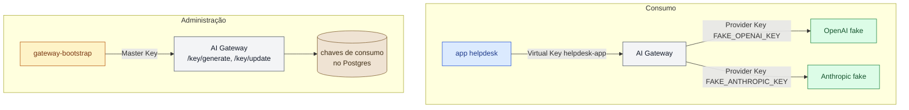
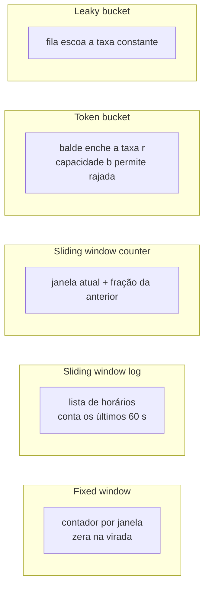
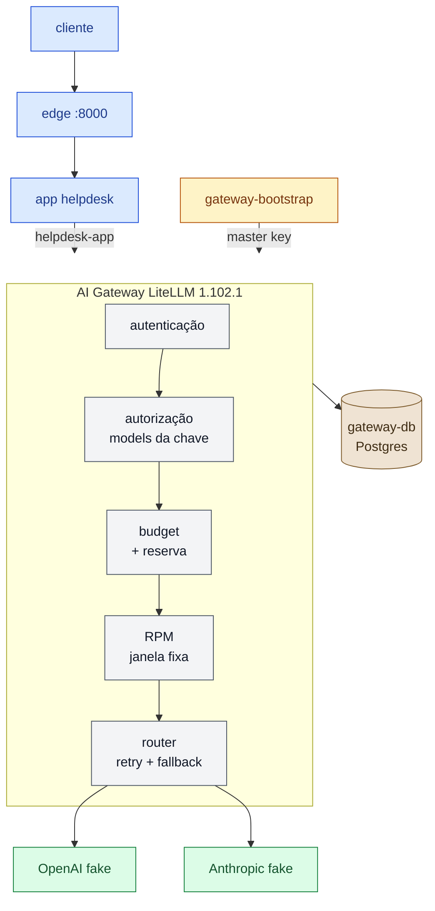
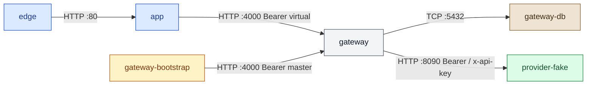
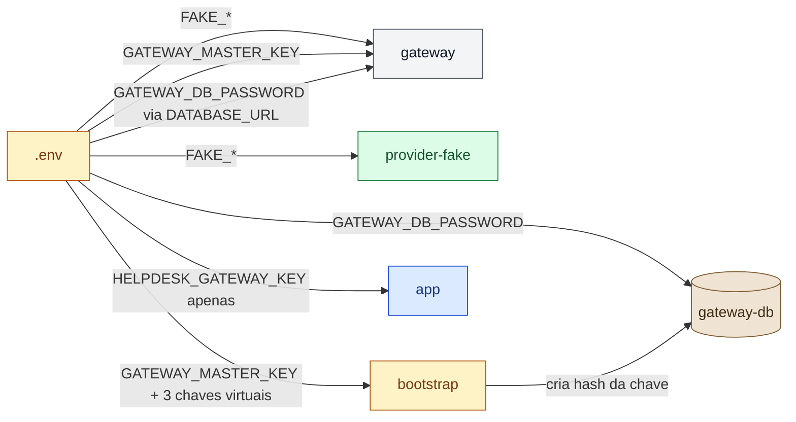
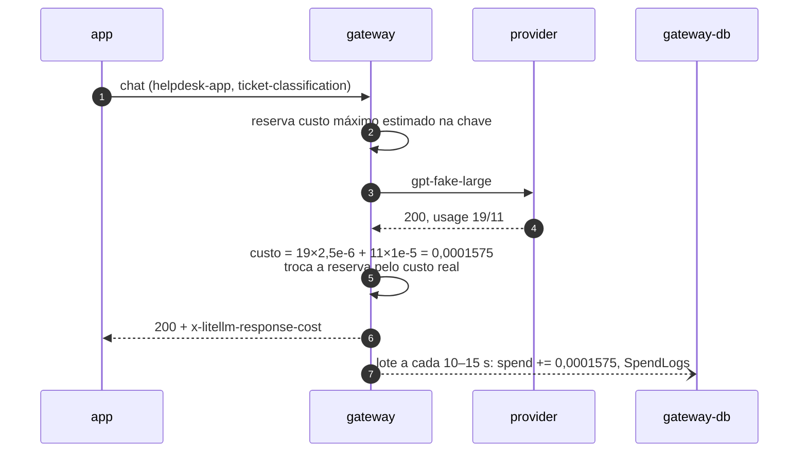
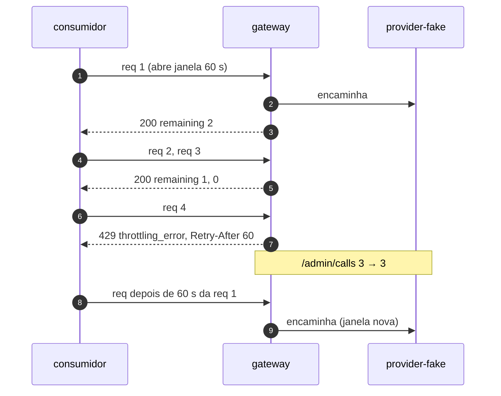
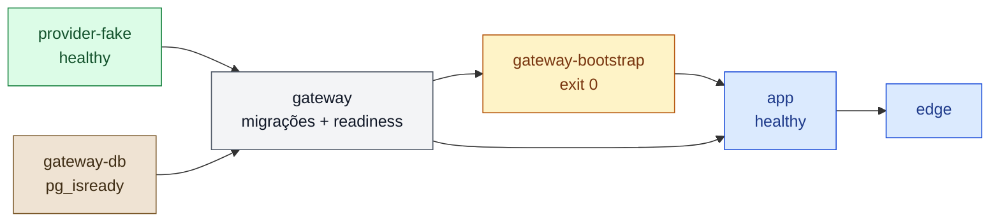

# 🛡️ Passo 12: governança, credenciais, budget e rate limiting

> **Pergunta central:** como disponibilizar IA como capacidade compartilhada de infraestrutura, com consumo autenticado, limitado, contabilizado e financeiramente controlado?
>
> **Resposta implementada:** todo consumo passa pelo gateway LiteLLM com uma **chave virtual por consumidor**; o gateway conhece o **preço de cada modelo físico**, cobra a chave pelo modelo que respondeu, **recusa antes do provider** quando o orçamento acabou ou a frequência passou do limite, e um serviço de **bootstrap idempotente** cria as chaves a cada subida. Recusas de governança não disparam retry nem fallback.

> **Legenda de cores dos diagramas:** 🟦 Consumidor/app · ⬜ Gateway · 🟥 Recusa de governança · 🟩 Provider · 🟫 Banco de governança · 🟨 Provisionamento

## Sumário
1. [Mapa das subetapas](#1-mapa-das-subetapas)
2. [Contexto recuperado (4.1)](#2-contexto-recuperado-41)
3. [Fundamentos de governança (4.2 a 4.4)](#3-fundamentos-de-governança-42-a-44)
4. [Credenciais: estado atual e estratégia (4.5 a 4.10)](#4-credenciais-estado-atual-e-estratégia-45-a-410)
5. [FinOps e preço (4.11 a 4.16)](#5-finops-e-preço-411-a-416)
6. [Budget (4.17, 4.18)](#6-budget-417-418)
7. [Rate limiting (4.19 a 4.22)](#7-rate-limiting-419-a-422)
8. [Infraestrutura (4.23 a 4.27)](#8-infraestrutura-423-a-427)
9. [Arquitetura de governança: diagramas (4.26)](#9-arquitetura-de-governança-diagramas-426)
10. [Provisionamento (4.28 a 4.32)](#10-provisionamento-428-a-432)
11. [Experimentos (4.33 a 4.44)](#11-experimentos-433-a-444)
12. [Governança × retry e fallback (4.45 a 4.49)](#12-governança--retry-e-fallback-445-a-449)
13. [Concorrência (4.50)](#13-concorrência-450)
14. [Testes (4.52, 4.53)](#14-testes-452-453)
15. [Impacto operacional e revisão arquitetural (4.54, 4.55)](#15-impacto-operacional-e-revisão-arquitetural-454-455)
16. [Preparação para o Passo 13 (4.64)](#16-preparação-para-o-passo-13-464)
17. [Limitações](#17-limitações)
18. [Perguntas de fixação](#18-perguntas-de-fixação)

## 1. Mapa das subetapas


Ordem respeitada: preço validado antes do budget, budget validado antes do rate limit, cada mecanismo com prova em `/admin/calls` antes do próximo.

## 2. Contexto recuperado (4.1)

| Artefato | Informação relevante | Utilização nesta etapa |
|---|---|---|
| `provider-fake/README.md` | preços por 1M tokens; `usage`; aviso de que o LiteLLM calcula custo zero sem preço declarado | configuração de preço |
| Comparativo de modelos (`docs/model-comparison.md`, `docs/fallback/evidencias/comparacao-modelos.json`) | tokens e custos por tarefa; large ≡ large | exemplos de custo e cadeia |
| `gateway/config.yaml` | 10 grupos, `master_key`, sem banco | autenticação e roteamento |
| ADR 0005 revisado | primário: 2 tentativas em `500/503`, 1 em `429`/timeout; prazos da app 14/25 s | controle de consumo por requisição |
| ADR 0006 | cadeia primário → equivalente → mini (F1/F2); até 4 chamadas | contabilização em fallback |
| `compose.yaml` | 4 serviços; app recebia `GATEWAY_API_KEY=${GATEWAY_MASTER_KEY}` | provisionamento e menor privilégio |
| ADRs 0001–0006 | gateway como único dono de modelos, chaves e recuperação | coerência |
| Testes | caracterização 32, resiliência 34, fallback 40 | regressão |

Confirmações (comandos reais, saída em `docs/governanca/evidencias/`):

| Item | Resultado |
|---|---|
| Tags | `v1-coupled` → `8028305`, `v2-decoupled` → `b637c5a`, intactas |
| Quatro features | `200` pela borda (caracterização 32 passed) |
| Comunicação só pelo gateway | `grep -rE "gpt-fake\|claude-fake" app/` vazio; app só tem `openai` SDK apontado ao gateway |
| Credenciais de provider | só no gateway e no provider-fake |
| Autenticação do gateway | **só a master key**, e a app a usava |
| Banco ou serviço auxiliar | nenhum (`/key/info` → `500 Database not connected`) |
| Custo registrado | **0.0** numa F1 com 19/11 tokens (evidência `00`) |
| Versão do gateway | `x-litellm-version: 1.102.1` |

## 3. Fundamentos de governança (4.2 a 4.4)

**Governança de IA** é o conjunto de políticas que respondem quem pode usar IA, para quê, com quais limites, com que rastreabilidade e quem responde pelo resultado e pelo custo. Não se resume a segurança do modelo nem a avaliar respostas: aqui o foco é **consumo** (acesso, dinheiro, frequência, rastreio).

| Dimensão | Pergunta central | Mecanismo neste projeto |
|---|---|---|
| Segurança | Quem pode acessar? | chave virtual; `401` sem chave válida |
| Autorização | O que pode acessar? | `models` da chave; `403` fora dela |
| Budget | Quanto pode gastar? | `max_budget`; `429 budget_exceeded` |
| Rate limiting | Com que frequência? | `rpm_limit`; `429 throttling_error` |
| Observabilidade | O que aconteceu? | `LiteLLM_SpendLogs`, headers `x-litellm-*`, `/admin/calls` |
| Governança | Quais políticas valem? | ADR 0009 → configuração (ADR 0010) |

Governança **decide** a política; gerenciamento **organiza** sua execução (quem provisiona, quem revisa orçamento); controle operacional **executa** a cada requisição (o gateway recusando).

Problemas de cada aplicação cuidar de tudo sozinha: chaves de provider espalhadas (rotação em N lugares), contratos e preços divergentes, ninguém sabe o total gasto, cada app com limite diferente (ou nenhum), modelo físico decidido por quem codifica. O gateway vira o **ponto de aplicação** (policy enforcement point) dessas políticas.

**Mínimo do desafio** (feito): chave com orçamento, chave com RPM, recusa antes do provider, chaves criadas automaticamente, credenciais isoladas, compose reprodutível. **Governança completa** (fora): aprovação de casos de uso, classificação de dados, guardrails, avaliação de qualidade, auditoria regulatória, chargeback.

### Três níveis de arquitetura (4.3)

| Decisão | Nível | Justificativa |
|---|---|---|
| Todo consumo de IA passa pelo gateway | corporativa | padroniza contrato, credencial e custo para todas as apps ([0009](../adr/0009-corporate-ai-governance.md)) |
| Toda identidade tem orçamento com recusa e limite de frequência | corporativa | política financeira e de proteção de recurso |
| Providers permitidos | corporativa | contrato e risco |
| Gateway como ponto de aplicação, chave virtual por consumidor | solução | como a política é aplicada ([0010](../adr/0010-gateway-governance.md)) |
| Postgres do gateway | solução | exigência da ferramenta para chave virtual ([0007](../adr/0007-gateway-governance-database.md)) |
| Serviço de bootstrap | solução | remover passo manual ([0008](../adr/0008-key-bootstrap-service.md)) |
| Contadores em memória, sem Redis | solução | uma instância; nenhum requisito pede compartilhar |
| Preço por destino em `config.yaml` | software | custo do modelo que respondeu |
| `IDENTITIES` e reconciliação no script | software | estado desejado executável |
| `throttled`/`budget_exceeded` no adapter | software | features não conhecem o gateway |

**Exemplo didático (fictício, não é política de empresa real):** "cada aplicação de atendimento pode gastar até US$ 20 por mês com IA, com aviso aos 75%". Vira: `max_budget: 20.0`, `soft_budget: 15.0`, `budget_duration: "30d"` na identidade `helpdesk-app` → o gateway recusa com `429 budget_exceeded` quando o gasto atinge 20.

### Governança distribuída × centralizada (4.4)

| Critério | A. Distribuída (cada app → provider) | B. Centralizada (gateway) |
|---|---|---|
| Complexidade operacional | baixa por app, alta no total | um componente a mais, regra única |
| Segurança das credenciais | chave de provider em N apps | só no gateway |
| Rastreabilidade | logs heterogêneos | gasto por chave e requisição num lugar |
| Controle financeiro | soma manual de faturas | orçamento por identidade com recusa |
| Padronização | ❌ | ✅ |
| Administração | N configurações | uma |
| Isolamento entre consumidores | natural | por chave (verificado no experimento 05) |
| Disponibilidade | falha de um provider afeta só quem o usa | **gateway fora derruba toda a IA** |
| Risco de concentração | baixo | gateway e banco concentram segredos e decisão |

Centralizar governança cria dependência de um componente compartilhado: o gateway (e agora o banco dele) é ponto único de falha. Alta disponibilidade (réplicas, Redis, banco gerenciado) ficou fora do escopo, registrada como risco.

## 4. Credenciais: estado atual e estratégia (4.5 a 4.10)

### Antes (commit `ce6c041`)

| Credencial | Consumidor | Finalidade | Localização | Permissões |
|---|---|---|---|---|
| `FAKE_OPENAI_KEY` | gateway, provider-fake | chamar/validar provider OpenAI | `.env` → `environment` | provider inteiro |
| `FAKE_ANTHROPIC_KEY` | gateway, provider-fake | idem Anthropic | idem | provider inteiro |
| `GATEWAY_MASTER_KEY` | gateway **e app** (como `GATEWAY_API_KEY`) | admin e consumo | idem | **tudo**: criar chaves, todos os grupos, sem limite |

Problemas confirmados na configuração real: **a app usava a chave administrativa** (compose: `GATEWAY_API_KEY: ${GATEWAY_MASTER_KEY}`); **credencial excessivamente privilegiada**; **sem identificação individual do consumo** (uma chave para tudo). Não confirmados: compartilhamento indiscriminado de `.env` (nenhum serviço usa `env_file`, cada um recebe só o que usa) e chaves em logs (o log do gateway mostra `REDACTED` e `sk-...0001`).

### Conceitos (4.6, 4.7)

| Conceito | Responsabilidade |
|---|---|
| Autenticação | identificar o consumidor (a chave existe e está ativa?) |
| Autorização | o que ele pode acessar (essa capacidade está na chave?) |
| Contabilização | registrar o que consumiu (gasto por chave e por requisição) |
| Governança | aplicar as políticas (orçamento, frequência) |

Identidade é "quem"; principal é a identidade autenticada numa requisição; credencial é a prova (aqui, um bearer token: quem tem o valor é tratado como o dono). Entre serviços não há usuário: a identidade é a do **serviço** (service account). A app do helpdesk não precisa saber quem é o provider nem a chave dele, só a sua chave de consumo; trocar de provider ou de chave de provider não muda a app. A identidade lógica pode carregar aplicação, ambiente, equipe, produto e centro de custo: aqui, em `key_alias` e `metadata` (`owner`, `cost_center`, `environment`). RBAC completo e autenticação de usuários finais ficaram fora.



A app não deve usar a master key permanentemente porque quem tem a chave da app (um log, um dump de ambiente, um bug) passaria a poder criar chaves, mudar orçamentos e consumir sem limite, e porque todo gasto apareceria como "admin", sem dono.

### Identidades (4.8)

| Identidade | Finalidade | Capacidades | Política financeira | Limite operacional | Onde está | Criação |
|---|---|---|---|---|---|---|
| `helpdesk-app` | consumo normal | 4 capacidades | US$ 20 / 30 d, soft 15 | 600 RPM | `HELPDESK_GATEWAY_KEY` → só `app` | bootstrap |
| `governance-budget-demo` | demonstrar orçamento | F1 | US$ 0,0004 acumulado | — | `.env`, uso manual | bootstrap |
| `governance-rate-demo` | demonstrar RPM | F1 | US$ 1 | 3 RPM | `.env`, uso manual | bootstrap |
| `gateway-admin` (master key) | administração | todas | — | — | gateway e bootstrap | `.env` |

Separar as demos da chave do helpdesk: os experimentos esgotam orçamento e janela **sem** derrubar a app, os testes normais continuam verdes, cada demo isola uma única causa de recusa, o reset de demo não toca o orçamento real e cada chave tem uma responsabilidade.

### Isolamento (4.9)

| Credencial | App | Gateway | Bootstrap |
|---|---|---|---|
| OpenAI Fake | não | sim | não |
| Anthropic Fake | não | sim | não |
| Master key | não | sim | sim |
| Senha do banco | não | sim (`DATABASE_URL`) | não |
| Chave do helpdesk | **sim** | valida (hash no banco) | cria |
| Chaves de demo | não | valida | cria |

Variável de **interpolação** é a que o compose lê do `.env` para montar o arquivo (`${HELPDESK_GATEWAY_KEY:?...}`); variável **injetada** é a que aparece no `environment` do container. O `.env` inteiro nunca entra em container (sem `env_file`): entregar o arquivo todo a todos os serviços daria a master key e as chaves de provider à app. Nenhum Dockerfile recebe segredo em `ARG`; o único arquivo montado novo é `gateway/scripts/` (código, sem segredo), só no bootstrap.

### Ciclo de vida (4.10)

| Etapa | Agora | Futuro (boa prática) |
|---|---|---|
| Provisionamento | bootstrap a cada `up` | pipeline com aprovação |
| Distribuição | `.env` → `environment` do serviço | cofre de segredos injetando em runtime |
| Armazenamento | `.env` local; só o hash no banco | cofre |
| Utilização | bearer token | idem, com escopo por capacidade |
| Rotação | manual: novo valor + `up`, depois `/key/delete` da antiga | `key/regenerate` com janela de convivência |
| Expiração | não usada (`duration` disponível) | chaves de curta duração |
| Revogação | `/key/delete` → `401` na hora (testado) | idem, com alerta |
| Auditoria | `LiteLLM_SpendLogs`, logs do gateway | trilha imutável |

E se...: **credencial comprometida** → revoga só aquela chave; dano limitado a US$ 20/30 d e 600 RPM nas 4 capacidades. **App deixa de existir** → remove-se de `IDENTITIES` e revoga-se (remover da lista não revoga: decisão explícita). **Equipe precisa de novo orçamento** → muda `max_budget` em `IDENTITIES`; o próximo `up` faz `key/update` sem zerar o gasto. **Chave precisa ser substituída** → nova identidade/valor, consumidor atualizado, antiga revogada. **Master key usada indevidamente** → é o pior caso (controle total do gateway): por isso ela só existe em dois serviços e nunca na app; trocar exige recriar gateway e bootstrap.

## 5. FinOps e preço (4.11 a 4.16)

FinOps é a prática de dar **visibilidade**, **dono** e **controle** ao custo variável, com engenharia, produto e finanças juntos: alocar custo (por chave), controlar orçamento (hard limit), medir eficiência (unit economics), prever (orçamento periódico), mostrar (showback) e, se a empresa quiser, cobrar (chargeback). O custo de IA é diferente de uma VM: não é por hora, é **por token**, e cresce com tokens de entrada, tokens de saída, número de chamadas, modelo, provider, **retries**, **fallbacks** e volume.

Fórmula, preços por milhão: `custo = (tokens_in × preço_in + tokens_out × preço_out) / 1.000.000`.

Exemplos **com valores fictícios** (só para exercitar a fórmula; modelo X a US$ 1/1M entrada e US$ 4/1M saída):

| Caso | Conta | Custo |
|---|---|---|
| chamada curta, 100 in / 20 out | (100×1 + 20×4)/1M | US$ 0,00018 |
| resposta extensa, 100 in / 2.000 out | (100 + 8.000)/1M | US$ 0,0081 (45×) |
| lote, 7.000 in / 1.000 out | (7.000 + 4.000)/1M | US$ 0,011 |
| a mesma curta repetida 3× (retry que gera) | 3 × 0,00018 | US$ 0,00054 |
| fallback para modelo Y a US$ 3/12 | (100×3 + 20×12)/1M | US$ 0,00054 (3× o primário) |

Erro clássico de unidade: usar "2,50" como preço **por token** em vez de por milhão multiplica a conta por 1.000.000; usar "por mil" em vez de "por milhão", por 1.000. No LiteLLM o campo é **por token**: 2,50/1M = `0.0000025`.

**F3 em escala (valores reais do desafio):** o mês de agosto tem 5.000 tickets → 34 lotes de 150 → 34 chamadas ao modelo por relatório, ~222 mil tokens de entrada (calculados com a regra `ceil(caracteres/4)` do provider). No `claude-fake-large`: entrada US$ 0,67; saída limitada por `max_tokens: 2000` por lote → no máximo US$ 1,02. Um relatório mensal custa até ~US$ 1,69; um por hora, ~US$ 1.200 por mês. Uma chamada barata vira conta grande pelo volume.

### Preços reais dos modelos simulados (4.13)

| Modelo | Entrada | Saída | Unidade | Fonte |
|---|---|---|---|---|
| `gpt-fake-large` | 2,50 | 10,00 | US$ por 1M tokens | `provider-fake/README.md`, tabela Modelos |
| `gpt-fake-mini` | 0,15 | 0,60 | idem | idem |
| `claude-fake-large` | 3,00 | 15,00 | idem | idem |
| `claude-fake-mini` | 0,80 | 4,00 | idem | idem |

Moeda dólar; cobrança por token; o Claude large é 20% mais caro na entrada e 50% na saída que o GPT large; o mini é de 5 a 17 vezes mais barato. `usage` no formato OpenAI: `prompt_tokens`, `completion_tokens`, `total_tokens`; no formato Messages, `input_tokens`/`output_tokens` (o gateway normaliza). `/admin/calls` registra `input_tokens` e `output_tokens` (nulo sem geração completa).

### Contabilização (4.14, 4.15)

| Informação | Esperado | Observado antes | Observado depois do preço |
|---|---|---|---|
| Modelo físico | `gpt-fake-large` | `openai/gpt-fake-large` | idem |
| Tokens de entrada | 19 | 19 | 19 |
| Tokens de saída | 11 | 11 | 11 |
| Preço de entrada | US$ 2,50/1M | desconhecido (0) | `0.0000025`/token |
| Preço de saída | US$ 10,00/1M | desconhecido (0) | `0.00001`/token |
| Custo da chamada | **US$ 0,0001575** | **0.0** | `0.0001575` |
| Consumo acumulado | soma por chave | sem banco, sem chave | por chave (seção 11) |

Causa da diferença: **modelo desconhecido** no catálogo interno do LiteLLM (`LITELLM_LOCAL_MODEL_COST_MAP=True` usa a tabela embutida, que não tem modelos simulados). Não houve arredondamento nem atraso: o valor era zero na origem.

### Preços configurados (4.16)

`input_cost_per_token`/`output_cost_per_token` em `litellm_params` de **cada destino** (documentação do LiteLLM: custom pricing). Preço por destino físico, não por capacidade: na cadeia de fallback, cada destino tem o preço do seu modelo.

| Modelo | Preço configurado (in/out por token) | Manual (19/11 tok) | Registrado | Validado? |
|---|---|---|---|---|
| `gpt-fake-large` | 0.0000025 / 0.00001 | 0,0001575 | 0,0001575 | ✅ |
| `claude-fake-large` | 0.000003 / 0.000015 | 0,000222 | 0,000222 | ✅ |
| `gpt-fake-mini` | 0.00000015 / 0.0000006 | 0,00000945 | 0,00000945 | ✅ |
| `claude-fake-mini` | 0.0000008 / 0.000004 | 0,0000592 | 0,0000592 | ✅ |

Fonte: `evidencias/01-precos.json` (chamada curta em cada grupo com a master key).

## 6. Budget (4.17, 4.18)

Orçamento é o teto financeiro de um consumidor. Consumo acumulado é o que já foi gasto; disponível = orçamento − acumulado. Pode ser por consumidor, equipe, aplicação ou global; pode renovar por período (`budget_duration`) ou acumular até um reset autorizado.

| Mecanismo | Comportamento | Aqui |
|---|---|---|
| Soft limit | sinaliza | `soft_budget: 15` no helpdesk; sem canal de alerta, fica só registrado |
| Hard limit | impede | `max_budget`; `429 budget_exceeded` |
| Budget periódico | renova | helpdesk, 30 d (`budget_reset_at: 2026-12-01`, calculado pelo gateway) |
| Budget acumulado | até reset autorizado | demos; `--reset-spend` |

Um alerta não é recusa: só o `max_budget` atende o desafio.

**Concorrência (experimento mental):** saldo US$ 0,0001, duas requisições leem o saldo ao mesmo tempo, ambas veem "há saldo", ambas passam; cada uma custa US$ 0,0001575 → gasto final US$ 0,000315, três vezes o disponível. O custo só é conhecido **depois** da resposta. Estratégias:

| Estratégia | Ideia | Garantia |
|---|---|---|
| Verificar o consumo já contabilizado | admite se `gasto < teto` | passa do teto em até N chamadas simultâneas |
| Estimar antes | calcula o pior caso da requisição | precisa de `max_tokens` conhecido |
| Reservar | soma a estimativa ao contador antes de encaminhar | não passa do teto; recusa mais cedo |
| Contabilizar depois | soma o custo real na resposta | exato, mas tardio |
| Reconciliar | troca a reserva pelo custo real | combina as duas |

**Semântica do LiteLLM 1.102.1 (lida no código e medida):** na autenticação, recusa se `gasto >= max_budget` (`auth_checks._virtual_key_max_budget_check`); em seguida **reserva** o custo máximo estimado (entrada + `max_tokens`, ou 16.384 tokens de saída quando a requisição não informa, limitado ao teto) em `spend_tracking/budget_reservation.py`, e reconcilia com o custo real na resposta. Resultado: em sequência a última chamada admitida pode passar do teto (0,0004725 contra 0,0004); em paralelo a reserva segura as outras (6 → 1). O aceite obrigatório (recusa da chave já esgotada antes do provider) está provado; garantia financeira absoluta entre várias instâncias não é oferecida sem Redis.

## 7. Rate limiting (4.19 a 4.22)

Rate limiting limita **frequência**; budget limita **dinheiro**. Um orçamento alto não impede 10.000 requisições num minuto: isso esgotaria a cota do provider, a capacidade do gateway e o orçamento em minutos. Um RPM folgado não impede gastar demais devagar. Por isso as duas coisas.

| Mecanismo | Recurso controlado |
|---|---|
| Budget | dinheiro |
| RPM | requisições por minuto |
| TPM | tokens por minuto |
| Limite de concorrência | operações simultâneas |
| Quota | volume num período longo |

Throughput é o trabalho por tempo; burst, rajada; throttling, recusar/atrasar para conter a taxa; load shedding, descartar carga para proteger o sistema; fairness, um consumidor não tomar a capacidade dos outros; resource protection, o motivo de tudo isso.

### Algoritmos (4.20)



| Algoritmo | Estrutura | Memória | Rajadas? | Precisão | Distribuído | Custo de implementar |
|---|---|---|---|---|---|---|
| Fixed window | 1 contador + início da janela | O(1) | sim; até 2× na virada | baixa na borda | `INCR`+`EXPIRE` atômicos | baixo |
| Sliding window log | lista de timestamps | O(N) por chave | não | exata | lista ordenada compartilhada | médio |
| Sliding window counter | 2 contadores | O(1) | pouco | aproximada | simples | baixo |
| Token bucket | tokens + último refill | O(1) | sim, até a capacidade | boa | script atômico | médio |
| Leaky bucket | fila ou contador de nível | O(fila) | não (suaviza) | boa | fila compartilhada | médio |

O LiteLLM 1.102.1 usa o limitador v3 (`parallel_request_limiter_v3.py`): **janela fixa de 60 s** (`LITELLM_RATE_LIMIT_WINDOW_SIZE`), início na primeira requisição admitida, contador em memória (`DualCache`) quando não há Redis; com Redis, os mesmos contadores num script Lua atômico. Nada foi implementado à mão.

### Exercícios com 5 RPM (4.21)

Antes de ler as respostas, tente calcular. Janela fixa começando em 10:00:00; token bucket de capacidade 5 e recarga de 1 a cada 12 s.

| Cenário | Fixed window | Sliding window (log) | Token bucket |
|---|---|---|---|
| 5 seguidas | 5 passam | 5 passam | 5 passam (balde vazio) |
| 6ª no mesmo minuto | recusada | recusada | recusada (se < 12 s depois) |
| 5 às 10:00:59 + 5 às 10:01:00 | **10 passam em 1 s** | só 5 (as 5 primeiras ainda estão nos últimos 60 s) | 5 passam; depois 1 a cada 12 s |
| 1 a cada 12 s | todas | todas | todas |
| 6 simultâneas | 5 passam se o contador é atômico | 5 | 5 |
| consumidores diferentes | contadores separados | separados | baldes separados |

A semântica muda a experiência: janela fixa é simples mas permite rajada dupla na virada e faz o cliente esperar até a janela terminar; token bucket distribui melhor e diz "espere 12 s" em vez de "espere até 60 s". O valor 5 é didático; a demo usa **3** (menos chamadas para demonstrar) e o helpdesk 600.

### Estado distribuído (4.22)

Contador local fica na memória de uma instância; compartilhado fica num armazenamento comum. Incrementar "ler, somar, gravar" sem atomicidade perde contagens (race condition); `INCR` atômico ou lock resolve. Contadores de janela expiram com TTL; ao reiniciar o gateway, contadores em memória somem (a janela de RPM recomeça; o gasto é relido do banco). Com duas instâncias e contadores locais:

```text
Gateway A: 5 requisições permitidas     Gateway B: 5 requisições permitidas
consumidor alterna entre A e B  →  10 por minuto, o dobro do limite "global"
```

A solução é um contador compartilhado (Redis, com script atômico; o LiteLLM já faz isso quando recebe Redis). Hoje há uma instância: o contador local é exato (6 simultâneas → 3 admitidas com RPM 3).

## 8. Infraestrutura (4.23 a 4.27)

| Recurso | Dependência | Justificativa | Obrigatória? |
|---|---|---|---|
| Chaves virtuais | Postgres (`DATABASE_URL`) | o LiteLLM guarda chaves e hashes no banco; sem ele, `500 Database not connected` | **sim, da ferramenta** |
| Budget por chave | Postgres | gasto persistido por chave | sim, da ferramenta e do desafio |
| Registro de consumo | Postgres (`LiteLLM_SpendLogs`) | gasto por requisição | sim, da ferramenta |
| Persistência entre reinícios | volume do Postgres | gasto e chaves sobrevivem | sim, do desafio (reprodutível) |
| Rate limiting | nenhuma (memória) | limitador v3 funciona sem Redis | não |
| Contadores entre instâncias | Redis | só com réplicas | recomendada em ambiente distribuído; não aqui |
| Administração de chaves | master key + banco | endpoints `/key/*` | sim |
| Processo de inicialização | migrações Prisma (automáticas) + bootstrap | esquema e chaves | sim |

| Alternativa | Benefícios | Limitações |
|---|---|---|
| Estado em memória | simples | **impossível**: o LiteLLM não emite chave virtual sem banco |
| Postgres | persistência, transações, suportado | novo serviço, senha, volume |
| Outra solução | — | o LiteLLM não suporta outro banco para chaves |

**Redis**, questionado: o gateway já oferece RPM suficiente? sim. Redis é obrigatório na versão usada? não. Algum requisito não se atende sem ele? não (uma instância). Benefício verificável hoje? nenhum. **Não entrou.** Cache de resposta também não (fora do escopo).

Implementação (detalhe no [ADR 0007](../adr/0007-gateway-governance-database.md)): `postgres:17.2-alpine` fixado, variáveis `POSTGRES_DB/USER/PASSWORD`, volume `gateway-db-data`, rede padrão do compose, healthcheck `pg_isready`, gateway com `depends_on: gateway-db: service_healthy`, `DATABASE_URL` só no gateway, migrações pelo próprio gateway, **sem porta publicada**. A app não depende do banco.

## 9. Arquitetura de governança: diagramas (4.26)

**1. Componentes**



**2. Comunicação entre serviços**



**3. Fluxo das credenciais**



**4. Contabilização financeira**



**5. Validação do orçamento** e **7. recusa**

```mermaid
sequenceDiagram
    autonumber
    participant C as consumidor
    participant G as gateway
    participant P as provider-fake
    C->>G: chat (governance-budget-demo)
    G->>G: autentica; gasto 0,0004725 >= 0,0004
    G-->>C: 429 budget_exceeded
    Note over G,P: router não é acionado: /admin/calls 3 → 3
```

**6. Validação do limite de requisições**



**8. Provisionamento das chaves**: ver o diagrama de sequência do [ADR 0008](../adr/0008-key-bootstrap-service.md). **Inicialização dos serviços:**



**Interação entre governança e fallback:** ver o fluxograma do [ADR 0010](../adr/0010-gateway-governance.md): recusas acontecem antes do router.

## 10. Provisionamento (4.28 a 4.32)

Infrastructure as Code descreve infraestrutura em arquivos versionados (`compose.yaml`); Configuration as Code faz o mesmo com a configuração (`config.yaml`, `IDENTITIES`). Bootstrap é o passo que leva o sistema do vazio ao mínimo funcional; provisioning cria recursos e credenciais; startup readiness é estar pronto (não só "rodando"); desired state + reconciliation é declarar o estado e corrigir o que diverge; idempotência é repetir sem mudar o resultado.

Comparação e decisão no [ADR 0008](../adr/0008-key-bootstrap-service.md): declarativa não existe no LiteLLM; script manual exige passo humano; **serviço de inicialização** escolhido; embutir no gateway ou na app daria a master key a quem não deve. Chave da app com **valor fixo** no `.env`: a app sabe a chave antes de subir; gerar chave aleatória a cada subida deixaria chaves órfãs e a app com a chave antiga.

O script: (1) espera `/health/readiness` com `db: connected` (sem `sleep` fixo); (2) autentica com a master key; (3) `GET /key/info`; (4) cria o que falta; (5) alinha só a política divergente; (6) a app recebe a chave pelo compose; (7) relê e confere; (8) sai com 0 ou 1.

| Cenário | Esperado | Observado |
|---|---|---|
| A. Ambiente novo | 3 × `criada`, app sobe | `evidencias/30-ambiente-limpo.txt` |
| B. Existente | 3 × `já conforme`, gasto igual | `já conforme ... spend=0.0030570` (helpdesk) |
| C. Gateway reiniciado | `já conforme`, gasto preservado | `evidencias/31-reinicio-gateway.txt` |
| D. Falha parcial | sai com 1, app não sobe; depois completa | 1ª: helpdesk criada e `FALHA` na verificação, `up` com `exit 1`; 2ª: helpdesk `já conforme`, 2 `criada` |

**Reprovisionar ≠ resetar.** Reprovisionar alinha política (orçamento, RPM, modelos) e **nunca** toca `spend`. Resetar zera o estado operacional e é outro comando, só para demos: `docker compose run --rm gateway-bootstrap --reset-spend governance-budget-demo`. Achado: o primeiro reset (`key/update spend=0` direto) voltou a `0.00055` 10 s depois, porque o gasto ainda estava na fila de gravação em lote; o reset agora espera o gasto ficar estável por um ciclo, zera e confere depois de outro ciclo (`spend 0.0005500 -> 0.0000000 ... confirmado`).

## 11. Experimentos (4.33 a 4.44)

Instrumento de prova em todos: `GET localhost:8090/admin/calls` antes e depois, **sem** `/admin/reset` no meio, sem outro tráfego. Script: [`sondas_governanca.py`](sondas_governanca.py).

### Orçamento de demonstração (4.33)

| Informação | Valor | Justificativa |
|---|---|---|
| Identidade | `governance-budget-demo` | separada da app |
| Capacidade | `ticket-classification` | curta (1,1 s), saída fixa de 11 tokens |
| Modelo primário | `gpt-fake-large` | — |
| Budget | US$ 0,0004 | 0,0004 / 0,0001575 = 2,54 → 3 admitidas, 4ª recusada |
| Unidade | US$ | igual aos preços |
| Custo por chamada | US$ 0,0001575 | 19/11 tokens |
| Chamadas até o limite | 3 | gasto 0,0004725 ≥ 0,0004 |
| Período | acumulado | reset só explícito |

Precisão: o gateway guarda `float` (o corpo mostra `0.0004725000000000212`); a demo não depende de arredondamento. Orçamento didático, inadequado para produção (o do helpdesk é US$ 20 / 30 d).

### Experimento 01/02: consumo e esgotamento (`03-budget-esgotamento-e-recusa.json`)

| Requisição | Custo | Acumulado | Disponível | Status | Chegou ao provider? |
|---|---|---|---|---|---|
| 1 | 0,0001575 | 0,0001575 | 0,0002425 | 200 | sim |
| 2 | 0,0001575 | 0,000315 | 0,000085 | 200 | sim |
| 3 | 0,0001575 | 0,0004725 | −0,0000725 | 200 | sim |
| 4 | 0 | 0,0004725 | — | **429** | **não** |

| Informação | Antes | Depois |
|---|---|---|
| Budget | 0,0004 | 0,0004 |
| Consumo acumulado (`/key/info`) | 0,0 | 0,0004725 (após o lote) |
| Chamadas ao provider | 0 | 3 |

### Experimento 03: prova de bloqueio por orçamento

| Verificação | Esperado | Observado |
|---|---|---|
| Budget esgotado | sim | gasto 0,0004725 ≥ 0,0004 |
| Requisição recusada | sim | `429` `{"type":"budget_exceeded","message":"Budget has been exceeded! Key=governance-budget-demo (sk-...0001) Current cost: 0.0004725…, Max budget: 0.0004"}` |
| Chamadas antes | N | 3 |
| Chamadas depois | N | 3 |
| Novas chamadas | 0 | **0** |

Log do gateway: `user_api_key_auth(): Exception occured - Budget has been exceeded!` (a recusa é na **autenticação**). O status é `429`, não `402`/`403`: o LiteLLM define `BudgetExceededError.status_code = 429`.

### Rate limit (4.38 a 4.42, `06-rate-limit-recusa-e-recuperacao.json`)

| Informação | Valor | Justificativa |
|---|---|---|
| Identidade | `governance-rate-demo` | separada |
| Limite | 3 | demonstração em 4 chamadas |
| Unidade | requisições recebidas pelo gateway | — |
| Janela | 60 s, fixa, a partir da 1ª admitida | semântica do LiteLLM v3 |
| Capacidade | `ticket-classification` | curta |
| Política financeira | US$ 1 (≈ 6.300 chamadas) | nunca é a causa da recusa |

| Requisição | Horário (UTC) | Status | Restante | Chegou ao provider? |
|---|---|---|---|---|
| 1 | 07:56:41.028 | 200 | 2 | sim |
| 2 | 07:56:42.439 | 200 | 1 | sim |
| 3 | 07:56:43.851 | 200 | 0 | sim |
| 4 | 07:56:44.183 | **429** | — | **não** (3 → 3) |
| 5, 6 (recusas extras) | 07:56:44 | 429, 429 | — | não |
| 7 | 07:57:41 (60 s após a 1ª) | **200** | — | sim |
| 8 | 07:57:47 | 200 | 1 | sim |

| Verificação | Esperado | Observado |
|---|---|---|
| Limite atingido | sim | restante 0 |
| Recusada | sim | `429 throttling_error` "Rate limit exceeded for api_key: <hash>. Limit type: requests. Current limit: 3, Remaining: 0. Limit resets at: 07:57:44 UTC" |
| Motivo | rate limiting | idem; log `Rate limit exceeded for REDACTED` |
| Novas chamadas | 0 | 0 |

Headers observados: `retry-after: 60`; nas respostas admitidas `x-ratelimit-api_key-remaining-requests` e `-limit-requests`. Achado: o corpo diz que a janela termina 60 s depois da **recusa** (07:57:44), mas ela terminou 60 s depois da **primeira admitida** (07:57:41 já passou). `Retry-After: 60` e "resets at" são limites pessimistas, não o instante exato. As recusas não estenderam a janela, e a chave voltou sozinha: recusa por RPM não é indisponibilidade permanente.

### Isolamento (4.43, `05-isolamento.json`)

| Chave | Orçamento | Limite | Resultado |
|---|---|---|---|
| `governance-budget-demo` | esgotado | sem RPM | `429 budget_exceeded`, 0 chamadas |
| `governance-rate-demo` | folgado | esgotado | `429 throttling_error`, 0 chamadas |
| `helpdesk-app` (pela borda) | folgado | folgado | `200` F1 `delivery/high` |

Limites individuais (por chave) não se afetam; não há limite global nem compartilhado configurado. Se houvesse um `max_budget` global do proxy, uma chave poderia esgotar o de todas: por isso o isolamento não é absoluto por natureza, é desta configuração.

### Autenticação (4.44, `02-autenticacao.json`)

| Cenário | Status | Motivo | Novas chamadas |
|---|---|---|---|
| chave válida | 200 | — | 1 |
| inválida | 401 | `Authentication Error, Invalid proxy server token passed` | 0 |
| ausente | 401 | `No api key passed in.` | 0 |
| revogada (`/key/delete`) | 401 | inválida | 0 |
| capacidade fora da chave | 403 | `key_model_access_denied` | 0 |
| grupo interno pela chave da app | 403 | idem | 0 |

Exposição: o `401` devolve o **hash** da chave recebida e o nome da tabela `LiteLLM_VerificationTokenTable`; não devolve o valor da chave, a URL do banco nem chaves de provider. A app não repassa nada disso (responde `502 model_rejected`).

## 12. Governança × retry e fallback (4.45 a 4.49)

| Erro | Origem | Retry? | Fallback? | Justificativa |
|---|---|---|---|---|
| HTTP 500 do provider | provider | 1 no primário | sim | falha possivelmente transitória |
| HTTP 429 do provider | provider | 0 no primário | sim | saturação de um provider; outro responde |
| Timeout | provider | 0 no primário | sim | migrar cabe no prazo |
| Rate limit do gateway | gateway | **não** | **não** | é a política; repetir só desperdiça e contornaria a intenção |
| Budget esgotado | gateway | **não** | **não** | idem; outro modelo continuaria gastando o mesmo orçamento |
| Credencial inválida ou capacidade negada | gateway | não | não | precisa de correção |

**Experimento 09** (`04-…` e `07-…`): orçamento esgotado com primário `500` e com os dois large `500` → `429 budget_exceeded` e **0** chamadas em `gpt-fake-large`, `claude-fake-large`, `gpt-fake-mini` e `claude-fake-mini`. RPM esgotado com a cadeia inteira em `500` → `429 throttling_error`, `/admin/calls` 12 → 12. Na app: `max_retries=0`; o teste `test_app_traduz_orcamento_esgotado_sem_repetir` prova que a app real traduz e não gera chamada.

**Mesmo status, origens diferentes:** `429` do limitador e `429` do provider no fim da cadeia têm o **mesmo `type`** (`throttling_error`). Diferenciam-se pelo início da mensagem ("Rate limit exceeded for" no gateway; "litellm.RateLimitError: …" no provider). O orçamento tem `type: budget_exceeded`, único. O adapter usa `type` + prefixo; o acoplamento ao texto do LiteLLM fica isolado no adapter e coberto por teste.

### Custo e RPM em cadeias (4.47, 4.48, `08-custo-em-cadeias-de-fallback.json`)

| Tentativa | Modelo | Status | Tokens | Custo esperado | Custo registrado |
|---|---|---|---|---|---|
| normal | gpt-fake-large | 200 | 19/11 | 0,0001575 | 0,0001575 |
| primário 500, tentativa 1 | gpt-fake-large | 500 | 19/— | 0 | — |
| tentativa 2 | gpt-fake-large | 500 | 19/— | 0 | — |
| equivalente | claude-fake-large | 200 | 19/11 | 0,000222 | 0,000222 |
| dois large 500: 3 falhas | gpt L, gpt L, claude L | 500 | —| 0 | — |
| mini | gpt-fake-mini | 200 | 19/11 | 0,00000945 | 0,00000945 |

Gasto da chave nos três cenários: 0,00038895 = 0,0001575 + 0,000222 + 0,00000945 (delta do `/key/info` igual à soma). Pela borda, F1 com primário `500` debitou US$ 0,000222 do `helpdesk-app`. O gateway cobra **só a tentativa que respondeu**; as que falharam sem `usage` custam 0. Limitação: um timeout de provider real é cobrado pela geração que continuou do lado do provider, e o gateway registra 0.

RPM: a mesma chave fez 3 requisições com 4 tentativas físicas cada (12 chamadas) e o restante caiu 2, 1, 0: **o RPM conta a requisição lógica recebida**, não a tentativa. Na F3, um relatório de um mês = **34 requisições** ao gateway (uma por lote), e cada uma conta 1: um RPM de 30 recusaria o próprio relatório no meio; os 600 do helpdesk comportam ~17 relatórios mensais por minuto.

### Erros na app (4.49)

Menor mudança justificável: o contrato `LanguageModelError` ganhou dois motivos e um campo opcional, as features não mudaram.

| Motivo | HTTP da app | `code` | Mensagem |
|---|---|---|---|
| `budget_exceeded` | 503 | `model_budget_exceeded` | "O orçamento de uso de IA deste serviço está esgotado." |
| `throttled` | 503 + `Retry-After` | `model_throttled` | "O limite de uso de IA deste serviço foi atingido. Tente novamente em instantes." |
| `rejected` (401/403) | 502 | `model_rejected` | "A requisição ao modelo foi recusada." |
| `rate_limited` (provider) | 503 | `model_rate_limited` | inalterado |

503 porque, para o cliente do helpdesk, o serviço está temporariamente sem capacidade de IA (não é erro do pedido dele); o `code` diferencia governança de falha do provider. Nada de resultado fictício ou campo nulo: a recusa é explícita. O log da app grava o `type` do gateway, não a mensagem (que traz hash de chave).

## 13. Concorrência (4.50)

| Cenário | Iniciadas | Autorizadas | Recusadas | Chamadas ao provider |
|---|---|---|---|---|
| Budget US$ 0,0004, 6 simultâneas | 6 | 1 | 5 (`budget_exceeded`, "Current cost: 0.327…") | 1 |
| RPM 3, 6 simultâneas | 6 | 3 | 3 | 3 |
| Budget, 8 em sequência colada (3 execuções) | 8 | 3 | 5 (200, 429, 200, 429, 200, 429, 429, 429) | 3 |

Leitura: o contador de RPM é atômico (exatamente 3). No orçamento, a reserva do custo máximo (até 16.384 tokens de saída ≈ US$ 0,164 por F1) faz as simultâneas verem o saldo "ocupado"; nenhuma ultrapassagem, mas recusas que caberiam no orçamento. Em sequência colada na mesma conexão, a reserva da anterior ainda não foi liberada quando a próxima chega, e ela é recusada cedo; com meio segundo entre chamadas, não acontece. Experimento local, uma instância: não vale como validação de escala.

## 14. Testes (4.52, 4.53)

`tests/governance/` (33 testes, ~3 min, `evidencias/20-testes-governanca.txt`):

| Arquivo | Cobre |
|---|---|
| `test_authentication.py` | válida, inválida, ausente, revogada, capacidade negada, grupo interno, recusa não ecoa a chave |
| `test_budget.py` | consumo contabilizado, esgotamento e recusa com 0 chamadas, ultrapassagem ≤ 1 chamada, concorrência, rajada sequencial |
| `test_rate_limiting.py` | saldo 2/1/0, recusa com 0 chamadas e `Retry-After`, conta requisição lógica, concorrência, recuperação após 60 s |
| `test_consumer_isolation.py` | chaves esgotadas não afetam outra nem o helpdesk (F4 pela borda) |
| `test_cost_accounting.py` | custo = manual nos 4 modelos, gasto acumulado, fallback cobra o destino que respondeu |
| `test_governance_resilience.py` | recusa sem fallback (primário e cadeia inteira em 500), sem retry, fallback elegível continua, app real traduz orçamento, RPM (com `Retry-After`), 429 do provider e credencial inválida |

Reprodutibilidade: cada teste cria **sua chave efêmera** (gasto zero, janela vazia) e a apaga no fim; as demos e o helpdesk nunca são esgotados pelos testes; o reset do provider (`/admin/reset`) zera só o provider, nunca orçamento; nenhum volume é apagado. A prova de ausência de chamada é sempre o `/admin/calls` real.

```bash
docker run --rm -v "${PWD}:/w" -w /w -e PYTHONDONTWRITEBYTECODE=1 \
  -e HELPDESK_BASE_URL=http://host.docker.internal:8000 -e PROVIDER_ADMIN_URL=http://host.docker.internal:8090 \
  -e GATEWAY_URL=http://host.docker.internal:4000 python:3.12-slim \
  sh -c "pip install -q -r tests/governance/requirements.txt && python -m pytest tests/governance -v -p no:cacheprovider"
```

Suítes anteriores: `evidencias/21-testes-anteriores.txt`.

## 15. Impacto operacional e revisão arquitetural (4.54, 4.55)

| Dimensão | Antes | Depois | Interpretação |
|---|---|---|---|
| Autenticação | master key, uma para tudo | chave virtual por consumidor | menor privilégio e atribuição |
| Controle financeiro | custo 0, nenhum | preço por modelo, orçamento com recusa | controle real |
| Limite de requisições | nenhum | RPM por chave | proteção contra laço |
| Latência | overhead do gateway | mediana 1,35 ms (master) vs 1,41 ms (virtual); F1 pela borda 1,09 s | desprezível; F1 dentro dos 3 s |
| Dependências | 4 serviços | 6 (Postgres, bootstrap que termina) | cada um com ADR |
| Rastreabilidade | `/admin/calls` | + gasto por chave e por requisição | showback possível |

Revisão: a app **não** voltou a conhecer modelos físicos nem credenciais de provider (`grep` vazio); as features não mudaram, só o contrato do erro e o adapter; políticas ficam num lugar (gateway), sem duplicação na app; não há caminho que contorne a recusa (retry e fallback estão depois dela; a app não repete); o bootstrap só acopla a app à **existência** da chave (`service_completed_successfully`); Postgres resolve chave e gasto, o bootstrap resolve o passo manual.

Métricas (`docs/governanca/metricas/governance-step-12.csv`, `evidencias/22-metricas.txt`): **idênticas** às do Passo 11 e da V2 neste nível (o adapter ganhou funções, não dependências). Resultados oficiais e `main.csv` não foram tocados.

## 16. Preparação para o Passo 13 (4.64)

| Feature | Modo atual | Impacto da governança | Investigação futura |
|---|---|---|---|
| F1 | síncrono | 1 requisição = 1 de RPM; US$ 0,0001575 (0,000222 em fallback); reserva ~US$ 0,164 em voo | Passo 13: prazo de 3 s com recusa explícita |
| F2 | síncrono | texto longo: custo maior e reserva de até 16.384 tokens; recusa antes do primeiro token | Passo 14: streaming (recusa vem antes do fluxo; custo só no fim) |
| F3 | síncrono | 34 requisições por mês de relatório, cada uma conta no RPM e no orçamento; recusa no meio deixa relatório parcial | Passo 15: job assíncrono com estado `failed` por governança e retomada |
| F4 | síncrono | igual à F1, sem mini | Passo 13 |

Credencial: `helpdesk-app` para todas. Erros: `503 model_budget_exceeded`/`model_throttled`. Orçamento temporal: prazos da app inalterados (14/25 s). Fallback: muda o custo por operação (−33% a +44%), não a contagem de RPM.

## 17. Limitações

1. Contadores de RPM e de gasto em memória de uma instância; réplicas exigiriam Redis (não há réplica).
2. Reserva de orçamento conservadora: recusa requisições que caberiam (simultâneas ou coladas); helpdesk limitado a ~120 requisições simultâneas em voo.
3. Ultrapassagem de até uma chamada no teto (custo só conhecido depois).
4. Gasto no banco atrasado em até ~15 s; reinício do gateway perde o lote pendente; reset de demo precisa esperar o lote.
5. Tentativa por timeout custa 0 no gateway; num provider real seria cobrada.
6. `Retry-After: 60` e "resets at" pessimistas.
7. Mensagem de `401` com hash da chave e nome de tabela interna.
8. Diferenciar `429` do gateway e do provider depende do texto do LiteLLM 1.102.1.
9. `soft_budget` sem canal de alerta (só registrado).
10. Rotação de chave manual; master key fixa em `.env`; gateway e banco são pontos únicos de falha.

## 18. Perguntas de fixação

1. Por que um orçamento que só **alerta** não atende o requisito, e qual campo do LiteLLM faz a recusa?
2. Calcule o custo de uma chamada de 400 tokens de entrada e 900 de saída no `claude-fake-large`. E no `claude-fake-mini`?
3. A F1 com o primário em `500` custa mais ou menos que a F1 normal? Quanto, e por quê?
4. A chave de demonstração tem US$ 0,0004. Por que passam 3 chamadas, e não 2, se a terceira leva o gasto acima do teto?
5. O que prova que a requisição recusada não chegou ao provider, e por que um `429` sozinho não prova?
6. Com RPM 3 e janela fixa, a primeira chamada às 10:00:10, quando a 4ª pode passar? E o que o corpo do `429` informa?
7. Uma requisição que gera 4 tentativas físicas consome quanto do RPM da chave? E do orçamento?
8. Por que o RPM e o orçamento devem existir juntos? Dê um cenário em que cada um sozinho falha.
9. Por que a app não deve ter a master key, mesmo que "funcione"? O que um vazamento de cada chave permitiria?
10. Por que o Postgres entrou e o Redis não? Em que mudança da arquitetura o Redis passaria a ser necessário?
11. Qual a diferença entre reprovisionar e resetar? Por que o primeiro reset ingênuo foi desfeito?
12. Por que recusa por orçamento não pode disparar fallback para o mini, que é mais barato?
13. Como a app distingue `429` do provider de `429` do limitador do gateway?
14. Por que 6 requisições simultâneas com US$ 0,0004 admitem só 1, se o orçamento comporta 3?
15. Qual decisão desta etapa é corporativa, qual é de solução e qual é de software? Dê um exemplo de cada e como uma vira a outra.
