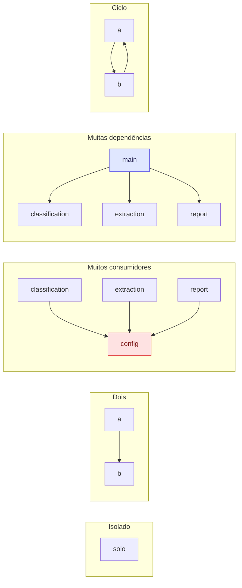
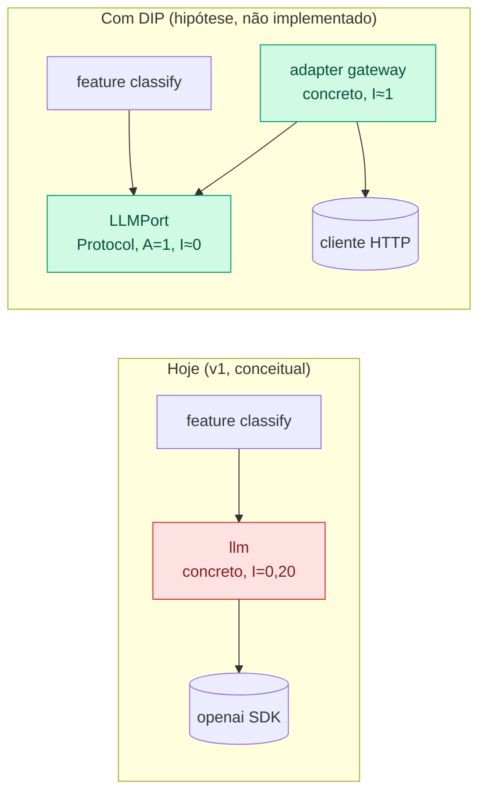
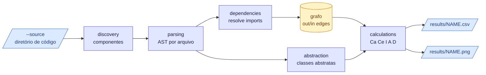

# Métricas de acoplamento: fundamentação, régua e exercícios

> Material de estudo do Passo 05. A **régua** (o que é componente, dependência e abstração, e as fórmulas) vem do enunciado do desafio e não é escolha nossa. Onde a literatura (Robert C. Martin, *Clean Architecture*, cap. 14) diverge da régua, isso fica sinalizado.

## Mapa das subetapas

| # | Subetapa | Onde está |
|---|---|---|
| 4.1 | Preparação (tag, suíte, inventário) | [relatório v1](relatorio-v1-coupled.md#1-preparação) |
| 4.2 | Acoplamento e coesão | §1 |
| 4.3 | Ca, Ce, I, A, D | §2 |
| 4.4 | SDP, SAP e DIP | §3 |
| 4.5 | Main Sequence, zonas e limitações | §4 |
| 4.6 | Exercícios de cálculo manual | §5 |
| 4.7 | Régua obrigatória e interpretações | §6 |
| 4.8 | Análise estática e AST | §7 |
| 4.9 | Grafo de dependências | §8 |
| 4.10–4.20 | Ferramenta e testes | §9 e `metrics/`, `tests/metrics/` |
| 4.21–4.27 | Validação, medição, interpretação, ADR e hipóteses | [relatório v1](relatorio-v1-coupled.md), [ADR 0001](../adr/0001-metrics-and-architectural-stability.md) |
| 7.8 | Glossário | §10 |

---

## 1. Acoplamento e coesão

| Conceito | Definição curta |
|---|---|
| **Componente** | Unidade de implantação ou organização com fronteira própria. Na régua do desafio, **cada arquivo `.py` de `app/helpdesk/`** (exceto `__init__.py`). |
| **Módulo** | Um arquivo `.py`. Aqui, módulo = componente. |
| **Pacote** | Um diretório com módulos (com ou sem `__init__.py`). Organiza nomes; **não** é componente na régua. |
| **Dependência** | A conhece B: se B mudar, A pode precisar mudar. Na régua: A **importa** B. |
| **Acoplamento** | Grau em que um componente depende de outros. Forte = conhece detalhes concretos (classes, SDKs, literais); fraco = conhece só um contrato estável. |
| **Coesão** | Grau em que o que está dentro de um componente muda pelo mesmo motivo. Alta coesão + baixo acoplamento é o objetivo clássico. |
| **Direta × transitiva** | `main → report → tickets`: `main` depende diretamente de `report` e só transitivamente de `tickets`. A régua conta **só as diretas**. |
| **Interna × externa** | Interna: outro componente da árvore analisada. Externa: `fastapi`, `openai`, `os`... A régua **ignora as externas**. |
| **Cíclica** | A → B → A. Uma mudança em qualquer um pode exigir mudar o outro; nenhum pode ser entendido ou testado isoladamente. |
| **Propagação de mudança** | Quem importa um componente pode ser afetado quando ele muda. Quanto mais consumidores, maior o raio de impacto. |
| **Fragilidade** | Tendência de uma mudança quebrar lugares "distantes". Nasce de dependências em direção a coisas que mudam muito. |

```python
# isolado: não importa nada interno e ninguém o importa
# solo.py
PI = 3.14

# dependência simples: a -> b
# a.py
from . import b

# múltiplos consumidores: a, c, d -> config
# múltiplas dependências: main -> a, b, c
# ciclo: a -> b -> a
# b.py
from .a import algo
```



**No helpdesk:** `config` é o caso "muitos consumidores" (6 módulos o importam); `main` é o "muitas dependências" (importa 5). Não há ciclos.

**Por que contar dependências não basta:** depender de algo **estável** (um contrato, um tipo de dados que quase não muda) é barato; depender de algo **volátil** (um SDK, um nome de modelo físico) é caro. Duas arquiteturas com o mesmo número de arestas podem ter riscos opostos, conforme a **direção** das arestas e a **volatilidade** do que está na ponta. É isso que I, A e D tentam capturar.

---

## 2. As cinco métricas

### 2.1 Ca — acoplamento aferente (o que chega)

**Régua:** número de componentes **distintos** que importam o componente. Vários imports do mesmo importador contam 1.

Ca alto = muita responsabilidade: muita gente quebra se ele mudar. Por isso componentes com Ca alto são mais caros de modificar.

> Exercício 2.1: `a` importa `config` duas vezes, `b` importa `config` uma vez, `config` importa `os`. Ca(config)?
> <details><summary>resposta</summary>2 (a e b). `os` é externo e não entra em nada.</details>

### 2.2 Ce — acoplamento eferente (o que sai)

**Régua:** número de componentes **internos distintos** que o componente importa. Externos e biblioteca padrão não contam.

Ce alto = o componente está exposto a mudanças de muitos outros.

> Exercício 2.2: `main.py` tem `from . import a, b`, `from .a import X`, `import fastapi`. Ce(main)?
> <details><summary>resposta</summary>2 (a, b).</details>

### 2.3 I — instabilidade

**I = Ce / (Ce + Ca)**; **I = 0** quando Ca = Ce = 0.

| I | Leitura |
|---|---|
| 0 | maximamente estável: só recebe dependências; difícil de mudar sem afetar outros |
| 0,5 | equilíbrio entre entrada e saída |
| 1 | maximamente instável: só depende; ninguém depende dele, então mudar é barato |

| Caso | Ca | Ce | I |
|---|---|---|---|
| muitos consumidores (`config`) | 6 | 0 | 0,00 |
| muitas dependências (`main`) | 0 | 5 | 1,00 |
| equilibrado | 2 | 2 | 0,50 |
| sem dependências (isolado) | 0 | 0 | 0,00 (por convenção da régua) |

**Estabilidade aqui é estrutural**, uma propriedade do grafo. Não é disponibilidade (uptime), nem ausência de bugs, nem "quase não muda no Git". `config` tem I = 0 e mesmo assim é exatamente o arquivo que precisa mudar para trocar de modelo (Dor 4). Atenção também ao isolado: I = 0 por convenção, mas ele não é "difícil de mudar"; ninguém depende dele.

### 2.4 A — abstração

**A = classes abstratas / total de classes**; **A = 0** sem classes.

**Régua:** abstrata é a classe que herda de `typing.Protocol` ou `abc.ABC`.

| Conceito | Em Python |
|---|---|
| Classe concreta | Implementação instanciável (`class OpenAIClient: ...`) |
| Classe abstrata | Define o contrato e deixa partes para subclasses (`class Gateway(ABC)` + `@abstractmethod`) |
| Interface | Só o contrato, sem implementação. Em Python: `Protocol` (estrutural) ou ABC (nominal) |
| ABC | `abc.ABC`: herança **nominal**; a implementação precisa herdar |
| Protocol | `typing.Protocol`: tipagem **estrutural**; qualquer classe com os métodos certos satisfaz |
| Inversão de dependência | O detalhe (SDK) passa a depender do contrato, e não o contrário |

Fora da régua, **mesmo que pareçam contratos**: funções, type aliases, `TypedDict`, modelos Pydantic, `Generic[T]`, `metaclass=ABCMeta`, `typing_extensions.Protocol` e subclasses indiretas de uma ABC. Incluir qualquer um deles seria ampliar a régua.

### 2.5 D — distância da Main Sequence

**D = |A + I − 1|**, entre 0 e 1.

É a distância vertical (ou horizontal) até a reta A + I = 1. A distância euclidiana perpendicular seria |A + I − 1| / √2 (máximo ≈ 0,707); a régua usa a versão **normalizada**, de 0 a 1.

| A | I | D | Leitura |
|---|---|---|---|
| 0 | 0 | 1 | concreto e estável: zona de dor |
| 0 | 1 | 0 | concreto e instável: ok (folhas, `main`) |
| 1 | 0 | 0 | abstrato e estável: ok (contratos) |
| 1 | 1 | 1 | abstrato e instável: zona de inutilidade |
| 0,5 | 0,5 | 0 | sobre a Main Sequence |
| 0 | 0,2 | 0,8 | concreto e quase estável |

D perto de 0 = equilíbrio entre "quanto me usam" e "quão extensível eu sou". D alto pede **investigação**, não condenação automática (ver §4.3).

---

## 3. SDP, SAP e DIP

**SDP (Stable Dependencies Principle):** dependa na direção da estabilidade. A aresta A → B é saudável se I(A) ≥ I(B). Se um componente estável depende de um instável, a mudança frequente do instável arrasta o estável, que tem muitos consumidores.

**SAP (Stable Abstractions Principle):** um componente deve ser tão abstrato quanto é estável. Estável e concreto = difícil de mudar e, ao mesmo tempo, sem pontos de extensão (zona de dor). Estável e abstrato = estende-se por novas implementações sem mexer nele.

**DIP (Dependency Inversion Principle):** módulos de política (as features) não devem depender de detalhes (SDKs); ambos dependem de abstrações. O DIP é a ferramenta que **inverte a direção** de uma aresta para satisfazer o SDP e o SAP.



Na hipótese da direita, a feature depende de um contrato abstrato e estável (A=1, I≈0, D≈0), e o detalhe concreto vira folha instável (A=0, I≈1, D≈0). **Nada disso foi implementado nesta etapa.**

---

## 4. Main Sequence e interpretação

```text
 A
1.0 ┤ \ (1,0) abstrato e estável        ░░░░░░░ zona de inutilidade
    │   \                                 ░░░░░ (A alto, I alto)
    │     \                                 ░░░
0.5 ┤▓      \  Main Sequence: A + I = 1       ░
    │▓▓▓      \
    │▓▓▓▓▓      \
0.0 ┤▓▓▓▓▓▓▓      \ (0,1) concreto e instável
    └────────────────┬──────────────────────── I
   0.0 zona de dor  0.5                     1.0
```

O gráfico real fica em `metrics/results/v1-coupled.png`.

### 4.1 Zona de dor (régua do desafio)

Um componente está na zona de dor quando **A < 0,5 e I < 0,5 e D ≥ 0,5**, as três ao mesmo tempo:

- só `A < 0,5` pegaria quase tudo (folhas concretas são normais);
- só `I < 0,5` pegaria contratos estáveis (que são bons);
- só `D ≥ 0,5` pegaria também a zona de inutilidade.

Juntas, as três descrevem "concreto, estável e longe da reta". Como A + I < 1 nessa região, D ≥ 0,5 equivale a **A + I ≤ 0,5**: a zona da régua é o triângulo (0,0), (0,5;0), (0;0,5), incluindo a hipotenusa. Na literatura, a zona de dor é uma vizinhança difusa de (0,0), sem limites numéricos; aqui o avaliador fixou o triângulo.

### 4.2 Zona de inutilidade

Componentes muito abstratos e instáveis: contratos que ninguém usa. O desafio **não** define regra numérica para ela; no gráfico, ela aparece só como referência conceitual.

### 4.3 Limitações: D alto que não é problema

| Tipo | Por que tende a D alto | Por que pode estar ok |
|---|---|---|
| Objetos de valor e modelos de dados (Pydantic) | Concretos (A=0) e muito importados (I≈0) | Mudam pouco; são o vocabulário compartilhado |
| Constantes estáveis | Idem | Se o valor realmente não muda, a rigidez não custa |
| Tipos de domínio | Idem | Representam o negócio, não a tecnologia |
| Módulos isolados | Ca=Ce=0 → I=0, A=0 → D=1 | Ninguém depende deles: não há rigidez real |

Por isso **não** se cria interface, classe abstrata ou import artificial para melhorar o número (Goodhart). Componentes estáveis por natureza podem virar **exceção no ADR**, com justificativa concreta, revisada na versão final. **As features e o componente de comunicação com o gateway nunca podem receber exceção.**

---

## 5. Exercícios de cálculo manual

Tente calcular antes de abrir as respostas. Os mesmos cenários estão automatizados em `tests/metrics/`.

### Exercício 5.1: dependência unidirecional

```python
# app.py
from . import service
# service.py
from . import repo
# repo.py
import sqlite3
```

<details><summary>resposta</summary>

| Comp. | Ca | Ce | I | A | D |
|---|---|---|---|---|---|
| app | 0 | 1 | 1,00 | 0 | 0,00 |
| repo | 1 | 0 | 0,00 | 0 | 1,00 → zona de dor |
| service | 1 | 1 | 0,50 | 0 | 0,50 |

`app` não depende de `repo` (só transitivamente). `sqlite3` é externo.
</details>

### Exercício 5.2: ciclo

```python
# a.py
from . import b
# b.py
from .a import f
# c.py
from . import a
```

<details><summary>resposta</summary>

a: Ca=2 (b, c), Ce=1 → I=0,33, D=0,67 (zona de dor). b: Ca=1, Ce=1 → I=0,50, D=0,50. c: Ca=0, Ce=1 → I=1, D=0. Soma Ca = soma Ce = 3. O ciclo a↔b não aparece em nenhuma das 5 métricas: é preciso olhar o grafo.
</details>

### Exercício 5.3: isolado e múltiplos consumidores

```python
# config.py   (sem imports internos)
# x.py, y.py, z.py: todos com "from . import config"
# util.py     (sem imports internos, ninguém o importa)
```

<details><summary>resposta</summary>

config: Ca=3, Ce=0, I=0, D=1 (zona de dor). util: Ca=Ce=0 → I=0 pela convenção, A=0, D=1 → **zona de dor pela régua**, embora ninguém dependa dele: falso positivo clássico. x, y, z: Ca=0, Ce=1, I=1, D=0.
</details>

### Exercício 5.4: abstratas e concretas

```python
# ports.py
from typing import Protocol
from abc import ABC
class LLMPort(Protocol): ...
class Store(ABC): ...
class Settings: ...
# a.py, b.py: from .ports import LLMPort
# ports importa nada interno
```

<details><summary>resposta</summary>

ports: A = 2/3 = 0,67 (exato 0,666…), Ca=2, Ce=0, I=0, D = |2/3 + 0 − 1| = 1/3 = 0,33. Fora da zona de dor (A ≥ 0,5).
</details>

### Exercício 5.5: o mesmo módulo importado várias vezes

```python
# feature.py
import helpdesk.config
from helpdesk import config
from .config import MODEL
from . import llm
def f():
    from .config import KEY
```

<details><summary>resposta</summary>

Ce(feature) = 2 (config, llm). As 4 formas de importar `config` viram uma aresta só.
</details>

### Exercício 5.6: dízima e arredondamento

Ca=2, Ce=1, 1 abstrata em 3 classes.

<details><summary>resposta</summary>

I = 1/3, A = 1/3, D = |1/3 + 1/3 − 1| = 1/3. Publicado: I=0,33, A=0,33, D=0,33. Se arredondássemos antes (0,33 + 0,33 − 1 = −0,34), D sairia 0,34: erro de arredondamento intermediário. A ferramenta usa frações exatas e só arredonda no fim.
</details>

---

## 6. A régua obrigatória e as interpretações

| Item | Régua do desafio | Interpretação adotada onde o enunciado é omisso |
|---|---|---|
| Componente | cada `.py` sob o diretório analisado, recursivo; `__init__.py` fora; nome com pontos | subpastas sem `__init__.py` também contam (são `.py` na árvore) |
| Dependência | import absoluto ou relativo que resolve para **outro** componente | absoluto interno = começa pelo nome do pacote raiz (`helpdesk`, o nome do diretório analisado); `import config` sem prefixo é tratado como externo |
| Símbolo × módulo | `from helpdesk.config import X` → `config` | se `X` for um submódulo existente (`from helpdesk import config`), a aresta vai para o submódulo |
| `__init__.py` | não é componente | `from helpdesk.pkg import X` com `X` reexportado em `pkg/__init__.py` (`from .mod import X`) → aresta para `pkg.mod`; `import helpdesk.pkg` (só o pacote) não gera aresta |
| Duplicatas e autorreferência | uma aresta por par; sem self | — |
| Imports dentro de funções, `if TYPE_CHECKING`, `try` | — | **contam**: a análise é estática e o import existe no código |
| Import interno que não resolve | — | não conta e é listado como aviso na saída |
| Abstrata | herda de `typing.Protocol` ou `abc.ABC` | só herança **direta**, com origem verificada pelos imports (aliases, qualificados, `Protocol[T]`); herança indireta, `ABCMeta`, `typing_extensions` não contam |
| Total de classes | — | todas as `class` do módulo, inclusive aninhadas e locais a funções |
| Arredondamento | 2 casas, sem erro intermediário | cálculo com `Fraction`; arredondamento final `ROUND_HALF_UP` |
| Zona de dor | A<0,5, I<0,5, D≥0,5 | avaliada sobre os **valores publicados** (2 casas), que são os que qualquer avaliador reproduz pelo CSV; se o valor exato classificar diferente, a ferramenta avisa ("limite") |

Na v1, nenhuma dessas interpretações muda resultado: os 9 componentes usam só `from . import x` e `from .x import Y`, e não há classes abstratas.

---

## 7. Análise estática com AST

**Estática × dinâmica:** a análise estática lê o código sem executá-lo; a dinâmica observa a execução. Importar o módulo para inspecioná-lo **executaria** o `config.py` real, que lê `os.environ["FAKE_OPENAI_KEY"]` e falharia fora do container, e o `llm.py`, que instanciaria clientes de SDK. Por isso a ferramenta só faz parsing.

**AST:** o `ast.parse()` transforma o texto em uma árvore de nós (`Module` → `ImportFrom`, `ClassDef`, `FunctionDef`...).

```python
import ast
tree = ast.parse(open("classification.py", encoding="utf-8").read())
for node in ast.walk(tree):                 # travessia completa
    if isinstance(node, ast.ImportFrom):
        print(node.level, node.module, [a.name for a in node.names])
# 0 fastapi ['HTTPException']
# 1 None ['config', 'llm']          <- from . import config, llm
# 1 schemas ['Classification', 'TicketInput']
```

| Nó | O que representa | Campos usados |
|---|---|---|
| `ast.Import` | `import a.b as c` | `names[i].name`, `names[i].asname` |
| `ast.ImportFrom` | `from ..a import b as c` | `module`, `level` (nº de pontos), `names` |
| `ast.ClassDef` | `class X(Base1, mod.Base2, P[T])` | `name`, `bases` |
| `ast.Name` | `Protocol` | `id` |
| `ast.Attribute` | `typing.Protocol` | `value.id`, `attr` |
| `ast.Subscript` | `Protocol[T]` | `value` |

`ast.NodeVisitor` implementa o padrão **Visitor** (um método `visit_ClassDef` por tipo de nó). A ferramenta usa `ast.walk` porque só precisa de dois tipos de nó, mas o efeito é o mesmo.

**Por que não regex:** `import a, b` (dois módulos), parênteses em várias linhas (`main.py` da v1), aliases, `from .. import`, imports dentro de strings/comentários/docstrings e continuação com `\` quebram expressões regulares. A AST já resolveu a gramática.

**Resolução de nomes:** para saber se `class P(Interface)` é abstrata, a ferramenta registra de onde veio cada nome (`from typing import Protocol as Interface` → `Interface` = `typing.Protocol`). Um `class Protocol: ...` local apaga esse vínculo.

---

## 8. O grafo

| Grafo | Métrica |
|---|---|
| grau de entrada (in-degree) | Ca |
| grau de saída (out-degree) | Ce |
| aresta A → B | A importa B |
| vértice isolado | sem dependências internas |
| ciclo | dependência circular |

```python
out_edges = {"main": {"classification", "schemas"}, "classification": {"config"}, ...}
in_edges  = {"config": {"classification", ...}, ...}   # mapa reverso
ca = len(in_edges[c]);  ce = len(out_edges[c])
```

Usar `set` elimina duplicatas por construção. Cada aresta soma 1 no Ce de quem importa e 1 no Ca de quem é importado, então **ΣCa = ΣCe** sempre; a ferramenta imprime essa verificação. NetworkX não é necessário: dois dicionários de conjuntos bastam e não adicionam dependência.

---

## 9. Estrutura da ferramenta

```text
metrics/
├── measure.py          CLI (argparse) e pipeline
├── discovery.py        1. descoberta dos componentes (pathlib)
├── parsing.py          2. leitura e parsing (AST); extração dos imports
├── dependencies.py     3–4. resolução dos imports e grafo (Ca, Ce)
├── abstraction.py      5. classes abstratas (Protocol/ABC por origem)
├── calculations.py     6. I, A, D com frações; arredondamento; zona de dor
├── reporting.py        7–8. CSV e gráfico (matplotlib)
├── requirements.txt    matplotlib==3.11.2
└── results/            v1-coupled.csv, v1-coupled.png
```



**Trade-offs considerados:** um script único seria mais curto, mas misturaria parsing, matemática e I/O, e cada teste precisaria passar por tudo. A versão modular permite testar a resolução de imports sem gerar gráfico e testar as fórmulas sem arquivos. Só a biblioteca padrão é usada na análise; matplotlib entra apenas no gráfico (importado dentro de `write_plot`, com `--no-plot` disponível), fixado em versão exata para o PNG ser reproduzível.

---

## 10. Glossário

| Termo | Definição | Aplicação aqui |
|---|---|---|
| Acoplamento | Grau de dependência entre componentes | Arestas do grafo de imports |
| Coesão | O que está junto muda pelo mesmo motivo | Não medida pela régua; analisada à parte |
| Componente | Unidade com fronteira própria | Cada `.py` de `app/helpdesk/` (sem `__init__`) |
| Afferent Coupling (Ca) | Componentes distintos que importam este | `config`: 6 |
| Efferent Coupling (Ce) | Componentes internos distintos que este importa | `main`: 5 |
| Instability (I) | Ce/(Ca+Ce), 0 se ambos 0 | `llm`: 1/5 = 0,20 |
| Abstractness (A) | abstratas/total, 0 sem classes | 0 em toda a v1 |
| Distance (D) | \|A + I − 1\| | `config` e `schemas`: 1,00 |
| Main Sequence | Reta A + I = 1 | Linha azul do gráfico |
| Zona de dor | A<0,5, I<0,5, D≥0,5 (régua) | `config`, `llm`, `schemas` na v1 |
| Zona de inutilidade | Abstrato e instável; sem regra no desafio | Vazia na v1 |
| SDP | Depender na direção da estabilidade | Features (I=0,75) → `llm` (I=0,20): respeita o SDP, mas `llm` é concreto |
| SAP | Estável deve ser abstrato | Violado por `llm` e `config` |
| DIP | Política e detalhe dependem de abstrações | Hipótese para a v2 |
| AST | Árvore sintática do código | `ast.parse` em cada arquivo |
| Análise estática | Ler sem executar | A ferramenta nunca importa o app |
| Grafo direcionado | Vértices + arestas com sentido | 9 vértices, 20 arestas na v1 |
| Grau de entrada / saída | Arestas que chegam / saem | Ca / Ce |
| Dependência cíclica | A → … → A | Nenhuma na v1 |
| Protocol | Contrato estrutural (`typing.Protocol`) | Conta como abstrata |
| Abstract Base Class | Contrato nominal (`abc.ABC`) | Conta como abstrata |
| Goodhart's Law | "Quando uma medida vira meta, deixa de ser boa medida" | Proíbe interfaces e imports artificiais |
