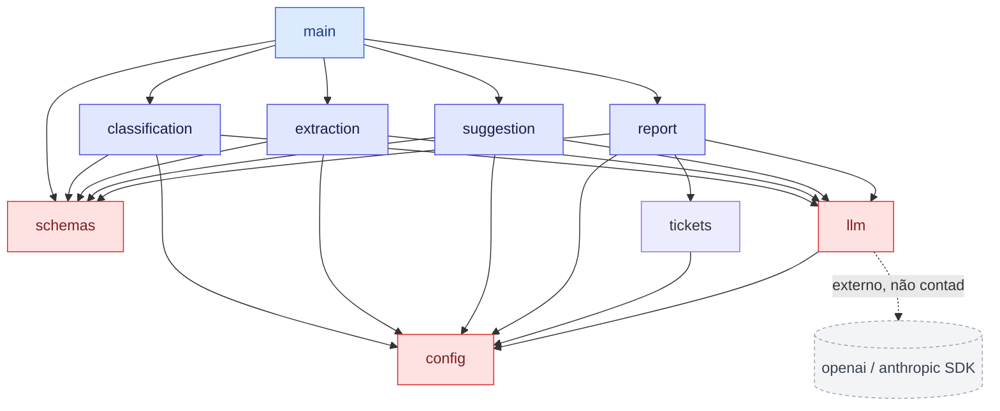
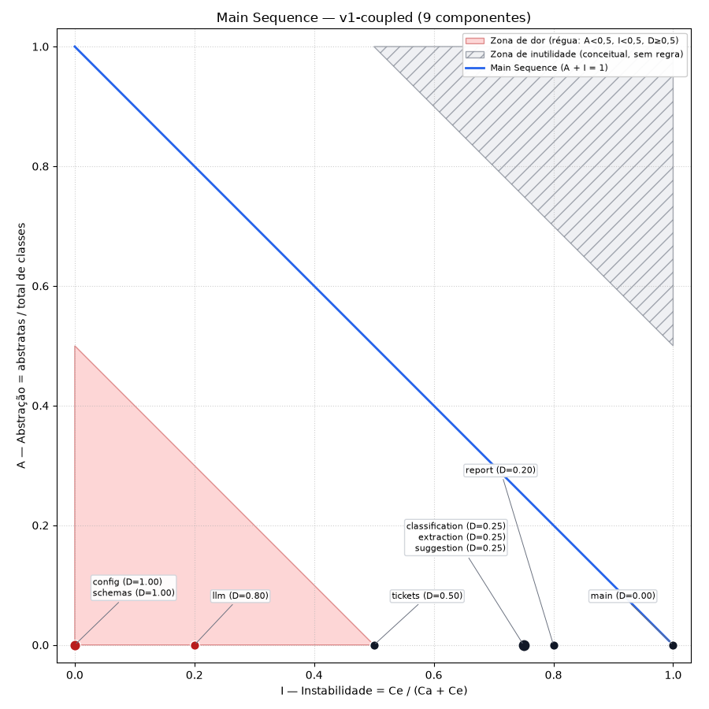
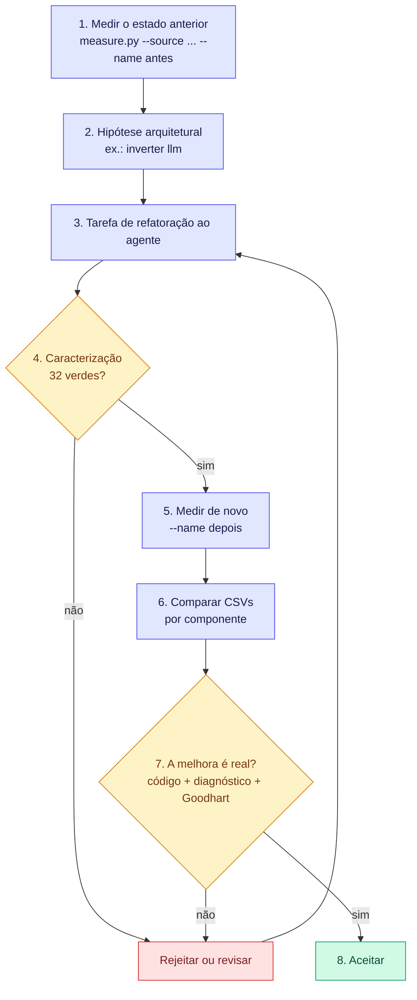

# Baseline arquitetural da v1 (`v1-coupled`)

> Medição oficial da arquitetura original com a régua do desafio. Ferramenta em `metrics/`; resultados em `metrics/results/v1-coupled.csv` e `metrics/results/v1-coupled.png`. Fundamentos em [fundamentacao.md](fundamentacao.md); decisão em [ADR 0001](../adr/0001-metrics-and-architectural-stability.md).

## 1. Preparação

| Verificação | Resultado |
|---|---|
| Branch de trabalho | `main` (`8028305`) |
| Tag `v1-coupled` | anotada (`07c2026d`), aponta para `80283055f02175a84c8b6bc62dacf81964ad15f0` |
| A tag é o código original? | `git diff --stat a1aedd7 v1-coupled -- app provider-fake edge data` vazio |
| Suíte de caracterização | 32 verdes na tag (Passo 04), também a partir do worktree |
| Worktree | `../helpdesk-v1`, destacado em `8028305` |

**Por que a ferramenta vem depois da tag:** a tag congela o "antes" que queremos medir. Se a ferramenta entrasse no commit da tag, a `v1-coupled` deixaria de ser exatamente o código original. Mantendo-a fora, a mesma ferramenta, na `main`, mede qualquer checkout (`--source`), e a régua fica idêntica para v1, v2 e final. O `metrics/` não é analisado porque está fora de `app/helpdesk/`.

### Inventário (`app/helpdesk/`)

| Arquivo | Componente | Responsabilidade |
|---|---|---|
| `__init__.py` | (não contabilizado; vazio) | marca o pacote |
| `main.py` | `main` | FastAPI: rotas das 4 features |
| `classification.py` | `classification` | F1: classifica via `llm.call_openai` |
| `suggestion.py` | `suggestion` | F2: sugere resposta via `llm.call_anthropic` |
| `report.py` | `report` | F3: relatório em lotes via `llm.call_anthropic` |
| `extraction.py` | `extraction` | F4: extrai pedido via `llm.call_openai` |
| `llm.py` | `llm` | clientes OpenAI/Anthropic (SDKs) e `parse_json` |
| `config.py` | `config` | chaves, URLs, **nomes de modelos físicos**, limites |
| `schemas.py` | `schemas` | 7 modelos Pydantic de entrada/saída |
| `tickets.py` | `tickets` | leitura do `tickets.jsonl` |

9 componentes. Nenhum subpacote.

## 2. Grafo de dependências (20 arestas, sem ciclos)



ΣCa = ΣCe = 20 (conferido pela ferramenta).

## 3. Resultados

`metrics/results/v1-coupled.csv`:

```csv
component,ca,ce,i,a,d
classification,1,3,0.75,0.00,0.25
config,6,0,0.00,0.00,1.00
extraction,1,3,0.75,0.00,0.25
llm,4,1,0.20,0.00,0.80
main,0,5,1.00,0.00,0.00
report,1,4,0.80,0.00,0.20
schemas,5,0,0.00,0.00,1.00
suggestion,1,3,0.75,0.00,0.25
tickets,1,1,0.50,0.00,0.50
```



## 4. Validação manual × ferramenta

Contagem feita lendo os imports de cada arquivo (Passo 01 e dump do código da tag).

| Componente | Imports internos (Ce) | Quem o importa (Ca) | Classes |
|---|---|---|---|
| `config` | — (só `os`) | classification, extraction, llm, report, suggestion, tickets | 0 |
| `llm` | config (`anthropic`, `openai`, `json` são externos) | classification, extraction, report, suggestion | 0 |
| `classification` | config, llm, schemas (`fastapi` externo) | main | 0 |
| `schemas` | — (`datetime`, `pydantic` externos) | classification, extraction, main, report, suggestion | 7 Pydantic, 0 abstratas |

| Componente | Métrica | Cálculo manual | Ferramenta | Confere |
|---|---|---|---|---|
| config | Ca / Ce | 6 / 0 | 6 / 0 | ✅ |
| config | I / A / D | 0/6 = 0 · 0 (sem classes) · \|0+0−1\| = 1 | 0.00 · 0.00 · 1.00 | ✅ |
| llm | Ca / Ce | 4 / 1 | 4 / 1 | ✅ |
| llm | I / A / D | 1/5 = 0,20 · 0 · \|0+0,2−1\| = 0,80 | 0.20 · 0.00 · 0.80 | ✅ |
| classification | Ca / Ce | 1 / 3 | 1 / 3 | ✅ |
| classification | I / A / D | 3/4 = 0,75 · 0 · 0,25 | 0.75 · 0.00 · 0.25 | ✅ |
| schemas | Ca / Ce | 5 / 0 | 5 / 0 | ✅ |
| schemas | I / A / D | 0 · 0/7 = 0 · 1 | 0.00 · 0.00 · 1.00 | ✅ |

Nenhuma divergência. Pontos que poderiam enganar e foram conferidos: `main.py` importa `schemas` com parênteses em duas linhas (uma aresta só); `from . import config, llm` gera duas arestas; os 7 `BaseModel` contam no total de classes de `schemas` mas não como abstratas.

## 5. Interpretação

| Componente | Ca | Ce | I | A | D | Zona de dor? | Interpretação |
|---|---|---|---|---|---|---|---|
| `config` | 6 | 0 | 0,00 | 0,00 | 1,00 | **sim** | Concreto e o mais importado. Guarda **nomes de modelos físicos e URLs de provider** (Dor 4): é volátil por natureza, mas estruturalmente rígido. **Problemático.** |
| `llm` | 4 | 1 | 0,20 | 0,00 | 0,80 | **sim** | O único caminho até os providers, concreto, preso aos SDKs e com um método por provider (`call_openai`/`call_anthropic`). Todas as features dependem dele (Dores 2, 3, 4). **Problemático; é o componente de comunicação com providers e não pode virar exceção.** |
| `schemas` | 5 | 0 | 0,00 | 0,00 | 1,00 | **sim** | DTOs Pydantic do contrato HTTP, sem lógica nem dependência interna. Rígido, mas muda só quando o contrato HTTP muda (que a caracterização trava). **Candidato a exceção**, a confirmar na versão final. |
| `tickets` | 1 | 1 | 0,50 | 0,00 | 0,50 | não (I = 0,5 não é < 0,5) | Acesso a arquivo, concreto, usado só por `report`. Está **exatamente no limite** da régua. **Investigar** (lê o arquivo inteiro a cada chamada, mas isso é desempenho, não acoplamento). |
| `report` | 1 | 4 | 0,80 | 0,00 | 0,20 | não | Feature F3. Métrica boa, mas carrega o problema de execução síncrona em lotes (Dor 1), que a régua não vê. **Métrica adequada, problema em outro eixo.** |
| `classification` | 1 | 3 | 0,75 | 0,00 | 0,25 | não | Feature F1. Perto da reta, mas escolhe o provider pelo nome da função (`call_openai`) e o modelo por `config`. **Acoplamento semântico** não capturado. |
| `extraction` | 1 | 3 | 0,75 | 0,00 | 0,25 | não | Feature F4. Idem F1. |
| `suggestion` | 1 | 3 | 0,75 | 0,00 | 0,25 | não | Feature F2. Idem; sem streaming (Dor 2). |
| `main` | 0 | 5 | 1,00 | 0,00 | 0,00 | não | Ponto de entrada; concreto e instável, como deve ser. **Adequado.** |

### Leitura de conjunto

- **SDP é respeitado:** em todas as 20 arestas, I(origem) ≥ I(destino). As dependências já apontam para o que é mais estável.
- **SAP é violado:** os três componentes mais estáveis (`config`, `schemas`, `llm`) têm A = 0. Toda a estabilidade está em coisas concretas. A v1 inteira tem **zero abstrações** (A = 0 em 9/9).
- **O problema central** é que o destino estável das features (`llm` + `config`) é **o detalhe tecnológico**: SDKs, providers e modelos físicos. Pelo DIP, deveria ser o contrário: as features dependeriam de um contrato estável, e o detalhe dependeria desse contrato.

### Relação com o diagnóstico (Passo 02)

| Dor | O que a métrica mostra | O que ela não mostra |
|---|---|---|
| 1. Relatório do mês não chega | nada de anormal em `report` (D = 0,20) | execução síncrona, lotes em série, ausência de cancelamento |
| 2. Sugestão sem streaming | nada em `suggestion` | o modo de entrega (`messages.create` sem `stream`) |
| 3. Provider fora derruba metade | `llm` na zona de dor: único ponto, concreto, Ca = 4 | provider fixo por função, padrões dos SDKs, ausência de fallback |
| 4. Troca de modelo exige deploy | `config` na zona de dor: Ca = 6, A = 0 | que os valores são literais e voláteis |

### Acoplamento que a régua não conta

`llm` importa `openai` e `anthropic`; as features importam `fastapi`. Esses imports são externos e não entram em Ce, mas são o acoplamento mais caro da aplicação: a API dos SDKs, os nomes dos modelos e a semântica de cada provider. Também não entram: o contrato HTTP com o provider-fake, as variáveis de ambiente, o `/data/tickets.jsonl` e o fato de `classification` "saber" que usa OpenAI pelo nome da função chamada.

## 6. Limitações da medição

| Não capturado | Exemplo na v1 |
|---|---|
| Dependências externas (SDKs, frameworks) | `llm → openai/anthropic` |
| Acoplamento semântico | features escolhem o provider pela função chamada |
| Dependências de runtime e infraestrutura | `os.environ`, `/data/tickets.jsonl`, `provider-fake:8090`, timeout do nginx |
| Contratos HTTP | formato das respostas do provider |
| Transitivas | `main` depende indiretamente dos SDKs |
| Frequência real de mudança | `config` é "estável" no grafo, mas é o que mais muda numa troca de modelo |
| Abstração sintática × arquitetural | um `Protocol` mal desenhado conta como abstração; uma função bem desenhada não |
| Coesão, complexidade ciclomática, responsabilidades excessivas | `llm` mistura cliente OpenAI, cliente Anthropic e parse de JSON |
| Dependências dinâmicas | `importlib`, `getattr` (não há na v1) |
| Falsos positivos | módulos isolados e DTOs caem na zona de dor sem rigidez real |

**Goodhart's Law:** se a meta virar "D baixo", dá para "melhorar" a v1 sem melhorar nada: criar um `class ConfigPort(Protocol)` que ninguém usa (A de `config` sobe), adicionar imports inúteis (I muda), quebrar `config.py` em 6 arquivos (Ca cai) ou mover o código de `llm` para dentro das features (o `llm` some da zona de dor e o acoplamento aos SDKs se espalha). Todas mudam o número sem reduzir o custo de trocar um provider. Por isso a métrica é **um** critério, ao lado da caracterização, dos experimentos do Passo 02 e da revisão humana.

## 7. Matriz preliminar para o Passo 06 (hipóteses, não plano)

| Componente | Problema observado | Evidência quantitativa | Evidência no código | Hipótese de evolução |
|---|---|---|---|---|
| `llm` | Ponto único, concreto, preso aos SDKs | Ca=4, I=0,20, A=0, D=0,80 (zona de dor) | `OpenAI(...)`, `Anthropic(...)`, `call_openai`/`call_anthropic` | Inversão de dependência: contrato de capacidade (Protocol) estável + adaptador concreto para o gateway; isolar o detalhe tecnológico |
| `config` | Decisão de infraestrutura (modelo físico) dentro do código, muito importada | Ca=6, I=0, A=0, D=1,00 | `CLASSIFICATION_MODEL = "gpt-fake-large"` etc. | Redução de dependências: nomes de modelo saem da aplicação (gateway/configuração externa); features deixam de importar `config` para escolher modelo |
| Features (`classification`, `extraction`, `suggestion`, `report`) | Escolhem provider pelo nome da função | D=0,20–0,25 (métrica ok) | `llm.call_openai(config.CLASSIFICATION_MODEL, ...)` | Depender da capacidade, não do provider; composição com o contrato injetado |
| `schemas` | DTOs rígidos | Ca=5, I=0, A=0, D=1,00 | 7 `BaseModel` | Provável exceção (objeto de valor do contrato HTTP), a revisar na versão final; não criar interface artificial |
| `tickets` | Concreto, no limite da régua | I=0,50, D=0,50 | `open(config.TICKETS_FILE)` | Investigar; possível isolamento atrás de um contrato de leitura se a F3 mudar |
| `report` | Execução síncrona (Dor 1) | D=0,20 (métrica não acusa) | laço de lotes | Fora do escopo da métrica; tratado nos passos de resiliência |

## 8. Uso no ciclo com agentes de IA



Uma refatoração só é bem-sucedida com as três evidências juntas: **comportamento preservado** (caracterização verde), **evolução estrutural** (métrica) e **justificativa arquitetural** (o número mudou pelo motivo certo).
