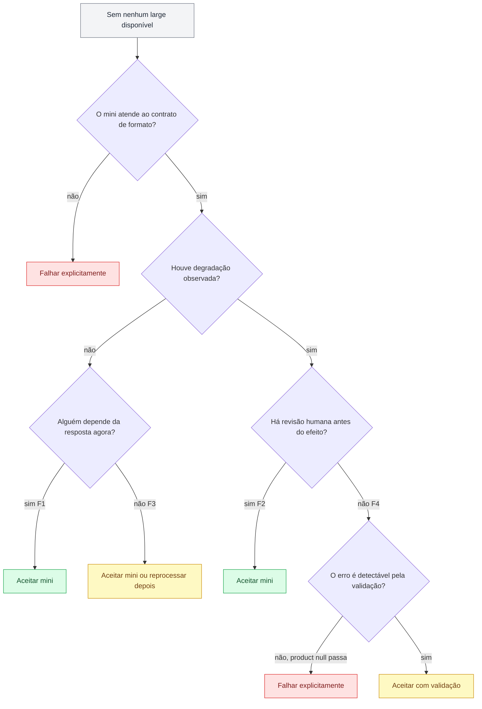

# 🧪 Comparação dos modelos do provider simulado

Este documento registra a comparação experimental dos quatro modelos do `provider-fake` (`gpt-fake-large`, `gpt-fake-mini`, `claude-fake-large`, `claude-fake-mini`) nas quatro tarefas do helpdesk. O objetivo é responder, feature por feature, se **uma resposta de um modelo inferior é melhor do que nenhuma resposta**. Os resultados servem de insumo para os futuros ADRs de capacidades, roteamento e fallback. Nada na aplicação foi alterado.

> **Legenda de cores:** 🟦 OpenAI / formato Chat Completions · 🟪 Anthropic / formato Messages · 🟩 equivalente ou aceitável · 🟨 atenção · 🟥 degradação ou risco

> [!IMPORTANT]
> O provider é **simulado e determinístico**: a mesma entrada no mesmo modelo gera sempre a mesma saída, e a latência segue uma fórmula fixa. As conclusões valem para este simulador e para os casos testados. Elas **não** se generalizam para modelos comerciais reais, que variam entre execuções, versões e prompts.

## Sumário

1. [Objetivos e metodologia](#1-objetivos-e-metodologia)
2. [Conceitos](#2-conceitos)
3. [Inventário dos modelos](#3-inventário-dos-modelos)
4. [F1: classificação](#4-f1-classificação)
5. [F2: sugestão de resposta](#5-f2-sugestão-de-resposta)
6. [F3: relatório de temas](#6-f3-relatório-de-temas)
7. [F4: extração de dados do pedido](#7-f4-extração-de-dados-do-pedido)
8. [Matriz de performance](#8-matriz-de-performance)
9. [Matriz de custos e projeções](#9-matriz-de-custos-e-projeções)
10. [Equivalência funcional](#10-equivalência-funcional)
11. [Large vs. mini](#11-large-vs-mini)
12. [Matriz de risco por feature](#12-matriz-de-risco-por-feature)
13. [Proposta preliminar de modelos e fallback](#13-proposta-preliminar-de-modelos-e-fallback)
14. [Limitações](#14-limitações)
15. [Conclusões arquiteturais](#15-conclusões-arquiteturais)
16. [Glossário](#16-glossário)

---

## 1. Objetivos e metodologia

| Item | Valor |
|---|---|
| Data | 25/11/2026, cerca de 10:10–10:20 UTC |
| Commit | `ab53bae` (sobre `a1aedd7`); `git diff --stat upstream/main -- app provider-fake edge data` vazio |
| Alvo | chamadas **diretas** ao `provider-fake` (porta 8090 / `http://provider-fake:8090`), sem passar pelo `app` nem pela borda |
| Ferramenta | script Python (só `urllib`) executado com `docker compose exec -T app python -`, lendo `/data/tickets.jsonl` em modo somente leitura; mais amostras manuais com `curl` |
| Isolamento | `POST /admin/reset` antes e depois; `GET /admin/failures` com tudo em `normal` |
| Parâmetros | o mesmo prompt `TASK: <tarefa>\n<conteúdo>` e `max_tokens: 2000` nos quatro modelos |
| Prova | `/admin/calls`: 188 chamadas, com tokens e contagens batendo com o script |
| Combinações | 4 tarefas × 4 modelos, com 21 casos de F1, 12 de F4, 3 de F2 (+ streaming e `max_tokens: 50`) e 4 conjuntos de F3 |

O resultado esperado de cada caso foi escrito **antes** da execução, a partir do texto e do contrato. Em casos ambíguos, a expectativa ficou registrada como `null` ou "ambíguo".

Comandos de referência:

```bash
curl -s -X POST localhost:8090/admin/reset
curl -s "localhost:8090/admin/calls?last=50"

# formato OpenAI, com medição
curl -s -w "\nstatus=%{http_code} ttfb=%{time_starttransfer} total=%{time_total}\n" \
  localhost:8090/openai/v1/chat/completions \
  -H "Authorization: Bearer sk-fake-openai-0001" -H "Content-Type: application/json" \
  -d '{"model": "gpt-fake-mini", "max_tokens": 2000, "messages": [{"role": "user", "content": "TASK: classify\nMeu pedido #481516 não chegou e já passou do prazo, urgente"}]}'

# formato Messages, com streaming (curl -N não acumula a saída)
curl -sN localhost:8090/anthropic/v1/messages \
  -H "x-api-key: sk-ant-fake-0001" -H "anthropic-version: 2023-06-01" -H "Content-Type: application/json" \
  -d '{"model": "claude-fake-mini", "max_tokens": 2000, "stream": true, "messages": [{"role": "user", "content": "TASK: suggest\nMeu pedido #481516 não chegou e já passou do prazo, urgente"}]}'
```

---

## 2. Conceitos

| Conceito | Significado | No helpdesk |
|---|---|---|
| Provider | empresa ou API que serve modelos | `openai` e `anthropic` simulados |
| Modelo físico | nome concreto do modelo | `gpt-fake-large`, `claude-fake-mini` |
| Capacidade lógica | o que a feature precisa, sem nome de modelo | "classificar ticket", "extrair pedido" (ainda não existe na v1) |
| Compatibilidade de API | mesmo contrato de chamada | **não há**: Chat Completions ≠ Messages (seção 3) |
| Vendor lock-in | custo de trocar de fornecedor | `call_openai` / `call_anthropic` no código das features |
| Token | unidade de cobrança e de limite | no simulador, `ceil(caracteres/4)` |
| Janela de contexto | máximo de tokens de **entrada** | 8.000 nos quatro modelos; 200 tickets geraram `400` |
| Limite de geração | `max_tokens` corta a **saída** | com 50 tokens: `finish_reason: "length"` / `stop_reason: "max_tokens"` |
| TTFT | tempo até o modelo produzir o 1º token | 0,80 s (large) e 0,30 s (mini) |
| TTFB | tempo até o cliente receber o 1º byte | streaming: 0,001 s (só headers); síncrono: igual ao total |
| Primeiro conteúdo consumível | 1º trecho de texto útil | streaming: igual ao TTFT; síncrono: só no fim |
| Throughput | tokens gerados por segundo | 40 (large) e 150 (mini) |
| Custo por operação | custo da operação de negócio, não da chamada | 1 relatório mensal = 34 chamadas |
| Fallback técnico | outro destino **equivalente** | `gpt-fake-large` ↔ `claude-fake-large` |
| Fallback com degradação | destino inferior | um `mini` quando não há `large` |
| Degradação graciosa | entregar menos, mas algo útil e honesto | sugestão mais curta que o atendente edita |
| Human-in-the-loop | uma pessoa revisa antes do efeito | F2 sim; F4 não |
| Indisponibilidade vs. incorreção | "não respondi" vs. "respondi errado" | na F4, a incorreção custa frete e estoque; a indisponibilidade pode ser reprocessada |

---

## 3. Inventário dos modelos

Fonte: `provider-fake/README.md` (tabela de Modelos), confirmada pelas medições e pelos endpoints `/models`.

| Característica | 🟦 GPT Large | 🟦 GPT Mini | 🟪 Claude Large | 🟪 Claude Mini | Relevância arquitetural |
|---|---|---|---|---|---|
| Janela de contexto | 8.000 | 8.000 | 8.000 | 8.000 | define o tamanho do lote da F3 (150 tickets ≈ 6.700 tokens); o mini **não** permite lotes maiores |
| Entrada (US$/1M) | 2,50 | 0,15 | 3,00 | 0,80 | domina o custo da F3 (entrada grande) |
| Saída (US$/1M) | 10,00 | 0,60 | 15,00 | 4,00 | domina o custo da F2 (saída longa) |
| TTFT documentado | 800 ms | 300 ms | 800 ms | 300 ms | primeiro conteúdo com streaming |
| TTFT medido | 0,802 s | 0,302 s | 0,802 s | 0,302 s | — |
| Velocidade | 40 tok/s | 150 tok/s | 40 tok/s | 150 tok/s | tempo total das saídas longas |
| Streaming | ✅ SSE `data:` + `[DONE]` | ✅ | ✅ eventos nomeados | ✅ | F2; o stream OpenAI **não trouxe `usage`**, o Anthropic trouxe |
| Formato | Chat Completions, `Bearer` | idem | Messages, `x-api-key`, `max_tokens` obrigatório | idem | um fallback entre providers exige traduzir o formato |
| Erro de contexto | `400 context_length_exceeded` | idem | `400 invalid_request_error` ("prompt is too long") | idem | tratamento de erro diferente por provider |

A latência medida segue `TTFT + tokens_de_saída ÷ velocidade` com erro de milissegundos. Por exemplo, F3 com 20 tickets no large: 0,8 + 199/40 = 5,775 s (medido: 5,777 s).

---

## 4. F1: classificação

**Hipótese:** os dois `large` são equivalentes, e os `mini` podem errar categoria ou prioridade.

**Entradas:** 11 textos criados para cobrir as 5 categorias e as 3 prioridades (c01–c11) e os 10 primeiros tickets reais (TK-00001 a TK-00010).

| Caso | Esperado | 🟦 GPT L | 🟦 GPT m | 🟪 Claude L | 🟪 Claude m |
|---|---|---|---|---|---|
| c01 pedido atrasado, "urgente" | delivery / high | delivery / high | = | = | = |
| c02 cobrado duas vezes | payment / — | payment / high | = | = | = |
| c03 trocar camiseta, "sem pressa" | exchange_return / low | exchange_return / **medium** | = | = | = |
| c04 liquidificador quebrado | product_defect / — | product_defect / medium | = | = | = |
| c05 alterar e-mail | other / low | other / **medium** | = | = | = |
| c06 boleto, "resolver hoje" | payment / high | payment / **medium** | = | = | = |
| c07 entrega atrasada | delivery / — | delivery / medium | = | = | = |
| c08 devolver tênis, arrependimento | exchange_return / — | exchange_return / medium | = | = | = |
| c09 "URGENTE", smartwatch parou | product_defect / high | product_defect / high | = | = | = |
| c10 danificado + quer trocar | ambíguo | exchange_return / medium | = | = | = |
| c11 irritado, pix cobrado, pedido não saiu | — / high | payment / **medium** | = | = | = |
| TK-00001 … TK-00010 | sem gabarito | delivery, product_defect, other, other, delivery, delivery, delivery, delivery, delivery (high), delivery | = | = | = |

`=` significa idêntico ao GPT Large.

**Resultados**
- **21/21 casos idênticos nos quatro modelos**, incluindo a prioridade. As 3 repetições do c01 deram saída idêntica, com variação de latência ≤ 0,002 s.
- As categorias bateram com a expectativa em todos os casos não ambíguos. Todos os valores estão no contrato.
- Quatro prioridades divergiram da minha expectativa (c03, c05, c06, c11), mas **igualmente nos quatro modelos**: é o critério do simulador (ele reage a "urgente" e "hoje vou cancelar", não a "resolver hoje" ou "sem pressa"). Isso não é diferença entre modelos.
- Latência: large de 1,077 a 1,153 s; mini de 0,375 a 0,396 s. Tokens de 11 a 14 de saída.

**Conclusão:** nos casos testados, **não houve degradação do mini na F1**. O mini atende ao contrato e é ~3× mais rápido.

---

## 5. F2: sugestão de resposta

**Hipótese:** o mini é mais rápido e mais barato, e a diferença funcional aparece no texto.

| Caso | Modelo | Tokens de saída | Caracteres | Tempo síncrono | Custo |
|---|---|---|---|---|---|
| s01 entrega | 🟦 GPT L / 🟪 Claude L | 606 | 2.424 | 15,952 s | US$ 0,00611 / 0,00915 |
| s01 entrega | 🟦 GPT m / 🟪 Claude m | 267 | 1.066 | 2,083 s | US$ 0,00016 / 0,00108 |
| s02 pagamento | L | 609 | 2.435 | 16,027 s | US$ 0,00613 / 0,00918 |
| s02 pagamento | m | 261 | 1.041 | 2,042 s | US$ 0,00016 / 0,00106 |
| s03 defeito | L | 613 | 2.451 | 16,128 s | US$ 0,00617 / 0,00924 |
| s03 defeito | m | 273 | 1.092 | 2,122 s | US$ 0,00017 / 0,00110 |

**Streaming direto no provider (s01, 3 repetições cada)**

| Modelo | TTFB | Primeiro trecho de texto | Tempo total | Chunks |
|---|---|---|---|---|
| 🟦 GPT L | 0,001 s | 0,802 s (0,802–0,803) | 16,168 s (16,159–16,173) | 606 |
| 🟦 GPT m | 0,001 s | 0,303 s (0,302–0,303) | 2,229 s (2,228–2,230) | 267 |
| 🟪 Claude L | 0,001 s | 0,802 s (0,802–0,803) | 16,176 s (16,173–16,181) | 606 |
| 🟪 Claude m | 0,001 s | 0,302 s (0,302–0,303) | 2,228 s (2,228–2,229) | 267 |

**Resultados**
- Os textos dos dois `large` são **idênticos entre si** (mesmo hash), e o mesmo vale para os dois `mini`.
- O `mini` gera cerca de **44% dos tokens** do large, e em s02 e s03 com as frases em outra ordem. O texto do large repete parágrafos ("Reforçando o ponto…"), então a diferença não é simplesmente "pior". A avaliação de qualidade textual ficou fora do escopo.
- **O streaming não reduz o tempo total** (16,17 s com stream contra 15,95 s sem). Ele reduz a **espera percebida** de ~16 s para 0,80 s (large) ou 0,30 s (mini). Com streaming, o large já cumpriria o requisito de primeiro trecho em até 1,5 s, chegando antes da metade do tempo total.
- `max_tokens: 50` cortou os quatro modelos em 50 tokens, com `finish_reason: "length"` (OpenAI) e `stop_reason: "max_tokens"` (Anthropic).

**Conclusão:** há diferença funcional (sugestão mais curta e reordenada), mas existe **revisão humana**. Uma sugestão menor é editável e melhor que nenhuma.

---

## 6. F3: relatório de temas

**Hipótese:** o mini pode perder temas ou errar contagens em lotes grandes.

| Conjunto | Tickets | Tokens de entrada | Resultado (4 modelos) | L: tempo | m: tempo |
|---|---|---|---|---|---|
| first20 | 20 | 894 | 10 temas, soma 20, **idênticos** | 5,777 s | 1,629 s |
| first150 (= 1 lote da app) | 150 | 6.711 | 15 temas, soma 150, **idênticos** | 9,828 s | 2,710 s |
| day1 (2026-08-01) | 137 | 6.132 | 15 temas, soma 137, **idênticos** | 9,803 s | 2,702 s |
| first200 | 200 | 8.934 | **400 nos quatro**: excede 8.000 | 0,002 s | 0,002 s |

- As contagens somam exatamente o número de tickets de entrada, e todos os exemplos pertencem à entrada.
- O limite de contexto é igual para todos. O mini **não** muda o tamanho do lote.

**Projeção para o mês (5.000 tickets, 34 lotes).** Tokens **medidos** no Passo 02 (222.114 de entrada / 12.162 de saída). Preços e tempos **projetados** para os outros modelos.

| Modelo | Custo do relatório | Tempo sequencial |
|---|---|---|
| 🟪 Claude L (atual) | US$ 0,8488 (medido) | ~5 min 22 s (medido) |
| 🟦 GPT L | US$ 0,6769 | ~5,4 min (projeção) |
| 🟪 Claude m | US$ 0,2263 | ~1,5 min (34 × ~2,7 s) |
| 🟦 GPT m | US$ 0,0406 | ~1,5 min |

> [!NOTE]
> Até com o mini, o relatório do mês em série (~92 s) continua acima dos 30 s da borda. O modelo mais rápido não resolve a Dor 1: quem resolve é o modo de execução.

**Conclusão:** nos três conjuntos testados, **não houve degradação** do mini. A economia é grande (73% no Claude, 94% no GPT, por relatório).

---

## 7. F4: extração de dados do pedido

**Hipótese:** um campo errado ou omitido passa no contrato, porque o formato é válido.

| Caso | Esperado | 🟦 GPT L = 🟪 Claude L | 🟦 GPT m = 🟪 Claude m |
|---|---|---|---|
| e01 #481516, fone de ouvido bluetooth | #481516 / fone de ouvido bluetooth | ✅ igual | 🟥 #481516 / **null** |
| e02 calça jeans #605065 | #605065 / calça jeans | ✅ | 🟥 #605065 / **null** |
| e03 sem pedido nem produto | null / null | ✅ | ✅ |
| e04 "pedido 481516" sem `#` | ambíguo | #481516 (normalizou) | #481516 |
| e05 protocolo #12345, aspirador robô | null / aspirador robô | ✅ | 🟥 null / **null** |
| e06 dois pedidos, só a cafeteira quebrou | #445566 / cafeteira elétrica | 🟥 **#112233** / cafeteira elétrica | 🟥 **#112233** / null |
| e07 número de 7 dígitos solto + #998877 smartwatch | #998877 / smartwatch | ✅ | 🟥 #998877 / **null** |
| e08 CPF + #314159 mouse sem fio | #314159 / mouse sem fio | ✅ | 🟥 #314159 / **null** |
| e09 "tênis Runner Pro" (fora do catálogo) #123456 | #123456 / tênis Runner Pro | 🟨 #123456 / null | 🟨 #123456 / null |
| e10 #4815162 (7 dígitos) | null / null | ✅ | ✅ |
| e11 sem pedido, produto genérico | null / null | ✅ | ✅ |
| e12 #777888 power bank | #777888 / power bank | ✅ | 🟥 #777888 / **null** |

**Resultados**
- Os dois `large` são **idênticos entre si** nos 12 casos, e os dois `mini` também.
- 🟥 **Degradação do mini comprovada:** em **6 de 6** casos em que o large extraiu o produto, o mini devolveu `product: null`. O número do pedido foi igual ao do large em 12/12.
- A resposta do mini é **estruturalmente válida** (JSON correto, `#NNNNNN` ou `null`), então a validação atual (`extraction.py:15`) **não a detecta**.
- 🟥 **Erro semântico também no large (e06):** com dois pedidos no texto, os quatro modelos pegaram o primeiro (`#112233`), embora o defeito fosse no segundo. Para uma automação sem revisão, isso gera troca no pedido errado.
- 🟨 Produto fora do catálogo do simulador (e09) vira `null` em todos. Já tinha sido visto no Passo 01.
- Latência: large de 1,05 a 1,23 s; mini de 0,37 a 0,38 s.

**Conclusão:** para a F4, o mini **troca uma falha visível por uma incorreção silenciosa**. Numa automação sem revisão humana, falhar explicitamente é mais seguro.

---

## 8. Matriz de performance

Medido direto no provider. A borda e a aplicação não estão incluídas, e esses testes serão feitos nos passos posteriores.

| Feature | Modelo | TTFB | Primeiro trecho | Tempo total | Entrada | Saída | Amostras |
|---|---|---|---|---|---|---|---|
| F1 | L | = total | — | 1,077–1,153 s | 13–51 | 11–14 | 21 casos + 3 reps (variação ≤ 0,002 s) |
| F1 | m | = total | — | 0,375–0,396 s | 13–51 | 11–14 | idem |
| F2 síncrono | L | = total | = total | 15,95–16,13 s | 15–19 | 606–613 | 3 casos |
| F2 síncrono | m | = total | = total | 2,04–2,12 s | 15–19 | 261–273 | 3 casos |
| F2 stream | L | 0,001 s | **0,802 s** | 16,17 s (méd.) | 19 | 606 | 3 reps |
| F2 stream | m | 0,001 s | **0,302 s** | 2,23 s (méd.) | 19 | 267 | 3 reps |
| F3 (150) | L | = total | — | 9,828 s | 6.711 | 361 | 1 por conjunto |
| F3 (150) | m | = total | — | 2,710 s | 6.711 | 361 | 1 |
| F4 | L | = total | — | 1,05–1,23 s | 11–31 | 10–17 | 12 casos |
| F4 | m | = total | — | 0,37–0,38 s | 11–31 | 10–11 | 12 casos |

- **Large × large** e **mini × mini** entre providers: tempos iguais em ±0,003 s.
- **Large × mini:** o mini é cerca de 2,9× mais rápido nas tarefas curtas e cerca de 7× na F2 (gera menos tokens e mais rápido).
- O tempo cresce linearmente com os tokens de saída. Os tokens de entrada não afetam a latência no simulador, só o custo.

> [!NOTE]
> O simulador é determinístico, então min = max em quase tudo. Médias e medianas aqui descrevem a fórmula do simulador, não uma distribuição estatística.

---

## 9. Matriz de custos e projeções

Fórmula: `custo = (entrada × preço_entrada + saída × preço_saída) / 1.000.000`. A economia é calculada em relação ao `large` do **mesmo provider**.

| Feature (caso) | Modelo | Entrada | Saída | Custo por chamada | Economia |
|---|---|---|---|---|---|
| F1 (c01) | 🟦 GPT L | 19 | 11 | US$ 0,0001575 | — |
| F1 (c01) | 🟦 GPT m | 19 | 11 | US$ 0,0000095 | 94,0% |
| F1 (c01) | 🟪 Claude L | 19 | 11 | US$ 0,000222 | — |
| F1 (c01) | 🟪 Claude m | 19 | 11 | US$ 0,0000592 | 73,3% |
| F2 (s01) | 🟦 GPT L | 19 | 606 | US$ 0,0061075 | — |
| F2 (s01) | 🟦 GPT m | 19 | 267 | US$ 0,0001631 | 97,3% |
| F2 (s01) | 🟪 Claude L | 19 | 606 | US$ 0,009147 | — |
| F2 (s01) | 🟪 Claude m | 19 | 267 | US$ 0,0010832 | 88,2% |
| F3 (1 lote de 150) | 🟦 GPT L | 6.711 | 361 | US$ 0,0203875 | — |
| F3 (1 lote) | 🟦 GPT m | 6.711 | 361 | US$ 0,0012233 | 94,0% |
| F3 (1 lote) | 🟪 Claude L | 6.711 | 361 | US$ 0,025548 | — |
| F3 (1 lote) | 🟪 Claude m | 6.711 | 361 | US$ 0,0068128 | 73,3% |
| F4 (e01) | 🟦 GPT L | 18 | 17 | US$ 0,000215 | — |
| F4 (e01) | 🟦 GPT m | 18 | 11 | US$ 0,0000093 | 95,7% |
| F4 (e01) | 🟪 Claude L | 18 | 17 | US$ 0,000309 | — |
| F4 (e01) | 🟪 Claude m | 18 | 11 | US$ 0,0000584 | 81,1% |

**Projeções ilustrativas** (custo por chamada × N; **não** são volumes reais do helpdesk). Para a F3, a unidade é **um relatório mensal** (34 chamadas), e não uma chamada.

| Feature | Modelo | 100 | 1.000 | 10.000 | 100.000 |
|---|---|---|---|---|---|
| F1 | GPT L / GPT m | 0,016 / 0,0009 | 0,16 / 0,009 | 1,58 / 0,09 | 15,75 / 0,95 |
| F1 | Claude L / Claude m | 0,022 / 0,006 | 0,22 / 0,06 | 2,22 / 0,59 | 22,20 / 5,92 |
| F2 | GPT L / GPT m | 0,61 / 0,016 | 6,11 / 0,16 | 61,08 / 1,63 | 610,75 / 16,31 |
| F2 | Claude L / Claude m | 0,91 / 0,11 | 9,15 / 1,08 | 91,47 / 10,83 | 914,70 / 108,32 |
| F3 (relatórios) | GPT L / GPT m | 67,69 / 4,06 | 676,9 / 40,6 | 6.769 / 406 | 67.690 / 4.061 |
| F3 (relatórios) | Claude L / Claude m | 84,88 / 22,63 | 848,8 / 226,3 | 8.488 / 2.263 | 84.880 / 22.630 |
| F4 | GPT L / GPT m | 0,022 / 0,0009 | 0,22 / 0,009 | 2,15 / 0,09 | 21,50 / 0,93 |
| F4 | Claude L / Claude m | 0,031 / 0,006 | 0,31 / 0,06 | 3,09 / 0,58 | 30,90 / 5,84 |

Valores em US$.

**Efeitos indiretos no custo** (do Passo 02 e deste passo)
- **Retries:** 3 tentativas por requisição sob falha. No simulador, as tentativas que falham com `500`/`429` não geram tokens, mas no `timeout` ou numa falha no meio do stream a geração pode ser paga e perdida.
- **Fallback técnico entre os `large`:** o Claude L custa **+41%** por chamada na F1 e **+50%** na F2 em relação ao GPT L. Ter um fallback não é neutro em custo.
- **Processamento desperdiçado:** a F3 órfã do Passo 02 pagou US$ 0,75 de US$ 0,85 sem entregar nada.
- **Respostas incorretas:** a F4 com mini economiza cerca de US$ 0,0002 por chamada e pode gerar uma troca errada. O custo do erro não está no enunciado e ficou como questão em aberto.

---

## 10. Equivalência funcional

| Tarefa | GPT L × Claude L | GPT m × Claude m | Large × mini |
|---|---|---|---|
| classify | 🟩 idênticos (21/21) | 🟩 idênticos | 🟩 idênticos (21/21) |
| suggest | 🟩 texto idêntico (hash) | 🟩 texto idêntico | 🟥 mini ~44% dos tokens, reordenado |
| topics | 🟩 idênticos (3/3) | 🟩 idênticos | 🟩 idênticos (3/3) |
| extract | 🟩 idênticos (12/12) | 🟩 idênticos | 🟥 `product` omitido (6/6) |

| Tipo de equivalência | GPT L × Claude L |
|---|---|
| Funcional (mesma saída) | ✅ em 100% dos casos testados |
| Performance | ✅ mesma TTFT e velocidade (diferença ≤ 0,003 s) |
| Custo | ❌ Claude L custa de 20% (entrada) a 50% (saída) a mais |
| Interface | ❌ formatos, autenticação, `max_tokens`, `usage` no stream e erros diferentes |

**Para o fallback técnico:** os dois `large` são substitutos funcionais um do outro, então o fallback não altera o resultado que a suíte de caracterização vai fixar. Mas ele exige **traduzir a interface** e aceitar uma diferença de custo. Na tag `v2-decoupled`, cada capacidade deve continuar num `large`.

---

## 11. Large vs. mini

| Dimensão | Large | Mini |
|---|---|---|
| Latência (tarefas curtas) | ~1,1 s | ~0,38 s |
| Primeiro trecho (stream) | 0,80 s | 0,30 s |
| Custo | referência | 73–97% menor |
| F1 | ✅ | ✅ sem diferença observada |
| F2 | texto longo | 🟨 texto ~44% menor e reordenado |
| F3 | ✅ | ✅ sem diferença observada |
| F4 | ✅ (exceto multi-pedido e fora do catálogo) | 🟥 perde o `product` |
| Contexto | 8.000 | 8.000 (sem ganho de lote) |

---

## 12. Matriz de risco por feature

Fatos do enunciado mais as evidências deste passo. O que o enunciado não fixa entrou como premissa.

| Feature | Revisão humana | Impacto da indisponibilidade | Impacto de uma resposta incorreta | Degradação observada no mini | Risco do mini |
|---|---|---|---|---|---|
| F1 Classificação | Não no momento; *premissa:* o atendente vê a categoria depois | 🟥 alto: o cliente espera a confirmação na tela | 🟨 médio: ticket urgente mal priorizado atrasa o atendimento | nenhuma em 21 casos | 🟩 baixo |
| F2 Sugestão | **Sim** (o atendente lê e edita) | 🟨 médio: o atendente escreve sozinho | 🟩 baixo: o atendente corrige | texto mais curto e reordenado | 🟩 baixo |
| F3 Relatório | *Premissa:* leitura humana num painel interno | 🟩 baixo: ninguém espera, pode ser reprocessado | 🟨 médio: decisões com base em contagens erradas | nenhuma em 3 conjuntos | 🟩 baixo, com amostra pequena |
| F4 Extração | **Não** (automação) | 🟨 médio: a automação para e a fila espera | 🟥 alto: troca errada, frete, estoque, cliente | `product` omitido em 6/6 | 🟥 alto |

---

## 13. Proposta preliminar de modelos e fallback

> [!WARNING]
> As decisões são **preliminares**. Elas serão formalizadas nos ADRs de capacidades e de fallback e implementadas no gateway. Na `v2-decoupled`, toda capacidade continua num `large`.

| Feature | Primário candidato | Fallback técnico | Aceitar mini? | Evidência | Justificativa |
|---|---|---|---|---|---|
| F1 | um `large` (o GPT L é o mais barato; o atual é o GPT L) | o `large` do outro provider | 🟩 **Sim** | 21/21 idênticos; mini 0,38 s | cliente esperando: uma resposta é melhor que nenhuma; nenhuma degradação observada |
| F2 | um `large` com streaming (1º trecho em 0,80 s) | o outro `large` | 🟩 **Sim** | mini: 1º trecho em 0,30 s, texto ~44% menor | há revisão humana; uma sugestão menor é editável e melhor que nenhuma |
| F3 | um `large` (atual: Claude L) | o outro `large` | 🟨 **Sim, com ressalva** | 3/3 idênticos; 73–94% mais barato | ninguém espera e não se observou perda; alternativa: falhar e reprocessar depois, já que não há urgência |
| F4 | um `large` (atual: GPT L) | o outro `large` | 🟥 **Não**: falhar explicitamente | `product: null` em 6/6; JSON válido | automação sem revisão: a incorreção silenciosa custa mais que a indisponibilidade |

Respostas resumidas por feature:
1. **Contrato:** os quatro modelos geram respostas válidas no formato em todas as features.
2. **Performance:** o mini é cerca de 3× mais rápido (7× na F2).
3. **Custo:** o mini sai de 73% a 97% mais barato.
4. **Degradação:** só na F2 (texto) e na F4 (`product`).
5. **Impacto da degradação:** baixo na F2 (há revisão) e alto na F4 (automação).
6. **Impacto de não responder:** alto na F1 (cliente na tela), médio na F2 e F4, baixo na F3.
7. **Revisão humana:** só na F2 é garantida.
8. **Risco aceitável:** sim para F1, F2 e F3; não para F4.
9. **Evidências:** seções 4 a 7.
10. **Incertezas:** seção 14.



---

## 14. Limitações

- O simulador é **determinístico** e baseado em regras. Ele não reproduz a variabilidade, as alucinações nem a sensibilidade a prompt dos LLMs reais.
- As amostras são pequenas: 21 casos de F1, 12 de F4, 3 de F2 e 3 conjuntos válidos de F3. A ausência de degradação na F1 e na F3 vale **para esses casos**.
- O gabarito de prioridade da F1 é meu. As divergências mostram o critério do simulador, e não erro de um modelo.
- A qualidade textual da F2 não foi avaliada; só tamanho, ordem e equivalência.
- Os custos usam os preços declarados pelo simulador. As projeções são ilustrativas.
- A latência foi medida direto no provider. Os requisitos (3 s, 1,5 s, 1 s) valem **pela borda** e serão medidos depois.
- O stream OpenAI não trouxe `usage`, então os tokens dessas chamadas vieram do `/admin/calls`.
- O mecanismo interno que faz o mini omitir `product` não foi inspecionado no código do simulador. A conclusão vem só do comportamento observado.

---

## 15. Conclusões arquiteturais

1. **Provider ≠ modelo ≠ capacidade.** Os dois `large` entregam o mesmo resultado com interfaces diferentes. A aplicação deveria pedir uma capacidade e deixar a tradução de formato para a infraestrutura.
2. **O fallback técnico entre os `large` é funcionalmente seguro** nos casos testados, mas tem custo diferente (Claude de +20% a +50%) e interface diferente.
3. **O fallback com mini é uma decisão de produto por feature:** aceitável onde não houve degradação (F1, F3) ou onde há revisão humana (F2); inaceitável na F4, onde a degradação é silenciosa e não há revisão.
4. **Uma resposta estruturalmente válida pode estar semanticamente errada** (o mini na F4 e até o large com dois pedidos). Validar o formato não basta para a automação.
5. **O modelo mais rápido não resolve o problema do modo de execução:** a F3 com mini ainda leva ~92 s em série, e a F2 com mini, sem streaming, ainda dá 2 s de tela vazia.
6. **O streaming muda a latência percebida, não a total.**

---

## 16. Glossário

| Conceito | Situação observada |
|---|---|
| Equivalência funcional | GPT L e Claude L com saídas idênticas nas 4 tarefas |
| Compatibilidade de interface | ausente: `Bearer` × `x-api-key`, `usage` só no stream Anthropic |
| Janela de contexto | 200 tickets = 8.934 tokens → `400` nos quatro modelos |
| Limite de geração | `max_tokens: 50` → `finish_reason: length` / `stop_reason: max_tokens` |
| TTFT | 0,802 s (L) e 0,302 s (m) no streaming |
| TTFB | 0,001 s no stream (headers); igual ao total no síncrono |
| Throughput | 606 tokens em ~15,2 s (L) contra 267 em ~1,8 s (m) |
| Custo por operação | 1 relatório mensal = 34 chamadas = US$ 0,85 no Claude L |
| Fallback técnico | GPT L ↔ Claude L: mesmo resultado, até 50% mais caro |
| Fallback com degradação | mini na F4 omite `product` |
| Degradação graciosa | mini na F2: sugestão menor, ainda editável |
| Human-in-the-loop | o atendente edita a F2; a F4 não tem ninguém |
| Incorreção silenciosa | `product: null` válido no contrato |
| Indisponibilidade vs. incorreção | na F4, falhar é mais barato que errar |
