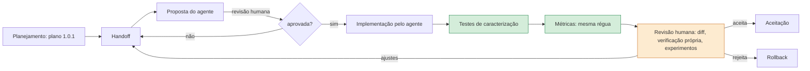
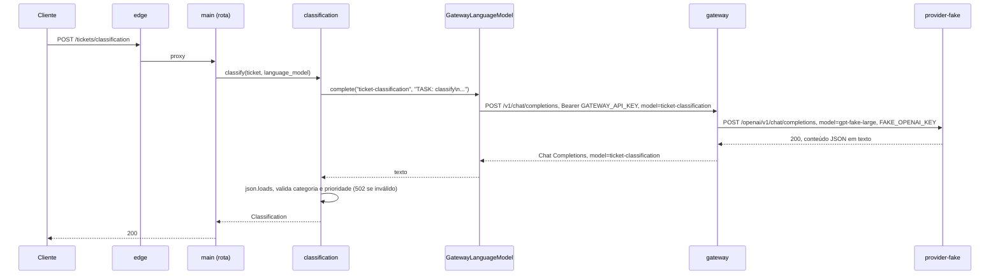
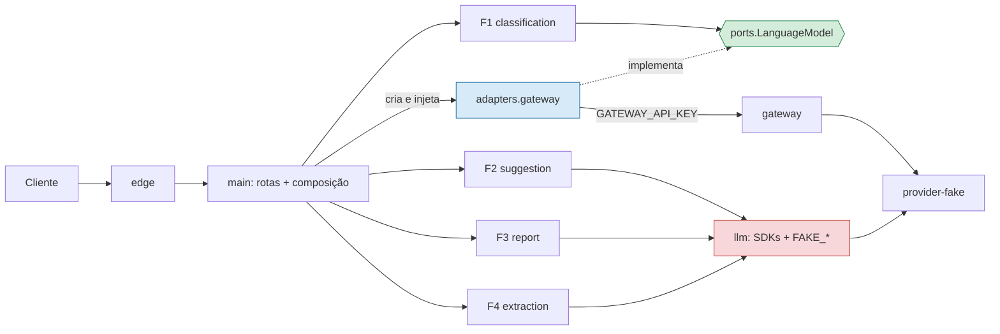
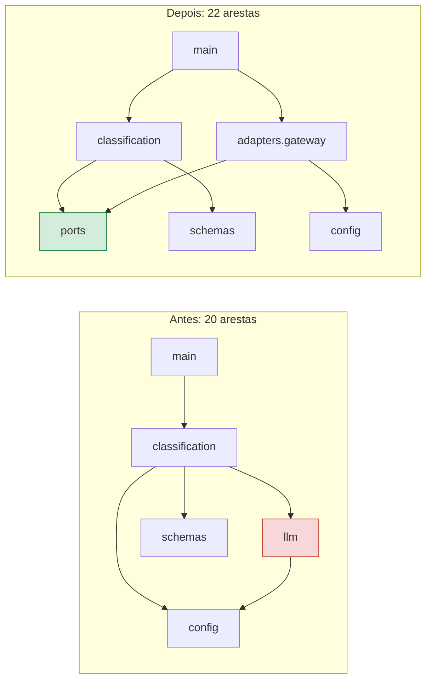

# Passo 08: piloto de refatoração da F1 com agente de IA

| Item | Valor |
|---|---|
| Data | 2026-11-25 (horários das evidências em UTC) |
| Base | `6efadeb` (Passo 07) na `main`, sobre a tag `v1-coupled` (objeto `07c2026d`, commit `8028305`) |
| Componente-alvo | F1, `app/helpdesk/classification.py` |
| Agente | Claude Code, sessão separada na máquina do Igor, com acesso só ao repositório e ao handoff |
| Decisão | **aprovada** (sem ajustes de código), com 3 diferenças de comportamento sob falha registradas |
| Evidências | `docs/piloto/evidencias/00` a `26`; métricas em `docs/piloto/metricas/`; handoff em `docs/piloto/handoff-f1.md` |
| Estado | transitório: só a F1 passa pelo gateway; F2, F3 e F4 seguem na integração original até o Passo 09 |

> **Pergunta da etapa:** como comprovar que uma refatoração feita por um agente melhora a arquitetura sem depender da avaliação do próprio agente?
>
> **Resposta deste piloto:** separando quem implementa de quem julga. O agente recebeu o escopo, as restrições e os critérios por escrito, e propôs antes de mexer. O código foi aceito só depois de quatro verificações feitas fora da sessão do agente:
> - os testes de caracterização, rodados de novo;
> - as métricas, recalculadas por mim a partir do código entregue;
> - uma verificação nova, escrita pelo arquiteto, para o que a suíte não cobre;
> - experimentos pela borda que só têm uma explicação possível se a F1 passar pelo gateway.

---

## 1. Recuperação do contexto (4.1)

| Artefato | Informação relevante | Utilização no piloto |
|---|---|---|
| Plano de refatoração (v1.0.1) | Alt 2: `ports.LanguageModel` + `adapters.gateway` + composição em `main`; F1 como piloto; projeção pós-piloto (§14.2); handoff preliminar (§19.1); `max_retries=0` (revisão 1.0.1) | estratégia, escopo, critérios e metas do piloto |
| Diagnóstico da v1 (README) | feature escolhe provider pelo nome da função; modelo físico no código; troca de modelo exige rebuild; provider fora derruba metade do sistema | justificativa da inversão e do experimento de troca |
| Testes de caracterização | 32 testes pela borda; 13 da F1 (9 de sucesso, 4 de 422); nenhum cobre o 502 nem falhas do modelo | detecção de regressão e lacunas que exigiram verificação extra |
| Métricas da V1 | `classification` 1/3/0,75/0/0,25; `llm` 4/1/0,20/0/0,80 (zona de dor); `config` 6/0/0/0/1,00 (zona de dor) | baseline estrutural |
| Ferramenta de métricas | `metrics/measure.py`, régua do ADR 0001, 64 testes próprios | mesma régua antes e depois |
| Configuração do gateway | `ticket-classification` → `openai/gpt-fake-large`; master key; 2 retentativas padrão em 5xx | interface do adapter |
| Experimentos do gateway (Passo 07) | normalização, autenticação 400/401, troca de modelo com cliente de teste, +6 ms | o que o adapter pode supor |
| ADRs 0001 a 0004 | régua, contrato e DI, gateway, capacidades lógicas | restrições arquiteturais |

Confirmado em 2026-11-25 (`evidencias/00` e `01`):

- **Repositório:** `main` em `6efadeb`, sem alterações locais; tag `v1-coupled` intacta; diretórios protegidos e ferramenta de métricas sem diff.
- **Comportamento e métricas:** 32 testes verdes; `pilot-before.csv` idêntico a `metrics/results/v1-coupled.csv`.
- **Gateway:** as 4 capacidades estão no ar com modelos `large`, e a autenticação usa a master key.

---

## 2. Fundamentação (4.2 e 4.3)

### 2.1 Pilotos arquiteturais

| Conceito | Significado | Neste piloto |
|---|---|---|
| Piloto arquitetural | aplicar a estratégia escolhida a uma parte real e limitada do sistema, para descobrir se ela funciona antes de escalar | a F1 migrou de verdade; as outras três, não |
| Proof of Concept | mostrar que uma ideia é viável, em geral fora do produto | o Passo 07 foi próximo disso: o gateway sozinho, com cliente de teste |
| Technical Spike | investigação curta para reduzir uma incerteza técnica específica, código descartável | a verificação de `max_retries` no SDK `openai==3.19.0` |
| Hipótese arquitetural | afirmação verificável sobre o efeito de uma mudança estrutural | seção 5 |
| Experimentação controlada | mudar uma variável por vez e comparar com uma referência medida | baseline, infraestrutura e piloto em etapas separadas, cada uma com testes |
| Redução de incerteza | o objetivo do piloto é transformar suposições em fatos | 3 diferenças sob falha que o plano não previa |
| Evolução incremental | passos pequenos, cada um verificável e reversível | infraestrutura e código da F1 em etapas distintas |
| Feedback loop | ciclo curto entre mudança e verificação objetiva | proposta, revisão, implementação, testes, métricas |
| Architectural Fitness Function | verificação objetiva de uma característica arquitetural | FF1 a FF11 do plano; a FF6 precisou ser corrigida (seção 12) |
| Refatoração orientada por evidências | aceitar ou recusar com base em resultados observados, não em opinião | matriz da seção 10 |
| Fail-fast | errar cedo e alto | `config` lê `GATEWAY_URL` com `os.environ[...]`: sem a variável, a app nem sobe |
| Rollback | voltar a um estado conhecido | seção 7 |

| Abordagem | Objetivo | Exemplo no desafio |
|---|---|---|
| Proof of Concept | investigar a viabilidade de uma ideia | o gateway traduzir para o fake Anthropic (Passo 07) |
| Technical Spike | reduzir uma incerteza técnica | `max_retries` aceito pelo SDK |
| Piloto arquitetural | validar uma estratégia em um contexto real e limitado | F1 pelo contrato e pelo gateway (este passo) |
| Refatoração completa | aplicar a estratégia validada a todo o escopo | F2, F3 e F4, remoção de `llm` (Passo 09) |

**Por que uma estratégia correta no papel surpreende na prática.** O plano descreve dependências de código; a execução tem comportamento em tempo de execução, ferramentas com padrões próprios, testes que cobrem só parte do sistema e um agente que interpreta instruções. Este piloto revelou exatamente esse tipo de coisa:

- **Limitação do gateway:** o retry passou a ser do gateway, com backoff próprio. A falha persistente ficou mais lenta.
- **Dependência não considerada:** a F1 agora depende do gateway em tempo de execução. Com ele parado, ela cai e a F4 não.
- **Problema de validação:** a fitness function FF6 não enxergava o adapter, por causa dos imports relativos.
- **Lacuna de cobertura:** a suíte não exercita o 502 nem as falhas do modelo.
- **Contrato mais forte que a implementação:** o SDK tipa o conteúdo como `str | None`, e o contrato promete `str`.

Não houve abstração inadequada, problema de composição nem métrica fora da projeção. Isso também é resultado: o desenho do Passo 06 resistiu ao código real.

### 2.2 Desenvolvimento assistido por agentes

| Termo | Diferença |
|---|---|
| Assistente de código | sugere trechos a pedido; quem decide e integra é o humano |
| Agente de desenvolvimento | recebe uma tarefa, lê o repositório, edita, roda comandos e relata, com autonomia dentro de limites |
| Geração de código | produzir texto de programa; não implica entender o sistema |
| Execução autônoma de tarefas | encadear passos (ler, editar, testar) sem intervenção a cada passo |
| Planejamento arquitetural | decidir problema, estratégia, escopo e critérios; responsabilidade do arquiteto |
| Avaliação automatizada | testes e métricas: determinísticos e repetíveis, mas só veem o que medem |
| Revisão humana | julga intenção, necessidade e proporcionalidade, que nenhuma ferramenta mede |

| Conceito | Aplicação |
|---|---|
| Context Engineering | o handoff dá o mínimo suficiente: problema, contrato já decidido, arquivos, limites e critérios. O agente não recebeu a conversa nem o plano inteiro |
| Handoff | `docs/piloto/handoff-f1.md`, instrução independente |
| Task Specification | seção 3 do handoff: componente, dependência a inverter, contrato, adapter, composição e o que preservar |
| Context Window | o agente leu 8 arquivos e 2 seções do plano; o resto ficou fora de propósito |
| Feedback determinístico | testes, métricas, `grep`, `/admin/calls`, verificação do adapter |
| Human-in-the-loop | duas portas: aprovação da proposta e aprovação da entrega |
| Agent Evaluation | matriz da seção 10, com evidências próprias do arquiteto |
| Scope Control | lista fechada de 5 arquivos; `git status --untracked-files=all` conferido |
| Acceptance Criteria | definidos antes da tarefa (seção 6) e não alterados depois |

**Por que código "que funciona" ainda pode estar errado.** O agente otimiza o pedido: se o critério for "testes verdes", alterar um teste satisfaz o critério. Se for "D baixo", um import sem uso também satisfaz. Ele pode ainda:

- violar fronteiras para simplificar (a feature importando o adapter);
- reproduzir a interface do SDK como "contrato";
- extrapolar o escopo ("já que estou aqui, migro a F4").

Por isso os critérios proíbem cada um desses atalhos explicitamente, e a aceitação usa evidências que o agente não controla.



**Testes e métricas não substituem a análise.** Os testes dizem que o comportamento observado pela suíte não mudou, mas não cobrem o 502 nem as falhas. As métricas dizem como as setas de import mudaram, mas não veem o runtime: a F1 depende do gateway em execução, e nenhuma seta mostra isso. A revisão humana avalia se cada mudança tem razão de existir. São três lentes, e o piloto precisou das três.

---

## 3. Componente escolhido (4.4)

A escolha do Passo 06 (F1) foi mantida.

| Aspecto | F1 `classification.py` (antes) |
|---|---|
| Responsabilidade | montar a tarefa `classify`, chamar o modelo, interpretar o JSON, validar categoria e prioridade (502), montar `Classification` |
| Dependências internas | `config` (modelo físico), `llm` (cliente concreto), `schemas` |
| Dependências externas | `fastapi` (`HTTPException`); `openai`, indiretamente via `llm` |
| Acoplamento ao provider | `llm.call_openai`: o nome da função escolhe o provider |
| Acoplamento ao modelo | `config.CLASSIFICATION_MODEL = "gpt-fake-large"` |
| Testes | 13 em `test_classification.py`: 9 de sucesso e 4 de 422 |
| Métricas | Ca=1, Ce=3, I=0,75, A=0, D=0,25 |
| Complexidade | 15 linhas |
| Risco de regressão | baixo: resposta curta, determinística, 1 s por chamada |
| Representatividade | alta: a F4 tem a mesma forma; a F2 é a mesma chamada sem validação; a F3 muda só a linha da chamada |

Limite da escolha: a F1 não exercita o caminho Anthropic do gateway. Ele foi validado diretamente no Passo 07 (texto da F2 byte a byte) e é o principal risco do Passo 09.

---

## 4. Escopo (4.5)

| Item | Arquivos | Quem alterou |
|---|---|---|
| Componente-alvo | `app/helpdesk/classification.py` | agente |
| Contrato | `app/helpdesk/ports.py` (novo) | agente |
| Adapter | `app/helpdesk/adapters/__init__.py` (vazio) e `adapters/gateway.py` (novos) | agente |
| Composição | `app/helpdesk/main.py` | agente |
| Infraestrutura mínima | `app/helpdesk/config.py` (+2 constantes, nada removido), `compose.yaml` (`GATEWAY_URL` e `GATEWAY_API_KEY` no `app`, `depends_on: gateway`), `.env.example` (1 comentário) | arquiteto, antes do agente |
| Evidências e documentação | `docs/piloto/`, `docs/refactoring-plan.md`, ADRs, README | arquiteto |
| Proibido | `suggestion.py`, `extraction.py`, `report.py`, `llm.py`, `schemas.py`, `tickets.py`, `app/requirements.txt`, `tests/`, `metrics/`, `gateway/`, `provider-fake/`, `edge/`, `data/`, `env_file` do `app` | — |

Diferenças entre os quatro tipos de mudança:

- **Refatorar o componente-alvo:** a F1 muda a forma de pedir o modelo e mantém o que faz.
- **Criar componentes auxiliares:** `ports` e `adapters.gateway` existem porque a F1 precisa deles, não para o futuro.
- **Alterar o ponto de composição:** `main` passa a montar e injetar o adapter, sem regra nova.
- **Refatorar a aplicação toda:** é o Passo 09. O contrato e o adapter já servem às outras features, mas isso não justificou migrá-las agora.

---

## 5. Hipótese (4.6)

> Se a F1 depender do `Protocol` `LanguageModel` injetado por `main`, e o único concreto for um adapter do gateway, então a F1 deixa de conhecer provider, modelo e SDK **sem mudar o comportamento externo**. A escolha do modelo passa a ser configuração do gateway, e o padrão pode ser repetido nas outras features sem alterar o contrato.

| Hipótese | Resultado esperado | Mecanismo de validação | Invalidada se |
|---|---|---|---|
| Preservação do comportamento | mesmas respostas HTTP | 32 testes; verificação do 502 | um teste falha ou o 502 muda |
| Independência do provider | F1 sem SDK, provider ou modelo físico | inspeção do código e `grep` | qualquer import ou nome concreto na F1 |
| Inversão de dependências | F1 → `ports` ← adapter; só `main` → adapter | grafo de arestas do `measure.py` | aresta F1 → adapter, `llm` ou `config` |
| Comunicação pelo gateway | chamadas da F1 chegam ao gateway com a capacidade lógica | log do gateway, `/admin/calls`, gateway parado, troca de modelo | F1 funciona com o gateway parado |
| Modelo como configuração | trocar o mapeamento muda o modelo sem tocar na app | troca pela borda | precisar reiniciar ou reconstruir a app |
| Evolução estrutural | métricas iguais à projeção §14.2 pós-piloto | `pilot-after.csv` | divergência sem explicação ou componente novo na zona de dor |

---

## 6. Baseline imediatamente anterior (4.7)

| Item | Valor | Evidência |
|---|---|---|
| Branch e commit | `main`, `6efadeb` | 00 |
| Alterações pendentes | nenhuma (só `docs/piloto/`, recém-criada) | 00 |
| Diretórios protegidos e régua | sem diff contra `v1-coupled` e `13fc247` | 00 |
| Provider | modo normal (`/admin/reset` em cada sonda) | 03 a 05 |
| Caracterização | `32 passed in 59.95s` | 02 |
| F1 manual pela borda | 200 em 1,082 s, `delivery`/`high`, atendida por `openai`/`gpt-fake-large` | 03 |
| F1 sob falha (`error_500` no `gpt-fake-large`) | 500 em 1,249 s, **3 tentativas** no provider (retries do SDK) | 04 |
| Quem atende cada feature | F1 e F4: openai/gpt-fake-large; F2 e F3: anthropic/claude-fake-large | 05 |
| Gateway | nenhuma requisição de inferência no log | 06 |
| Testes da ferramenta de métricas | `64 passed` | 07 |
| Métricas `pilot-before` | idênticas à `v1-coupled` (20 arestas) | 08 e `metricas/pilot-before.csv` |
| Após o incremento de infraestrutura | `32 passed in 60.02s`; app com `GATEWAY_URL=http://gateway:4000`; F1 ainda direto no provider | 09 a 11 |

| Componente | Ca | Ce | I | A | D | Zona de dor |
|---|---|---|---|---|---|---|
| **classification** | 1 | 3 | 0,75 | 0,00 | 0,25 | |
| config | 6 | 0 | 0,00 | 0,00 | 1,00 | sim |
| extraction | 1 | 3 | 0,75 | 0,00 | 0,25 | |
| **llm** | 4 | 1 | 0,20 | 0,00 | 0,80 | sim |
| **main** | 0 | 5 | 1,00 | 0,00 | 0,00 | |
| report | 1 | 4 | 0,80 | 0,00 | 0,20 | |
| schemas | 5 | 0 | 0,00 | 0,00 | 1,00 | sim |
| suggestion | 1 | 3 | 0,75 | 0,00 | 0,25 | |
| tickets | 1 | 1 | 0,50 | 0,00 | 0,50 | no limite |

Três referências distintas, que não se misturam:

1. **Baseline oficial da `v1-coupled`:** `metrics/results/v1-coupled.csv`, intocada.
2. **Baseline imediatamente anterior ao piloto:** `docs/piloto/metricas/pilot-before.csv`. É igual à oficial porque nada em `app/` mudou desde a tag.
3. **Projeções do Passo 06:** plano, §14.2, calculadas sobre um esqueleto.

---

## 7. Rollback (4.9)

O plano previa uma branch `refactor/v2-decoupled` com um commit por incremento. Na execução, o Igor manteve a regra de trabalhar na branch atual e commitar ele mesmo. Por isso o piloto rodou como alterações locais sobre um commit limpo e conhecido (`6efadeb`). A troca preserva o que importa:

| Situação | Como voltar |
|---|---|
| Rejeitar o código do agente | `git restore app/helpdesk/classification.py app/helpdesk/main.py` e apagar `app/helpdesk/ports.py` e `app/helpdesk/adapters/` (conferidos no `git status --untracked-files=all`) |
| Rejeitar também a infraestrutura | `git restore app/helpdesk/config.py compose.yaml .env.example` |
| Preservar a tentativa rejeitada | antes do restore, `git diff > docs/piloto/tentativa-N.diff` e copiar os arquivos novos |
| Depois do commit do Igor | `git revert HASH` (não reescreve histórico) |
| Comparar com a v1 | worktree `../helpdesk-v1` na `v1-coupled` |

Nenhuma operação destrutiva foi necessária. O agente não fez commit, branch nem push.

---

## 8. Agente e handoff (4.10 a 4.12)

| Informação | Valor |
|---|---|
| Agente | Claude Code, numa sessão própria na máquina do Igor, separada da sessão do arquiteto |
| Modelo | não registrado pela sessão do agente |
| Ambiente | Windows, Git Bash, Docker Desktop; stack do compose no ar |
| Permissões | pasta do repositório; comandos `git` de leitura, `docker` e `docker compose`; proibido commit, push, branch, tags e apagar volumes |
| Commit inicial | `6efadeb` + incremento de infraestrutura local |
| Escopo autorizado | 2 arquivos a modificar e 3 a criar (seção 4) |
| Contexto entregue | só o handoff (`docs/piloto/handoff-f1.md`); nada da conversa com o arquiteto |

O handoff partiu do template do plano (§19.1), com estas diferenças:

- duas fases explícitas: proposta e implementação;
- infraestrutura já preparada e proibida ao agente;
- `GATEWAY_URL` sem `/v1`, para o adapter montar o caminho do protocolo;
- tabela de metas por componente;
- comandos de sonda pela borda;
- lista de entrega em 13 itens.

**Proposta do agente (fase 1).** Ela coincidiu com o handoff em arquivos, contrato, adapter, composição e métricas projetadas (22 arestas). Pontos próprios do agente:

| Ponto | Avaliação do arquiteto |
|---|---|
| Não anotar a instância em `main` com `LanguageModel` (evita um import sem consumidor) | aceito: `main` conhece o concreto; a anotação não teria uso. A decisão seria a mesma sem a métrica |
| R1: com `max_retries=0`, uma falha de **conexão** app → gateway gera 1 tentativa, contra 3 na v1 (app → provider) | aceito como diferença conhecida, para o Passo 10. Não estava no plano |
| R2: timeout em dois saltos (600 s do SDK e o do gateway) | aceito como diferença conhecida, para o Passo 10 |
| R4: a suíte não cobre o 502 nem falhas | confirmado; motivou a verificação própria do arquiteto (seção 9.2) |
| R5: herdar do `Protocol` dá um `complete` que devolve `None` se não for sobrescrito | registrado; o caminho feliz dos testes pegaria |
| Sugestão: rodar também `f1-falha` e `features` | aceita |

Ela não antecipou nenhuma funcionalidade, não ampliou o escopo e não propôs reescrita. A proposta foi aprovada sem mudanças no handoff.

---

## 9. Implementação e revisão (4.13 a 4.18)

### 9.1 O que foi produzido

```python
# app/helpdesk/ports.py
class LanguageModel(Protocol):
    def complete(self, capability: str, prompt: str) -> str:
        """Executa a capacidade lógica sobre o prompt e devolve o texto gerado."""
        ...
```

- **Contrato.** Existe porque a F1 precisa pedir "execute esta capacidade sobre este texto" sem saber quem executa. Dependem dele a F1, que o consome, e o adapter, que o implementa.
  - Esconde: SDK, protocolo HTTP, endereço, credencial, provider e modelo físico.
  - `capability` é o nome do que a feature quer. `prompt` é o texto que só a feature sabe montar.
  - Ficam de fora: modelo físico, tokens, temperatura, streaming e erros próprios. Ninguém os usa hoje (ISP, YAGNI).
  - É um `Protocol`, ou seja, tipagem estrutural: qualquer objeto com `complete` compatível serve, inclusive um dublê de teste.
- **Adapter** (`GatewayLanguageModel(LanguageModel)`).
  - Cria o cliente do SDK `openai` uma vez, no construtor, com `base_url=f"{config.GATEWAY_URL}/v1"`, a chave do gateway e `max_retries=0`.
  - `complete` envia `model=capability` e uma mensagem de usuário, e devolve `choices[0].message.content`. Não trata erros: a exceção do SDK vira 500, como na v1.
  - Usar o SDK `openai` não acopla a F1 ao provider OpenAI. É só o protocolo que o gateway fala, e esse detalhe fica no adapter: a troca de modelo para Anthropic (seção 9.5) passou pelo mesmo SDK.
- **F1.** Recebe `model: LanguageModel` por parâmetro e declara `CAPABILITY = "ticket-classification"`.
  - Monta `f"TASK: classify\n{ticket.text}"`, o mesmo texto que `llm.call_openai` montava.
  - Troca `llm.parse_json` por `json.loads`, que é exatamente o que `parse_json` fazia.
  - Validação, 502 e `Classification` ficaram intactos.
- **Composition Root.** `main` importa o adapter e cria **uma** instância no carregamento do módulo (um cliente HTTP com pool de conexões, reutilizado: o log mostra as 9 chamadas da suíte na mesma conexão keep-alive). A rota passa essa instância à F1.
  - A F1 não instancia, não importa e não configura o adapter.
  - Inversão de controle: quem decide qual implementação a F1 usa é `main`, não a F1.

| Dependências | Removidas | Adicionadas |
|---|---|---|
| F1 | `classification → llm`, `classification → config` | `classification → ports`; `json` (externo) |
| Novos | — | `adapters.gateway → ports`, `adapters.gateway → config`, `main → adapters.gateway`; `openai` no adapter |

### 9.2 Revisão do diff (feita pelo arquiteto, `evidencias/12`)

O conteúdo dos 5 arquivos na máquina tem os mesmos hashes Git que eu reconstruí do relatório do agente: `f4755a8`, `c3d38a3`, `b2f5e25`, `e69de29` e `fabda3c`. Ou seja, o que foi relatado é o que está no disco.

| Arquivo | Alteração | Justificativa | No escopo? | Avaliação |
|---|---|---|---|---|
| `classification.py` | recebe o contrato; capacidade; `json.loads` | inversão da dependência | sim | aprovado: regras intactas; `grep` de `llm`, `config`, `openai`, `anthropic`, `adapters` e `gateway` vazio |
| `main.py` | importa e instancia o adapter; injeta na F1 | Composition Root | sim | aprovado: as outras rotas não mudaram; o comentário de uma linha é útil |
| `ports.py` | `Protocol` com 1 operação | contrato | sim | aprovado: só importa `typing`; tem consumidor e implementação |
| `adapters/__init__.py` | vazio | pacote | sim | aprovado |
| `adapters/gateway.py` | cliente do gateway | único concreto novo | sim | aprovado: sem nomes físicos, chaves de provider ou URL do provider; `max_retries=0` com comentário do porquê |
| `config.py`, `compose.yaml`, `.env.example` | variáveis do gateway | infraestrutura (arquiteto) | sim | aprovado: só acréscimos |
| `tests/`, `metrics/`, `gateway/`, protegidos | — | — | — | sem diff; sem arquivos novos em `tests/` |

Outras verificações do arquiteto, feitas no meu próprio ambiente sobre os mesmos arquivos:

- `pyflakes`: sem imports sem uso.
- `mypy`: um aviso, `adapters/gateway.py:23` devolve `str | None` onde o contrato promete `str`. O SDK tipa `message.content` como opcional.
  - Não é regressão: `llm.call_openai` tinha o mesmo tipo de retorno e o mesmo comportamento. Com conteúdo nulo, `json.loads(None)` levanta `TypeError` e a rota devolve 500, antes e depois.
  - Foi mantido para não alterar comportamento e fica registrado para o Passo 10.
- Com uma assinatura errada de `complete`, o `mypy` acusa sobrescrita incompatível. Isso confirma a justificativa da herança explícita (checagem estática), levantada como risco R3 no Passo 06.

**Verificação própria do arquiteto** (`docs/piloto/verificacao_f1.py`, `evidencias/13`). A app real roda contra um gateway simulado em memória, para cobrir o que a suíte não cobre:

| Cenário | Esperado | Observado |
|---|---|---|
| Sucesso | 200, mesmo JSON | 200, 1 requisição |
| Categoria fora da lista | 502, mesma mensagem | 502, 1 requisição |
| Prioridade fora da lista | 502, mesma mensagem | 502, 1 requisição |
| Gateway responde 500 | 500, **sem** retentativa no cliente | 500, 1 requisição |
| Requisição ao gateway | `/v1/chat/completions`, `Bearer` com a chave do gateway, `model=ticket-classification`, prompt idêntico, nada a mais | 5 de 5 |

Antes de usar a verificação, testei que ela detecta erros: com `max_retries` no padrão do SDK, o cenário de 500 recebe 3 requisições e o resultado é `FALHOU`.

### 9.3 Testes depois do piloto (4.19)

| Feature | Testes antes | Testes depois | Comportamento preservado? |
|---|---|---|---|
| F1 | 13 de 13 | 13 de 13 | sim; o 502 também (verificação própria) |
| F2 | 4 de 4 | 4 de 4 | sim (byte a byte) |
| F3 | 6 de 6 | 6 de 6 | sim |
| F4 | 9 de 9 | 9 de 9 | sim |
| Total | `32 passed in 59.95s` | `32 passed in 59.97s` (arquiteto); `60.33s` (agente) | sim |

`git diff v1-coupled -- tests/characterization/` ficou vazio, sem arquivos novos na pasta. Nenhum teste falhou, e nenhuma correção foi necessária.

### 9.4 Comunicação pelo gateway (4.20)

`/admin/calls` sozinho não prova nada, porque a app antiga e o gateway chamam o mesmo provider. A prova combina cinco evidências independentes:

| Evidência | Observado | Por que só se explica pelo gateway |
|---|---|---|
| Código | o adapter aponta para `http://gateway:4000/v1` com `GATEWAY_API_KEY`; a F1 não tem URL nem chave de provider | estático |
| Log do gateway | `POST /v1/chat/completions` vindos de `172.18.0.4` (IP do `app`): 9 na suíte (as 9 de sucesso da F1) + 1 por sonda; F2, F3 e F4 não aparecem (16) | antes do piloto o log não tinha nenhuma (06) |
| Falha injetada | 1 requisição do app ao gateway; log `LiteLLM Retried: 2 times`; 3 tentativas no provider (16, 17) | na v1, as 3 tentativas vinham do SDK da app |
| Gateway parado | F1 responde 500 em 3,99 s e **nenhuma** chamada chega ao provider; F4 responde 200 direto (19) | se a F1 ainda fosse direto, funcionaria |
| Troca de modelo | depois de mudar só o gateway, o provider registra `anthropic`/`claude-fake-large`/`classify` para a F1 (22) | a app não tem código para chamar a Anthropic na F1 |



### 9.5 Troca de modelo na F1 (4.21)

| Característica | Antes | Depois |
|---|---|---|
| Capacidade lógica | `ticket-classification` | `ticket-classification` |
| Provider (`/admin/calls`) | openai | **anthropic** |
| Modelo físico | gpt-fake-large | **claude-fake-large** |
| Requisição HTTP | `POST /tickets/classification`, TK-00042 | idêntica |
| Resposta | 200, `{"ticket_id":"TK-00042","category":"delivery","priority":"high"}` em 1,428 s | idêntica, em 1,276 s |
| Container da aplicação | `5ea6f877...`, iniciado 23:40:59.058Z | mesmo Id, mesmo horário |
| Código da aplicação | hashes dos 5 arquivos e `git diff --stat -- app/` | idênticos |

Procedimento:

1. Editar só o bloco da capacidade em `gateway/config.yaml`.
2. `docker compose restart gateway` e `up -d --wait gateway`, em 7,7 s.
3. Repetir a chamada pela borda.
4. Restaurar o arquivo (7,8 s) e repetir a chamada: voltou a `openai`/`gpt-fake-large` (23).

Isso mostra que a escolha do modelo da F1 deixou de ser uma decisão embutida no código e virou configuração operacional do gateway. No Passo 02, a mesma troca exigia editar `config.py`, reconstruir a app e passar por 6 a 7 s de 502 na borda. A prova vale para a F1; a validação final será repetida depois da migração completa.

### 9.6 Arquitetura transitória (4.17)



O que ainda precisa existir até o Passo 09:

- `llm.py` e os SDKs `openai` e `anthropic`;
- em `config.py`, as chaves `FAKE_*`, as URLs do provider, os três modelos físicos de F2, F3 e F4 e `MAX_OUTPUT_TOKENS`;
- o `env_file: .env` do `app`.

`CLASSIFICATION_MODEL` não tem mais consumidor, mas fica até o incremento 8, que remove tudo de uma vez, junto com `llm.py`. Também ficam até lá o `anthropic` em `requirements.txt` e as chaves e URLs de provider. O isolamento das credenciais (`app` sem `env_file`) é o incremento 9.

---

## 10. Métricas depois do piloto (4.22 a 4.24)

| Componente | Ca antes | Ca depois | Ce antes | Ce depois | I antes | I depois | A antes | A depois | D antes | D depois |
|---|---|---|---|---|---|---|---|---|---|---|
| adapters.gateway | não existia | 1 | não existia | 2 | não existia | 0,67 | não existia | 0,00 | não existia | 0,33 |
| classification | 1 | 1 | 3 | 2 | 0,75 | 0,67 | 0,00 | 0,00 | 0,25 | 0,33 |
| config | 6 | 6 | 0 | 0 | 0,00 | 0,00 | 0,00 | 0,00 | 1,00 | 1,00 |
| extraction | 1 | 1 | 3 | 3 | 0,75 | 0,75 | 0,00 | 0,00 | 0,25 | 0,25 |
| llm | 4 | 3 | 1 | 1 | 0,20 | 0,25 | 0,00 | 0,00 | 0,80 | 0,75 |
| main | 0 | 0 | 5 | 6 | 1,00 | 1,00 | 0,00 | 0,00 | 0,00 | 0,00 |
| ports | não existia | 2 | não existia | 0 | não existia | 0,00 | não existia | 1,00 | não existia | 0,00 |
| report | 1 | 1 | 4 | 4 | 0,80 | 0,80 | 0,00 | 0,00 | 0,20 | 0,20 |
| schemas | 5 | 5 | 0 | 0 | 0,00 | 0,00 | 0,00 | 0,00 | 1,00 | 1,00 |
| suggestion | 1 | 1 | 3 | 3 | 0,75 | 0,75 | 0,00 | 0,00 | 0,25 | 0,25 |
| tickets | 1 | 1 | 1 | 1 | 0,50 | 0,50 | 0,00 | 0,00 | 0,50 | 0,50 |

O `measure.py` produziu a mesma tabela em três lugares: na sessão do agente, na sessão de verificação (`metricas/pilot-after.csv`, 25) e no meu ambiente, sobre os arquivos reconstruídos. São 22 arestas, igual à projeção do Passo 06 em todos os componentes. A zona de dor continua com `config`, `llm` e `schemas`, e nenhum componente novo entrou nela.



(Só as arestas que mudaram; as de F2, F3, F4, `report`, `tickets` e `main → schemas` são as mesmas nos dois estados.)

| Componente | Esperado (§14.2) | Observado | Justificativa | Avaliação |
|---|---|---|---|---|
| `classification` | 1/2/0,67/0/0,33 | igual | perdeu `llm` e `config`; ganhou `ports`. D sobe porque a F1 ficou com **menos** dependências | aceito (previsto em §14.3) |
| `ports` | 2/0/0/1/0 | igual | estável e abstrato: sobre a Main Sequence. Ca=2 é a prova estrutural de que consumidor e implementação apontam para ele | aprovado |
| `adapters.gateway` | 1/2/0,67/0/0,33 | igual | só `main` o importa; fora da zona de dor | aprovado |
| `llm` | 3/1/0,25/0/0,75 | igual | perdeu a F1, ainda na zona de dor (transitório, some no incremento 8) | esperado |
| `config` | 6/0/0/0/1,00 | igual | perdeu a F1, ganhou o adapter | esperado; decisão final no Passo 16 |
| `main` | 0/6/1/0/0 | igual | ganhou o adapter: é o papel do Composition Root | aprovado |

Perguntas do roteiro:

- **A abstração ficou instável?** Não: I=0.
- **O adapter tem Ca alto?** Não: Ca=1.
- **A F1 ainda depende de concretos?** Não.
- **`main` concentrou responsabilidade indevida?** Não: só cria e passa um objeto.
- **Algum componente com D alto novo?** Não.

O que resta na zona de dor ou é transitório (`llm`) ou já estava decidido para a `main` final (`config` e `schemas`). Nada disso é usado como desculpa: `llm` **precisa** sumir no Passo 09, e esse é um critério de aceite.

### 10.1 Melhorias artificiais? (Goodhart)

Goodhart: quando uma medida vira alvo, deixa de ser boa medida. Para separar estrutura real de número, medi duas variações hipotéticas do código aprovado. Nenhuma delas foi aplicada ao repositório.

| Variação | Comportamento | Métricas |
|---|---|---|
| F1 sem a anotação `model: LanguageModel` (sem `import` de `ports`) | idêntico: o Python chama `complete` em qualquer objeto | F1: Ce=1, D=0,50; `ports`: Ca=1 |
| Adapter sem herdar de `LanguageModel` | idêntico | adapter: Ce=1, D=0,50; `ports`: Ca=1 |

A régua mede dependências **declaradas**. As duas setas para `ports` existem por razão de código, não de métrica:

- a anotação documenta o contrato e permite checagem estática;
- a herança faz o `mypy` recusar um adapter incompatível, como demonstrado na seção 9.2.

Sem elas, o código funcionaria igual e a métrica pioraria. Com elas, as métricas melhoram **e** a intenção fica verificável. É o caso em que métrica e arquitetura concordam. Não foi encontrado nenhum dos sinais de manipulação:

- nenhum import sem uso (`pyflakes` limpo);
- nenhum `Protocol` sem consumidor;
- nenhuma classe abstrata ociosa;
- nenhuma interface duplicada;
- nenhuma fragmentação de módulos;
- nenhum wrapper vazio;
- nenhum ciclo.

O contrato também não reproduz a interface do SDK: `complete(capability, prompt)` não tem `messages`, `choices` nem `model` físico.

Avaliação do roteiro (4.24):

- **A mudança se justifica sem a métrica?** Sim: requisito do desafio e P1/P3 do diagnóstico.
- **O contrato permite substituir a implementação?** Sim: a verificação usa um gateway simulado e a troca de modelo usa outro provider.
- **As responsabilidades ficaram mais claras?** Sim.
- **A troca de provider exige menos conhecimento da feature?** Exige nenhum.
- **A solução ficou mais fácil de modificar?** Sim: um arquivo de configuração.
- **A complexidade é proporcional?** Dois arquivos de 7 e 23 linhas, mais um vazio.

---

## 11. Avaliação e decisão (4.25)

| Critério | Resultado | Evidência | Aprovado? |
|---|---|---|---|
| 32 testes de caracterização | 32 passed | 14 | sim |
| Suíte inalterada | sem diff e sem arquivos novos | 12 | sim |
| Contrato externo e 502 | iguais | 13, 14 | sim |
| Síncrono, modelo `large` | rotas `def`; `gpt-fake-large` | 12, 15 | sim |
| F2, F3 e F4 preservadas | 200, mesmos providers, mesmos tempos | 18 | sim |
| F1 sem `llm`, `config` e SDK | `grep` vazio | 12 | sim |
| Só `main` importa o adapter | 1 linha | 12; aresta única no CSV | sim |
| Um único concreto novo com SDK | `adapters/gateway.py` | 12 | sim |
| Métricas iguais à projeção, nada novo na zona de dor | 22 arestas iguais | 25 | sim |
| Sem abstrações ou imports artificiais | `pyflakes`; análise da 10.1 | — | sim |
| Capacidade lógica e chave do gateway | 5 de 5 na verificação | 13 | sim |
| Comunicação pelo gateway comprovada | log, falha, gateway parado, troca | 16, 17, 19, 22 | sim |
| Troca de modelo sem tocar na app | mesmo container, mesmos hashes | 20 a 23 | sim |
| Ambiente normal ao final | provider `normal`, 4 serviços no ar, config do gateway igual ao `HEAD` | 26 | sim |

| Perspectiva | Evidência | Resultado |
|---|---|---|
| Comportamental | testes + verificação do 502 | preservado |
| Quantitativa | `pilot-before` × `pilot-after` | igual à projeção |
| Estrutural | diff, `grep`, grafo, `mypy` | inversão real, sem artifícios |
| Operacional | gateway e experimentos | F1 passa pelo gateway; modelo vira configuração |

**Decisão: aprovada.** O código preserva o comportamento caracterizado, atende às metas estruturais e quantitativas e respeita o escopo. Não houve pedido de correção ao agente: o único ponto de código (o `str | None`) é herança da v1, e alterá-lo mudaria o comportamento.

Diferenças de comportamento **não caracterizadas**, aceitas e registradas para o Passo 10:

| # | Diferença | v1 | Piloto | Evidência |
|---|---|---|---|---|
| D1 | latência da F1 com o provider em 5xx persistente | 500 em 1,25 s | 500 em 4,6 a 4,7 s (backoff do LiteLLM) | 04 × 17 |
| D2 | dependência em execução | F1 depende do provider | F1 depende do gateway **e** do provider; gateway parado = F1 em 500 (3,99 s) | 19 |
| D3 | falha de conexão no primeiro salto | 3 tentativas app → provider (SDK) | 1 tentativa app → gateway | código (`max_retries=0`); 19 |

Nenhuma delas viola um critério do desafio: o limite de 15 s sob falha e o de 30 s da borda continuam folgados.

### Ciclos registrados

| Iteração | Tarefa entregue | Resultado produzido | Testes | Métricas | Decisão |
|---|---|---|---|---|---|
| 1 | handoff, fase 1 (proposta) | proposta alinhada ao plano; 6 riscos, 2 sugestões | — | projeção de 22 arestas | aprovada sem mudanças; sugestões aceitas |
| 2 | fase 2 (implementação) | 5 arquivos; 13 itens de entrega | 32 passed (agente) | igual à projeção (agente) | encaminhada à verificação |
| 3 | verificação do arquiteto (fora da sessão do agente) | diff conferido por hash; verificação do 502 e do retry; 4 experimentos | 32 passed; verificação OK | `pilot-after` igual | **aprovada** |

Não houve rejeições nem retrabalho. O histórico não foi enfeitado.

---

## 12. Planejamento × execução e revisão do plano (4.26 e 4.27)

| Dimensão | Planejado | Resultado | Divergência |
|---|---|---|---|
| Contrato | `LanguageModel.complete(capability, prompt) -> str` | igual | o SDK devolve `str \| None`; o contrato é mais forte que a fonte (pré-existente) |
| Organização | `ports.py` + `adapters/gateway.py` | igual | nenhuma |
| Adapter | SDK `openai`, `max_retries=0`, lê `config` | igual | nenhuma |
| Injeção | parâmetro de função | igual | nenhuma |
| Composição | instância única em `main` | igual | nenhuma |
| Dependências | 22 arestas projetadas | 22 medidas | nenhuma |
| Métricas | §14.2 pós-piloto | iguais | nenhuma |
| Complexidade | ~30 linhas novas | 31 linhas | nenhuma |
| Integração com o gateway | sem impacto além de +6 ms | retry migrou para o gateway: falha 3,5 s mais lenta; gateway como dependência em execução; 1 tentativa no primeiro salto | **sim** (D1 a D3) |
| Critérios de validação | FF1 a FF11 + testes | a FF6 não detecta o adapter; a suíte não cobre 502 e falhas | **sim** |
| Processo | branch própria e commit por incremento | alterações locais na `main`, commit pelo Igor | **sim** |

- **Hipóteses confirmadas:** preservação do comportamento; independência do provider; inversão; comunicação pelo gateway; modelo como configuração; métricas.
- **Inconclusiva:** "o padrão se repete nas outras features sem mudar o contrato". É provável (as quatro chamadas têm a mesma forma), mas só o Passo 09 comprova, sobretudo na F2 (caminho Anthropic e `max_tokens` ainda não provado).
- **Nenhuma hipótese invalidada.**

Divergir do plano não é falha: o desenho estrutural se confirmou exatamente, e o que o piloto encontrou está **fora** do que a régua e a suíte enxergam. É esse o valor de um piloto.

### Revisão 1.1 do plano (real, fundamentada em evidência)

| Elemento | Plano original | Evidência do piloto | Plano revisado | Justificativa |
|---|---|---|---|---|
| Validação de cada migração | FF1 (32 testes) + métricas + diff | a suíte não exercita o 502 nem falhas do modelo; o mutante sem `max_retries=0` passaria nos 32 testes e só a verificação própria pegou | cada feature migrada no Passo 09 ganha: (a) uma verificação contra gateway simulado (mesmo método de `verificacao_f1.py`), cobrindo erro de negócio e "1 requisição sob 500"; (b) a sonda de falha pela borda, comparada com a v1 | o que a régua e a suíte não veem precisa de verificação própria, escrita pelo arquiteto e não pelo agente |
| FF6 (fronteira do concreto) | `grep -rlE "adapters"`, esperado `main.py` e `adapters/` | o adapter usa imports relativos (`..ports`) e não contém a palavra; a FF não o enxergava | `grep -rnE "^\s*(from\|import) .*(adapters\|gateway)" app/helpdesk` (esperado: só `main.py`) **e** conferir no CSV/arestas que a única aresta para `adapters.gateway` vem de `main` | uma fitness function que não detecta o que pretende medir dá falsa segurança |
| Resiliência (novos riscos R18 a R20) | R16 (retries somados) e R17 (latência) | D1 a D3 | R18: latência sob falha agora vem do backoff do gateway; R19: o gateway é dependência em execução de cada feature migrada (SPOF crescente no Passo 09); R20: conteúdo nulo do modelo vira 500 (pré-existente). O Passo 10 passa a ter como entrada: `num_retries` e backoff explícitos no gateway, timeout nos dois saltos e decisão sobre retry de conexão no primeiro salto | evitar que a migração completa multiplique um comportamento não decidido |
| Fitness functions | FF1 a FF11 | herança explícita + `mypy` pegam adapter incompatível e o `str \| None` | nova **FF12** (opcional, recomendada): `mypy` sobre `ports.py`, `adapters/` e as features migradas; o único aviso aceito hoje é o `str \| None` herdado | transforma a justificativa da herança (R3) em verificação |
| Handoff dos próximos passos | template §19.1 | duas fases funcionaram; infraestrutura preparada antes evitou escopo misto; o agente sugeriu a sonda de falha | template revisado: fases 1 e 2; infraestrutura fora do escopo do agente; FF6 corrigida; sondas `falha` e `features`; entrega em 13 itens com conteúdo integral dos arquivos | o que funcionou vira padrão |
| Processo e rollback | branch própria, commit por incremento | Igor trabalha na branch atual e commita ele mesmo | alterações locais sobre commit limpo; `git status --untracked-files=all` antes de aceitar; rollback por `git restore` (seção 7); o commit do piloto separa, se possível, infraestrutura e código | registrar o que de fato aconteceu, sem perder a capacidade de reverter |

Consequências para os próximos passos:

- o Passo 09 fica um pouco mais caro, com uma verificação e uma sonda por feature, em troca de cobrir o que a suíte não vê;
- o Passo 10 ganha três entradas concretas (D1 a D3);
- a ordem de migração não muda: F4, F2, F3.

---

## 13. Preparação para o Passo 09 (4.33)

Elementos reutilizáveis:

- contrato e adapter, sem mudança;
- composição em `main`, com uma linha por rota;
- `config.GATEWAY_*` e as variáveis do compose;
- `sondas.py` e `verificacao_f1.py`, generalizáveis;
- o handoff revisado;
- os critérios da §15.4.

| Feature restante | Mudança necessária | Estratégia validada | Particularidades | Risco |
|---|---|---|---|---|
| F4, Extração | `extract(ticket, model)`; `CAPABILITY = "order-extraction"`; `json.loads` | idêntica à F1 | resultado mais sensível: o `mini` daria `product: null` (nunca usar `mini`); validação de formato do pedido | baixo |
| F2, Sugestão | `suggest(ticket, model)`; `CAPABILITY = "reply-suggestion"` | mesma chamada, sem JSON nem validação | caminho **Anthropic** do gateway; texto byte a byte (validado direto no gateway no Passo 07); `max_tokens: 2000` configurado e ainda não provado; 16 s por chamada | médio |
| F3, Relatório | `topics(period, model)`; só a linha da chamada muda; laço, lote de 150 e ordenação intactos | mesma chamada | lotes (`tickets`, `TICKETS_PER_CALL` continua em `config`); 10 s por dia; várias chamadas por requisição multiplicam o efeito de D1 | médio |
| Remoção (incremento 8) | apagar `llm.py`; tirar de `config` as chaves `FAKE_*`, as URLs, os modelos e `MAX_OUTPUT_TOKENS`; tirar `anthropic` de `requirements.txt` | — | só depois da última feature; FF5, FF7 e FF8 | baixo |
| Credenciais (incremento 9) | `app` sem `env_file`; `environment:` só com `GATEWAY_*` | — | `GATEWAY_MASTER_KEY` some do ambiente do `app`; FF9 | baixo |

Nenhuma dessas features foi tocada neste passo.
