# Plano de refatoração arquitetural

| Item | Valor |
|---|---|
| Versão do plano | 1.2 (1.0 do Passo 06; 1.0.1 com os fatos do gateway do Passo 07; 1.1 com o resultado do piloto do Passo 08; 1.2 com a refatoração completa do Passo 09) |
| Data | 2026-11-25 (1.0.1); 2026-11-26 (1.1 e 1.2) |
| Estado de partida | tag `v1-coupled` (commit `8028305`) |
| Estado de chegada desta fase | tag `v2-decoupled` (Passo 09) |
| Status | **refatoração completa executada e verificada** (Passo 09, seção 28): as 4 features pelo contrato e pelo gateway, `llm.py` removido, credenciais fora do `app`, medição `v2-decoupled` igual à projeção. Commit `b637c5a` e tag anotada `v2-decoupled`; suíte, inicialização e métricas validadas nas duas tags |

> Convenções deste documento. **Medido** é o que saiu da ferramenta de métricas sobre a `v1-coupled` ou de execuções reais nos Passos 02 a 05. **Projetado** é o que esperamos para a arquitetura proposta; nunca é medição da v2. **Decisão** é algo que adotamos; **requisito** é algo que o enunciado impõe; **hipótese** é algo que o piloto pode derrubar.

---

## 1. Contexto

### 1.1 Recuperação do contexto (entradas do plano)

| Artefato | Informação | Utilização neste plano |
|---|---|---|
| `docs/diagnostico/` e README, seção "Diagnóstico da v1" (Passo 02) | 4 dores comprovadas: F3 do mês dá 504 em 30,03 s; F2 sem streaming (15,96 s até o 1º byte); provider fora derruba metade das features; troca de modelo exige editar `config.py:10` e rebuild | problemas da seção 5; distinguir o que a v2 resolve do que fica para depois |
| `docs/model-comparison.md` (Passo 03) | GPT large ≡ Claude large em 100% dos casos; mini degrada F2 e F4; contexto de 8.000 tokens; preços | mapeamento capacidade → modelo (seção 11); manter `large` na v2 |
| `tests/characterization/` (Passo 04) | 32 testes pela borda (F1 13, F2 4, F3 6, F4 9), goldens reais; ~60 s | fitness function comportamental; critério de rejeição |
| tag `v1-coupled` | código original congelado + suíte | baseline e rollback |
| `metrics/` + `metrics/results/v1-coupled.csv` (Passo 05) | Ca, Ce, I, A, D dos 9 componentes; 20 arestas; zona de dor: `config`, `llm`, `schemas` | baseline quantitativa e metas (seções 4, 14, 15) |
| `docs/adr/0001-metrics-and-architectural-stability.md` | régua, exceções candidatas (`schemas` sim, `config` não, `llm`/gateway/features proibidos) | critérios quantitativos compatíveis com a régua |
| Código real de `app/helpdesk/` (v1) | 9 módulos, ~200 linhas; detalhes abaixo | toda proposta é ancorada nele |
| `compose.yaml`, `.env.example` | `app` recebe `env_file: .env` com `FAKE_OPENAI_KEY`/`FAKE_ANTHROPIC_KEY` | separação de credenciais (seção 12.4) |

### 1.2 O código que vamos evoluir (fatos)

```text
main.py            rotas síncronas (def) das 4 features; importa as 4 features + schemas
classification.py  llm.call_openai(config.CLASSIFICATION_MODEL, "classify", text) -> parse_json -> valida -> 502
extraction.py      llm.call_openai(config.EXTRACTION_MODEL, "extract", text) -> parse_json -> regex #\d{6} -> 502
suggestion.py      llm.call_anthropic(config.SUGGESTION_MODEL, "suggest", text)
report.py          lotes de config.TICKETS_PER_CALL (150), em série, llm.call_anthropic(config.REPORT_MODEL, "topics", ...)
llm.py             OpenAI(...) e Anthropic(...) instanciados no import; call_openai, call_anthropic(max_tokens=2000), parse_json
config.py          os.environ["FAKE_*_KEY"], URLs do provider-fake, 4 nomes de modelo físico, MAX_OUTPUT_TOKENS, TICKETS_*
schemas.py         7 BaseModel (contrato HTTP)
tickets.py         lê /data/tickets.jsonl inteiro a cada chamada
```

Ambas as funções de `llm.py` enviam a mesma mensagem: `f"TASK: {task}\n{content}"`. O provider-fake usa a linha `TASK:` para decidir o que responder; portanto, **o texto do prompt faz parte do comportamento caracterizado**.

### 1.3 Restrições que valem para toda a refatoração

Não alterar `provider-fake/`, `edge/`, `data/` nem `tests/characterization/`; não mudar o `proxy_read_timeout`; não usar providers reais; nenhum serviço novo no compose sem ADR; não alterar a régua da métrica; não mover a tag `v1-coupled`. Na v2: mesmas rotas, mesmos contratos HTTP, mesmos modos de execução (síncronos) e modelos `large`.

---

## 2. Objetivos

### 2.1 O que é cada marco

| Marco | Escopo | Fora do escopo |
|---|---|---|
| `v2-decoupled` (este plano) | todas as chamadas via gateway; features dependem de um contrato; capacidades lógicas; credenciais e modelos físicos fora da `app`; comportamento idêntico | timeout, retry, backoff, fallback, governança, streaming, assíncrono, modelos `mini` |
| `main` final (Passos 10 a 16) | resiliência, governança, streaming na F2, F3 assíncrona, eventual uso de `mini`; zero componentes na zona de dor fora das exceções do ADR 0001 | — |

**Por que refatorar e não reescrever:** a aplicação tem ~200 linhas, comportamento caracterizado por 32 testes e um problema localizado (como as features chegam aos modelos). Reescrever jogaria fora o que funciona e o que está protegido; a refatoração muda a estrutura preservando o comportamento, em passos pequenos e verificáveis (Fowler; Feathers).

### 2.2 Objetivos verificáveis

| # | Objetivo | Situação atual (medida) | Estado desejado | Evidência de conclusão |
|---|---|---|---|---|
| O1 | Features independentes de SDK e de provider | 4 features importam `llm` e escolhem o provider pelo nome da função | features importam só o contrato (`ports`) e `schemas` (e `tickets`/`config` no caso do relatório) | FF5, FF6 (seção 16); arestas no CSV |
| O2 | Comunicação com a IA em um único componente | `llm.py` (2 SDKs) | `adapters/gateway.py`, único que fala HTTP com o gateway | FF5 |
| O3 | Só o ponto de composição conhece o concreto | não existe composição | apenas `main` importa `adapters.gateway` | Ca(`adapters.gateway`) = 1 e o importador é `main` |
| O4 | A aplicação não conhece modelos físicos | 4 literais em `config.py:10-13` | capacidades lógicas; modelos só no gateway | FF7 |
| O5 | Credenciais dos providers fora da aplicação | `FAKE_*_KEY` no código e no ambiente do `app` | só a credencial do gateway no `app` | FF8, FF9 |
| O6 | Todas as chamadas passam pelo gateway | chamadas diretas ao `provider-fake` | `app` → `gateway` → `provider-fake` | FF10 |
| O7 | Comportamento preservado | 32 verdes na v1 | 32 verdes, suíte idêntica | FF1, FF2 |
| O8 | Estrutura melhor e explicável | zona de dor: `config`, `llm`, `schemas` | `llm` eliminado; nenhum componente novo na zona de dor | CSV `v2-decoupled` (seção 14) |

---

## 3. Diagnóstico da arquitetura atual

### 3.1 Arquitetura original

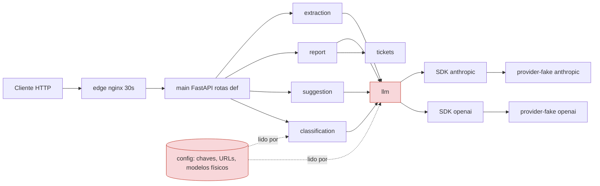

### 3.2 Grafo de dependências original (medido, 20 arestas, sem ciclos)

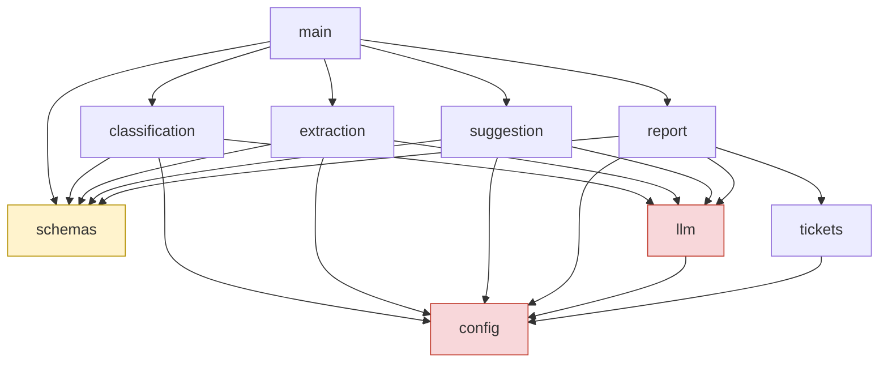

**Fluxo de execução × direção das dependências.** Em execução, a requisição desce `main → feature → llm → SDK → provider`. No código, as setas de import apontam na mesma direção: quem tem a regra de negócio (a feature) depende de quem tem o detalhe tecnológico (`llm`, `config`). É exatamente isso que o DIP pede para inverter: o fluxo continua descendo, mas a dependência de código da feature deve apontar para uma abstração que ela mesma define.

### 3.3 Sequência de uma chamada (F1, v1)

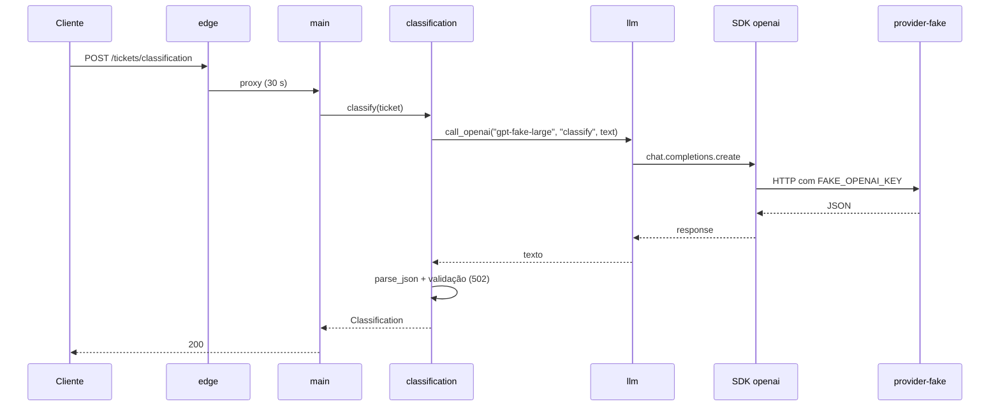

### 3.4 Problemas comprovados

| # | Problema | Evidência | Causa no código | Impacto (atributo de qualidade) | Resolvido na v2? |
|---|---|---|---|---|---|
| P1 | Features acopladas ao provider | F1/F4 chamam `call_openai`, F2/F3 `call_anthropic` | escolha do provider pelo nome da função | modificabilidade, disponibilidade | **sim** (capacidade + contrato) |
| P2 | Componente concreto e tecnológico no centro | `llm`: Ca=4, I=0,20, A=0, D=0,80 (zona de dor) | SDKs instanciados no import; um método por provider | modificabilidade, testabilidade | **sim** (inversão + adapter) |
| P3 | Modelo físico no código | `config.py:10-13`; troca exige edição + rebuild (6–7 s, 502 na borda) | literais em `config` | modificabilidade, operabilidade | **sim** (nomes lógicos; mapeamento no gateway) |
| P4 | Credenciais de provider na aplicação | `config.py:3-4`; `env_file: .env` no `app` | aplicação autentica direto nos providers | segurança | **sim** |
| P5 | `config` muito importado e concreto | Ca=6, D=1,00 | todas as decisões voláteis num só módulo | modificabilidade | **parcial**: o conteúdo volátil sai; o D projetado continua 1,00 (seção 14.3) |
| P6 | Provider fora derruba metade das features | Passo 02: openai fora → F1/F4 500/504 | sem fallback | disponibilidade | **não** (fallback na `main`); a v2 apenas cria o ponto onde ele será configurado |
| P7 | F3 do mês: 504 em 30,03 s | 34 chamadas em série | `report.py:15-18`, rota síncrona | desempenho, disponibilidade | **não** (assíncrono na `main`) |
| P8 | F2 sem streaming | 15,96 s até o 1º byte | `messages.create` sem `stream` | usabilidade | **não** (streaming na `main`) |
| P9 | Retries e timeouts implícitos dos SDKs | 3 tentativas; timeout de 600 s | padrões do SDK | disponibilidade, custo | **não** (resiliência na `main`); risco de somar retries com o gateway (seção 21) |
| P10 | `schemas` concreto e estável | Ca=5, D=1,00 | DTOs Pydantic | — | **não é problema**: exceção candidata (ADR 0001) |

---

## 4. Baseline de métricas (medida na `v1-coupled`)

| Componente | Ca | Ce | I | A | D | Zona de dor | Leitura |
|---|---|---|---|---|---|---|---|
| classification | 1 | 3 | 0.75 | 0.00 | 0.25 | | métrica boa, acoplamento semântico ao provider |
| config | 6 | 0 | 0.00 | 0.00 | 1.00 | **sim** | detalhes voláteis num módulo estável |
| extraction | 1 | 3 | 0.75 | 0.00 | 0.25 | | idem F1 |
| llm | 4 | 1 | 0.20 | 0.00 | 0.80 | **sim** | detalhe tecnológico no lugar de uma abstração |
| main | 0 | 5 | 1.00 | 0.00 | 0.00 | | entrada; instável como deve ser |
| report | 1 | 4 | 0.80 | 0.00 | 0.20 | | métrica boa; problema de execução (P7) invisível à régua |
| schemas | 5 | 0 | 0.00 | 0.00 | 1.00 | **sim** | DTOs; exceção candidata |
| suggestion | 1 | 3 | 0.75 | 0.00 | 0.25 | | idem F1 |
| tickets | 1 | 1 | 0.50 | 0.00 | 0.50 | no limite | acesso a arquivo; não é alvo da v2 |

**Limitações consideradas** (ADR 0001): a régua não vê SDKs, acoplamento semântico, runtime, HTTP, coesão nem frequência de mudança. Por isso nenhum critério deste plano usa a métrica sozinha: ela é sempre combinada com testes e inspeção do código.

---

## 5. Problemas arquiteturais priorizados

| Componente | Problema | Impacto | Complexidade | Risco | Prioridade |
|---|---|---|---|---|---|
| `llm` | detalhe concreto do qual todas as features dependem (P1, P2) | alto | baixa (30 linhas) | médio (toca as 4 features) | **1** |
| `config` | modelos físicos, URLs e chaves de provider (P3, P4, P5) | alto | baixa | baixo | **2** (acompanha a 1) |
| `compose.yaml` (serviço `app`) | credenciais dos providers no ambiente do container (P4) | alto (segurança) | baixa | baixo | **3** |
| features (4) | escolhem o provider (P1) | médio | baixa cada | baixo cada, protegido pela caracterização | **4** (uma por vez, piloto primeiro) |
| `report` | execução síncrona em lotes (P7) | alto | alta | alto | **fora da v2** |
| `suggestion` | sem streaming (P8) | médio | média | médio | **fora da v2** |
| `tickets` | no limite da régua | baixo | baixa | baixo | **não refatorar** (sem dor comprovada) |
| `schemas` | DTO estável | nenhum | — | — | **não refatorar** |

Prioridade = impacto do problema na meta da v2, ponderado pelo risco de mexer. Os problemas de execução (P6–P9) são reais, mas pertencem a passos posteriores; atacá-los agora misturaria duas mudanças e impediria saber qual delas quebrou um teste.

---

## 6. Componentes-alvo (matriz de referência para a implementação)

| Componente | Problema | Evidência | Estratégia | Resultado esperado | Critério de conclusão |
|---|---|---|---|---|---|
| `llm.py` | concreto, 2 SDKs, Ca=4 | D=0,80, zona de dor | **substituição progressiva**: cada feature migra para o contrato; ao fim, o arquivo é removido | não existe mais | `llm` ausente do CSV; `git ls-files app/helpdesk/llm.py` vazio |
| `ports.py` (novo) | — (introduz a abstração) | — | **inversão de dependência**: `Protocol` com uma operação | contrato estável usado pelas 4 features e pelo adapter | A=1,00; Ca = 5 (4 features + adapter); Ce = 0 |
| `adapters/gateway.py` (novo) | — (absorve a comunicação) | — | **encapsulamento** do único cliente HTTP do gateway | único componente que fala com a IA | único import de SDK em `app/helpdesk`; Ca = 1 (`main`); fora da zona de dor |
| `classification.py` | escolhe provider e modelo | `call_openai(config.CLASSIFICATION_MODEL, ...)` | **composição + DIP**: recebe o contrato por parâmetro; pede a capacidade `ticket-classification` | Ce = {ports, schemas} | 13 testes F1 verdes; sem import de `llm`/`config` |
| `extraction.py` | idem | `call_openai(config.EXTRACTION_MODEL, ...)` | idem; capacidade `order-extraction` | Ce = {ports, schemas} | 9 testes F4 verdes |
| `suggestion.py` | idem | `call_anthropic(config.SUGGESTION_MODEL, ...)` | idem; capacidade `reply-suggestion` | Ce = {ports, schemas} | 4 testes F2 verdes |
| `report.py` | idem | `call_anthropic(config.REPORT_MODEL, ...)` | idem; capacidade `topics-report`; lotes e ordem inalterados | Ce = {ports, schemas, tickets, config} | 6 testes F3 verdes |
| `config.py` | modelos, URLs, chaves de provider | `config.py:3-13` | **redução de responsabilidades**: sai o que é do gateway; entram URL e chave do gateway | só parâmetros da aplicação | FF7, FF8; Ca ≤ 3 |
| `main.py` | não compõe nada | — | **ponto de composição** (Composition Root) | instancia o adapter e o entrega às features | único importador de `adapters.gateway` |
| `compose.yaml` (`app`) | `env_file: .env` com chaves dos providers | `compose.yaml` | **isolamento de credenciais** | `app` recebe só `GATEWAY_URL` e `GATEWAY_API_KEY` | FF9 |

Não são alvos: `schemas`, `tickets`, `provider-fake/`, `edge/`, `data/`, `tests/characterization/`.

---

## 7. Alternativas arquiteturais consideradas

### 7.1 Estratégias por componente

| Componente | Problema | Estratégias consideradas | Escolhida | Justificativa |
|---|---|---|---|---|
| `llm` | concreto no centro | A (abstração), B (reduzir Ca), D (inverter), E (composição) | **D + E** | só a inversão tira o concreto do caminho das features; reduzir Ca sem inverter só move o problema |
| `config` | detalhes voláteis | B, C (reduzir dependências) | **C** | os dados voláteis saem para o gateway; não se cria abstração sobre constantes |
| features | dependem do provider | A, D, E | **E** (recebem o contrato) | é a menor mudança que faz a dependência apontar para a abstração |
| `schemas` | D=1 | A | **nenhuma** | interface sobre DTO seria artificial (Goodhart) |
| `tickets` | no limite | A, D | **nenhuma** | não há dor comprovada; abstrair só para a métrica é proibido |

Legenda: A = introduzir abstração; B = reduzir acoplamento aferente; C = reduzir dependências; D = inverter dependências; E = composição em vez de herança/acesso global.

### 7.2 Alternativas de arquitetura-alvo

- **Alt 1, encapsulamento centralizado.** `llm.py` vira um cliente do gateway com `complete(capability, prompt)`; as features continuam importando esse módulo concreto.
- **Alt 2, contrato abstrato + adapter do gateway.** Um `Protocol` define a operação de que as features precisam; um adapter concreto o implementa; `main` compõe.
- **Alt 3, contratos por capacidade.** Um `Protocol` por feature (`Classifier`, `ReplySuggester`, ...), cada um com seu adapter ou com um adapter que implementa todos.

| Critério | Alt 1 | Alt 2 | Alt 3 |
|---|---|---|---|
| Simplicidade | **alta** (1 arquivo) | alta (2 arquivos novos, 1 removido) | baixa (4 contratos, tipos próprios) |
| Acoplamento | features → concreto | features → abstração | features → abstrações |
| Testabilidade | exige monkeypatch do módulo | qualquer objeto com `complete` serve | idem, com mais dublês |
| Modificabilidade | trocar o cliente afeta as 4 features | troca restrita ao adapter e a `main` | idem Alt 2, mais arquivos a manter |
| Extensibilidade | baixa | média (novo método ou novo `Protocol` quando houver necessidade real, como streaming) | alta, mas especulativa |
| Compatibilidade com o desafio | **não atende** ("nenhuma feature pode importar o componente do gateway") | **atende** | atende |
| Complexidade de implementação | mínima | baixa | média |
| Impacto projetado nas métricas | o cliente fica com Ca=4, I=0,20, D=0,80: **continua na zona de dor** | `ports` A=1, D=0; adapter fora da zona de dor (seção 14) | igual à Alt 2 se os contratos ficarem num módulo; mais componentes se separados |
| Riscos | nenhum novo, mas não resolve P2 | `Protocol` com uma só implementação parecer cerimônia | abstrações sem consumidor distinto; fragmentação |

**Selecionada: Alt 2.** A Alt 1 é a mais simples, mas viola o requisito obrigatório e mantém o problema P2 (o concreto continua no centro). A Alt 3 resolveria, mas as quatro features precisam da mesma operação ("dada uma capacidade e um prompt, devolva texto"): separar contratos não segrega nada que hoje seja diferente. O ISP é atendido pela Alt 2 porque o contrato tem **uma** operação, e todas as features a usam.

---

## 8. Arquitetura proposta (hipótese a validar no piloto)

### 8.1 Visão geral e fluxo de execução

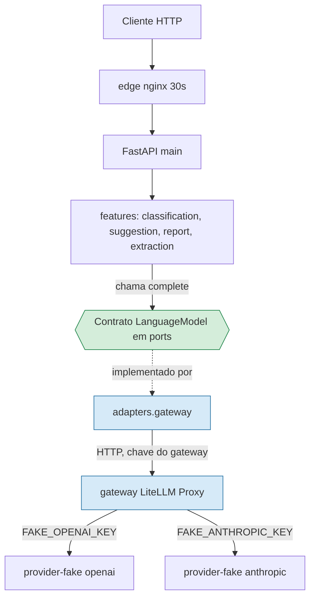

### 8.2 Direção das dependências de código, contratos e infraestrutura

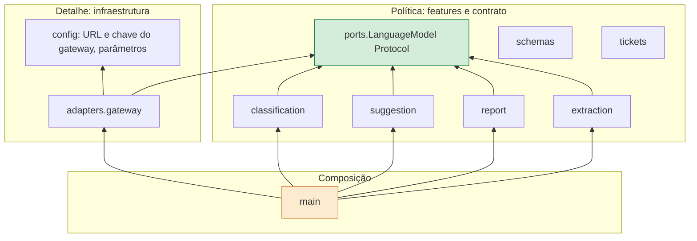

- **Contrato** (`ports.py`): definido do lado de quem usa, no vocabulário das features (capacidade, prompt, texto). Não menciona HTTP, SDK, provider ou modelo.
- **Detalhes de infraestrutura** (`adapters/gateway.py`, `config.py`, serviço `gateway`): sabem que existe um gateway OpenAI-compatível, URL e chave.
- **Ponto de composição** (`main.py`): o único lugar que conhece contrato **e** implementação; cria o adapter uma vez e o entrega às features.
- **Execução × dependência:** em execução, a chamada vai da feature ao adapter; no código, ambos apontam para `ports`. A seta da feature para a infraestrutura deixou de existir.

### 8.3 Inversão de dependência (antes × depois)

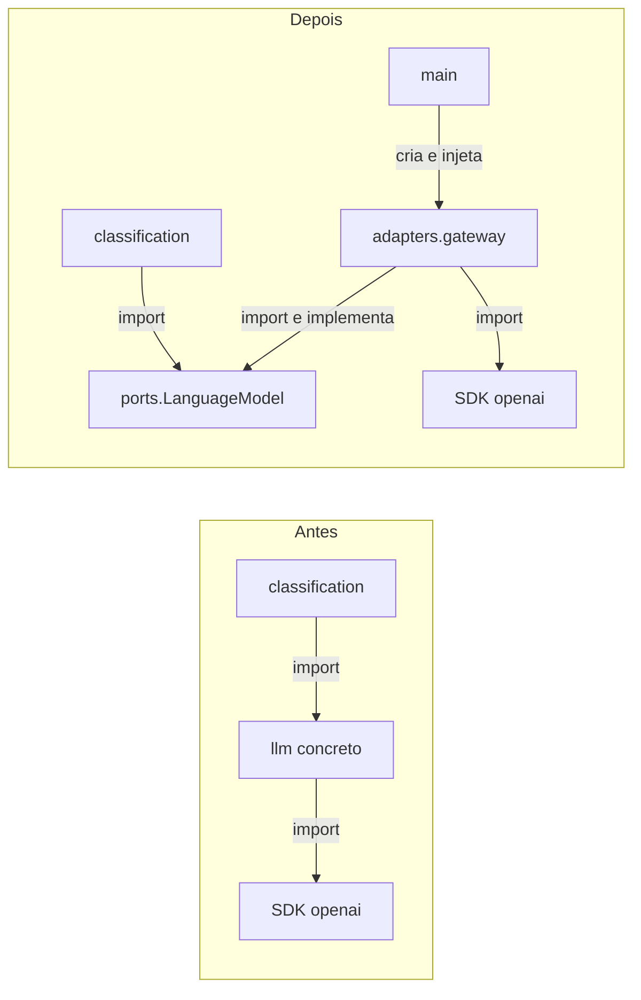

### 8.4 Composição da aplicação

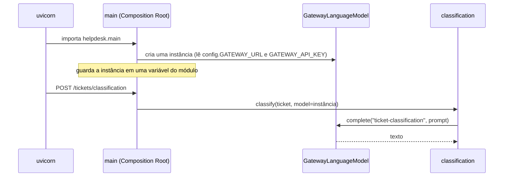

Injeção por **parâmetro de função** (DI manual). Alternativas descartadas: `Depends` do FastAPI (funcionaria, mas acrescenta um mecanismo para resolver um único objeto), contêiner de DI (complexidade sem necessidade) e variável global lida pelas features (esconde a dependência).

### 8.5 Comunicação com o gateway

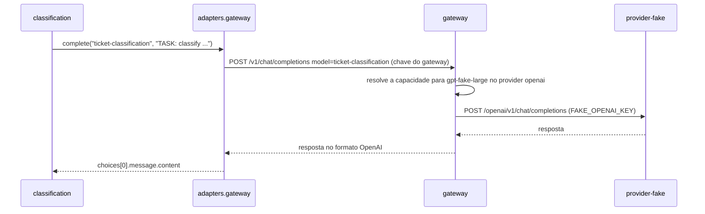

Para `reply-suggestion` e `topics-report`, o gateway traduz para a API Anthropic do provider-fake. Essa tradução é a principal incerteza técnica e será validada no Passo 07 (seção 12.5).

---

## 9. Estratégias de refatoração por componente

| Componente | Responsabilidade hoje | Responsabilidade na v2 | Como chegar lá |
|---|---|---|---|
| `classification`, `extraction` | montar a chamada, escolher provider/modelo, validar | montar o prompt, pedir a capacidade, validar e mapear para 502 | trocar `llm.call_openai(config.X_MODEL, task, text)` por `model.complete(CAPABILITY, f"TASK: {task}\n{text}")`; `llm.parse_json` por `json.loads` |
| `suggestion` | idem, via Anthropic | montar o prompt e pedir a capacidade | idem |
| `report` | lotes, chamada, agregação, ordenação | idem, sem saber de provider/modelo | só a linha da chamada muda; laço, tamanho de lote e ordenação ficam idênticos |
| `llm` | clientes de SDK, `parse_json` | — | removido no fim (incremento 8); `parse_json` era `json.loads` e volta a ser chamado diretamente |
| `config` | chaves, URLs, modelos, limites, arquivo de tickets | `GATEWAY_URL`, `GATEWAY_API_KEY` (do ambiente), `TICKETS_FILE`, `TICKETS_PER_CALL` | remover em etapas o que perde o último consumidor |
| `main` | rotas | rotas + composição | criar o adapter e passá-lo às features |

**Destino de `llm.py`.** Ele é **substituído progressivamente**, não transformado. Transformar `llm.py` no contrato misturaria nomes e responsabilidades (o arquivo hoje é concreto, com SDKs) e quebraria as features ainda não migradas. Reorganizá-lo como adapter também misturaria as duas fases. Na substituição, o código novo nasce ao lado, cada feature migra em um incremento protegido pelos testes e o antigo morre quando não tem mais quem o importe (padrão Strangler Fig em pequena escala).

**Prompt fica na feature.** O texto `TASK: classify` é a instrução da feature para o modelo e faz parte do comportamento caracterizado. Deixá-lo no adapter faria a infraestrutura conhecer o vocabulário de cada feature. O custo é repetir um f-string de uma linha em quatro lugares, e qualquer desvio é detectado pela caracterização.

---

## 10. Contratos e abstrações

### 10.1 Contrato proposto (decisão provisória, confirmada no piloto)

```python
# app/helpdesk/ports.py  (será criado no Passo 08, não agora)
from typing import Protocol


class LanguageModel(Protocol):
    def complete(self, capability: str, prompt: str) -> str:
        """Executa a capacidade lógica sobre o prompt e devolve o texto gerado."""
        ...
```

| Questão | Decisão | Motivo |
|---|---|---|
| O que a feature fornece | capacidade lógica + prompt completo | é tudo o que as 4 features usam hoje (`task` e `content` viram o prompt) |
| O que volta | `str` | as 4 features consomem só o texto; F1/F3/F4 fazem `json.loads` |
| Capacidade como `str`, `Enum` ou objeto | `str`, como constante em cada feature (`CAPABILITY = "ticket-classification"`) | cada feature dona do seu nome; um `Enum` central reacoplaria as features num módulo concreto; erro de digitação é detectado pelo gateway (400) e pelos testes da rota |
| Objetos de requisição/resposta | não | nenhum consumidor precisa de mais que texto (YAGNI) |
| Uso de tokens | não | ninguém consome hoje; a contabilidade é responsabilidade do gateway (governança na `main`) |
| Erros próprios | não na v2 | na v1, nenhuma feature captura exceção de provider; elas viram 500 ou 504 na borda. Manter isso preserva o comportamento. Quando houver fallback ou mensagem de erro específica (na `main`), introduzir um `ModelUnavailable` no `ports` |
| `Protocol` ou `ABC` | `Protocol` | tipagem estrutural: qualquer dublê com `complete` serve em teste, sem herança obrigatória. O adapter herda explicitamente do `Protocol` (PEP 544 permite) para declarar a intenção e permitir checagem estática |
| Síncrono ou assíncrono | síncrono | as rotas são `def` e a v2 preserva os modos de execução |
| Genérico ou específico | uma operação genérica orientada a capacidade | as 4 features têm a mesma forma de chamada; ver Alt 3 |
| Orientado a capacidade ou a provider | capacidade | é o que tira o provider do vocabulário da feature (P1) |
| Streaming | não agora | quando a F2 precisar (na `main`), criar uma operação ou `Protocol` separado usado só por ela (ISP), sem alterar o `complete` |

### 10.2 Negócio × infraestrutura

| Pertence às features (negócio) | Pertence à infraestrutura |
|---|---|
| texto do prompt (`TASK: ...`) | URL e chave do gateway |
| nome da capacidade | modelo físico, provider, URL e chave do provider |
| validação de categoria, prioridade e formato do pedido (502) | `max_tokens` por capacidade (ver 12.3) |
| tamanho do lote, agregação e ordenação da F3 | formato do protocolo (OpenAI-compatível), retries e timeouts do cliente |

### 10.3 SOLID aplicado

| Princípio | Violação na v1 | Como a v2 atende |
|---|---|---|
| SRP | `llm` mistura 2 clientes + parse; `config` mistura segredos, URLs, modelos e regra de lote | adapter só transporta; `config` só parâmetros da aplicação |
| OCP | trocar provider de uma feature exige editar a feature | trocar modelo ou provider é configuração do gateway |
| LSP | — | qualquer implementação de `complete` precisa devolver o texto do modelo sem alterá-lo (o golden da F2 é byte a byte) |
| ISP | features veem `call_openai`, `call_anthropic` e `parse_json` | contrato com uma operação |
| DIP | features dependem de `llm` concreto | features e adapter dependem de `ports` |

### 10.4 Ports and Adapters, sem cerimônia

O contrato é uma **porta de saída** (driven port) no sentido de Cockburn; o adapter do gateway é o adaptador secundário; FastAPI em `main` faz o papel do adaptador primário. Não adotamos camadas (domain/application/infrastructure), entidades, casos de uso, repositórios ou factories: a aplicação tem quatro funções de ~10 linhas, e nenhum desses elementos resolveria um problema comprovado. A Clean Architecture contribui a regra da dependência; não a estrutura de pastas.

---

## 11. Capacidades lógicas

**Modelo físico × capacidade.** Pedir `gpt-fake-large` é escolher fornecedor, família e tamanho, uma decisão operacional. Pedir `ticket-classification` é declarar a intenção de negócio; quem decide qual modelo atende é o gateway. Assim, trocar o modelo (P3) passa a ser configuração do gateway, sem rebuild da `app`.

| Capacidade lógica | Feature | Modelo atual (v1) | Modelo primário na v2 | Justificativa (Passo 03) |
|---|---|---|---|---|
| `ticket-classification` | F1 | `gpt-fake-large` | `gpt-fake-large` | mantém o modelo caracterizado; GPT L ≡ Claude L na F1 |
| `reply-suggestion` | F2 | `claude-fake-large` | `claude-fake-large` | o texto do golden é byte a byte; mini reduz ~44% e reordena frases |
| `topics-report` | F3 | `claude-fake-large` | `claude-fake-large` | mantém o caracterizado; 150 tickets cabem nos 8.000 tokens |
| `order-extraction` | F4 | `gpt-fake-large` | `gpt-fake-large` | mini devolve `product: null` em 6/6 (incorreção silenciosa) |

- **Nomes:** os quatro sugeridos são mantidos. Descrevem o resultado de negócio (substantivo + objeto), não o provider, o tamanho ou a técnica (`gpt-`, `-large`, `-fast` ficam proibidos nos nomes). São estáveis enquanto a feature existir; mudar o modelo não muda o nome.
- **Relação com a regra de negócio:** uma capacidade por feature, porque cada feature tem requisitos de qualidade diferentes (F4 não tolera mini, F1 tolera). Compartilhar uma capacidade entre F1 e F4 só porque usam o mesmo modelo hoje acoplaria decisões futuras.
- **Destinos equivalentes futuros:** o gateway pode listar mais de um destino sob o mesmo nome lógico (fallback, `mini` onde o Passo 03 permitir). Isso é da `main`; a v2 configura um destino por capacidade.
- **Duplicação aceitável:** o nome existe em dois lugares (feature e configuração do gateway). Um nome inexistente falha alto (erro do gateway) e é pego pelos testes de rota.

---

## 12. Introdução do AI Gateway

### 12.1 Conceitos

| Elemento | O que é | No projeto |
|---|---|---|
| Reverse proxy | repassa HTTP sem entender o conteúdo | `edge` (nginx) |
| API Gateway | entrada de APIs: roteamento, autenticação, limites por rota | não há (o `edge` faz o papel mínimo) |
| AI Gateway | proxy que entende chamadas a modelos: API padronizada, roteamento por nome lógico, credenciais centralizadas, retry/fallback, custo e limites por chave | serviço `gateway` proposto |
| SDK de provider | biblioteca cliente de um fornecedor | `openai`, `anthropic` em `llm.py` |
| Biblioteca de abstração | padroniza providers dentro do processo da aplicação (ex.: LiteLLM SDK) | descartada: credenciais e modelos continuariam na `app` |

### 12.2 Alternativas

| Alternativa | Característica | Avaliação |
|---|---|---|
| SDKs diretos | integração específica por provider | é a v1; não resolve P1–P4 |
| Biblioteca de abstração na aplicação | padronização dentro do código | resolve P1, mas não P3/P4 (credenciais e modelos ficam na `app`) e não atende "todas as chamadas passam pelo gateway" |
| **AI Gateway self-hosted** | serviço separado no compose | **escolhida**: resolve P1–P4, roda local, sem custo |
| AI Gateway SaaS | serviço gerenciado externo | proibido (providers reais/serviços pagos) |

**Candidato: LiteLLM Proxy** (sugerido pelo enunciado), imagem oficial com versão fixada no Passo 07.

| Requisito | Expectativa | Validar no Passo 07? |
|---|---|---|
| Docker Compose local | serviço `gateway` com `config.yaml` montado | sim |
| Providers simulados | `api_base` por modelo apontando para `provider-fake:8090/openai/v1` e `provider-fake:8090/anthropic` | **sim, crítico** (sobretudo Anthropic) |
| Nomes lógicos | `model_name` = capacidade; `litellm_params.model` = físico | sim |
| Autenticação própria | master key do proxy como `GATEWAY_API_KEY` | sim |
| Isolamento de credenciais | chaves `FAKE_*` só no ambiente do `gateway` (`os.environ/...` no config) | sim |
| Streaming | suportado pela API OpenAI-compatível | apenas registrar; uso na `main` |
| Roteamento, retry, fallback | existem na configuração do proxy | registrar os **padrões** (retries do proxy somados aos do SDK); não configurar políticas agora |
| Budget, rate limiting, virtual keys | dependem de banco (Postgres) | **não** na v2; evitar dependência adicional |
| Dependências adicionais | nenhuma além da imagem, se usarmos só master key e config em arquivo | sim |

### 12.3 Responsabilidades do gateway na v2

Centralizar credenciais dos providers; resolver capacidade → modelo físico e provider; expor uma API única OpenAI-compatível; traduzir para a API Anthropic quando necessário; manter `max_tokens = 2000` nas capacidades que hoje o usam (`reply-suggestion`, `topics-report`) para preservar a semântica da v1 (**provisório**: validar se o proxy aceita o parâmetro por modelo; se não, o adapter envia `max_tokens` e o limite volta a ser parâmetro da `app`).

Não fazem parte da v2: fallback, retry configurado, timeouts por capacidade, budget, rate limiting, logs de custo.

> **Passo 07:** `max_tokens: 2000` foi configurado por capacidade no gateway e aceito, mas não está provado que é aplicado (as saídas caracterizadas ficam abaixo do limite). A imagem faz **2 retentativas por padrão** em 5xx, sem configuração. Ver `docs/gateway/relatorio-gateway.md`.

### 12.4 Separação de configurações e credenciais

| Informação | Localização atual | Localização proposta |
|---|---|---|
| Nome físico do modelo | `config.py:10-13` | configuração do gateway |
| Credencial do provider | `.env` → `app` (`config.py:3-4`) e `provider-fake` | `.env` → `gateway` e `provider-fake` |
| URL do provider | `config.py:6-7` | configuração do gateway |
| Nome da capacidade lógica | inexistente | feature (constante) e configuração do gateway |
| URL do gateway | inexistente | ambiente do `app` → `config.GATEWAY_URL` |
| Credencial do gateway | inexistente | `.env` (`GATEWAY_API_KEY`) → `app` e `gateway` |
| Parâmetros de negócio (`TICKETS_PER_CALL`, `TICKETS_FILE`) | `config.py` | `config.py` |
| `MAX_OUTPUT_TOKENS` | `config.py:15` | gateway (provisório, ver 12.3) |

**Princípio:** a implementação não deve mudar quando muda o ambiente (12-factor, "config"). O que varia por ambiente ou por decisão operacional (modelo, chave, URL) fica fora do código; o que é regra da aplicação (lote de 150) fica nele.

**Como garantir:**
- serviço `app` deixa de usar `env_file: .env` (que injeta **todas** as variáveis, inclusive as `FAKE_*`) e passa a declarar `environment:` só com `GATEWAY_URL` e `GATEWAY_API_KEY` (interpolação `${GATEWAY_API_KEY}` lida do `.env` pelo compose, sem levar as demais variáveis ao container);
- nenhum volume monta `.env` ou a configuração do gateway no `app`;
- `.env.example` ganha `GATEWAY_API_KEY` (valor fictício);
- verificação por FF7, FF8 e FF9 (seção 16).

### 12.5 Questões para o Passo 07

1. O LiteLLM aceita `api_base` customizado para Anthropic e chega ao endpoint do fake (`/anthropic/v1/messages`)?
2. O texto devolvido para `reply-suggestion` é **byte a byte** igual ao golden `expected/reply_suggestion_TK-00042.json`?
3. Qual `max_tokens` o proxy envia ao Anthropic quando o cliente não informa? Dá para fixar por modelo?
4. Quantas tentativas o proxy faz por padrão em erro? (Somadas às 2 do SDK `openai` no adapter, podem multiplicar chamadas; em modo `normal` não afeta os testes.)
5. O proxy adiciona latência relevante à F2 (~16 s) ou à F3 (~10 s), perto dos 30 s da borda?
6. O `/admin/calls` do fake identifica a origem da chamada? Se não, que log do gateway prova que todas as chamadas passaram por ele?
7. O proxy precisa de banco para a master key? (Esperado: não.)
8. Vale isolar a rede do `app` do `provider-fake` (o `app` não alcança o fake), como prova física de O6? Decisão no ADR 0003, se for adotado.

> **Respondidas no Passo 07** (`docs/gateway/relatorio-gateway.md`, §12): 1 sim; 2 sim, com e sem streaming; 3 aceito, aplicação não provada; 4 duas retentativas em 5xx; 5 +6 ms; 6 `/admin/calls` não identifica a origem, a prova será por exclusão e contagem (FF7 a FF10); 7 sim, e qualquer outra chave recebe 400; 8 adiado para o Passo 09.

---

## 13. Organização dos componentes

| Critério | Opção 1: `ports.py` + `adapters/gateway.py` | Opção 2: `ports/llm.py` + `adapters/gateway.py` | Opção 3 (plana): `ports.py` + `gateway.py` |
|---|---|---|---|
| Responsabilidades | claras | claras | claras, papel do adapter só pelo nome |
| Clareza | o caminho diz o papel | idem | menor |
| Complexidade | 1 pacote | 2 pacotes | nenhum pacote novo |
| Componentes | +2 | +2 | +2 |
| Métricas | idênticas (o pacote não conta) | idênticas | idênticas |
| Evolução | outro adapter cabe em `adapters/` | um contrato por arquivo | mistura adapters e features no mesmo nível |
| Adequação ao tamanho | boa | excessiva para 1 contrato | boa |

**Decisão:** Opção 1.

```text
app/helpdesk/
├── __init__.py
├── main.py            rotas + ponto de composição
├── schemas.py         inalterado
├── config.py          GATEWAY_URL, GATEWAY_API_KEY, TICKETS_FILE, TICKETS_PER_CALL
├── classification.py  CAPABILITY = "ticket-classification"; recebe LanguageModel
├── suggestion.py      CAPABILITY = "reply-suggestion"
├── extraction.py      CAPABILITY = "order-extraction"
├── report.py          CAPABILITY = "topics-report"
├── tickets.py         inalterado
├── ports.py           LanguageModel (Protocol)
└── adapters/
    ├── __init__.py
    └── gateway.py     GatewayLanguageModel: SDK openai apontado para o gateway
```

`llm.py` sai. `app/requirements.txt` perde `anthropic` no incremento 8. O adapter usa o SDK `openai` (já dependência; o gateway expõe API OpenAI-compatível) em vez de escrever um cliente HTTP à mão. O timeout padrão do SDK (600 s) fica igual ao da v1 de propósito: mudá-lo é política de resiliência, assunto da `main`. **Revisão 1.0.1:** o cliente usa `max_retries=0`, porque o gateway já faz 2 retentativas por padrão (Passo 07). Assim uma falha continua gerando 3 chamadas ao provider, como na v1, em vez de 9; a política de retry passa a ter um único dono, configurado explicitamente no Passo 10.

---

## 14. Impacto esperado nas métricas

### 14.1 Grafo projetado (v2 completa, 19 arestas)

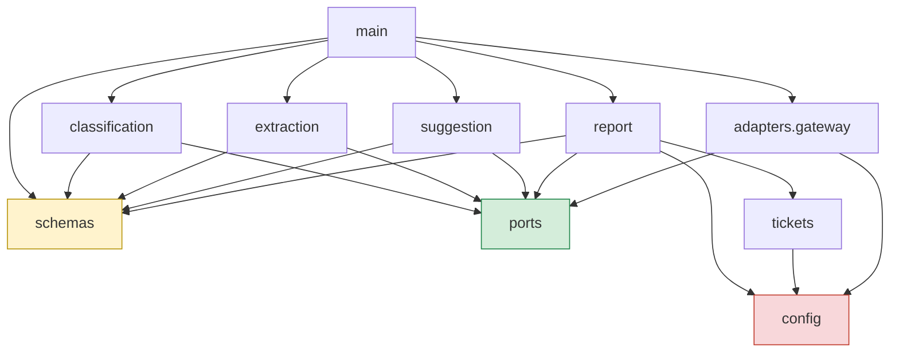

### 14.2 Projeção

**Método:** os valores abaixo foram calculados com a própria ferramenta (`metrics/measure.py`), sem alterá-la, sobre um **esqueleto descartável** que contém só os imports e as classes previstos (fora do repositório, não versionado). São **projeções**: confirmam a aritmética do desenho, não o código que o agente vai escrever.

| Componente | D atual medido | Ca proj. | Ce proj. | I proj. | A proj. | D proj. | Zona de dor proj. | Justificativa |
|---|---|---|---|---|---|---|---|---|
| `adapters.gateway` | — (novo) | 1 | 2 | 0.67 | 0.00 | 0.33 | não | só `main` o importa; depende de `ports` e `config` |
| `classification` | 0.25 | 1 | 2 | 0.67 | 0.00 | 0.33 | não | perde `config` e `llm`, ganha `ports` |
| `config` | 1.00 | 3 | 0 | 0.00 | 0.00 | 1.00 | **sim** | Ca cai de 6 para 3; continua concreto e estável |
| `extraction` | 0.25 | 1 | 2 | 0.67 | 0.00 | 0.33 | não | idem F1 |
| `llm` | 0.80 | — | — | — | — | — | — | removido |
| `main` | 0.00 | 0 | 6 | 1.00 | 0.00 | 0.00 | não | ganha `adapters.gateway` |
| `ports` | — (novo) | 5 | 0 | 0.00 | 1.00 | 0.00 | não | abstrato e estável: está **na** Main Sequence |
| `report` | 0.20 | 1 | 4 | 0.80 | 0.00 | 0.20 | não | troca `llm` por `ports`, mantém `config` e `tickets` |
| `schemas` | 1.00 | 5 | 0 | 0.00 | 0.00 | 1.00 | **sim** | inalterado; exceção candidata |
| `suggestion` | 0.25 | 1 | 2 | 0.67 | 0.00 | 0.33 | não | idem F1 |
| `tickets` | 0.50 | 1 | 1 | 0.50 | 0.00 | 0.50 | não (no limite) | inalterado |

Projeção do **estado pós-piloto** (só F1 migrada): `llm` Ca=3, I=0,25, D=0,75 (ainda na zona de dor); `config` Ca=6, D=1,00; `ports` Ca=2, A=1, D=0,00; `adapters.gateway` e `classification` como acima; demais iguais à v1. São 22 arestas.

### 14.3 O que a simulação revelou

1. **D das features piora (0,25 → 0,33) enquanto a arquitetura melhora.** Elas passam a ter menos dependências (Ce 3 → 2), e isso as aproxima do centro. É um caso concreto de por que melhorar a métrica não é o objetivo. Não adicionaremos dependências para "consertar" isso.
2. **O adapter depende de como é escrito.** Se só usasse tipagem estrutural e recebesse URL e chave de `main`, teria Ca=1, Ce=0, D=1,00: entraria na **zona de dor**, e a regra do desafio proíbe declará-lo exceção. Lendo `config` sozinho (como `llm.py` faz hoje), fica com I=0,50, D=0,50 (no limite). Com herança explícita de `LanguageModel` e leitura de `config`, fica com D=0,33. Escolhemos esta última **por razões de código**: a herança explícita declara a conformidade e permite checagem estática; ler a própria configuração mantém `main` simples. O ganho métrico é consequência, não motivo, e deve ser revisado no piloto (risco R3).
3. **`config` continua na zona de dor na v2.** Perde tudo o que era volátil (modelos, URLs, chaves de provider), mas segue concreto, com Ca=3. O ADR 0001 o recusou como exceção **pelo conteúdo volátil**, e essa razão desaparece na v2. Para a `main` final há duas saídas legítimas, a decidir no Passo 16 com a medição real: (a) revisar o ADR 0001 e declará-lo naturalmente estável; (b) dissolvê-lo, levando cada constante ao seu único consumidor, se isso aumentar a coesão. Não é requisito da v2.
4. **`ports` com A=1 e Ca=5 é a evidência estrutural da inversão.** Se o agente criar o `Protocol` e as features não o importarem, Ca cai e o critério reprova.

---

## 15. Critérios de conclusão da `v2-decoupled`

### 15.1 Comportamentais
- B1. Os 32 testes de caracterização passam (FF1).
- B2. `tests/characterization/` idêntico à `v1-coupled` (FF2).
- B3. As 4 rotas e o `/health` existem com os mesmos métodos e caminhos.
- B4. Contratos de entrada e saída iguais (garantido por B1 e por `schemas.py` sem diff).
- B5. Rotas continuam `def` (síncronas); nenhuma resposta em stream.
- B6. Capacidades mapeadas para os mesmos modelos `large` da v1.

### 15.2 Estruturais
- S1. Nenhuma feature importa `openai`, `anthropic`, `llm` ou `adapters` (FF5, FF6).
- S2. Um único componente fala com o gateway: `adapters.gateway`, único import de SDK em `app/helpdesk` (FF5).
- S3. Só `main` importa `adapters.gateway` (FF6; Ca = 1 no CSV).
- S4. Sem ciclos (a ferramenta reporta).
- S5. Metas quantitativas da 15.4 atendidas.

### 15.3 De infraestrutura
- I1. Serviço `gateway` no `compose.yaml`, com ADR 0003 aceito.
- I2. Todas as chamadas aos modelos passam pelo gateway (FF10).
- I3. A aplicação usa capacidades lógicas e não conhece modelos físicos (FF7).
- I4. Credenciais dos providers só no `gateway` e no `provider-fake` (FF8, FF9).
- I5. A aplicação usa uma credencial própria do gateway (`GATEWAY_API_KEY`).

### 15.4 Quantitativos (fundamentados na v1)

| Componente | Situação atual (medida) | Meta arquitetural | Meta da métrica (v2) | Evidência necessária |
|---|---|---|---|---|
| `llm` | Ca=4, D=0,80, zona de dor | responsabilidade absorvida pelo adapter | componente inexistente | CSV sem `llm` |
| `ports` | não existe | contrato estável usado por todas as features | A = 1,00; Ce = 0; Ca ≥ 5 (4 features + adapter) | CSV + arestas |
| `adapters.gateway` | não existe | único concreto da IA, composto só em `main` | Ca = 1 (`main`); fora da zona de dor | CSV + FF6 |
| features (4) | D 0,20–0,25; dependem de `llm` e `config` (F1, F2, F4) | dependem do contrato | Ce ⊆ {ports, schemas} para F1, F2, F4; {ports, schemas, tickets, config} para F3; fora da zona de dor | arestas no relatório |
| `config` | Ca=6, D=1,00 | só parâmetros da aplicação | Ca ≤ 3; zona de dor **aceita na v2** com justificativa (14.3) | CSV + FF7/FF8 |
| `schemas` | D=1,00 | inalterado | inalterado | `git diff` vazio |
| `main` | Ce=5 | ponto de composição | I = 1,00 | CSV |
| Global | 3 componentes na zona de dor | nenhum componente **novo** na zona de dor | zona de dor ⊆ {config, schemas} | CSV |

Não usamos metas percentuais uniformes ("reduzir D em 50%"): cada meta deriva do problema daquele componente.

**Critério da `main` final** (registrado aqui para não ser esquecido, não exigido na v2): nenhum componente na zona de dor, exceto os declarados naturalmente estáveis no ADR 0001 com justificativa; features e o componente do gateway nunca são exceção. A arquitetura proposta é compatível: os únicos candidatos são `schemas` e `config` (14.3).

---

## 16. Fitness Functions arquiteturais

Uma fitness function é uma verificação objetiva, preferencialmente automatizada, de uma característica arquitetural (Ford, Parsons, Kua, *Building Evolutionary Architectures*). Aqui elas são os comandos que já temos, mais buscas simples. Não construiremos plataforma.

| ID | Característica | Mecanismo | Evidência esperada | Quando |
|---|---|---|---|---|
| FF1 | Comportamento | testes de caracterização (README, "Como rodar", opção B) | `32 passed` | antes e depois de cada incremento |
| FF2 | Integridade da suíte | diff Git contra a `v1-coupled` | sem saída, código 0 | sempre |
| FF3 | Diretórios protegidos | diff Git contra a `v1-coupled` | sem saída | sempre |
| FF4 | Acoplamento estrutural | ferramenta de métricas | tabela comparada com a 15.4 | após cada incremento de código |
| FF4b | Régua intacta | diff Git contra o commit do Passo 05 | sem saída | sempre |
| FF5 | Isolamento tecnológico | busca de imports de SDK | só `adapters/gateway.py` (e `llm.py` enquanto existir) | após cada incremento |
| FF6 | Fronteira do concreto | busca nas features migradas + linhas de import de `adapters`/`gateway` (**revisada na 1.1**) | features: sem saída; imports: só `main.py` | idem |
| FF7 | Sem modelos físicos | busca no código | sem saída | ao final (incremento 8) |
| FF8 | Sem credenciais e URLs de provider no código | busca no código | sem saída | ao final |
| FF9 | Sem credenciais no ambiente do `app` | ambiente do container e compose resolvido | nenhuma variável `FAKE_*`; `app` sem `env_file`, só `GATEWAY_*` | ao final (incremento 9) |
| FF10 | Tudo pelo gateway | `/admin/calls` × log do gateway | totais iguais (método exato definido no Passo 07, questão 12.5-6) | ao final |
| FF11 | Modo de execução | busca de rotas assíncronas | sem saída | ao final |
| FF12 | Conformidade com o contrato (**nova na 1.1**, recomendada) | `mypy` sobre `ports.py`, `adapters/` e as features migradas | nenhum aviso além do `str \| None` herdado da v1 (R20) | após cada incremento de código |

```bash
# FF1 (Docker, sem instalar nada no host)
docker run --rm -v "${PWD}:/w" -w /w -e PYTHONDONTWRITEBYTECODE=1 \
  -e HELPDESK_BASE_URL=http://host.docker.internal:8000 \
  -e PROVIDER_ADMIN_URL=http://host.docker.internal:8090 \
  python:3.12-slim sh -c "pip install -q -r tests/requirements.txt && python -m pytest tests/characterization -v -p no:cacheprovider"

# FF2 e FF3
git diff --exit-code v1-coupled -- tests/characterization/
git diff --exit-code v1-coupled -- provider-fake/ edge/ data/

# FF4 (NOME = pre-piloto, piloto-f1, v2-decoupled ...)
python metrics/measure.py --source app/helpdesk --name NOME --no-plot

# FF4b (COMMIT_PASSO_05 = hash do commit que versionou a ferramenta)
git diff --exit-code COMMIT_PASSO_05 -- metrics/*.py tests/metrics/

# FF5
grep -rnE "^\s*(from|import) (openai|anthropic)" app/helpdesk

# FF6 (listar só as features já migradas)
grep -nE "adapters|gateway|\bllm\b|\bconfig\b" app/helpdesk/classification.py
# revisão 1.1: a busca original (grep -rlE "adapters" ...) não encontrava adapters/gateway.py, que usa
# imports relativos (from ..ports import ...) e não contém a palavra. Busca-se a linha de import:
grep -rnE "^\s*(from|import) .*(adapters|gateway)" app/helpdesk --include=*.py   # esperado: só main.py
# e, no CSV da FF4/arestas do measure.py, a única aresta para adapters.gateway vem de main

# FF7 e FF8
grep -rnE "gpt-fake|claude-fake" app/
grep -rnE "FAKE_OPENAI_KEY|FAKE_ANTHROPIC_KEY|sk-fake-openai|sk-ant-fake|provider-fake" app/

# FF9
docker compose exec app env | grep -E "FAKE_|sk-fake|sk-ant"
docker compose config                                  # conferir o bloco do serviço app

# FF10
curl -X POST http://localhost:8090/admin/reset
# rodar FF1, depois comparar:
curl http://localhost:8090/admin/calls
docker compose logs gateway

# FF11
grep -n "async def" app/helpdesk/main.py

# FF12 (opcional; não altera requirements: roda num container descartável)
docker run --rm -v "${PWD}:/w" -w /w/app python:3.12-slim sh -c \
  "pip install -q -r requirements.txt mypy && mypy --ignore-missing-imports helpdesk/ports.py helpdesk/adapters helpdesk/classification.py"
```

Os comandos rodam na raiz do repositório, em Git Bash ou dentro de um container `python:3.12-slim` (o PowerShell não tem `grep`). No FF6, `config` some das features F1, F2 e F4; a F3 continua importando `config` (para `TICKETS_PER_CALL`) e deve ser verificada só quanto a `adapters`, `gateway` e `llm`.

FF5 a FF9 não rodam agora: dependem de uma implementação que ainda não existe. Na v1 elas falhariam, o que é esperado e documenta o ponto de partida.

---

## 17. Seleção e planejamento do piloto

### 17.1 Seleção

| Componente | Complexidade | Risco | Representatividade | Facilidade de validação | Adequação ao piloto |
|---|---|---|---|---|---|
| `classification` (F1) | baixa (15 linhas) | baixo; 13 testes, 1,1 s cada | alta: mesma forma de F4 e F2 (prompt → texto → validação) e caminho OpenAI | alta (~15 s de suíte) | **alta** |
| `extraction` (F4) | baixa | **médio**: regra mais sensível (incorreção silenciosa) | alta (igual à F1) | alta | média: melhor migrar depois que o padrão for provado |
| `suggestion` (F2) | mínima (7 linhas) | médio: texto byte a byte via tradução Anthropic | média (sem validação; não exercita o 502) | baixa (16 s por caso) | média |
| `report` (F3) | alta (lotes, `tickets`, agregação) | alto | baixa (forma única) | média (10 s por caso) | baixa |
| `llm` | baixa | alto (as 4 features dependem dele) | não valida a hipótese (refatorá-lo é a Alt 1) | — | **inadequado** |

**Selecionado: F1, `classification.py`.** Não pela simplicidade em si, mas porque:
- valida as três partes da hipótese de uma vez: contrato, adapter e composição em `main`;
- mantém a validação de negócio (o 502) na feature, o que mostra se a fronteira negócio × infraestrutura está certa;
- o resultado vale para F4 (idêntica) e F2 (a mesma chamada, sem validação).

Ressalva: a F1 não exercita o caminho Anthropic do gateway. Por isso o Passo 07 **precisa** validar `reply-suggestion` e `topics-report` diretamente no gateway antes do piloto. Se não validar, a seleção é revista.

### 17.2 Hipótese arquitetural
Se a F1 depender de um `Protocol` `LanguageModel` injetado por `main`, e o único concreto for um adapter do gateway, então a F1 deixa de conhecer provider, modelo e SDK **sem mudar comportamento**, e o padrão pode ser repetido nas outras três features sem alterar o contrato.

### 17.3 Estado anterior (registrar no Passo 08 antes de qualquer mudança)
- Responsabilidades: chamar `llm.call_openai(config.CLASSIFICATION_MODEL, "classify", ticket.text)`, `parse_json`, validar `CATEGORIES`/`PRIORITIES` (502), montar `Classification`.
- Dependências: `config`, `llm`, `schemas` (+ `fastapi` externo). Métricas: Ca=1, Ce=3, I=0,75, A=0, D=0,25.
- Testes que protegem: `tests/characterization/test_classification.py` (13).
- Comando de medição: `python metrics/measure.py --source app/helpdesk --name pre-piloto` (deve reproduzir os valores da `v1-coupled`).
- **Registrado no Passo 08 (2026-11-25):** confirmado como acima; `docs/piloto/metricas/pilot-before.csv` idêntico à `v1-coupled`; 32 testes verdes; F1 em 1,08 s; sob `error_500`, 500 em 1,25 s com 3 tentativas no provider. Detalhes na seção 23.

### 17.4 Escopo
| Item | Autorizado |
|---|---|
| Componente-alvo | `app/helpdesk/classification.py` |
| Novos arquivos | `app/helpdesk/ports.py`, `app/helpdesk/adapters/__init__.py`, `app/helpdesk/adapters/gateway.py` |
| Ajustes de composição | `app/helpdesk/main.py` (criar o adapter; passar à rota de F1) |
| Ajustes de infraestrutura mínimos (separados, commit próprio) | `app/helpdesk/config.py` (acrescentar `GATEWAY_URL` e `GATEWAY_API_KEY`, sem remover nada); `compose.yaml` (acrescentar `GATEWAY_URL`/`GATEWAY_API_KEY` ao `app` e `depends_on: gateway`); `.env.example` |
| Proibido | `suggestion.py`, `extraction.py`, `report.py`, `llm.py`, `schemas.py`, `tickets.py`, `app/requirements.txt`, `tests/`, `metrics/`, diretórios protegidos, remoção de `env_file` do `app` |
| Responsabilidades a preservar | prompt `TASK: classify\n{text}`; validação e 502; mensagem do 502; formato de `Classification` |

### 17.5 Estado esperado
- `classification.classify(ticket, model: LanguageModel)` chama `model.complete("ticket-classification", f"TASK: classify\n{ticket.text}")` e `json.loads`.
- `classification` importa só `ports` e `schemas`; `main` importa `adapters.gateway`.
- Métricas projetadas: seção 14.2, estado pós-piloto.

### 17.6 Protocolo de validação
1. Confirmar a baseline: `git status` limpo, tag `v1-coupled` intacta, gateway do Passo 07 no ar.
2. Rodar FF1 (32 verdes) e FF2/FF3.
3. Medir: `--name pre-piloto`.
4. Entregar o handoff da seção 19 ao agente.
5. Revisar o diff: escopo (17.4), FF5, FF6, legibilidade.
6. Rodar FF1, FF2, FF3.
7. Medir: `--name piloto-f1`.
8. Comparar com a 14.2 (pós-piloto) e preencher a 23.
9. Analisar trade-offs e divergências.
10. Decidir: aceitar, revisar ou rejeitar (seção 20); registrar a revisão 1.1 (seção 24).

**Acrescentado na revisão 1.1** (para cada feature migrada no Passo 09), porque o piloto mostrou que a suíte não exercita erros de negócio nem falhas do modelo:

11. Verificação própria contra gateway simulado, no método de `docs/piloto/verificacao_f1.py`: sucesso, erro de negócio (quando existir), "gateway em 500 gera 1 requisição" e o formato exato da requisição (capacidade, chave, prompt, parâmetros). Antes de usar, confirmar que ela reprova um mutante (ex.: `max_retries` padrão).
12. Sonda pela borda com falha injetada (`docs/piloto/sondas.py`, fase de falha adaptada à feature), comparada com a mesma sonda na v1: tentativas no provider e latência.
13. FF12 (`mypy`) e o FF6 revisado.

### 17.7 Aprovação e rejeição
Aprovar se: B1–B5 valem; FF2, FF3, FF4b sem diff; F1 sem `llm`/`config`; `ports` com A=1; Ca(`adapters.gateway`)=1; nenhum componente novo na zona de dor; o diff fica dentro de 17.4.
Rejeitar se: altera comportamento externo; modifica testes; cria dependências artificiais (import sem uso); extrapola o escopo; cria abstrações sem consumidor; a F1 continua sabendo de provider ou modelo; métricas incompatíveis com 14.2 sem explicação; toca diretórios protegidos.

### 17.8 Rollback
Ver seção 22. O piloto roda em branch própria; a `main` só recebe o merge após aprovação.

**Revisão 1.1 (execução real):** o piloto rodou como alterações locais, não commitadas, sobre a `main` limpa em `6efadeb`, porque o Igor trabalha na branch atual e faz os commits ele mesmo. A capacidade de reverter foi preservada: base limpa e conhecida, `git status --untracked-files=all` antes de aceitar, e `git restore` mais a remoção dos arquivos novos para rejeitar. Ver `docs/piloto/relatorio-piloto.md`, seção 7.

---

## 18. Estratégia de implementação incremental

Cada incremento termina com FF1 verde e um commit próprio, revisado antes do próximo. Nenhum incremento mistura mudança estrutural com mudança de comportamento.

| # | Passo | Objetivo | Arquivos | Pré-requisito | Alterações permitidas | Conclusão e validação | Recuperação |
|---|---|---|---|---|---|---|---|
| 0 | — | baseline | — | — | nenhuma | FF1 = 32; CSV `v1-coupled` reproduz | — |
| 1 | 07 | gateway no ar | `compose.yaml`, config do gateway, `.env.example`, ADR 0003 | plano aprovado | serviço `gateway`; `app` intocado | as 4 capacidades respondem direto no gateway com os mesmos textos do golden; FF1 verde (a `app` ainda vai direto) | remover o serviço (revert) |
| 2 | 08 | infraestrutura do piloto | `config.py` (+2 constantes), `compose.yaml` (`app` recebe `GATEWAY_*`) | 1 | só acréscimos | FF1 verde; `docker compose exec app env` mostra `GATEWAY_URL` | revert |
| 3 | 08 | **piloto F1** | `ports.py`, `adapters/`, `classification.py`, `main.py` | 2 | escopo 17.4 | 17.6 e 17.7; medição `piloto-f1` | revert do commit; seção 22 |
| 4 | 08 | revisão do plano | este documento | 3 medido | seções 23–25 | revisão 1.1 baseada em evidência | — |
| 5 | 09 | F4 `extraction` | `extraction.py`, `main.py` | 4 aprovado | igual ao piloto | 9 testes F4 + FF1; FF6 | revert |
| 6 | 09 | F2 `suggestion` | `suggestion.py`, `main.py` | 5 | idem | 4 testes F2 (byte a byte) + FF1 | revert |
| 7 | 09 | F3 `report` | `report.py`, `main.py` | 6 | só a linha da chamada e a assinatura | 6 testes F3 + FF1; laço e ordenação sem diff | revert |
| 8 | 09 | remover integrações antigas | `llm.py` (removido), `config.py` (sai chaves, URLs, modelos, `MAX_OUTPUT_TOKENS`), `app/requirements.txt` (sai `anthropic`) | 7 | só remoções | FF1, FF5, FF7, FF8; `llm` ausente do CSV | revert |
| 9 | 09 | isolar credenciais | `compose.yaml` (`app` sem `env_file`; `environment:` só `GATEWAY_*`) | 8 | só o bloco `app` | FF9; FF1 | revert |
| 10 | 09 | medir a v2 | `metrics/results/v2-decoupled.{csv,png}`, relatório | 9 | nenhuma no código | 15.4 atendida; FF10, FF11 | — |
| 11 | 09 | tag `v2-decoupled` | — | 10 e aprovação do Igor | criar a tag | todos os critérios da seção 15 | apagar a tag local antes do push |

**Revisão 1.1:** os incrementos 2, 3 e 4 foram executados no Passo 08 como alterações locais na `main` (17.8), com o commit feito pelo Igor depois da aprovação. Os incrementos 5 a 7 passam a exigir também os itens 11 a 13 do protocolo (17.6), e o 10 passa a registrar a sonda de falha da v2 completa como entrada do Passo 10.

**Revisão 1.2:** os incrementos 5 a 9 foram executados no Passo 09 como alterações locais na `main`, cada um aprovado antes do próximo, e serão versionados num único commit feito pelo Igor (os incrementos 5 a 9 do agente correspondem aos handoffs 1 a 5 de `docs/v2/handoffs/`). O incremento 10 (medição) foi feito pelo arquiteto numa verificação independente; o 11 (tag) foi feito depois da aprovação, sobre o commit `b637c5a`. Resultado de cada um na seção 28.

O incremento 8 vem depois de todas as features porque `llm.py` e as constantes de provider só morrem quando o último consumidor sai. O 9 vem depois do 8 porque, enquanto `config.py` ler `FAKE_*`, tirar o `env_file` quebraria o import.

---

## 19. Handoff para o agente de IA

**Por que "refatore usando Clean Architecture" não basta:** não diz qual problema resolver, qual componente mexer, o que não pode mudar, nem como o resultado será julgado. O agente preencheria as lacunas com padrões genéricos (camadas, repositórios, factories) e não teria feedback determinístico para saber se acertou. Um bom handoff é Context Engineering: dá ao agente o contexto mínimo suficiente, um escopo fechado, restrições explícitas e critérios que **ele mesmo pode rodar**.

### 19.1 Template (usar no Passo 08, ajustando o que estiver entre colchetes)

````markdown
# Tarefa: piloto de refatoração da F1 (classificação de tickets)

## Contexto
- Projeto: helpdesk FastAPI com 4 features de IA. Objetivo desta fase: v2-decoupled,
  em que as features dependem de um contrato e só um adapter fala com o AI Gateway.
- Estado atual: v1 acoplada (tag v1-coupled). classification.py chama
  llm.call_openai(config.CLASSIFICATION_MODEL, "classify", ticket.text).
- Problemas comprovados: llm.py é concreto, usa dois SDKs e está na zona de dor
  (Ca=4, I=0.20, A=0, D=0.80); features escolhem provider pelo nome da função;
  modelo físico em config.py.
- Arquitetura proposta: docs/refactoring-plan.md, seções 8, 10 e 13.
- Gateway: serviço "gateway" (LiteLLM Proxy v1.102.1) em http://gateway:4000,
  API OpenAI-compatível (POST /v1/chat/completions), autenticação
  Authorization: Bearer GATEWAY_API_KEY (valor provisório: a master key).
  Capacidade "ticket-classification" configurada e validada no Passo 07
  (docs/gateway/relatorio-gateway.md). A resposta traz o nome lógico em "model";
  erros chegam como status HTTP com mensagem do LiteLLM: não interprete a mensagem.

## Tarefa
- Componente: app/helpdesk/classification.py.
- Problema: a F1 conhece provider, modelo e SDK.
- Estratégia: inversão de dependência por composição.
  1. Criar app/helpdesk/ports.py com o Protocol LanguageModel
     (método complete(capability: str, prompt: str) -> str).
  2. Criar app/helpdesk/adapters/__init__.py (vazio) e adapters/gateway.py com
     GatewayLanguageModel(LanguageModel), usando o SDK openai com
     base_url=config.GATEWAY_URL (http://gateway:4000/v1),
     api_key=config.GATEWAY_API_KEY e max_retries=0 (o gateway já retenta
     2 vezes); model=capability; mensagem única de usuário com o prompt; retorna
     choices[0].message.content. Sem timeouts ou fallback próprios.
  3. classification.classify(ticket, model: LanguageModel): prompt
     f"TASK: classify\n{ticket.text}", capacidade "ticket-classification",
     json.loads; validação e 502 inalterados.
  4. main.py cria uma instância do adapter e a passa a classification.classify.
- Resultado estrutural esperado: classification importa só ports e schemas;
  apenas main importa adapters.gateway.

## Entradas disponíveis
Código em app/helpdesk/; docs/refactoring-plan.md; README (Diagnóstico, Métrica);
metrics/results/v1-coupled.csv; tests/characterization/; docs/adr/0001 a 0004.

## Escopo autorizado
- Modificar: app/helpdesk/classification.py, app/helpdesk/main.py.
- Criar: app/helpdesk/ports.py, app/helpdesk/adapters/__init__.py,
  app/helpdesk/adapters/gateway.py.
- Nada além disso.

## Restrições
- Não alterar tests/, metrics/, provider-fake/, edge/, data/, compose.yaml.
- Não alterar suggestion.py, extraction.py, report.py, llm.py, schemas.py, tickets.py, config.py.
- Não mudar rotas, contratos HTTP, mensagens de erro nem o prompt.
- Rotas continuam def (síncronas). Sem streaming, retry, fallback, async.
- Não criar classes, módulos ou imports que não sejam usados.
- Não alterar a ferramenta de métricas nem seus resultados versionados.

## Critérios de conclusão (rode e cole a saída)
1. Testes de caracterização: [comando FF1] -> 32 passed.
2. git diff --exit-code v1-coupled -- tests/characterization/ provider-fake/ edge/ data/ -> vazio.
3. python metrics/measure.py --source app/helpdesk --name piloto-f1 --no-plot
   -> classification Ce=2 (ports, schemas); ports A=1.00; adapters.gateway Ca=1.
4. grep -nE "llm|config|openai|adapters" app/helpdesk/classification.py -> vazio.

## Formato da resposta
Resumo; arquivos modificados/criados; justificativa de cada mudança; dependências
introduzidas; testes executados e saída; métricas antes e depois (tabela);
riscos; limitações; decisões que exigem revisão humana.
````

### 19.2 Registro do handoff efetivamente realizado

| Item | Registro (eventos reais, 2026-11-25) |
|---|---|
| Agente | Claude Code, numa sessão própria na máquina do Igor, separada da sessão do arquiteto; o modelo usado pela sessão não foi registrado |
| Contexto fornecido | só o handoff; nenhuma conversa anterior. O agente leu 8 arquivos de `app/helpdesk/`, `compose.yaml`, a config do gateway e as seções do plano indicadas |
| Handoff efetivamente usado | `docs/piloto/handoff-f1.md` (versionado junto) |
| Artefatos disponibilizados | repositório em `6efadeb` + incremento de infraestrutura; stack do compose no ar; `metrics/measure.py`; suíte de caracterização |
| Escopo autorizado | 17.4: modificar `classification.py` e `main.py`; criar `ports.py`, `adapters/__init__.py`, `adapters/gateway.py` |
| Restrições | as de 17.4 e 1.3; sem commit, push, branch ou tags; sem apagar volumes; sem antecipar outras features |
| Critérios de aceite | 17.7, com as metas por componente de 14.2 em tabela |
| Proposta do agente (fase 1) | idêntica ao handoff; decisão própria de não anotar a instância em `main`; 6 riscos (conexão com 1 tentativa, timeout em dois saltos, `max_retries` no SDK, 502 sem cobertura, `complete` herdado devolvendo `None`, prompt literal); sugeriu rodar as sondas de falha e de features |
| Feedback fornecido | proposta aprovada sem mudanças; as duas sugestões de sonda aceitas |
| Alterações implementadas | os 5 arquivos do escopo; conteúdo conferido por hash Git na máquina |
| Testes executados | pelo agente: `32 passed in 60.33s`; pelo arquiteto: `32 passed in 59.97s` + `docs/piloto/verificacao_f1.py` |
| Métricas coletadas | pelo agente e pelo arquiteto: iguais à projeção 14.2 (22 arestas) |
| Problemas encontrados | FF6 cega aos imports relativos (achado do agente); latência sob falha 1,25 → 4,6 s; ver 23.14 |
| Correções solicitadas | nenhuma |
| Decisão | aprovada; justificativa em 23.16 |

Diferenças em relação ao template de 19.1:

- duas fases explícitas, proposta e implementação, com aprovação entre elas;
- o incremento de infraestrutura (2) foi feito pelo arquiteto antes, e ficou proibido ao agente, para não misturar escopos;
- `GATEWAY_URL` sem `/v1`, para o adapter montar o caminho do protocolo;
- tabela de metas por componente no lugar da referência à 14.2;
- comandos de sonda pela borda e lista de entrega em 13 itens, com o conteúdo integral dos arquivos.

| Iteração | Tarefa entregue | Resultado produzido | Testes | Métricas | Decisão |
|---|---|---|---|---|---|
| 1 | handoff, fase 1 | proposta alinhada; 6 riscos; 2 sugestões | — | projeção de 22 arestas | aprovada sem mudanças |
| 2 | fase 2 | 5 arquivos; relatório de 13 itens | 32 passed | iguais à projeção | encaminhada à verificação |
| 3 | verificação independente do arquiteto | diff por hash; verificação do 502 e do retry; 4 experimentos pela borda | 32 passed; verificação OK | `pilot-after` igual | **aprovada** |

---

## 20. Processo de avaliação e aceitação

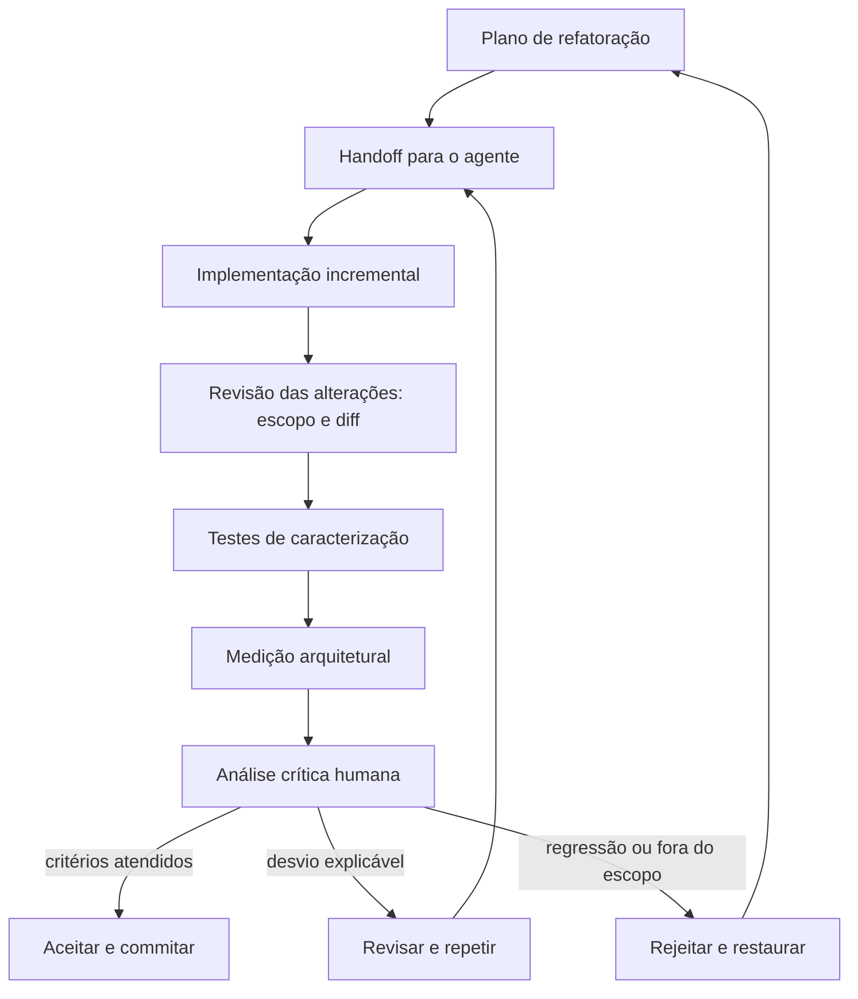

| Avaliação | Mecanismo | Pergunta |
|---|---|---|
| Comportamental | FF1, FF2 | o comportamento externo é o mesmo? |
| Quantitativa | FF4 + tabela 15.4 | a estrutura evoluiu na direção planejada? |
| Arquitetural | revisão humana | cada mudança tem justificativa e respeita responsabilidades? |
| De escopo | `git diff --stat` + FF3, FF4b | o agente mexeu só no autorizado? |

| Condição | Decisão |
|---|---|
| Testes falham | rejeitar ou corrigir a implementação (nunca o teste) |
| Testes passam, métricas pioram sem justificativa | revisar |
| Métricas melhoram artificialmente (import sem uso, `Protocol` sem consumidor, módulo fragmentado) | rejeitar |
| Testes passam, métricas melhoram e a arquitetura faz sentido | candidato à aprovação |
| Métricas pioram com explicação prevista (ex.: D das features 0,25 → 0,33) | aceitar, registrando |
| Agente extrapola o escopo | revisar ou rejeitar |
| Complexidade injustificada | revisar |

O agente não decide sozinho se o próprio trabalho está correto porque otimiza o que lhe foi pedido e pode satisfazer o critério sem resolver o problema (Goodhart): passar nos testes alterando um teste, ou melhorar D com um import. Testes e métricas são feedback determinístico; a revisão humana avalia intenção e justificativa, que nenhuma ferramenta mede.

---

## 21. Riscos e estratégias de mitigação

| # | Risco | Prob. | Impacto | Prevenção | Detecção |
|---|---|---|---|---|---|
| R1 | Alteração involuntária de comportamento | média | alto | incrementos pequenos; prompt preservado literalmente | FF1 |
| R2 | Abstrações excessivas | média (tendência de agentes) | médio | contrato fixado no handoff; escopo fechado | revisão; componentes novos no CSV |
| R3 | Métrica melhorada artificialmente | média | médio | critério de rejeição explícito; justificar cada import | revisão do diff; imports sem uso |
| R4 | Dependência cíclica (`ports` importando algo) | baixa | médio | `ports` sem imports internos | ferramenta (ciclos); Ce(`ports`)=0 |
| R5 | Incompatibilidade do gateway com o fake Anthropic | **média** | alto | validar no Passo 07 antes do piloto | testes diretos no gateway |
| R6 | Alteração do formato de resposta (espaços, quebras) via tradução | média | alto (golden byte a byte da F2) | comparar com o golden no Passo 07 | FF1 (F2) |
| R7 | Troca involuntária de modelo | baixa | alto | mapeamento revisado 1:1 com a v1 | FF1; log do gateway |
| R8 | Ordem dos resultados da F3 alterada | baixa | médio | laço e `sort` fora do escopo de mudança | FF1 (F3) |
| R9 | Agente modifica testes | média | alto | restrição explícita | FF2 |
| R10 | Vazamento de credenciais (no código, no ambiente ou no log) | média até o incremento 9 | alto | `.env` fora do Git; `environment:` explícito | FF8, FF9 |
| R11 | Serviços desnecessários (banco do LiteLLM, Redis) | média | médio | só master key e config em arquivo; ADR para qualquer serviço | `docker compose config` |
| R12 | Refatoração ampla demais | média | alto | um incremento por commit | `git diff --stat` |
| R13 | Rollback difícil | baixa | alto | branch e commit por incremento; tag intocada | — |
| R14 | Diferenças entre APIs dos providers (ex.: `max_tokens` obrigatório na Anthropic) | média | médio | gateway define `max_tokens` por capacidade | Passo 07; FF1 |
| R15 | Dependência de serviços externos (download da imagem do gateway) | baixa | baixo | imagem com versão fixada | `docker compose pull` |
| R16 | Retries somados (SDK 2 + gateway 2) multiplicam chamadas sob falha | **confirmada** no Passo 07 (o gateway retenta 2 vezes por padrão) | médio (custo, até 9 chamadas) | adapter com `max_retries=0` (revisão 1.0.1); política explícita no Passo 10 | `/admin/calls` com injeção de falha |
| R17 | Latência extra do gateway aproxima F2/F3 dos 30 s da borda | baixa | alto | medir no Passo 07 | tempos de FF1 |
| R18 | (**1.1**) Latência sob falha persistente sobe com o backoff do gateway (F1: 1,25 s → 4,6 s); na F3, com várias chamadas por requisição, o efeito se soma | **confirmada** no piloto | médio | Passo 10: `num_retries` e backoff explícitos no gateway; timeout nos dois saltos | sonda de falha por feature (17.6, item 12) |
| R19 | (**1.1**) O gateway vira dependência em execução de cada feature migrada; parado, a F1 cai (500 em 3,99 s) | **confirmada** no piloto | alto (cresce a cada feature) | healthcheck e `depends_on` (já existem); política de disponibilidade e fallback no Passo 10 | experimento de gateway parado |
| R20 | (**1.1**) Conteúdo nulo do modelo vira 500 (`json.loads(None)`); o contrato promete `str`, o SDK tipa `str \| None` | baixa (pré-existente na v1) | baixo | manter o comportamento; decidir tratamento junto com erros de modelo no Passo 10 | FF12 |
| R21 | (**1.1**) Falha de conexão app → gateway tem 1 tentativa (v1: 3 do SDK até o provider) | baixa | baixo | decidir no Passo 10 se o primeiro salto retenta só em conexão | revisão do adapter |

**Riscos que não podem ser eliminados agora** (validar nos Passos 07 e 08): R5, R6, R14, R16, R17 dependem do comportamento real do LiteLLM com o fake; R2 e R3 dependem do que o agente produzir.

**Situação após o piloto (1.1):** R1, R2, R3, R4, R7, R9 e R12 não se materializaram na F1 (evidência na seção 23). R16 ficou controlado (3 tentativas no provider, como na v1). R5, R6 e R14 continuam abertos para a F2 (caminho Anthropic e `max_tokens`). R18 a R21 são novos.

---

## 22. Estratégia de rollback

- **Marcos:** `v1-coupled` (intocável); um commit por incremento numa branch de trabalho (`refactor/v2-decoupled`); merge na `main` só após aceitação.
- **Antes de restaurar, inspecionar:** `git status`, `git diff --stat`, `git log --oneline -5`. Nada é descartado sem olhar.
- **Mudança ainda não commitada e rejeitada:** `git restore --source=HEAD -- app/` e remover os arquivos novos listados por `git status` (após conferir que são só os criados pelo agente).
- **Incremento já commitado e rejeitado:** `git revert HASH` (preserva o histórico; não reescreve nada).
- **Comparação com a v1 a qualquer momento:** worktree `../helpdesk-v1` na `v1-coupled`.
- Não usamos `reset --hard`, `push --force` ou movimentação de tags.
- **Revisão 1.1:** como os incrementos rodam como alterações locais na `main` (17.8), o marco de cada incremento é o commit do Igor que o encerra. Antes de restaurar, `git diff > docs/piloto/tentativa-N.diff` preserva a tentativa rejeitada.

---

## 23. Piloto de refatoração (Passo 08, concluído)

> Esta seção substitui a antiga "Resultados do piloto — pendente". A tabela projetada que existia aqui foi preservada em 23.12, na coluna "Projetado". O relatório completo, com a fundamentação e todos os diagramas, está em `docs/piloto/relatorio-piloto.md`; as evidências brutas estão em `docs/piloto/evidencias/` (00 a 26).

### 23.1 Componente selecionado
F1, Classificação (`app/helpdesk/classification.py`), como decidido em 17.1.

### 23.2 Justificativa
É a menor feature que exercita o caminho inteiro (prompt, chamada, JSON, regra de negócio com 502). Tem 13 testes, resposta determinística em cerca de 1 s e a mesma forma da F4. A limitação conhecida também se confirmou: a F1 não passa pelo caminho Anthropic do gateway (ver 23.18).

### 23.3 Hipótese arquitetural
A de 17.2, desdobrada em seis hipóteses verificáveis: comportamento, independência do provider, inversão, comunicação pelo gateway, modelo como configuração e métricas (relatório, seção 5).

### 23.4 Escopo autorizado
O de 17.4, sem mudança. O incremento de infraestrutura (`config.py` com 2 constantes, `compose.yaml` com `GATEWAY_*` e `depends_on: gateway`, `.env.example` com 1 comentário) foi feito pelo arquiteto, antes e separado do código do agente.

### 23.5 Estado anterior
- `main` em `6efadeb`, limpa; tag `v1-coupled` intacta.
- `32 passed in 59.95s`.
- F1 pela borda: 200 em 1,08 s, atendida por `openai`/`gpt-fake-large`. Sob `error_500`: 500 em 1,25 s, com 3 tentativas no provider (retries do SDK).
- Gateway no ar, mas sem nenhuma requisição de inferência.

### 23.6 Métricas anteriores
`docs/piloto/metricas/pilot-before.{csv,png}`, idêntico a `metrics/results/v1-coupled.csv` (20 arestas). Recorte: `classification` 1/3/0,75/0/0,25; `llm` 4/1/0,20/0/0,80; `config` 6/0/0/0/1,00; `main` 0/5/1/0/0.

### 23.7 Handoff para o agente de IA
Registro completo em 19.2; texto em `docs/piloto/handoff-f1.md`.

### 23.8 Implementação realizada

```python
# ports.py
class LanguageModel(Protocol):
    def complete(self, capability: str, prompt: str) -> str: ...

# adapters/gateway.py
class GatewayLanguageModel(LanguageModel):
    def __init__(self) -> None:
        self._client = OpenAI(base_url=f"{config.GATEWAY_URL}/v1",
                              api_key=config.GATEWAY_API_KEY, max_retries=0)
    def complete(self, capability: str, prompt: str) -> str:
        response = self._client.chat.completions.create(
            model=capability, messages=[{"role": "user", "content": prompt}])
        return response.choices[0].message.content

# classification.py (trecho)
CAPABILITY = "ticket-classification"
def classify(ticket: TicketInput, model: LanguageModel) -> Classification:
    text = model.complete(CAPABILITY, f"TASK: classify\n{ticket.text}")
    data = json.loads(text)
    # validação, 502 e Classification sem mudança

# main.py (trecho)
language_model = GatewayLanguageModel()          # Composition Root: instância única
...
return classification.classify(ticket, language_model)
```

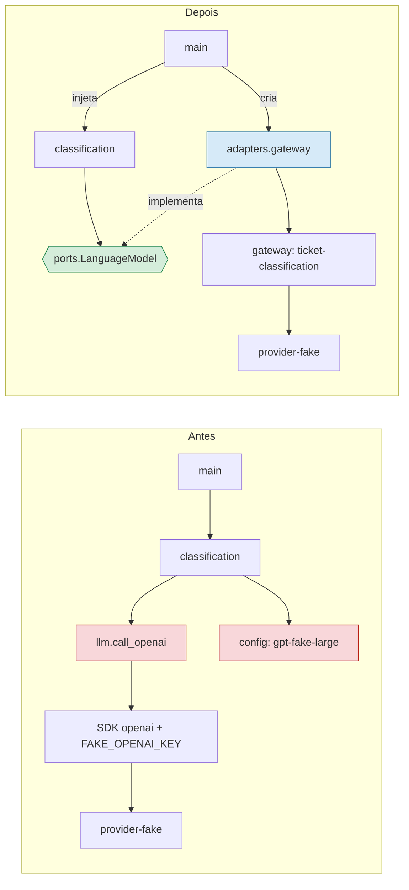

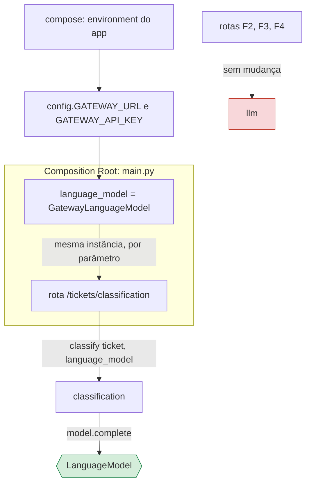

### 23.9 Alterações nas dependências
- **Saíram:** `classification → llm` e `classification → config`.
- **Entraram:** `classification → ports`, `adapters.gateway → ports`, `adapters.gateway → config` e `main → adapters.gateway`.
- **Externas:** a F1 passou a usar `json` (biblioteca padrão), e o SDK `openai` aparece em `adapters/gateway.py`, além de `llm.py`.
- **Total:** de 20 para 22 arestas, sem ciclos.

### 23.10 Resultados dos testes de caracterização

| Feature | Antes | Depois | Preservado? |
|---|---|---|---|
| F1 | 13 de 13 | 13 de 13 | sim; o 502 também, pela verificação própria |
| F2 | 4 de 4 | 4 de 4 | sim |
| F3 | 6 de 6 | 6 de 6 | sim |
| F4 | 9 de 9 | 9 de 9 | sim |
| Total | `32 passed in 59.95s` | `32 passed in 59.97s` | sim; `git diff v1-coupled -- tests/characterization/` vazio |

### 23.11 Métricas posteriores
Os valores estão em `docs/piloto/metricas/pilot-after.{csv,png}`. A mesma régua, sem mudança (FF4b), deu o mesmo resultado na sessão do agente, na verificação e no ambiente do arquiteto.

| Componente | Ca/Ce/I/A/D |
|---|---|
| adapters.gateway | 1/2/0,67/0/0,33 |
| classification | 1/2/0,67/0/0,33 |
| config | 6/0/0/0/1,00 |
| llm | 3/1/0,25/0/0,75 |
| main | 0/6/1,00/0/0 |
| ports | 2/0/0/1,00/0 |

`extraction`, `report`, `schemas`, `suggestion` e `tickets` não mudaram.

**Melhoria artificial?** Duas variações hipotéticas foram medidas e não aplicadas:
- sem a anotação `LanguageModel` na F1: Ce 1 e D 0,50;
- sem a herança no adapter: Ce 1 e D 0,50.

O comportamento seria idêntico nas duas, e a métrica pioraria. As setas para `ports` têm função própria: documentar o contrato e permitir checagem estática (o `mypy` pega um `complete` com assinatura errada). `pyflakes` não acusou nenhum import sem uso.

### 23.12 Comparação antes e depois

| Componente | Antes (medido) | Projetado (14.2, preservado da 1.0) | Depois (medido) | Divergência |
|---|---|---|---|---|
| classification | 1/3/0.75/0.00/0.25 | 1/2/0.67/0.00/0.33 | 1/2/0.67/0.00/0.33 | nenhuma (D sobe por ter menos dependências, previsto em 14.3) |
| ports | — | 2/0/0.00/1.00/0.00 | 2/0/0.00/1.00/0.00 | nenhuma |
| adapters.gateway | — | 1/2/0.67/0.00/0.33 | 1/2/0.67/0.00/0.33 | nenhuma |
| llm | 4/1/0.20/0.00/0.80 | 3/1/0.25/0.00/0.75 | 3/1/0.25/0.00/0.75 | nenhuma (transitório) |
| config | 6/0/0.00/0.00/1.00 | 6/0/0.00/0.00/1.00 | 6/0/0.00/0.00/1.00 | nenhuma |
| main | 0/5/1.00/0.00/0.00 | 0/6/1.00/0.00/0.00 | 0/6/1.00/0.00/0.00 | nenhuma |

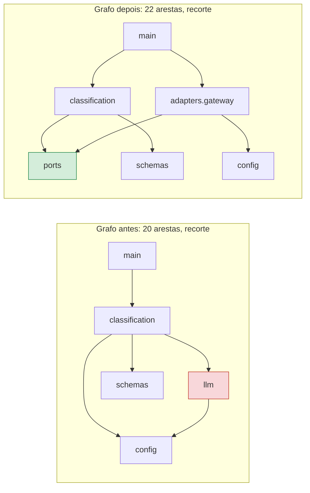

### 23.13 Evidências de integração com o gateway

| Evidência | Observado |
|---|---|
| Log do gateway | `POST /v1/chat/completions` vindos do IP do `app`: 9 na suíte, que são exatamente os 9 sucessos da F1, todos na mesma conexão keep-alive. F2, F3 e F4 não aparecem |
| Falha injetada | 1 requisição app → gateway; `LiteLLM Retried: 2 times`; 3 tentativas no provider |
| Gateway parado | F1 responde 500 em 3,99 s, com 0 chamadas ao provider; a F4 segue em 200, direto ao provider |
| Troca de modelo | só o mapeamento do gateway mudou e a F1 passou a ser atendida por `anthropic`/`claude-fake-large`, com a mesma resposta (1,28 s). Container da app (mesmo Id e horário de início) e código (mesmos hashes) não mudaram. Restaurado em seguida |
| Verificação própria | requisição com `/v1/chat/completions`, `Bearer` da chave do gateway, `model=ticket-classification`, prompt da v1 e nada mais |

### 23.14 Problemas encontrados
1. **A FF6 não detectava o adapter.** `grep -rlE "adapters"` não encontra `adapters/gateway.py`, que usa imports relativos. O problema foi apontado pelo agente e confirmado pelo arquiteto, e a FF6 foi revisada (16).
2. **A suíte não cobre o 502 nem as falhas do modelo.** Um adapter sem `max_retries=0` passaria nos 32 testes. A cobertura veio da verificação própria do arquiteto, que reprova esse mutante.
3. **A latência sob falha persistente subiu de 1,25 s para 4,6 s.** As 3 tentativas agora vêm do backoff do LiteLLM (R18).
4. **O gateway virou dependência em execução da F1** (R19).
5. **Falha de conexão no primeiro salto:** 1 tentativa, contra as 3 da v1 (R21).
6. **`str | None` × `str`.** O `mypy` acusa o retorno do adapter. O problema é pré-existente: `llm.call_openai` tinha o mesmo comportamento (R20).

Nenhum desses problemas viola critério do desafio ou a caracterização. O limite de 15 s sob falha e o de 30 s da borda continuam folgados.

### 23.15 Ciclos de feedback e correções
Houve três ciclos: proposta (aprovada sem mudanças), implementação (entregue com testes e métricas) e verificação independente (aprovada). Não houve correção de código, rejeição nem retrabalho; a tabela de iterações está em 19.2. O feedback relevante foi no sentido inverso: o agente apontou a falha da FF6 e sugeriu sondas que entraram na validação.

### 23.16 Decisão de aprovação ou rejeição
**Aprovada.** Todos os critérios de 17.7 foram atendidos:
- B1 a B5;
- FF2, FF3 e FF4b sem diff;
- a F1 sem `llm` e sem `config`;
- `ports` com A=1;
- `Ca(adapters.gateway)=1`;
- nada novo na zona de dor;
- o diff dentro de 17.4.

Nenhum critério de rejeição ocorreu. Os problemas 3 a 6 de 23.14 foram aceitos como diferenças registradas, com destino no Passo 10. A matriz completa está no relatório, seção 11.

### 23.17 Revisão do plano original
Revisão 1.1 (seção 24):
- FF6 corrigida e FF12 nova (seção 16);
- protocolo de validação com verificação própria, sonda de falha e `mypy` por feature (17.6);
- processo real de versionamento e rollback (17.8, 18 e 22);
- riscos R18 a R21 (seção 21);
- consolidação atualizada (26.2).

O que **não** mudou, porque a evidência confirmou: contrato, organização, adapter, DI, composição, projeção de métricas e a ordem de migração F4, F2, F3.

| Elemento | Plano 1.0.1 | Evidência | 1.1 |
|---|---|---|---|
| FF6 | `grep -rlE "adapters"` | não vê `adapters/gateway.py` | busca de linhas de import + aresta única no CSV |
| Validação por feature | FF1 + métricas + diff | suíte cega a 502 e falhas; mutante passa | + verificação própria, sonda de falha, FF12 |
| Resiliência | R16, R17 | 4,6 s sob falha; F1 cai com o gateway parado; 1 tentativa de conexão | R18 a R21; entradas concretas do Passo 10 |
| Processo | branch e commit por incremento | trabalho local na `main`, commit do Igor | 17.8 e 22 revisados |

### 23.18 Consequências para a refatoração completa

| Feature restante | Mudança necessária | Estratégia validada | Particularidades | Risco |
|---|---|---|---|---|
| F4, Extração | `extract(ticket, model)`; `CAPABILITY = "order-extraction"`; `json.loads` | idêntica à F1 | nunca usar `mini` (`product: null`); validar o formato do pedido na verificação própria | baixo |
| F2, Sugestão | `suggest(ticket, model)`; `CAPABILITY = "reply-suggestion"` | mesma chamada, sem JSON | caminho Anthropic e `max_tokens: 2000` ainda não exercitados pela app; texto byte a byte; 16 s por chamada | médio |
| F3, Relatório | assinatura e linha da chamada; laço, lote de 150 e ordenação intactos | mesma chamada | várias chamadas por requisição multiplicam R18; `TICKETS_PER_CALL` fica em `config` | médio |
| Remoção (8) | `llm.py`; em `config`, chaves `FAKE_*`, URLs, modelos e `MAX_OUTPUT_TOKENS`; `anthropic` em `requirements.txt` | — | só depois da última feature | baixo |
| Credenciais (9) | `app` sem `env_file`; só `GATEWAY_*` | — | FF9 | baixo |

O que pode ser reutilizado:
- o contrato e o adapter, sem mudança;
- uma linha de composição por rota;
- `docs/piloto/verificacao_f1.py` e `sondas.py`, como modelo;
- o handoff em duas fases, com a FF6 corrigida.

### 23.19 Lições aprendidas
1. **Um piloto que confirma o desenho ainda revela coisas.** Tudo o que mudou estava fora do alcance da régua (dependências em execução, retry, latência) e da suíte (502, falhas).
2. **Fitness functions também precisam ser testadas.** A FF6 dava falsa segurança, e a verificação própria só ganhou valor depois de reprovar um mutante.
3. **Quem implementa não deve escrever a prova.** A verificação do 502 e do retry foi escrita fora da sessão do agente, e é ela que pega o erro mais provável de um adapter.
4. **`/admin/calls` sozinho não prova a passagem pelo gateway.** São necessárias evidências que só se explicam pelo gateway: o gateway parado e a troca de modelo.
5. **Mover a política de retry muda o comportamento sob falha** mesmo quando o número de tentativas é preservado: o backoff vem junto.
6. **Separar a infraestrutura do código do agente** deixou o diff do agente pequeno, revisável e conferível por hash.
7. **Fazer o agente propor antes de implementar** custou uma iteração e trouxe dois riscos que o plano não tinha (R21 e o caminho de `None`).

---

## 24. Registro de revisões

| Versão | Evento | Evidência | Alteração realizada | Justificativa |
|---|---|---|---|---|
| 1.0 | Planejamento inicial | diagnóstico (Passo 02), comparação de modelos (Passo 03), caracterização (Passo 04), métricas da `v1-coupled` (Passo 05), simulação da 14.2 | plano inicial | — |
| 1.0.1 | Validação do gateway (Passo 07) | `docs/gateway/relatorio-gateway.md`: retries padrão do LiteLLM (3 chamadas sob 5xx), auth só com master key, `max_tokens` aceito, streaming e normalização validados | respostas da §12.5; handoff (§19.1) com URL, autenticação e `max_retries=0`; §13 e R16 atualizados | evidência experimental: manter o SDK com 2 retentativas sobre o gateway multiplicaria as chamadas (até 9) e mudaria o comportamento sob falha da v1 (3) |
| 1.1 | Resultado do piloto (Passo 08) | `docs/piloto/relatorio-piloto.md`; `docs/piloto/evidencias/`; `docs/piloto/metricas/pilot-{before,after}.csv` | 19.2 e 23 preenchidas; FF6 corrigida e FF12 nova (16); protocolo 17.6 com itens 11 a 13; 17.8, 18 e 22 com o processo real; riscos R18 a R21 (21); 25 e 26.2 atualizadas | o desenho estrutural se confirmou exatamente; o que mudou está fora do que a régua e a suíte enxergam: FF6 não detectava o adapter; a suíte não cobre 502 e falhas; o retry passou ao gateway (falha 3,5 s mais lenta) e o gateway virou dependência em execução |

| 1.2 | Refatoração completa (Passo 09) | `docs/v2/relatorio-v2.md`; `docs/v2/evidencias/00` a `25`; `metrics/results/v2-decoupled.csv` | seção 28 nova; 18 (nota 1.2); 25 com os incrementos 5 a 11; 26.2 e 27 atualizadas | o desenho se confirmou sem mudança nas 4 features; o que se acrescentou foi o protocolo (verificação própria e sonda de falha por feature), o isolamento do `provider-fake` (só `FAKE_*`) e a decisão de usar a master key como chave de consumo até o Passo 12 |

Para cada revisão: hipótese original; resultado esperado; resultado observado; divergências; problemas; alternativas consideradas; mudança no plano; evidência que a motivou; consequências para os próximos incrementos.

Revisar o plano depois do piloto não é falha de planejamento: o piloto existe para confrontar hipóteses com o código real. Um plano que nunca muda diante de evidência é que estaria errado.

---

## 25. Registro da execução assistida por IA (Passos 08 e 09 concluídos)

| Incremento | Agente / data | Handoff usado | Iterações | Resultado de FF1 | Métricas | Decisão | Observações |
|---|---|---|---|---|---|---|---|
| 2 (infraestrutura) | arquiteto (sem agente) / 2026-11-25 | — | 1 | `32 passed in 60.02s` | sem mudança (só `config` ganhou constantes) | aceito | feito antes do agente para não misturar escopos |
| 3 (piloto F1) | Claude Code, sessão separada / 2026-11-25 | `docs/piloto/handoff-f1.md` (19.1 revisado) | 2 do agente (proposta, implementação) + 1 de verificação | `32 passed` (agente 60.33 s; arquiteto 59.97 s) | iguais à 14.2 | **aprovado** | sem correções; agente apontou a falha da FF6 |
| 4 (revisão do plano) | arquiteto / 2026-11-26 | — | 1 | — | — | 1.1 | seções 16 a 26 |
| baseline do Passo 09 | arquiteto / 2026-11-26 | — | 1 | `32 passed in 60.42s` | `v2-baseline` = `pilot-after` | — | evidências `00` a `08` |
| 5 (F4) | Claude Code, sessão separada / 2026-11-26 | `docs/v2/handoffs/handoff-1-f4.md` | 2 (proposta, implementação) | `32 passed in 60.15s` | 21 arestas, esperado | **aprovado** | sem correção |
| 6 (F2) | idem | `handoff-2-f2.md` | 2 | `32 passed in 60.08s` | 20 arestas; `llm` D 0,50 | **aprovado** | texto byte a byte |
| 7 (F3) | idem | `handoff-3-f3.md` | 2 | `32 passed in 60.15s` | 20 arestas; `llm` Ca 0 | **aprovado** | só a linha da chamada |
| 8 (remoção) | idem | `handoff-4-remocao.md` | 2 | `32 passed in 60.09s` | 19 arestas = 14.2 | **aprovado** | `llm.py` e `anthropic` removidos |
| 9 (credenciais) | idem | `handoff-5-credenciais.md` | 2 | `32 passed in 60.13s` | iguais ao 8 | **aprovado** | `app` só com `GATEWAY_*` |
| 10 (medição e verificação) | arquiteto / 2026-11-26 | — | 1 | `32 passed` (60,10 s; 60,06 s; 60,60 s em cópia limpa) | `v2-decoupled` reproduzível | aceito | evidências `09` a `25` |
| 11 (tag) | Igor (commit) e arquiteto (tag) / 2026-11-26 | — | 1 | `32 passed` nos worktrees das duas tags | CSVs das tags iguais aos oficiais | **criada** em `b637c5a` | evidências `26` a `29`; push da tag com o Igor |

---

## 26. Revisão crítica e questões em aberto

### 26.1 Melhores contra-argumentos
1. **"Um `Protocol` com uma só implementação é cerimônia."** Em parte, sim. O que o justifica é o requisito (nenhuma feature importa o concreto) e o fato de as features ficarem testáveis com qualquer objeto. Sem o requisito, a Alt 1 seria defensável para esta aplicação.
2. **"O gateway é um ponto único de falha e um salto a mais."** Verdade. Em troca, centraliza credenciais, modelos e, na `main`, fallback e governança. O risco é medido no Passo 07 (R17).
3. **"O prompt repetido nas features é duplicação."** É uma linha por feature, e cada prompt é da feature. Centralizá-lo faria o adapter conhecer o vocabulário de negócio.
4. **"Capacidade como `str` não tem segurança de tipo."** Aceito. Um nome errado falha alto e os testes de rota cobrem as 4 capacidades. Um `Enum` central acoplaria as features entre si.
5. **"As métricas das features pioram."** Pioram (0,25 → 0,33) e isso é esperado (14.3). Usamos isso como lembrete de que D é indicador, não objetivo.
6. **"Herdar explicitamente do `Protocol` serve à métrica."** É o risco R3. A justificativa independente é a declaração de conformidade e a checagem estática; o piloto deve confirmar se ela se sustenta na revisão. **Resultado (1.1):** sustenta. Sem a herança, o comportamento é o mesmo e a métrica piora (Ce do adapter cai para 1, D sobe para 0,50); com ela, o `mypy` recusa um `complete` com assinatura errada. Ver 23.11.

### 26.2 Consolidação
| Tipo | Itens |
|---|---|
| Decisões aprovadas (neste plano) | Alt 2; contrato `LanguageModel.complete(capability, prompt) -> str`; DI por parâmetro com `main` como Composition Root; 4 capacidades com modelos `large`; LiteLLM Proxy self-hosted como candidato; F1 como piloto; substituição progressiva de `llm.py`; estrutura Opção 1 |
| Decisões confirmadas no piloto (1.1) | contrato de uma operação; DI por parâmetro; instância única em `main`; adapter herdando do `Protocol` e lendo `config` (a herança pega assinaturas erradas no `mypy`); `max_retries=0` |
| Decisões provisórias | `max_tokens` no gateway; isolamento de rede `app` × `provider-fake`; destino de `config` na `main`; política de retry, backoff e timeout (agora com dados: R18, R21) |
| Hipóteses a validar | o padrão do piloto se repete sem mudar o contrato (provável; Passo 09); LiteLLM traduz para o fake Anthropic sem alterar o texto **na app** (já validado direto no gateway no Passo 07); latência do gateway desprezível frente aos 30 s (confirmada no caminho feliz da F1) |
| Riscos remanescentes | R5, R6, R14 (F2); R17; R18 a R21 |
| Questões em aberto | 12.5 (1 a 8); como provar FF10 de forma objetiva; se `config` vira exceção ou é dissolvido (Passo 16) |
| Confirmado na refatoração completa (1.2) | o padrão do piloto se repetiu em F4, F2 e F3 sem mudar o contrato; o LiteLLM traduz o texto da F2 byte a byte pela app; `max_tokens` do gateway é aplicado (provado com 20); FF10 objetiva por contagem (19 = 19); a troca de modelo vale para a F2 pela borda; métricas iguais à 14.2 |
| Ainda abertos depois da 1.2 | R18 a R21 (entrada do Passo 10); master key como chave de consumo (Passo 12); `config` na zona de dor (Passo 16) |

---

## 27. Conclusão

A menor transformação que resolve os problemas comprovados da v1 é: um contrato de uma operação (`ports.LanguageModel`), um único adapter do gateway (`adapters.gateway`), composição em `main`, capacidades lógicas no lugar de modelos físicos e credenciais isoladas no gateway. Ela elimina `llm` da zona de dor, tira os detalhes voláteis de `config`, não cria camadas e mantém o comportamento sob a mesma suíte de 32 testes. O que ela não resolve (fallback, streaming, F3 assíncrona, governança) fica explicitamente para a `main`, com o gateway e o contrato como pontos de extensão.

Próximo passo: Passo 07, subir o gateway e responder às questões da seção 12.5. O checkpoint está em `docs/refatoracao/checkpoint-passo-06.md`; o glossário em `docs/refatoracao/glossario.md`; as decisões em `docs/adr/0002` a `0004`.

**Atualização 1.1 (Passo 08).** O piloto confirmou essa transformação na F1, com o comportamento caracterizado preservado e as métricas exatamente como projetadas. A arquitetura completa **não** está validada: só um de quatro componentes migrou, e a `v2-decoupled` não existe. Próximo passo: Passo 09, migrar F4, F2 e F3 nessa ordem, com o protocolo revisado (17.6, itens 11 a 13), remover `llm.py` e isolar as credenciais. Checkpoint em `docs/piloto/checkpoint-passo-08.md`; glossário em `docs/piloto/glossario.md`.

**Atualização 1.2 (Passo 09).** A transformação foi aplicada às quatro features em cinco incrementos, sem mudar o contrato nem o adapter, e verificada por instrumentos independentes do agente. A candidata à `v2-decoupled` atende todos os critérios da seção 15 (detalhe na seção 28). O que ela não resolve continua fora do escopo por decisão: timeouts, retry explícito, fallback, streaming, F3 assíncrona e governança (Passos 10 a 16). Relatório em `docs/v2/relatorio-v2.md`; checkpoint em `docs/v2/checkpoint-passo-09.md`; glossário em `docs/v2/glossario.md`.

---

## 28. Refatoração completa (Passo 09)

Registro consolidado do que foi planejado, entregue ao agente, implementado, medido e aceito. Os detalhes, as matrizes e os diagramas estão em `docs/v2/relatorio-v2.md`; as saídas integrais, em `docs/v2/evidencias/` (citadas pelo número).

### 28.1 Estratégia revisada após o piloto

Nenhuma mudança de desenho. O piloto confirmou o contrato, o adapter e a composição (seção 23), e o Passo 09 os reutilizou como estavam. O que mudou foi o **protocolo**: cada feature ganhou uma verificação contra um gateway simulado (`docs/v2/verificacao_v2.py`, que cobre 502, campos nulos, lotes da F3 e falha com uma única requisição) e uma sonda de falha pela borda (`docs/v2/sondas_v2.py`), porque a suíte não enxerga esses caminhos (17.6, itens 11 a 13).

### 28.2 Sequência de migração

F4 → F2 → F3 → remoção → credenciais → medição → tag (seção 18, incrementos 5 a 11). F4 primeiro por ter a mesma forma da F1; F2 depois por ser o primeiro texto livre pela tradução do LiteLLM e o primeiro uso real de `max_tokens` no gateway; F3 por último por fazer várias chamadas por requisição. A composição foi consolidada dentro de cada incremento (uma linha por rota).

### 28.3 Handoffs realizados

Cinco handoffs independentes em `docs/v2/handoffs/`, todos com o template da 19.1 (contexto, componente, tarefa, artefatos, restrições, critérios, formato) e executados em duas fases (proposta, depois implementação) por uma sessão do Claude Code separada da do arquiteto, sem acesso à conversa do arquiteto. Nenhum precisou de segunda rodada.

### 28.4 Migração da F1

Migrada no piloto; sem mudança de código no Passo 09 (blob `f4755a8`). Revalidada: FF6 sem saída, verificação OK, sonda em `openai/gpt-fake-large`, falha persistente em 4,0 s com 3 tentativas (evidências `10`, `15`, `16`, `17`).

### 28.5 Migração da F2

`suggestion.py` passou a depender só de `ports` e `schemas` (`CAPABILITY = "reply-suggestion"`). Os 2 golden masters de texto integral passaram; a verificação conferiu o texto unicode exato. O `max_tokens: 2000` saiu da app e ficou no gateway; reduzido para 20 a título de experimento, a resposta pela borda veio truncada (80 caracteres, `output_tokens: 20`), o que prova que o limite do gateway é o aplicado (evidência `19`).

### 28.6 Migração da F3

`report.py` mudou só na assinatura e na linha da chamada dentro do laço; o fatiamento em lotes de `config.TICKETS_PER_CALL`, a agregação e a ordenação ficaram sem diff. A verificação conferiu 274 tickets em 2 lotes, os prompts exatos e a agregação contra um oráculo independente.

### 28.7 Migração da F4

`extraction.py` com `CAPABILITY = "order-extraction"`; a regra do formato do pedido e o 502 ficaram iguais. Verificação: sucesso, campos nulos, formato inválido (502) e falha com uma requisição.

### 28.8 Consolidação do contrato abstrato

`ports.LanguageModel.complete(capability, prompt) -> str` atendeu as quatro features sem evolução: o `max_tokens` é configuração da capacidade no gateway e a F3 chama `complete` uma vez por lote. Nenhum contrato novo foi criado. `ports` tem Ca=5 (4 features e o adapter) e A=1.

### 28.9 Consolidação do gateway adapter

`adapters/gateway.py` sem mudança desde o piloto: único import de SDK em `app/` (FF5), `max_retries=0`, `model=capability`. Não trata erros nem define timeout (Passo 10). FF12 acusa só o `str | None` herdado (R20).

### 28.10 Composição da aplicação

`main.py` cria `language_model = GatewayLanguageModel()` uma vez e passa a mesma instância às quatro rotas. É o único importador do adapter (`main.py:4`; Ca=1).

### 28.11 Remoção das integrações antigas

Depois do último consumidor: `llm.py` removido; de `config.py` saíram as chaves, as URLs do provider-fake, os 4 modelos físicos e `MAX_OUTPUT_TOKENS` (ficaram `GATEWAY_URL`, `GATEWAY_API_KEY`, `TICKETS_FILE`, `TICKETS_PER_CALL`); `anthropic` saiu de `app/requirements.txt`. FF7 e FF8 sem saída.

### 28.12 Isolamento das credenciais

`compose.yaml`: o `app` não tem mais `env_file`; recebe só `GATEWAY_URL` e `GATEWAY_API_KEY` (o valor da master key, provisório até o Passo 12) e não depende mais do `provider-fake` na subida. O `provider-fake` também perdeu o `env_file` e recebe só as duas chaves que valida. FF9: o ambiente do `app` não tem nenhuma chave de provider nem `GATEWAY_MASTER_KEY` (evidência `12`).

### 28.13 Resultados dos testes

`32 passed` em todos os incrementos e três vezes na verificação final (60,10 s; 60,06 s; 60,60 s numa cópia limpa com `cp .env.example .env`). `tests/characterization/` sem diff contra a `v1-coupled`. OpenAPI gerado da v1 e da v2 idêntico (evidência `22`). FF10: 19 chamadas no provider = 19 requisições no gateway.

### 28.14 Métricas oficiais da V2

`metrics/results/v2-decoupled.csv` e `.png`, medidos com a régua sem diff desde o Passo 05 e reproduzidos numa segunda execução (evidência `23`):

| Componente | Ca | Ce | I | A | D | Zona de dor |
|---|---|---|---|---|---|---|
| adapters.gateway | 1 | 2 | 0.67 | 0.00 | 0.33 | |
| classification | 1 | 2 | 0.67 | 0.00 | 0.33 | |
| config | 3 | 0 | 0.00 | 0.00 | 1.00 | sim |
| extraction | 1 | 2 | 0.67 | 0.00 | 0.33 | |
| main | 0 | 6 | 1.00 | 0.00 | 0.00 | |
| ports | 5 | 0 | 0.00 | 1.00 | 0.00 | |
| report | 1 | 4 | 0.80 | 0.00 | 0.20 | |
| schemas | 5 | 0 | 0.00 | 0.00 | 1.00 | sim |
| suggestion | 1 | 2 | 0.67 | 0.00 | 0.33 | |
| tickets | 1 | 1 | 0.50 | 0.00 | 0.50 | no limite |

Idêntica, componente a componente, à projeção da 14.2.

### 28.15 Comparação entre V1 e V2

20 → 19 arestas; zona de dor de {`config`, `llm`, `schemas`} para {`config`, `schemas`}; `llm` (D 0,80) removido; `ports` novo sobre a Main Sequence; `config` Ca 6 → 3. As features pioraram em D (0,25 → 0,33) por terem menos dependências, como previsto em 14.3, e nada foi feito para "consertar" isso. Tabela completa em `docs/v2/relatorio-v2.md`, seção 15.

### 28.16 Avaliação do trabalho do agente

Cinco incrementos, cinco aprovações sem correção. Os blobs de `app/` são idênticos aos de uma implementação de referência escrita antes pelo arquiteto. Desvios só de processo (saídas filtradas, uma suíte rodada duas vezes), registrados e aceitos. Toda aprovação se apoiou em evidência que o agente não produziu: verificação própria, sondas, contagem da FF10 e métricas recalculadas.

### 28.17 Revisões do plano

Versão 1.2 (seção 24). Nenhuma decisão revertida. Acrescentados: o isolamento do `provider-fake` (não estava no plano: ele também recebia o `.env` inteiro), a remoção do `depends_on` do `app` para o `provider-fake`, e a decisão explícita de usar a master key como chave de consumo até o Passo 12 (ADR 0003).

### 28.18 Critérios de aceite

Seção 15: B1 a B6, S1 a S5 e I1 a I5 atendidos, com evidência em `docs/v2/relatorio-v2.md`, seção 14. I5 atendido com ressalva (o valor é o da master key). Commit `b637c5a` e tag `v2-decoupled` criados; entre as tags, suíte idêntica, `32 passed` nas duas a partir de worktrees limpos e métricas reproduzidas (evidências `26` a `29`). Falta só o push da tag.

### 28.19 Limitações remanescentes

Falha persistente em ~4 a 4,6 s (v1: ~1,2 a 1,4 s), por causa do backoff padrão do LiteLLM (R18); gateway como ponto único de falha de todas as features (R19); `str | None` do SDK (R20); 1 tentativa de conexão no primeiro salto (R21); master key como chave de consumo; a suíte não cobre falhas, timeouts nem períodos longos; a capacidade existe em dois lugares (feature e gateway).

### 28.20 Lições aprendidas

1. Um piloto real com o contrato mínimo tornou a escala mecânica: três features migraram com a mesma mudança de uma linha.
2. Proposta antes da implementação, comparada contra uma referência do arquiteto, eliminou retrabalho.
3. A suíte de caracterização prova o comportamento conhecido; os caminhos de erro precisaram de instrumentos próprios.
4. Remover só depois do último consumidor manteve cada incremento reversível.
5. Métrica igual à projeção confirma o desenho, mas a decisão de aceitar D pior nas features veio do código, não do número.
