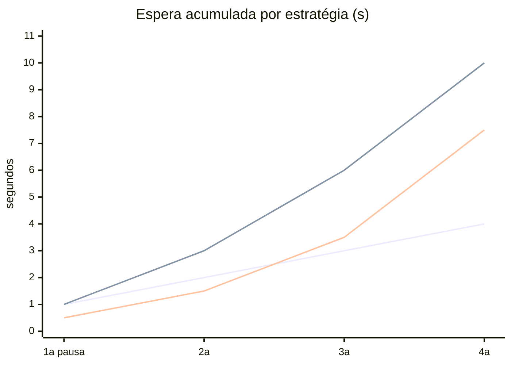
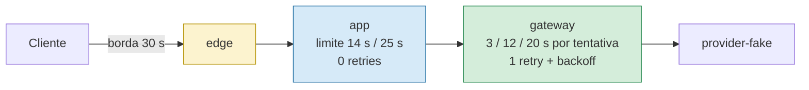
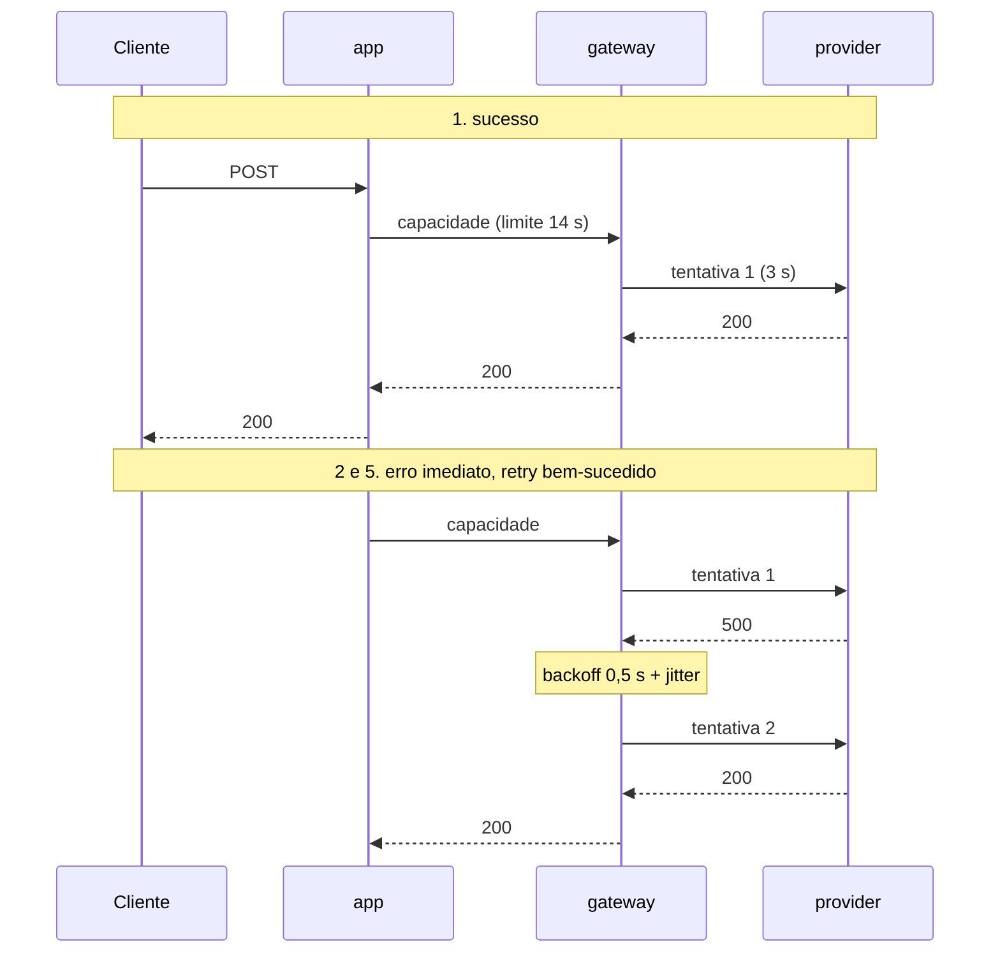
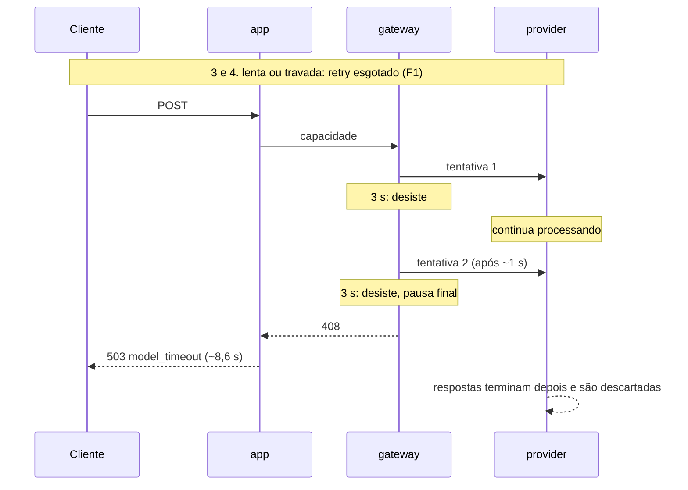
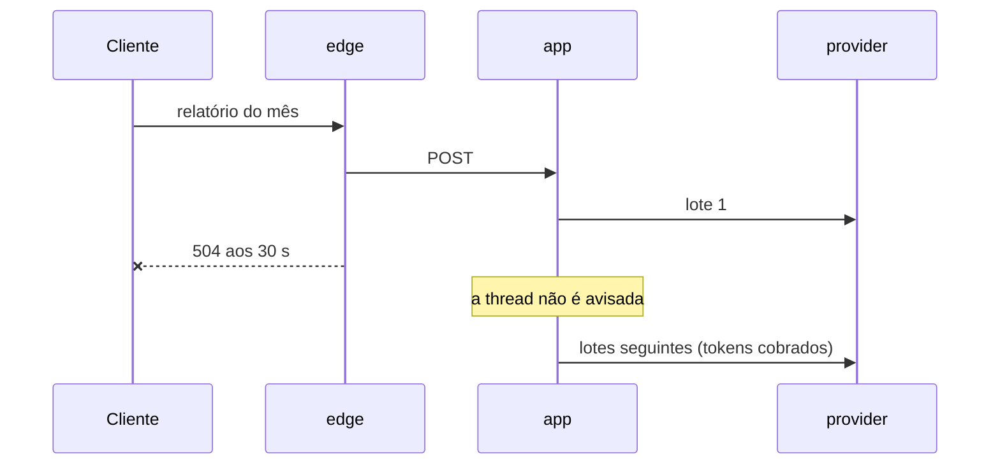
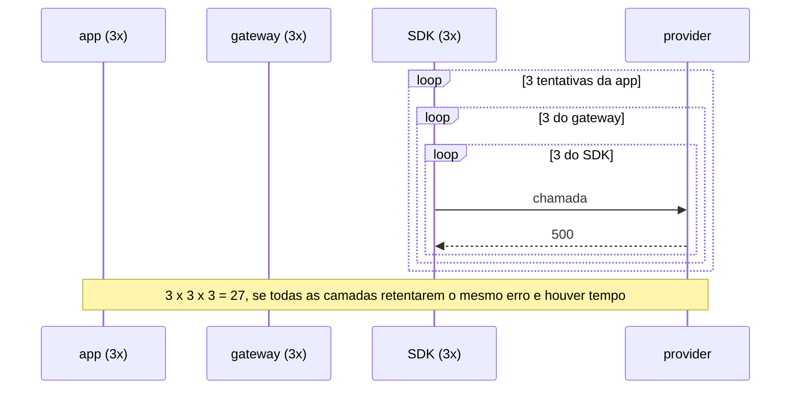
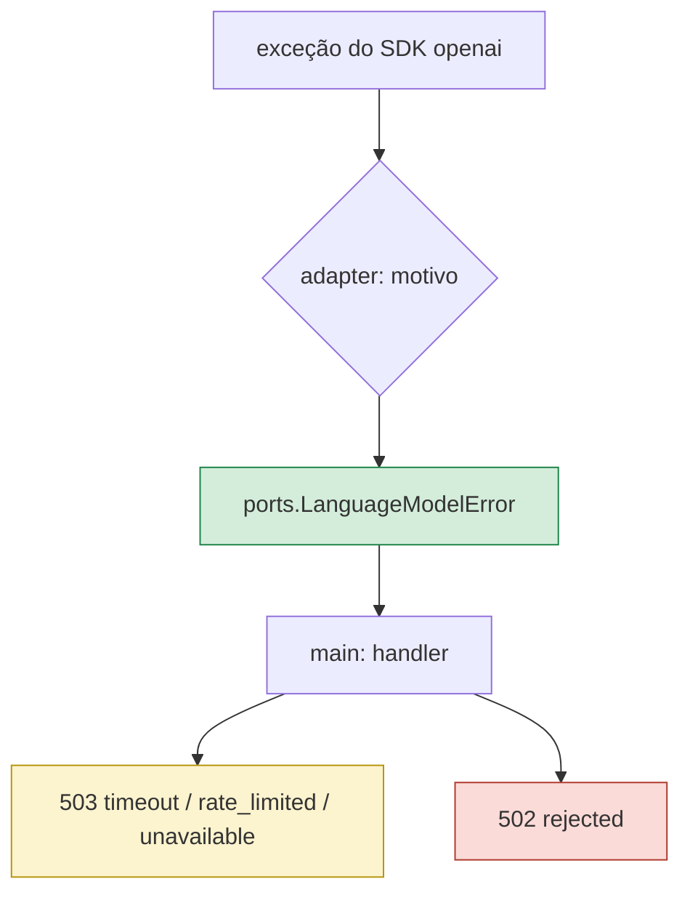
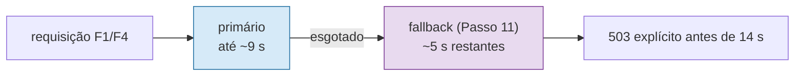

# Passo 10: timeout, retry e backoff

Execução em 2026-11-27 sobre a `main` (partindo de `a8e1fda`, aplicação igual à `v2-decoupled`). Decisão registrada no [ADR 0005](../adr/0005-resilience-policy.md). Evidências brutas em [`evidencias/`](evidencias/).

**Pergunta do passo:** como tentar se recuperar de falhas transitórias sem multiplicar latência, custo e consumo? Resposta adotada: cada tentativa tem prazo, há no máximo duas, só para erros que podem passar sozinhos, com pausa entre elas, em uma única camada, e com um limite externo que sempre fica abaixo da borda.

## 1. Conceitos aplicados

| Cenário | No helpdesk | Retry ajuda? |
|---|---|---|
| Erro imediato | `error_500`, `error_429` | só se for transitório |
| Lentidão | `slow` (tempo ×10) | raramente: a segunda tentativa tende a ser lenta também |
| Travamento | `timeout` (300 s sem bytes) | só se couber no prazo |
| Saturação | `429`; threads da app presas | retry imediato piora |
| Indisponibilidade | gateway ou provider fora | não, quando persistente |
| Falha parcial | um provider cai, metade das features cai | resolve com fallback (Passo 11) |

**Timeouts.** *Connection*: quanto esperar para conectar. *Read*: quanto esperar **entre** recebimentos de dados (não limita o total se houver gotejamento). *Write*: quanto esperar para enviar. *Pool*: quanto esperar por uma conexão livre. *Por tentativa*: uma chamada. *Da operação*: todas as tentativas e pausas. *Deadline*: o instante limite; deve ser medido com relógio monotônico, porque o relógio de calendário pode saltar (NTP, ajuste manual). O LiteLLM e o HTTPX tratam disso internamente; o único código nosso que mede duração (sondas e testes) usa `time.monotonic()`.

**Timeout não é cancelamento.** Desistir de esperar, fechar a conexão, cancelar a tarefa local e interromper o processamento remoto são quatro coisas diferentes.

**Retry.** 1 tentativa inicial + 1 retry = 2 tentativas totais. `num_retries` do LiteLLM conta **retries adicionais**.

**Idempotência.** Nenhuma das quatro features grava dados, mas repetir não é de graça:

| Feature | Repetir a chamada ao modelo | Repetir a operação de negócio |
|---|---|---|
| F1 | tokens em dobro | igual |
| F2 | tokens de saída em dobro (a parte cara); texto pode variar em modelo real | igual |
| F3 | só o lote que falhou | todos os lotes: no mês, 34 chamadas (US$ 0,85) |
| F4 | tokens em dobro; em modelo real, valor extraído poderia divergir | igual |

Não há deduplicação nem *idempotency key* (fora do escopo): a semântica é *at-least-once* por tentativa.

**Backoff.**

| Estratégia | Pausas | Efeito |
|---|---|---|
| imediato | 0, 0, 0 | recupera rápido, amplifica sobrecarga |
| fixo | 1, 1, 1 | previsível, sincroniza clientes |
| linear | 1, 2, 3 | alivia aos poucos |
| exponencial | 0,5, 1, 2, 4 | alivia rápido, consome orçamento |
| exponencial com teto | 0,5, 1, 2, 4, 8, 8 | limita a espera |
| com *jitter* | base + aleatório | espalha os clientes no tempo |

```python
import random
base = [min(0.5 * 2**n, 8) for n in range(5)]              # 0.5 1 2 4 8
litellm = [b + 0.75 * random.random() for b in base]       # jitter aditivo (o usado)
full = [random.uniform(0, b) for b in base]                # full jitter
equal = [b / 2 + random.uniform(0, b / 2) for b in base]   # equal jitter
```



Linhas, de baixo para cima na 4a pausa: fixo, exponencial, linear.

*Jitter decorrelacionado* sorteia cada pausa entre a base e 3 vezes a pausa anterior. 100 clientes recusados juntos voltam todos no mesmo instante com backoff fixo ou exponencial puro; com o jitter do LiteLLM voltam espalhados em uma janela de 0,75 s.

**Retry-After.** Vem em segundos ou em data HTTP, em `429` e `503`. É recomendação do servidor; o deadline do cliente continua valendo. O provider-fake envia `Retry-After: 2` no `error_429`.

## 2. Cadeia de comunicação

| Camada | Timeout antes → depois | Retry antes → depois | Backoff | Explícito? |
|---|---|---|---|---|
| Cliente HTTP | do cliente | nenhum | — | fora do nosso controle |
| nginx (`edge`) | connect 5 s, read/send 30 s | `proxy_next_upstream` padrão, sem efeito com um upstream | — | explícito, não alterado |
| FastAPI (`app`) | nenhum | nenhum | — | — |
| Adapter (SDK `openai` 3.19.0) | 600 s → 14/25 s, connect 2 s | 0 → 0 | — | explícito |
| AI Gateway (LiteLLM 1.102.1) | 6000 s → 3/12/20 s por tentativa | 2 → 1 | exponencial + jitter | padrão → explícito |
| SDK do gateway (`openai` 2.33.0, e cliente HTTP do LiteLLM para Anthropic) | recebe o timeout da tentativa | 0 (o router força `max_retries=0`) | — | implícito, verificado no código e em `/admin/calls` |
| provider-fake | segura 300 s no `timeout` | nenhum | — | simulado |

Antes, quem desistia primeiro era a borda. Agora é o gateway; a app é a rede de segurança; a borda não chega a agir.



Recursos do LiteLLM investigados (código dentro da imagem):

| Recurso | Configuração | Semântica | Validado |
|---|---|---|---|
| timeout por destino | `litellm_params.timeout` | timeout HTTPX por tentativa | sim |
| retries | `router_settings.num_retries` | retries adicionais; padrão 2 | sim |
| política por erro e capacidade | `model_group_retry_policy` | número de retries por classe de exceção, decidido pelo 1º erro | sim (timeout, 500, 429, 400) |
| backoff | fixo no código (`INITIAL_RETRY_DELAY` 0,5, `MAX_RETRY_DELAY` 8, `JITTER` 0,75) | com pausa também após a última tentativa | sim, 500 e 429 |
| Retry-After | automático se 0 < valor ≤ 60 | substitui o exponencial | sim (2 s) |
| cooldown | `disable_cooldowns: true` | desligado | não testado |
| fallback | não configurado | nenhum destino alternativo | sim (só 1 provider/modelo nas chamadas) |

### Sequências





### Timeout × cancelamento (v1, Dor 1, ainda válido para a F3)



Evidências de que algo continuou: `duration_ms` preenchido depois da resposta (`slow`), `duration_ms` nulo (`timeout`), horários em `/admin/calls` posteriores ao erro. Mecanismos de cancelamento disponíveis: apenas fechar a conexão; o provider-fake não interrompe a geração por isso.

## 3. Baseline antes da mudança

| Feature | Modo | HTTP | Tempo | Tentativas | Observado |
|---|---|---|---|---|---|
| F1 / F4 / F2 / F3 | `normal` | 200 | 1,09 / 1,25 / 15,96 / 9,85 s | 1 | referência |
| F1 / F4 / F2 / F3 | `error_500` | 500 | 4,66 / 4,92 / 4,53 / 4,90 s | 3 | backoff implícito |
| F1 / F4 / F2 / F3 | `error_429` | 500 | 6,65 / 7,31 / 6,38 / 7,08 s | 3 | pausas ~2 a 2,6 s |
| F1 / F4 | `slow` | 200 | 10,78 / 12,28 s | 1 | cabe na borda |
| F2 / F3 | `slow` | 504 | 30,03 s | 1 | chamada ainda aberta |
| F1 / F2 | `timeout` | 504 (nginx) | 30,0 s | 1 | chamada aberta; `upstream timed out` no log da borda |

F4 e F3 em `timeout` não foram executadas na baseline. As 3 tentativas de 300 s foram observadas na v1; na v2 o ambiente foi reiniciado antes disso.

## 4. Orçamento de latência

| Requisito | Vale agora? |
|---|---|
| F1 completa em até 3 s (normal) | sim: 1,35 s |
| F2 primeiro trecho em 1,5 s | não, exige streaming (Passo 14) |
| F3 aceite em 1 s | não, exige assíncrono (Passo 15) |
| F4 confiável e limitada | sim |
| síncronas travadas: resposta em até 15 s | F1 8,6 s, F4 7,6 s, F3 (1 lote) 12,1 s; **F2 20,0 s, não atende** |
| F3 assíncrona: falha em até 60 s | não se aplica ainda |

| Capacidade | Normal | Timeout/tentativa | Tentativas | Pausas máximas | Limite da app |
|---|---|---|---|---|---|
| classificação | 1,08–1,15 s | 3 s | 2 | 3,0 s | 14 s |
| extração | 1,23 s | 3 s | 2 | 3,0 s | 14 s |
| relatório (lote) | até 9,85 s | 12 s | 2 (1 em timeout) | 3,0 s | 14 s |
| sugestão | até 16,2 s | 20 s | 2 (1 em timeout) | 3,0 s | 25 s |

Na v2 a latência normal por capacidade vem de `/admin/calls`; o máximo de saída de cada tarefa foi calculado rodando o gerador do provider-fake sobre os 5.000 tickets (classificação 14 tokens, extração 17, sugestão 615, lote 362). Sem streaming não há TTFT observável pelo cliente (o modelo tem 0,8 s). O overhead do gateway medido no Passo 07 foi de ~6 ms.

### Exercício: 3 tentativas de 3 s, pausas de 0,5 e 1 s, prazo de 15 s

| Item | Valor |
|---|---|
| tentativas | 9 s |
| backoff | 1,5 s |
| total | 10,5 s mais comunicação e tratamento |
| margem | 4,5 s |
| + 1 fallback de 3 s | sobra 1,5 s |
| erros imediatos | total ≈ 1,5 s |
| 3ª tentativa com 2 s restantes | não deveria começar, ou deveria receber só 2 s |

Número máximo de tentativas não substitui deadline: 3 tentativas de 20 s respeitam o limite de contagem e passam em muito dos 15 s.

## 5. Implementação em etapas

| Etapa | Mudança | Evidência |
|---|---|---|
| 1. timeout por tentativa | `timeout` por destino, `num_retries: 0` temporário | F1 3,06 s, F2 20,03 s, F3 12,08 s, 1 chamada; ainda `500` genérico (`etapa1-*`) |
| 2. limite da app e erros | `GATEWAY_DEADLINE_SECONDS`, `LanguageModelError`, handler | `503` explícito; com o gateway pausado, F1 14,02 s e F2 25,03 s (`etapa2-*`) |
| 3. retry e backoff | `num_retries: 1`, `model_group_retry_policy` | `depois-*` |

Retry e backoff entraram juntos porque no LiteLLM o backoff é parte do retry e não pode ser desligado; os intervalos foram validados em separado (seção 7). A implementação foi feita direto nesta sessão, sem o handoff para um segundo agente previsto na subetapa 4.21.

## 6. Experimentos depois da mudança

| Feature | Modo | HTTP | Tempo | Tentativas |
|---|---|---|---|---|
| F1 / F4 / F2 / F3 | `normal` | 200 | 1,35 / 1,25 / 15,96 / 9,85 s | 1 |
| F1 / F4 / F2 / F3 | `error_500` | 503 | 2,50 / 2,19 / 2,73 / 2,19 s | 2 |
| F1 / F4 / F2 / F3 | `error_429` | 503 | 4,33 / 5,07 / 4,91 / 5,25 s | 2 |
| F1 / F4 / F2 / F3 | `timeout` | 503 | 8,59 / 7,63 / 20,03 / 12,06 s | 2 / 2 / 1 / 1 |
| F1 / F4 / F2 / F3 | `slow` | 503 | 8,37 / 8,00 / 20,03 / 12,27 s | 2 / 2 / 1 / 1 |

Nenhuma linha `upstream timed out` na borda. `openai` (F1, F4) e `anthropic` (F2, F3) foram exercitados. Nenhuma chamada foi para outro destino.

| Característica | HTTP 500 | HTTP 429 |
|---|---|---|
| Natureza | falha interna | limitação temporária |
| Retry | 1 | 1 |
| Espera | 0,5 s + jitter | `Retry-After` 2 s + jitter |
| Tentativas observadas | 2 | 2 |
| Tempo total | 2,2–2,7 s | 4,3–5,3 s |
| Erro final | `503 model_unavailable` | `503 model_rate_limited` |

### Recuperação (falha removida entre as tentativas, sem apagar o registro)

| Falha | Feature | HTTP | Tempo | Status no provider |
|---|---|---|---|---|
| `error_500` | F1 | 200 | 2,16 s | 500, 200 |
| `error_429` | F4 | 200 | 4,00 s | 429, 200 |
| `timeout` | F1 | 200 | 4,97 s | 504, 200 |
| `error_500` | F2 | 200 | 16,91 s | 500, 200 |

### Erros que não são repetidos

| Cenário | Status | Chamadas ao provider | Correto? |
|---|---|---|---|
| entrada inválida na API | 422 | 0 | sim |
| contexto excedido (400 do provider) | 502 | 1 | sim |
| chave do provider errada no gateway (override temporário) | 502 | 1 | sim |
| chave do gateway errada na app (override temporário) | 502 | 0 | sim |
| chave errada direto no gateway | 400 (sem banco, o LiteLLM não responde 401) | 0 | sim |
| capacidade inexistente direto no gateway | 400 | 0 | sim |
| gateway parado | 503 em 7,85 s | 0 | sem retry; ver limitação no ADR |

O `429` do provider é o único `429` testado. O `429` e a recusa por orçamento do próprio gateway só existirão no Passo 12, e **não** devem herdar o retry: a política atual de `RateLimitError` precisa ser revista lá.

## 7. Intervalos entre tentativas

Horários UTC de recebimento no provider (`/admin/calls`).

| Cenário | Tentativa 1 | Tentativa 2 | Duração da 1ª | Intervalo | Esperado |
|---|---|---|---|---|---|
| F1 `error_500` | 00:14:18,566 | 00:14:19,688 | 0 ms | 1,12 s | 0,5–1,25 s |
| F4 `error_500` | 00:14:24,093 | 00:14:24,898 | 0 ms | 0,81 s | 0,5–1,25 s |
| F2 `error_500` | 00:14:29,328 | 00:14:30,295 | 0 ms | 0,97 s | 0,5–1,25 s |
| F3 `error_500` | 00:14:35,114 | 00:14:35,691 | 1 ms | 0,58 s | 0,5–1,25 s |
| F1 `error_429` | 00:14:40,440 | 00:14:42,652 | 0 ms | 2,21 s | 2–2,75 s |
| F4 `error_429` | 00:14:47,797 | 00:14:50,350 | 0 ms | 2,55 s | 2–2,75 s |
| F1 `timeout` | 00:15:19,952 | 00:15:24,088 | cortada em 3 s | 4,14 s = 3 + 1,14 | 3,5–4,25 s |
| F4 `timeout` | 00:15:31,566 | 00:15:35,090 | cortada em 3 s | 3,52 s = 3 + 0,52 | 3,5–4,25 s |

A diferença entre o intervalo e o tempo total é a **pausa depois da última tentativa** (comportamento do router), mais o overhead.

## 8. Amplificação

| Capacidade | Falha | Máximo declarado | Observado | Amplificação? |
|---|---|---|---|---|
| as quatro | `error_500`, `error_429` | 2 | 2 | não |
| F1, F4 | `timeout`, `slow` | 2 | 2 | não |
| F2, F3 | `timeout`, `slow` | 1 | 1 | não |
| F3, 2 dias, 2º lote falhando | `error_500` | 1 + 2 | 3 chamadas: lote 1 (200) e lote 2 (500, 500) | não; o lote 1 foi desperdiçado |



Hoje: app 1 × adapter 1 × gateway 2 × SDK do gateway 1 = **2**. Antes: 3. Com o `max_retries` padrão no adapter seriam até 6.

## 9. Impacto financeiro

Preços do provider-fake. "Medido" = tokens registrados em chamadas concluídas; "potencial" = chamada abandonada que pode ter gerado a saída inteira.

| Feature | Cenário | Tentativas | Tokens (entrada/saída) | Custo (US$) | Natureza |
|---|---|---|---|---|---|
| F1 | normal | 1 | 19 / 11 | 0,000158 | medido |
| F4 | normal | 1 | 18 / 17 | 0,000215 | medido |
| F2 | normal | 1 | 19 / 606 | 0,009147 | medido |
| F3 (1 dia) | normal | 1 | 6.132 / 360 | 0,023796 | medido |
| F1 | `slow` | 2 | 38 / 22 | 0,000315, tudo desperdiçado | medido |
| F4 | `slow` | 2 | 36 / 34 | 0,000430, tudo desperdiçado | medido |
| F2 | `slow`/`timeout` | 1 | 19 / ? | até 0,009147 | potencial |
| F3 | `slow`/`timeout` | 1 | 6.132 / ? | até 0,023796 | potencial |
| todas | `500`/`429` | 2 | entrada registrada, sem saída | recusa antes da inferência; cobrança não assumida | indeterminado |

| Cenário (desperdício) | 100 | 1.000 | 10.000 |
|---|---|---|---|
| F1 `slow` | 0,03 | 0,32 | 3,15 |
| F2 abandonada (potencial) | 0,91 | 9,15 | 91,47 |
| F3 lote abandonado (potencial) | 2,38 | 23,80 | 237,96 |
| F3 com 3 tentativas em timeout (política não adotada) | 7,14 | 71,39 | 713,88 |

## 10. Erros entre as camadas

| Origem | Representação interna | Status | Por quê |
|---|---|---|---|
| timeout no gateway (408) ou limite da app | `reason="timeout"` | 503 | pode passar; `504` fica para a borda |
| `429` | `rate_limited` | 503 | o cliente do helpdesk não excedeu limite nenhum |
| 5xx, conexão | `unavailable` | 503 | indisponibilidade temporária |
| 400, 401, 403, 404 | `rejected` | 502 | defeito nosso ou de configuração |
| saída inválida do modelo | já existia na feature | 502 | inalterado |



## 11. Antes e depois

| Feature | Falha | Tempo antes → depois | Tentativas | Resultado |
|---|---|---|---|---|
| F1 | `500` | 4,66 → 2,50 s | 3 → 2 | falha mais rápida e explícita (não é recuperação) |
| F1 | `429` | 6,65 → 4,33 s | 3 → 2 | idem |
| F1 | `timeout` | 30,0 (504) → 8,59 s (503) | 1 observada → 2 | explícito |
| F1 | `slow` | 10,78 s **200** → 8,37 s **503** | 1 → 2 | **pior disponibilidade e custo em dobro** |
| F4 | `slow` | 12,28 s **200** → 8,00 s **503** | 1 → 2 | idem |
| F2 | `slow`/`timeout` | 30,0 (504) → 20,0 s (503) | 1 → 1 | explícito |
| F3 | `slow`/`timeout` | 30,0 (504) → 12,1 s (503) | 1 → 1 | explícito |

Sob falha persistente o sistema continua indisponível. O ganho é espera, tentativas e erro sob controle.

## 12. Testes, métricas e integridade

- `tests/resilience`: **34 passed** em 166 s ([saída](evidencias/testes-resiliencia.txt)). Rodam em sequência, com reset antes e depois de cada teste. O jitter é testado por faixa.
- `tests/characterization`: **32 passed** em 59,9 s, sem alteração.
- OpenAPI idêntico ao da `v2-decoupled` ([hash](evidencias/openapi.txt)).
- `verificacao_v2.py`: 9 cenários ok, 4 reprovados só porque esperam `500` no erro do gateway; a contagem de 1 requisição se mantém ([saída](evidencias/verificacao-v2.txt)).
- Métrica intermediária `resilience-step-10` ([CSV](metricas/resilience-step-10.csv)): 20 arestas (nova: `main -> ports`); `ports` Ca 5→6, A 1,00→0,50, D 0,00→0,50, fora da zona de dor; os demais iguais. Os arquivos oficiais em `metrics/results/` não mudaram.
- `provider-fake/`, `edge/`, `data/`, `tests/characterization/` e as duas tags intactos ([saída](evidencias/integridade.txt)).

Revisão arquitetural: nenhuma feature mudou; o único SDK continua no adapter; os prazos da app ficam em `config.py`, indexados por capacidade (o nome da capacidade passa a existir em três lugares: feature, `config.py` e gateway; o teste de orçamento confere os dois últimos).

## 13. Preparação do Passo 11



| Capacidade | Orçamento | Consumo máximo do primário | Reservado para fallback |
|---|---|---|---|
| classificação | 14 s | ~9,0 s | ~5 s |
| extração | 14 s | ~9,0 s | ~5 s |
| sugestão | 25 s | 20 s (timeout), 23 s (500 + travamento) | ~2 a 5 s: insuficiente para outra geração de 16 s |
| relatório (lote) | 14 s | 12 s a 15 s | nenhum no modo síncrono |

Retry repete no mesmo destino; fallback troca de destino. No Passo 11: conferir se o fallback do LiteLLM herda `num_retries` por destino (multiplicaria), se respeita o timeout por destino, e rever o `RateLimitErrorRetries` quando houver limites do próprio gateway.
