# Relatório do Passo 09: refatoração completa e `v2-decoupled`

| Item | Valor |
|---|---|
| Ponto de partida | `main` em `4a3447a` (piloto da F1 aprovado; F2, F3 e F4 ainda diretas ao provider) |
| Ponto de chegada | candidata à `v2-decoupled`: as quatro features pelo contrato e pelo gateway; `llm.py` removido; credenciais dos providers fora do serviço `app` |
| Executor do código | Claude Code, sessão separada na máquina do Igor, guiado por 5 handoffs (`docs/v2/handoffs/`) |
| Verificação | sessões do arquiteto antes (evidências `00` a `08`) e depois (evidências `09` a `25`), com instrumentos que o agente não escreveu |
| Data | 2026-11-26 (horários em UTC nas evidências) |
| Plano | `docs/refactoring-plan.md`, versão 1.2, seção 28 |

Convenção: **medido** é o que está numa evidência de `docs/v2/evidencias/` (citada pelo número). **Projetado** é o que o plano esperava. Nada aqui é estimado sem dizer.

---

## 1. Recuperação do contexto (4.1)

| Artefato | Informação relevante | Utilização nesta etapa |
|---|---|---|
| Plano revisado (1.1) | estratégia validada: contrato de uma operação, DI por parâmetro, `main` como Composition Root, adapter único com `max_retries=0`; incrementos 5 a 11 (seção 18); protocolo 17.6 com itens 11 a 13 | ordem de migração, critérios de cada incremento, FF5 a FF12 |
| Piloto (Passo 08) | hipóteses confirmadas na F1; limitações: suíte não cobre 502 e falhas, FF6 cega a imports relativos, retry mudou de dono, gateway virou dependência em execução | reutilizar contrato e adapter sem mudança; verificação própria contra gateway simulado e sonda de falha por feature |
| Testes | 32 testes de caracterização (F1 13, F4 9, F2 4, F3 6) contra a borda e o provider real | FF1 a cada incremento; `git diff v1-coupled -- tests/characterization/` vazio (FF2) |
| Métricas | `v1-coupled.csv` (20 arestas), `pilot-after.csv` (22 arestas), projeção da v2 (seção 14.2, 19 arestas) | metas por componente (15.4); medição por incremento e oficial |
| Gateway | LiteLLM Proxy `v1.102.1`; 4 capacidades em `gateway/config.yaml`; master key como única chave; retry padrão (3 tentativas sob 5xx) | `model=capacidade` no adapter; FF10 por contagem; troca de modelo pela borda |
| ADRs | 0001 (régua), 0002 (contrato e DIP), 0003 (gateway), 0004 (capacidades) | restrições do código; revisões no fim do passo |

## 2. Fundamentação aplicada (4.2)

Escalar a refatoração seguiu **Expand and Contract** com **Branch by Abstraction**, sem big bang:

| Momento | Aplicação no desafio | Onde |
|---|---|---|
| Introdução (expand) | contrato `ports.LanguageModel` e `adapters.gateway` criados no piloto, convivendo com `llm.py` | Passo 08 |
| Migração | F4, F2 e F3 passaram, uma por incremento, do `llm` para o contrato; cada uma com 32 testes, verificação própria e sonda de falha antes da próxima | incrementos 1 a 3 |
| Remoção (contract) | `llm.py`, chaves, URLs e modelos físicos em `config`, SDK `anthropic`; depois o `env_file` do `app` | incrementos 4 e 5 |

Durante a migração a aplicação esteve numa **arquitetura transitória** (seção 4): dois caminhos para a IA, cada feature num deles, todos com comportamento externo igual. A abstração (`ports`) é o que permitiu migrar uma feature por vez sem quebrar as outras.

## 3. Revisão dos resultados do piloto (4.3)

| Elemento | Planejamento original (1.0) | Resultado do piloto (Passo 08) | Estratégia revisada (Passo 09) |
|---|---|---|---|
| Contrato | `complete(capability, prompt) -> str`, provisório | bastou para a F1, sem parâmetro a mais | reutilizado sem mudança nas quatro features (seção 8) |
| Adapter | único, OpenAI-compatível, `max_retries=0` | herda do `Protocol`; lê `config`; `mypy` recusa assinatura errada | reutilizado sem mudança; nenhum adapter novo |
| Composição | `main` cria uma instância e injeta | funcionou sem `Depends` nem contêiner | uma linha por rota: `feature(..., language_model)` |
| Dependências | features só em `ports` e `schemas` (F3 também `tickets`, `config`) | confirmado na F1 | mesma meta; FF6 revisada (linha de import) |
| Configurações | `config` perde o volátil no incremento 8 | `GATEWAY_*` acrescentados; o resto ficou para o fim | removidos chaves, URLs, modelos e `MAX_OUTPUT_TOKENS` só depois do último consumidor |
| Métricas | projeção 14.2 | `pilot-after` igual à projeção | medir após cada incremento; a oficial só no fim |
| Validação | FF1 + métricas + revisão do diff | a suíte não vê 502 nem falhas; retry mudou de dono | `verificacao_v2.py` (gateway simulado) e `sondas_v2.py falha` em cada feature |

## 4. Arquitetura transitória (4.4) e baseline (4.5)

Estado medido em `4a3447a`, antes de qualquer migração (evidências `00` a `08`):

| Feature | Componente | Integração atual | Capacidade lógica | Estado |
|---|---|---|---|---|
| F1 — Classificação | `classification.py` | contrato → `adapters.gateway` → gateway → `openai/gpt-fake-large` | `ticket-classification` | migrada (piloto) |
| F2 — Sugestão | `suggestion.py` | `llm.call_anthropic(config.SUGGESTION_MODEL, ...)` direto ao provider-fake | `reply-suggestion` (só no gateway) | a migrar |
| F3 — Relatório | `report.py` | `llm.call_anthropic(config.REPORT_MODEL, ...)` por lote de 150 | `topics-report` (só no gateway) | a migrar |
| F4 — Extração | `extraction.py` | `llm.call_openai(config.EXTRACTION_MODEL, ...)` | `order-extraction` (só no gateway) | a migrar |

| Medida da baseline | Valor (evidência) |
|---|---|
| Suíte | `32 passed in 60.42s` (`02`) |
| FF10 antes | provider 19 chamadas (classify 9, extract 7, suggest 2, topics 1); gateway 9 POST, só a F1 (`03`) |
| Features pela borda | F1 1,089 s; F4 1,232 s; F2 15,957 s; F3 9,843 s (137 tickets); todas `stream: false` (`04`) |
| Falha persistente (5xx) | F1 500 em 4,622 s (via gateway); F4 1,249 s; F2 1,185 s; F3 1,439 s; 3 tentativas cada (`05`) |
| Verificação própria | F1 OK; F4, F2 e F3 FALHOU com 0 requisições ao gateway (`06`), como esperado |
| Métricas | `v2-baseline` = `pilot-after` (22 arestas); `tests/metrics` 64 passed (`07`) |
| Ambiente do `app` | `FAKE_ANTHROPIC_KEY`, `FAKE_OPENAI_KEY`, `GATEWAY_API_KEY`, `GATEWAY_MASTER_KEY`, `GATEWAY_URL` (`08`) |

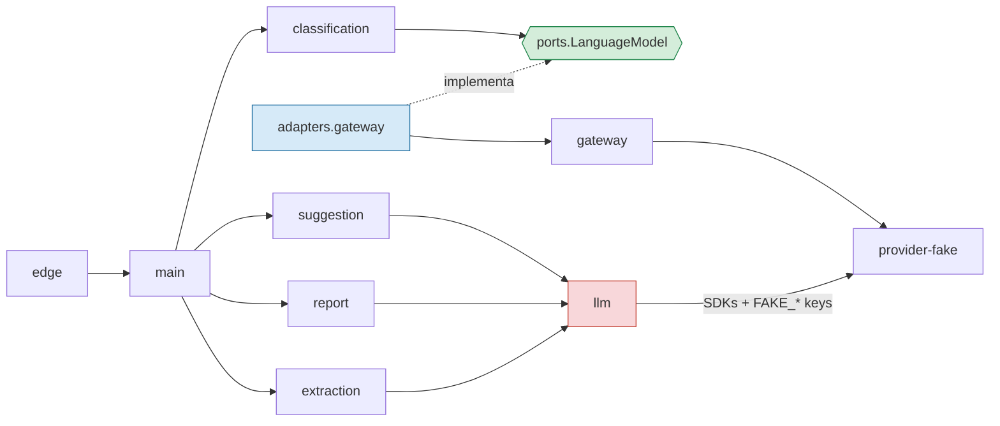

## 5. Sequência de migração (4.6)

| Ordem | Atividade | Justificativa | Resultado |
|---|---|---|---|
| 1 | Migrar F4 — Extração | mesma forma da F1 (prompt → JSON → validação com 502); 9 testes; repete o padrão já provado | aprovada sem correção |
| 2 | Migrar F2 — Sugestão | primeiro texto livre pela tradução do LiteLLM (Anthropic) e primeiro uso real do `max_tokens` do gateway | aprovada; texto byte a byte |
| 3 | Migrar F3 — Relatório | várias chamadas por requisição (lotes); laço e agregação não podem mudar | aprovada; só a linha da chamada e a assinatura |
| 4 | Consolidar a composição | as quatro rotas passam a mesma instância | feito junto com cada feature (uma linha por rota) |
| 5 | Remover integrações antigas | só depois do último consumidor | `llm.py`, constantes e `anthropic` removidos |
| 6 | Isolar credenciais | o `app` só lê `GATEWAY_*` depois do passo 5 | `env_file` removido de `app` e `provider-fake` |
| 7 | Medição oficial | código final | `metrics/results/v2-decoupled.{csv,png}` |
| 8 | Tag `v2-decoupled` | só depois do checklist (4.37) e da aprovação do Igor | pendente de aprovação |

A consolidação da composição não virou um incremento próprio: cada handoff mudou exatamente uma linha de `main.py`, e o incremento 3 terminou com as quatro rotas injetando a mesma instância.

## 6. Handoffs (4.7) e ciclo de validação (4.8)

Cada handoff (`docs/v2/handoffs/handoff-N-*.md`) é independente e tem as seções Contexto, Componente-alvo, Tarefa, Artefatos disponíveis, Restrições, Critérios de aceite e Formato da entrega. Todos foram executados em **duas fases**: o agente entrega a proposta (diff, dependências, métricas esperadas, riscos), o arquiteto aprova, e só então o agente implementa e roda os comandos.

| # | Handoff | Escopo autorizado | Métricas pedidas |
|---|---|---|---|
| 1 | `handoff-1-f4.md` | `extraction.py`, linha da rota em `main.py` | `extraction` 1/2/0,67/0/0,33; 21 arestas |
| 2 | `handoff-2-f2.md` | `suggestion.py`, linha da rota | `suggestion` idem; `llm` fora da zona de dor; 20 arestas |
| 3 | `handoff-3-f3.md` | `report.py` (linha da chamada e assinatura), linha da rota | `report` 1/4/0,80/0/0,20; `llm` Ca=0; `config` Ca=4 |
| 4 | `handoff-4-remocao.md` | `llm.py` (remover), `config.py`, `app/requirements.txt` | 19 arestas; `config` 3/0/0/0/1,00 |
| 5 | `handoff-5-credenciais.md` | `compose.yaml`, `.env.example` | iguais ao 4 |

Ciclo aplicado a cada incremento:

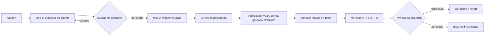

**Instrumentos do arquiteto, fora do controle do agente:**

- `docs/v2/verificacao_v2.py`: sobe um gateway HTTP simulado e chama a app real com `TestClient`. Confere caminho, `Bearer`, `model=capacidade`, o prompt exato da v1 e que o corpo só tem `model` e `messages`; cenários de sucesso, 502, campos nulos, texto unicode, lotes da F3 (274 tickets, 2 lotes de 150 com agregação contra um oráculo independente) e 500 com uma única requisição. Testada com mutantes: detecta lote de 100, `max_tokens` extra e features não migradas.
- `docs/v2/sondas_v2.py`: chama a borda como um cliente real e lê `/admin/calls`; fases `features`, `falha FEATURE` e `contar`.

## 7. Contrato (4.9) e adapter (4.10)

| Alternativa | Característica | Decisão |
|---|---|---|
| Reutilizar o contrato existente | preserva a estratégia validada | **adotada**: F4, F2 e F3 couberam em `complete(capability, prompt) -> str` |
| Evoluir minimamente o contrato | atende necessidade real ainda não contemplada | não houve necessidade: o `max_tokens` da F2 e da F3 é configuração da capacidade no gateway; a F3 chama `complete` uma vez por lote |
| Criar contratos específicos | separa responsabilidades | rejeitada: as quatro operações têm a mesma forma (texto entra, texto sai) |

```python
# app/helpdesk/ports.py (sem mudança desde o piloto)
class LanguageModel(Protocol):
    def complete(self, capability: str, prompt: str) -> str: ...

# app/helpdesk/adapters/gateway.py (sem mudança desde o piloto)
class GatewayLanguageModel(LanguageModel):
    def __init__(self) -> None:
        # max_retries=0: o gateway já faz as retentativas; o SDK não as multiplica.
        self._client = OpenAI(base_url=f"{config.GATEWAY_URL}/v1",
                              api_key=config.GATEWAY_API_KEY, max_retries=0)

    def complete(self, capability: str, prompt: str) -> str:
        response = self._client.chat.completions.create(
            model=capability, messages=[{"role": "user", "content": prompt}])
        return response.choices[0].message.content
```

Responsabilidades do adapter: traduzir `complete` para `POST {GATEWAY_URL}/v1/chat/completions` com a chave do gateway e `model=capacidade`; nada de negócio, nada de provider. O que ele **não** faz, de propósito: timeout próprio, retry, fallback, tratamento de erro (são do Passo 10 em diante). A única ressalva estática é a herdada da v1: o SDK tipa `message.content` como `str | None` e o `mypy` acusa 1 erro em `adapters/gateway.py:23` (FF12, evidência `10`; risco R20). O comportamento é o da v1 (conteúdo nulo vira 500).

## 8. Migrações (4.11 a 4.14)

Padrão comum: a feature declara `CAPABILITY`, recebe `model: LanguageModel` por parâmetro e troca `llm.call_*(config.MODELO, "tarefa", texto)` por `model.complete(CAPABILITY, f"TASK: tarefa\n{texto}")`. O prompt continua idêntico ao da v1, porque o `llm` montava exatamente essa string.

### 8.1 F4 — Extração (incremento 1)

| Etapa | Registro |
|---|---|
| Fundamentação | mesma forma da F1: JSON + validação de formato com 502; o padrão do piloto deveria repetir sem mudança no contrato |
| Implementação atual | `extraction.py` importava `config` (modelo) e `llm`; Ce=3 |
| Implementação guiada | proposta do agente idêntica à referência do arquiteto; aprovada sem mudanças |
| Resultado | blob `1410246`; `extraction` 1/2/0,67/0/0,33; 21 arestas (esperado) |
| Testes | `32 passed in 60.15s`; verificação F1+F4 OK (8 cenários, inclusive 502 "Número de pedido em formato inválido" e campos nulos) |
| Gateway | sonda: F4 atendida por `openai/gpt-fake-large/extract` |
| Problema | falha persistente passou de 1,249 s para 4,709 s (retry agora do gateway, com backoff); 3 tentativas, igual à v1 |
| Decisão | aprovada |

### 8.2 F2 — Sugestão (incremento 2)

| Etapa | Registro |
|---|---|
| Fundamentação | primeiro texto livre pelo gateway: o LiteLLM traduz Chat Completions para a API Anthropic do fake; o texto tem de chegar byte a byte e o `max_tokens` (antes enviado pelo SDK `anthropic`) passa a ser do gateway |
| Implementação atual | `llm.call_anthropic(config.SUGGESTION_MODEL, "suggest", ...)` com `max_tokens=config.MAX_OUTPUT_TOKENS` |
| Restrição específica | sem streaming, sem mudar o texto, sem `max_tokens` na app |
| Resultado | blob `8580313`; `suggestion` só depende de `ports` e `schemas`; `llm` saiu da zona de dor (D 0,50); 20 arestas |
| Testes | `32 passed in 60.08s`, incluindo os 2 golden masters de texto integral; verificação F1+F4+F2 OK (10) com texto unicode exato |
| Gateway | F2 por `anthropic/claude-fake-large/suggest`, `stream: false`, 15,963 s (v1: 15,957 s) |
| `max_tokens` | provado depois, pela borda: com `max_tokens: 20` no gateway a sugestão veio truncada em 80 caracteres e `/admin/calls` registrou `output_tokens: 20`; restaurado, 2424 caracteres e `output_tokens: 606` (evidência `19`) |
| Problema | falha persistente 1,185 s → 5,34 s |
| Decisão | aprovada |

### 8.3 F3 — Relatório (incremento 3)

| Etapa | Registro |
|---|---|
| Fundamentação | uma requisição gera N chamadas (lotes de 150); laço, fatiamento, agregação e ordenação têm de ficar intactos |
| Implementação atual | `llm.call_anthropic(config.REPORT_MODEL, "topics", content)` dentro do laço |
| Restrição específica | só a linha da chamada e a assinatura mudam; `TICKETS_PER_CALL` continua em `config`; nada assíncrono |
| Resultado | blob `b2e8573`; a única linha nova no laço: `answer = json.loads(model.complete(CAPABILITY, f"TASK: topics\n{content}"))`; `report` 1/4/0,80/0/0,20; `llm` com Ca=0 |
| Testes | `32 passed in 60.15s`; verificação das 4 features OK (13), com 274 tickets em 2 lotes e período vazio sem chamada |
| Gateway | F3 por `anthropic/claude-fake-large/topics`, 9,848 s (v1: 9,843 s) |
| Problema | falha persistente 1,439 s → 4,94 s; com falha no meio de um mês, os lotes anteriores já foram gastos (como na v1) |
| Decisão | aprovada |

### 8.4 F1 — Classificação (revisão, 4.14)

Sem mudança de código desde o piloto (blob `f4755a8`). Revisada com os mesmos instrumentos da v2: FF6 sem saída, verificação OK, sonda pela borda em `openai/gpt-fake-large/classify`, falha em 4,019 s com 3 tentativas (evidências `10`, `15`, `16`, `17`).

## 9. Gateway, composição e remoção (4.15 a 4.19)

**Composição (4.16).** `main.py` é o único arquivo que importa o adapter (`main.py:4`, evidência `10`):

```python
language_model = GatewayLanguageModel()   # Composition Root: uma instância, no carregamento
...
return classification.classify(ticket, language_model)
return suggestion.suggest(ticket, language_model)
return extraction.extract(ticket, language_model)
return report.topics(period, language_model)
```

**Remoção (4.17).**

| Elemento | Responsabilidade anterior | Ainda utilizado? | Ação |
|---|---|---|---|
| `app/helpdesk/llm.py` | clientes dos 2 SDKs, um método por provider, `parse_json` | não (Ca=0 após o incremento 3) | removido |
| `config.OPENAI_API_KEY`, `ANTHROPIC_API_KEY` | chaves dos providers lidas de `FAKE_*` | não | removidas |
| `config.OPENAI_BASE_URL`, `ANTHROPIC_BASE_URL` | endereços do provider-fake | não | removidas |
| `config.*_MODEL` (4) | modelos físicos por feature | não | removidas |
| `config.MAX_OUTPUT_TOKENS` | limite enviado pelo SDK `anthropic` | não (o gateway aplica 2000) | removida |
| `anthropic==1.8.0` | SDK do provider | não | removido de `app/requirements.txt` |
| `openai==3.19.0` | SDK | sim, pelo adapter (API OpenAI-compatível do gateway) | mantido |
| `env_file: .env` no `app` | injetava o `.env` inteiro | não | removido (incremento 5) |
| `depends_on: provider-fake` no `app` | ordem de subida | não (a app não fala com o provider) | removido; a ordem segue transitiva: app → gateway → provider-fake |

**Dependências externas (4.18).** `app/requirements.txt` ficou com `fastapi==0.115.6`, `uvicorn==0.34.0`, `openai==3.19.0`. `pip show anthropic` no ambiente da app: não encontrado; `import helpdesk.main` funciona (evidência `10`).

**Modelos físicos (4.19).**

| Feature | Modelo físico conhecido antes (v1, `config.py`) | Capacidade usada agora |
|---|---|---|
| F1 | `CLASSIFICATION_MODEL = "gpt-fake-large"` | `ticket-classification` |
| F2 | `SUGGESTION_MODEL = "claude-fake-large"` | `reply-suggestion` |
| F3 | `REPORT_MODEL = "claude-fake-large"` | `topics-report` |
| F4 | `EXTRACTION_MODEL = "gpt-fake-large"` | `order-extraction` |

`grep -rnE "gpt-fake|claude-fake|mini" app/` sem saída (FF7, evidência `10`). O mapeamento ficou só em `gateway/config.yaml`, sem diff em relação ao `HEAD`.

```python
# app/helpdesk/config.py (v2, inteiro)
import os

# AI Gateway: endereço e chave própria do gateway, vindos do ambiente.
# Usados só pelo adapter do gateway; modelo, provider e limites ficam no gateway.
GATEWAY_URL = os.environ["GATEWAY_URL"]
GATEWAY_API_KEY = os.environ["GATEWAY_API_KEY"]

# Relatório de temas: arquivo de tickets e tamanho do lote por chamada.
TICKETS_FILE = "/data/tickets.jsonl"
TICKETS_PER_CALL = 150
```

## 10. Credenciais (4.20 e 4.21)

| Credencial | Serviço `app` | Serviço `gateway` | Serviço `provider-fake` |
|---|---|---|---|
| Chave OpenAI Fake (`FAKE_OPENAI_KEY`) | não | sim (usa) | sim (valida) |
| Chave Anthropic Fake (`FAKE_ANTHROPIC_KEY`) | não | sim (usa) | sim (valida) |
| Chave de consumo do gateway | sim, como `GATEWAY_API_KEY` | valida (`master_key`) | não |
| Chave administrativa do gateway (`GATEWAY_MASTER_KEY`) | não com esse nome; o **valor** é o mesmo da chave de consumo (provisório, ADR 0003) | sim | não (removida no incremento 5) |

| Verificação | Esperado | Observado (evidência) | Aprovado? |
|---|---|---|---|
| Busca no código | nenhuma ocorrência de chave, URL de provider, `provider-fake`, `8090`, `max_tokens` ou `anthropic` em `app/` | todas sem saída (`10`) | sim |
| Ambiente do `app` | sem chaves dos providers | só `GATEWAY_API_KEY` e `GATEWAY_URL` além das variáveis da imagem base; `grep FAKE_\|sk-fake\|sk-ant\|GATEWAY_MASTER` vazio (`12`) | sim |
| Compose efetivo | sem injeção de chaves no `app` | `docker compose config`: `app.environment` = `GATEWAY_API_KEY`, `GATEWAY_URL`; nenhum `env_file` no arquivo resolvido (`12`) | sim |
| Volumes | sem credenciais montadas | o único volume do `app` é `./data:/data:ro` (tickets) (`12`) | sim |
| Comunicação da aplicação | autenticação própria do gateway | `Bearer` = `GATEWAY_API_KEY` conferido pela verificação própria (`17`); com o gateway parado, as 4 features falham e o provider recebe 0 chamadas (`18`) | sim |

Ressalva honesta: o valor entregue ao `app` ainda é o da master key, porque o LiteLLM sem banco só aceita a master key. Chaves virtuais por consumidor exigem Postgres e ficam para o Passo 12 (governança). A app nunca recebe a variável `GATEWAY_MASTER_KEY` nem as chaves dos providers.

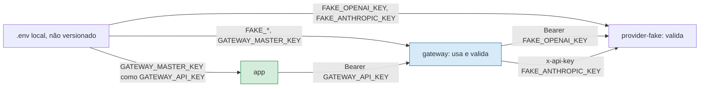

## 11. Tudo pelo gateway (4.22)

Método da FF10: `POST /admin/reset`, marca o horário T, roda a suíte inteira, compara o total de `/admin/calls` com as linhas `POST /v1/chat/completions` do log do gateway desde T. Sem falhas injetadas, cada requisição do gateway vira exatamente uma chamada ao provider; uma chamada direta apareceria só no provider.

| Momento | Provider | Gateway | Leitura |
|---|---|---|---|
| Antes (`03`) | 19 | 9 | 10 chamadas (F4, F2, F3) não passaram pelo gateway |
| Depois (`14`, T = 21:17:35Z) | 19 (classify 9, extract 7, suggest 2, topics 1) | 19, nenhuma com status diferente de 200 | todas passaram |

| Feature | Capacidade | Tarefa | Provider observado | Modelo observado | Evidência de passagem pelo gateway |
|---|---|---|---|---|---|
| F1 | `ticket-classification` | classify | openai | gpt-fake-large | FF10; gateway parado → 500 e 0 chamadas; verificação: `model=ticket-classification` |
| F2 | `reply-suggestion` | suggest | anthropic | claude-fake-large | idem; `max_tokens` do gateway aplicado (`19`); troca de modelo (`20`) |
| F3 | `topics-report` | topics | anthropic | claude-fake-large | idem; 2 lotes = 2 requisições na verificação |
| F4 | `order-extraction` | extract | openai | gpt-fake-large | idem |

Sem a chave dos providers no ambiente e com o gateway parado, não existe outro caminho: as 4 features responderam 500 em 3,85 a 3,97 s, `/admin/calls` ficou vazio e o log da app mostra `openai.APIConnectionError` saindo de `adapters/gateway.py:19` (`18`). Ao religar o gateway, as 4 voltaram a 200, com o mesmo container da app (Id e horário de início iguais).

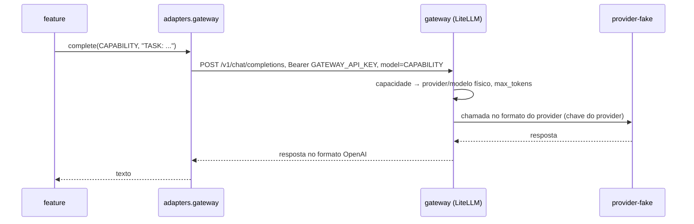

## 12. Troca de modelo sem tocar na app (4.23)

Feita pela borda na F2, a capacidade mais sensível (texto longo, tradução de formato): `reply-suggestion` de `anthropic/claude-fake-large` para `openai/gpt-fake-large`, mudando só 3 linhas de `gateway/config.yaml` (`model`, `api_base`, `api_key`; o `max_tokens` ficou). Evidência `20`.

| Característica | Antes | Depois |
|---|---|---|
| Capacidade lógica | `reply-suggestion` | `reply-suggestion` |
| Provider | anthropic | openai |
| Modelo físico | claude-fake-large | gpt-fake-large |
| Requisição HTTP | `POST /tickets/reply-suggestion` (TK-00042) pela borda | a mesma |
| Resposta | 200; 2424 caracteres; sha256 do JSON `bb5965b4…` | 200; idêntica (`cmp` sem diferença, mesmo sha256) |
| Container da aplicação | `7c6caa788672…` | `7c6caa788672…` |
| Horário de inicialização | 2026-11-26T21:17:20.645Z | 2026-11-26T21:17:20.645Z |
| Imagem da aplicação | `sha256:f55a1d46…` | `sha256:f55a1d46…` |
| Código da app | 12 hashes e `git diff --stat -- app/` | iguais |

Comando de reinício: `docker compose restart gateway && docker compose up -d --wait` (8,6 s). F1, F4 e F3 continuaram nos modelos de antes. Restaurado com `git restore gateway/config.yaml`, diff vazio, F2 de volta a `anthropic/claude-fake-large`.

## 13. Contratos externos (4.24) e testes (4.25, 4.26)

O esquema OpenAPI gerado do código da `v1-coupled` e do código atual é **idêntico** (7454 bytes, sha256 `830128f4…`, evidência `22`): mesmas rotas, métodos, modelos de entrada e saída.

| Feature | Contrato de entrada | Contrato de saída | Modo | Preservado? |
|---|---|---|---|---|
| F1 — Classificação | `TicketInput` (`ticket_id`, `text`, ambos não vazios) | `Classification` | síncrono (`def`) | sim (OpenAPI, 13 testes) |
| F2 — Sugestão | `TicketInput` | `ReplySuggestion` (texto integral) | síncrono, sem stream | sim (4 testes, golden master byte a byte) |
| F3 — Relatório | `PeriodInput` (`start`, `end`) | `TopicsReport` | síncrono | sim (6 testes) |
| F4 — Extração | `TicketInput` | `OrderData` (campos anuláveis) | síncrono | sim (9 testes) |

`schemas.py` sem diff; FF11 (`async def`) sem saída.

| Feature | Testes na v1 | Testes na candidata à v2 | Resultado |
|---|---|---|---|
| F1 | 13 | 13 | passam |
| F2 | 4 | 4 | passam |
| F3 | 6 | 6 | passam |
| F4 | 9 | 9 | passam |
| Total | 32 | 32 | `32 passed` em 60,10 s (`13`), 60,06 s (`21`) e 60,60 s numa cópia limpa (`24`) |

Integridade da suíte: `git diff --exit-code v1-coupled -- tests/characterization/` sem saída (`09`, `25`). A igualdade é a prova de que nenhum golden master foi ajustado para acomodar a refatoração. A comparação entre as tags (`git diff v1-coupled v2-decoupled -- tests/characterization/`) será feita depois da tag (4.40).

**O que a suíte não cobre** e foi coberto à parte: respostas 502 (verificação própria), falhas do provider (sonda `falha`), gateway parado (`18`), `max_tokens` (`19`). O que segue sem cobertura: períodos longos da F3 pela borda, conteúdo nulo do modelo, timeouts.

## 14. Revisão arquitetural (4.27)

| Critério (plano, seção 15) | Resultado | Evidência |
|---|---|---|
| B1 32 testes | atendido | `13`, `21`, `24` |
| B2 suíte idêntica | atendido | `09` |
| B3/B4 rotas e contratos | atendido | `22` (OpenAPI idêntico) |
| B5 síncrono, sem stream | atendido | FF11; `stream: false` em todas as chamadas (`15`) |
| B6 modelos `large` | atendido | `15`, `gateway/config.yaml` = `HEAD` |
| S1 features sem SDK, `llm` ou adapter | atendido | FF5, FF6 (`10`) |
| S2 um componente fala com o gateway | atendido | único import de SDK: `adapters/gateway.py:1` |
| S3 só `main` importa o adapter | atendido | `main.py:4`; Ca=1 |
| S4 sem ciclos | atendido | ferramenta; 19 arestas |
| S5 metas 15.4 | atendido | seção 15 deste relatório |
| I1 gateway com ADR | atendido | ADR 0003 |
| I2 tudo pelo gateway | atendido | FF10 19 = 19 (`14`) |
| I3 sem modelos físicos | atendido | FF7 (`10`) |
| I4 credenciais só no gateway e no provider | atendido | FF8, FF9 (`10`, `12`) |
| I5 credencial própria do gateway | atendido, com a ressalva da master key | `12`, ADR 0003 |

Nenhuma abstração nova foi criada no Passo 09; nenhum arquivo novo em `app/`. O diff total do código é `9 files changed, 36 insertions(+), 69 deletions(-)`, incluindo `compose.yaml` e `.env.example` (`09`).

## 15. Métricas oficiais (4.28 a 4.31)

Comando (evidência `23`): `python metrics/measure.py --source app/helpdesk --name v2-decoupled --output-dir metrics/results`. Régua sem diff desde o Passo 05 (FF4b); `tests/metrics` 64 passed; uma segunda medição deu CSV idêntico.

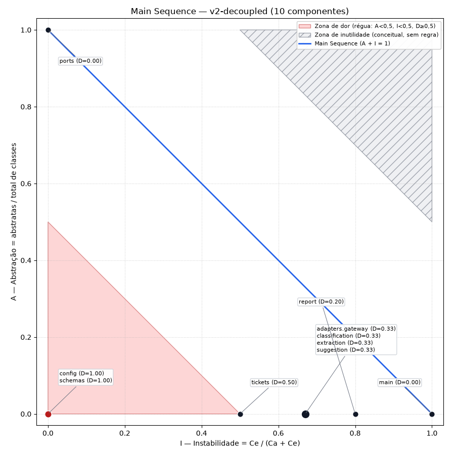

| Componente | Ca V1 | Ca V2 | Ce V1 | Ce V2 | I V1 | I V2 | A V1 | A V2 | D V1 | D V2 |
|---|---|---|---|---|---|---|---|---|---|---|
| adapters.gateway | — | 1 | — | 2 | — | 0.67 | — | 0.00 | — | 0.33 |
| classification | 1 | 1 | 3 | 2 | 0.75 | 0.67 | 0.00 | 0.00 | 0.25 | 0.33 |
| config | 6 | 3 | 0 | 0 | 0.00 | 0.00 | 0.00 | 0.00 | 1.00 | 1.00 |
| extraction | 1 | 1 | 3 | 2 | 0.75 | 0.67 | 0.00 | 0.00 | 0.25 | 0.33 |
| llm | 4 | — | 1 | — | 0.20 | — | 0.00 | — | 0.80 | — |
| main | 0 | 0 | 5 | 6 | 1.00 | 1.00 | 0.00 | 0.00 | 0.00 | 0.00 |
| ports | — | 5 | — | 0 | — | 0.00 | — | 1.00 | — | 0.00 |
| report | 1 | 1 | 4 | 4 | 0.80 | 0.80 | 0.00 | 0.00 | 0.20 | 0.20 |
| schemas | 5 | 5 | 0 | 0 | 0.00 | 0.00 | 0.00 | 0.00 | 1.00 | 1.00 |
| suggestion | 1 | 1 | 3 | 2 | 0.75 | 0.67 | 0.00 | 0.00 | 0.25 | 0.33 |
| tickets | 1 | 1 | 1 | 1 | 0.50 | 0.50 | 0.00 | 0.00 | 0.50 | 0.50 |

Arestas: 20 na v1, 19 na v2. Componentes na zona de dor: 3 (`config`, `llm`, `schemas`) → 2 (`config`, `schemas`).

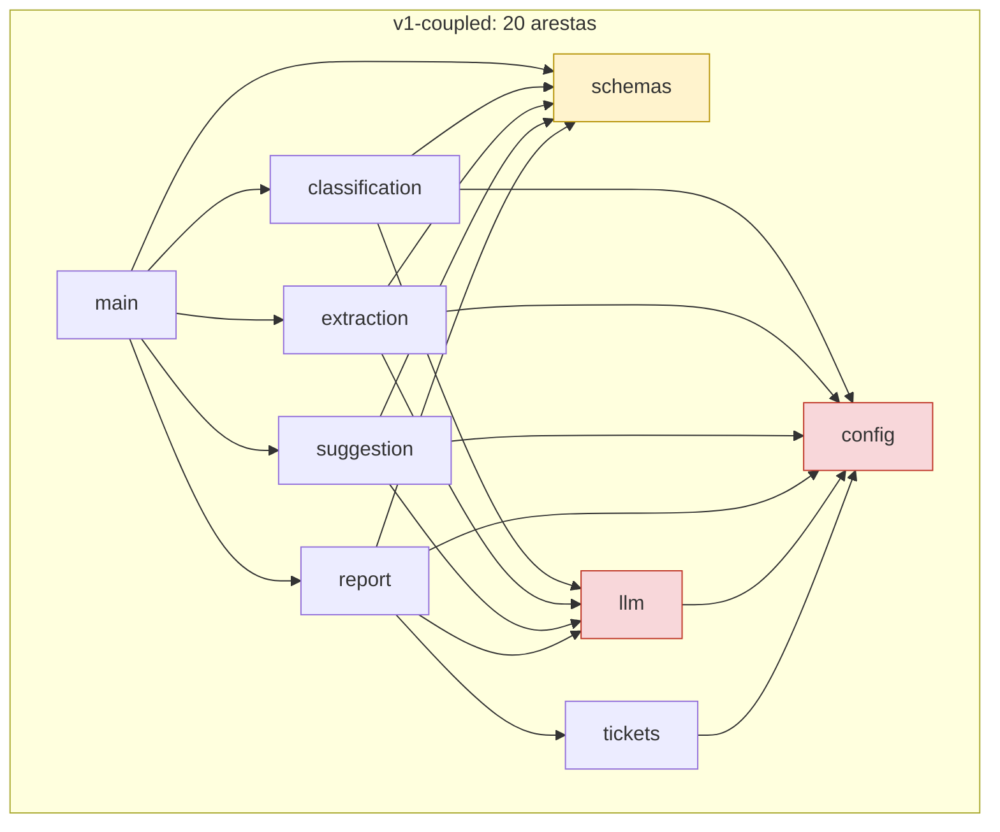

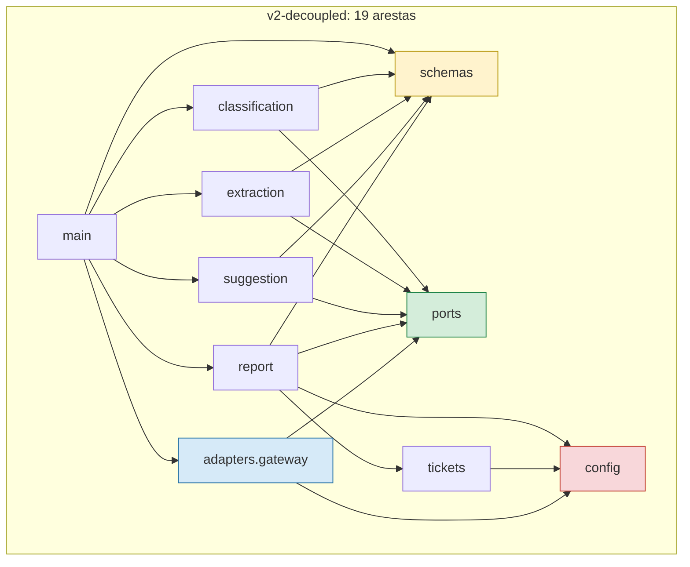

**Interpretação.** A mudança estrutural esperada aconteceu: o componente estável e concreto que concentrava a tecnologia (`llm`, D=0,80) desapareceu, e o ponto mais usado do grafo passou a ser uma abstração (`ports`, A=1, Ca=5, D=0). As features ficaram com D 0,33, **pior** que na v1 (0,25), porque perderam dependências (Ce 3 → 2) e foram para mais perto do centro; isso é esperado (plano 14.3) e não foi "corrigido". `config` perdeu tudo o que era volátil (Ca 6 → 3) e continua na zona de dor por ser concreto e estável.

**Zona de dor (4.30).**

| Componente | A | I | D | Zona de dor? | Interpretação |
|---|---|---|---|---|---|
| config | 0.00 | 0.00 | 1.00 | sim | só endereço e chave do gateway e dois parâmetros do relatório; não muda com provider ou modelo. Aceito na v2 com justificativa; decisão final (exceção ou dissolução) no Passo 16 |
| schemas | 0.00 | 0.00 | 1.00 | sim | DTOs do contrato HTTP; mudar aqui é mudar a API pública. Exceção candidata desde o ADR 0001 |
| tickets | 0.00 | 0.50 | 0.50 | não (no limite) | leitura do arquivo de tickets; inalterado |
| adapters.gateway | 0.00 | 0.67 | 0.33 | não | o único concreto da IA, fora da zona de dor sem import artificial (2 imports com função) |
| demais | — | — | ≤ 0.33 | não | — |

**Planejado × observado (4.31).**

| Componente | Estratégia planejada | Esperado (14.2) | Observado | Avaliação |
|---|---|---|---|---|
| llm | absorvido pelo adapter | inexistente | inexistente | igual |
| ports | contrato estável | 5/0/0/1/0 | 5/0/0/1/0 | igual |
| adapters.gateway | único concreto, composto em `main` | 1/2/0,67/0/0,33 | igual | igual |
| features | dependem do contrato | Ce ⊆ {ports, schemas}; F3 + {tickets, config} | igual | igual |
| config | só parâmetros da aplicação | Ca ≤ 3, D 1,00 aceito | Ca 3, D 1,00 | igual |
| schemas | inalterado | inalterado | inalterado | igual |
| main | ponto de composição | 0/6/1/0/0 | igual | igual |
| global | zona de dor ⊆ {config, schemas} | 19 arestas | 19 arestas; {config, schemas} | igual |

## 16. Avaliação do agente (4.32)

| Incremento | Handoff | Resultado produzido | Testes | Métricas | Decisão |
|---|---|---|---|---|---|
| 1 F4 | `handoff-1-f4.md` | `extraction.py` + 1 linha de `main.py`; proposta idêntica à referência | 32 passed (60,15 s); verificação 8/8 | 21 arestas, como esperado | aprovado sem correção |
| 2 F2 | `handoff-2-f2.md` | `suggestion.py` + 1 linha | 32 passed (60,08 s); verificação 10/10 | 20 arestas; `llm` D 0,50 | aprovado sem correção |
| 3 F3 | `handoff-3-f3.md` | `report.py` (só a chamada e a assinatura) + 1 linha | 32 passed (60,15 s); verificação 13/13 | 20 arestas; `llm` Ca 0 | aprovado sem correção |
| 4 Remoção | `handoff-4-remocao.md` | `llm.py` removido; `config.py` e `requirements.txt` | 32 passed (60,09 s); verificação 13/13; FF5, FF7, FF8 | 19 arestas = projeção | aprovado sem correção |
| 5 Credenciais | `handoff-5-credenciais.md` | `compose.yaml`, `.env.example` | 32 passed (60,13 s); verificação 13/13; FF9 | iguais ao 4 | aprovado sem correção |

Os blobs de todos os arquivos de `app/` produzidos pelo agente são idênticos aos de uma implementação de referência que o arquiteto escreveu antes, sem mostrar ao agente. Desvios de processo, todos aceitos e registrados: saída do `compose up` filtrada com `tail` (I1), avisos do `pip` filtrados (I3), suíte rodada duas vezes por um filtro errado (I4), edição por ferramenta em vez de `sed`/heredoc quando o classificador de comandos bloqueou. Em nenhum caso o agente alterou arquivo fora do escopo, criou abstração ou mexeu em testes. Pontos fortes observados: riscos levantados na proposta que de fato se confirmaram (latência sob falha, código morto até o incremento 4, ordem de inicialização do compose).

## 17. Inicialização reproduzível (4.36)

Numa cópia limpa do repositório (só arquivos rastreados e novos, sem `.env`), com a stack principal parada sem `-v` (evidência `24`):

| Verificação | Resultado |
|---|---|
| `cp .env.example .env && docker compose -p helpdesk-v2-init up -d --build --wait` | 21,6 s; `provider-fake`, `gateway`, `app` e `edge` saudáveis |
| `curl -s localhost:8000/health` | `{"status":"ok"}` 200 |
| Suíte contra a cópia | `32 passed in 60.60s` |
| Ambiente do `app` | só `GATEWAY_API_KEY` e `GATEWAY_URL` (além da imagem base) |
| Configuração manual dentro de containers | nenhuma |
| Serviços pagos ou credenciais privadas | nenhum; os valores do `.env.example` são de desenvolvimento e só valem contra o fake |
| Volumes persistentes | nenhum volume nomeado; o gateway roda sem banco |

A cópia foi derrubada com `down --rmi local` e apagada; a stack principal voltou com `/health` 200.

## 18. Checklist anterior à tag (4.37)

| Grupo | Situação |
|---|---|
| Comportamento | mesmas 4 rotas e contratos (OpenAPI idêntico), síncronas, modelos `large`, 32 testes, sem regressão na suíte. **Diferença fora da suíte**: falha persistente leva ~4 a 5 s em vez de ~1,2 a 1,4 s (seção 21) |
| Arquitetura | 4 features migradas; contrato justificado; adapter único; `main` como composição; sem acesso direto aos providers; sem dependência concreta indevida |
| Gateway | funcional; `gateway/config.yaml` versionado; 4 capacidades; autenticação própria; modelos físicos fora da app |
| Credenciais | ausentes de `app/`, do ambiente do `app` e de arquivos montados; app usa a chave do gateway |
| Métricas | `v2-decoupled.csv` e `.png` gerados; comparação com a v1; critérios 15.4 atendidos |
| Documentação | plano 1.2, ADRs, README, este relatório, glossário e checkpoint |
| Integridade | `tests/characterization/`, `provider-fake/`, `edge/`, `data/` sem diff contra a `v1-coupled`; tag `v1-coupled` intacta (`07c2026d` → `8028305`); `.tmp-passo09/` apagada |

Pendente só o que depende do Igor: commit, tag e push (4.38, 4.39, 4.43), e as verificações que só existem depois da tag (4.40 a 4.42).

## 19. Depois da tag (4.40 a 4.43)

Esta seção é preenchida depois da aprovação do commit e da tag. Roteiro:

1. **4.40.** `git diff v1-coupled v2-decoupled -- tests/characterization/` deve ser vazio.
2. **4.41.** Worktrees separados, com nomes de projeto do compose distintos e uma stack de cada vez:
   - `git worktree add --detach ../helpdesk-v1 v1-coupled` (já existe desde o Passo 05: reutilizar depois de conferir o commit);
   - `git worktree add --detach ../helpdesk-v2 v2-decoupled`;
   - em cada um: `cp .env.example .env`, `docker compose -p <nome> up -d --build --wait`, `/health` e a suíte.
3. **4.42.** Medir os dois worktrees com a ferramenta da `main` e comparar com `v1-coupled.csv` e `v2-decoupled.csv`.
4. **4.43.** `git push origin main` e `git push origin v2-decoupled`, só com aprovação.

| Característica | v1-coupled | v2-decoupled |
|---|---|---|
| Suíte de caracterização | original | idêntica (a confirmar entre as tags) |
| Contratos HTTP | originais | preservados (OpenAPI idêntico) |
| Modos de resposta | síncronos | síncronos |
| Modelos | large | large |
| Comunicação com IA | direta, 2 SDKs | gateway, 1 adapter |
| Credenciais dos providers | na aplicação | fora da aplicação |
| Estrutura interna | original | refatorada |

## 20. Dores da v1 reavaliadas (4.44)

| Problema original | Situação na V1 | Situação na V2 | Passo responsável pela solução completa |
|---|---|---|---|
| Relatório mensal excede o timeout | rota síncrona; agosto (5.000 tickets) = 34 chamadas sequenciais de ~9,8 s; a borda devolve 504 em 30 s e a thread continua por ~5 min | igual: o laço só trocou `llm` por `model.complete`; cada lote agora passa por mais um salto. Habilitado: a chamada está atrás do contrato | Passo 15 |
| Sugestão sem entrega progressiva | resposta só no fim (~16 s) | igual (15,96 s, `stream: false`). Habilitado: o gateway já faz streaming (Passo 07); falta o contrato e a rota | Passo 14 |
| Indisponibilidade de providers | provider fixo por feature, sem fallback; falha persistente em ~1,2 a 1,4 s | provider ainda fixo por capacidade, sem fallback; falha em ~4 a 4,6 s; o gateway virou dependência de todas as features. Habilitado: fallback e política de retry podem ser configurados num lugar só, sem tocar na app | Passos 10 e 11 |
| Troca de modelo exige alteração da aplicação | editar `config.py`, reconstruir a app | **resolvido**: só `gateway/config.yaml` e um restart do gateway; mesma resposta, mesmo container (`20`) | Passo 09 |

A `v2-decoupled` não é a solução final: ela remove as **causas estruturais** (tecnologia nas features, modelos e chaves na app), mas não implementa nenhuma **política**: não há timeout explícito, retry decidido, fallback, orçamento, streaming nem execução assíncrona. Ela deixa o sistema em condição de receber essas políticas sem mexer nas features.

## 21. Preparação para o Passo 10 (4.45)

| Mecanismo | Localização atual | Comportamento existente | Problema potencial | Atividade futura |
|---|---|---|---|---|
| Timeout do cliente HTTP | `adapters/gateway.py` (SDK `openai`, sem `timeout`) | padrão do SDK: 600 s de leitura | maior que a borda (30 s): a thread da rota fica presa depois do 504 | timeout explícito, derivado do orçamento de latência |
| Retry do cliente | adapter, `max_retries=0` | nenhuma retentativa app → gateway; falha de conexão com o gateway = 1 tentativa | conexão recusada transitória não é retentada no primeiro salto | decidir se o primeiro salto retenta (e quanto) |
| Timeout do gateway | `gateway/config.yaml` (não configurado) | padrão do LiteLLM, não medido | pode ser maior que a borda | `timeout` por capacidade |
| Retry do gateway | padrão do LiteLLM (não configurado) | 3 tentativas ao provider sob 5xx, com backoff; falha persistente em 4,0 a 4,6 s nas 4 features (`16`) | o backoff não foi decidido; somado ao timeout pode estourar a borda | `num_retries` e backoff explícitos |
| Camadas de repetição | SDK (0) × gateway (2 retentativas) | um único dono do retry | se alguém voltar o SDK ao padrão (2), viram até 9 chamadas | registrar a regra "um dono" e testá-la |
| Timeout da borda | `edge/nginx.conf` (30 s) | 504 para o cliente; o processamento continua | F3 mensal e F2 com falhas encostam nele | orçamento de latência por rota |
| Tratamento de erros | adapter não trata; rota responde 500 genérico | conteúdo nulo vira 500; erro do gateway só no log | o cliente não distingue indisponível de inválido | erros do contrato e mapeamento HTTP (Passo 10) |
| Falhas transitórias × persistentes | sem distinção | retry igual para todo 5xx | retry em falha persistente só gasta tempo | política por tipo de falha |

Responsabilidades: o **adapter** traduz e falha rápido; o **gateway** é quem decide retry, timeout e, no Passo 11, fallback. O Passo 10 parte daqui, sem nenhuma configuração antecipada nesta etapa.

## 22. Diagramas da arquitetura

**Original (v1):** ver plano, seção 3.1. **Transitória:** seção 4 deste relatório.

**Desacoplada (v2):**

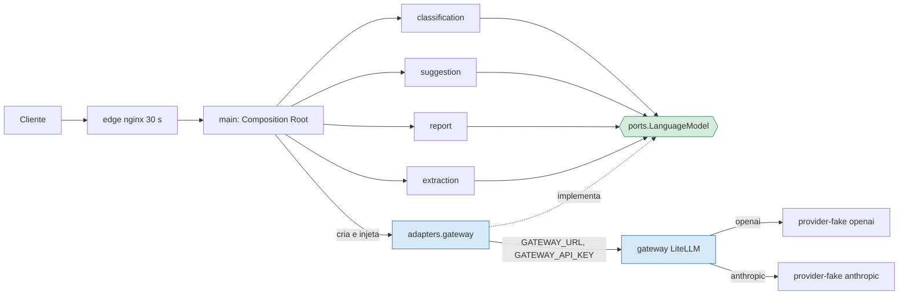

**Composição:**

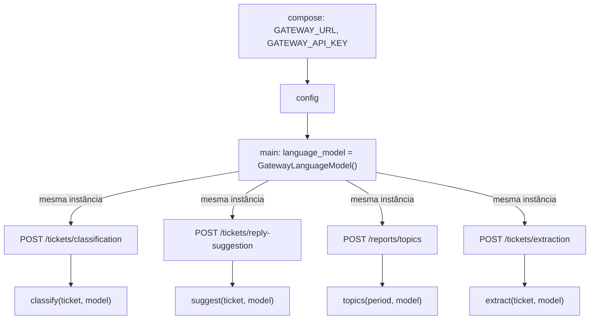

**Sequências das quatro funcionalidades:**

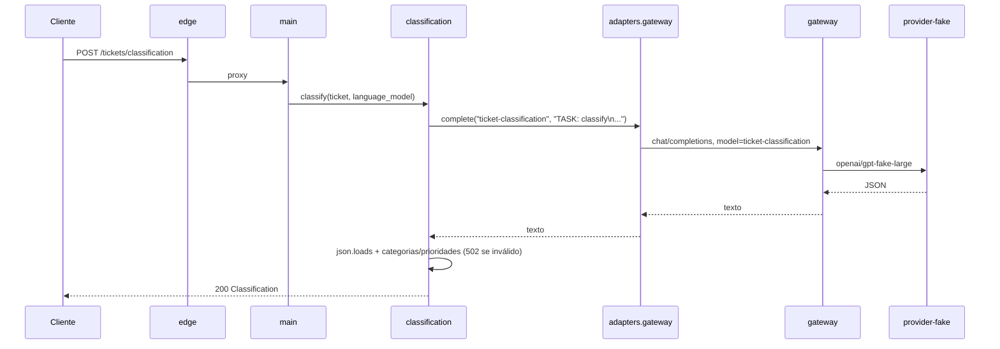

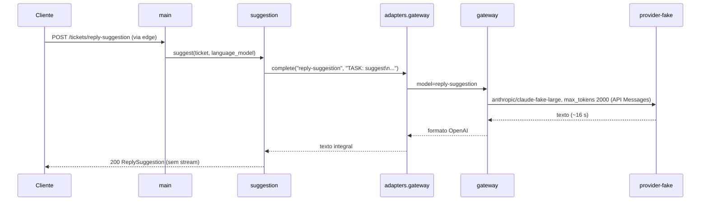

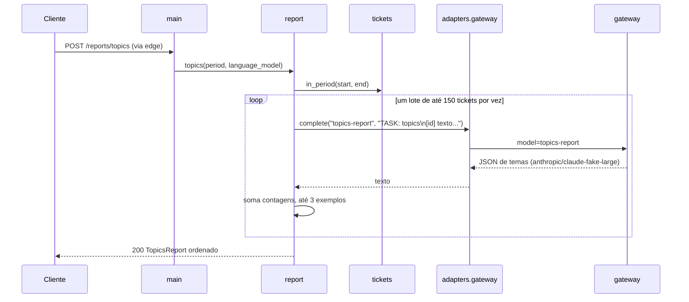

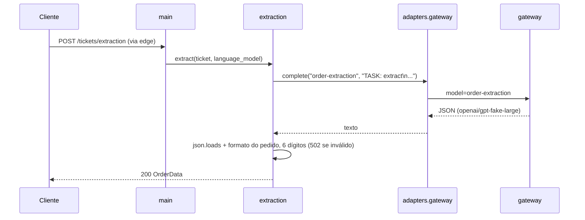

**Fluxo conceitual do passo:**

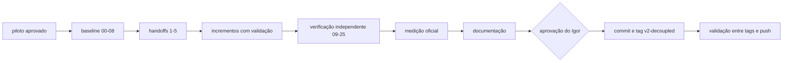

## 23. Limitações e lições

**Limitações remanescentes.**

1. Falha persistente 3 a 4 vezes mais lenta que na v1 (backoff do LiteLLM não decidido) e gateway como ponto único de falha de todas as features (R18, R19).
2. A app usa o valor da master key como chave de consumo (Passo 12).
3. `str | None` do SDK contra o `str` do contrato (R20, FF12).
4. A suíte de caracterização não cobre 502, falhas, timeouts e períodos longos; foram cobertos por instrumentos à parte, não pela suíte.
5. A capacidade existe em dois lugares (constante na feature e `model_name` no gateway); um nome errado só falha em execução (400). A verificação própria confere os quatro nomes.
6. A régua não vê dependências de execução (gateway) nem a configuração do compose.

**Lições.**

1. Um contrato pequeno, validado num piloto real, escalou para as quatro features sem uma linha de mudança.
2. Fazer o agente propor antes de implementar transformou a revisão em comparação contra uma referência: os cinco incrementos passaram sem retrabalho.
3. Os instrumentos do arquiteto (gateway simulado, sondas, contagem da FF10) pegaram o que a suíte não vê; nenhuma decisão dependeu só do relato do agente.
4. Remover só depois do último consumidor (expand and contract) manteve cada passo reversível com um `git restore`.
5. A métrica confirmou o desenho, mas não o justificou: as features pioraram em D e isso foi aceito.
